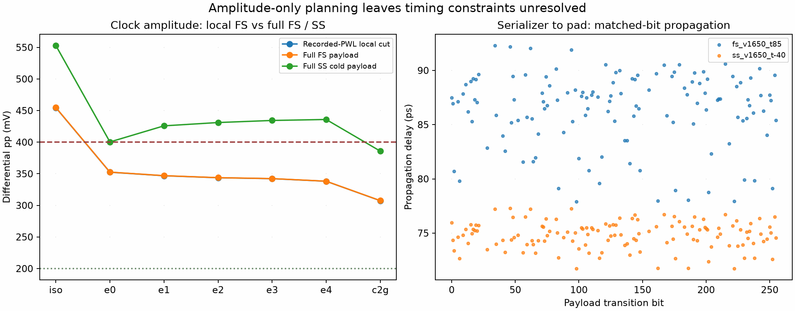
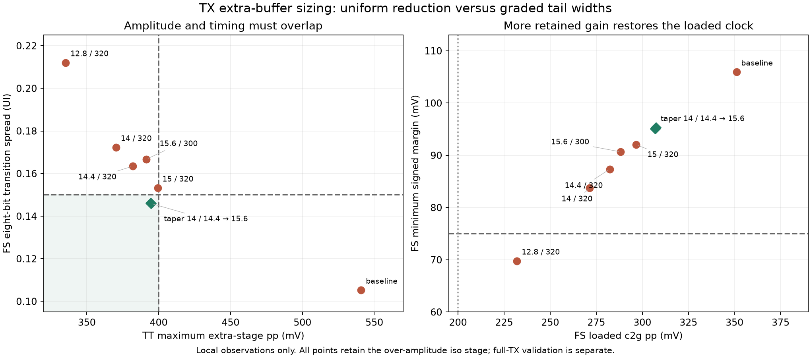

# TX 缓冲链尺寸规划与模型缺口

**本轮有仿真前的幅度规划，但尚未完成幅度、时序、负载和代价的联合sizing。分级尾宽候选因完整FS时序失败不采用。** 只在TT约束旧400mV上界、用FS八位切片筛时序，遗漏了SS冷角的更大幅度及完整焊盘的散布。内部上界现按[幅度依据](cml_swing_target.md)复核，SS的436mV本身不作为物理失败证据。当前采用的extra5/WT16/R400中间级及WT16/R240输出级保持原样；其MOS45点眼图资格与逐节点幅度/余量I-17缺口分别保留。

后续[末级需求与动态模型](tx_retime_demand.md)已建立：完整载荷消费方原样基线两角校准通过，TT/FS前四级模型已有留出误差；相位/幅度需求扫描及重负载/共模缺项继续补，不据此采用新尺寸。



## 已用到的规划及其覆盖

| 步骤 | 实际做过的工作 | 尚未覆盖 |
|---|---|---|
| 单级卡 | Xe2 尾宽、R 单轴扰动，联合 12.8/320 的 TT/FS 幅度预测误差 <0.3mV | 只在强输入及原负载附近成立 |
| 级联规划 | tanh 幅度传递近似，预报统一减幅会损失 FS 增益；五级 12.8/320 实测失败 | 不预测关闭时刻、slew、DDJ或功能 |
| 分级尾宽规划 | 用三组尾宽的 TT/FS 数据拟合；离线比较七组预选 profile，要求 TT 各 extra 级 ≤400mV，再比较 FS 末端幅度代理 | 没有联合约束求解、45 点模型、代价或灵敏度；末级重负载只用单点比例 |
| 精模型校准 | 均匀尾宽三轮局部比较，再验证首级14/14.4、后四级15.6/R320；接回完整 TX 两压力点 | 原八位切片没有当前全树源阻抗、共享偏置反馈及新输出级边界 |

幅度模型[源码](../../analog/tx/clock_distribution/theory/buffer_gain_plan.py)、[仿真前预测](../data/tx_buffer_gain_plan.json)及切片[残差](../data/tx_buffer_taper.json)均保留。选中的首级14.4方案最大逐级预测误差为 TT **13.99mV**、FS **18.68mV**，不能用样本内5.8/6.1mV残差充当保护带；TT末级预测383.96mV、实测394.61mV。



## 完整回接得到的约束

本次候选仅改五级 extra：首级 WN24/WT14.4/R320，后四级 WN24/WT15.6/R320。Xiso24/16/400、Xout32/16/240、输出级 pre120/WT60/out192 均固定。

| 边界 | 串化裕量 mV | 串化散布 UI | 焊盘裕量 mV | 焊盘散布 UI | 结论 |
|---|---:|---:|---:|---:|---|
| FS 1.65V/85°C，局部八位 | 95.29 | 0.145974 | 未评分 | 未评分 | 该局部窗口满足 |
| FS 完整 TX，同八位296–303 | 96.14 | 0.148975 | — | — | 同位序仍有边界差异 |
| FS 完整 TX，256bit/130转换 | 93.09 | **0.150051** | 127.25 | **0.179857** | 两处散布门槛失败 |
| SS 1.65V/−40°C，完整 TX | 122.44 | 0.040230 | 206.13 | 0.051882 | 眼图满足；内部偏离旧400mV目标，上界复核中 |

FS 串化散布仅比0.15UI多0.000051UI，不能作为可靠余量；焊盘明确超出 **7.46ps**（0.029857UI）。这是确定性载荷结果，不是随机抖动或BER签核。

FS 完整链的 extra 输出约338–353mVpp，与切片很接近；SS 冷角却为400.34–435.89mVpp，后四级超400mV。**TT 并非所有幅度约束的最强条件。** Xiso还分别为454.78/552.92mVpp。幅度和时序的压力角必须分别找，不能用一对TT/FS覆盖全部约束。

逐个相同载荷转换配对后，串化→焊盘传播时间范围为 FS **14.40ps**、SS **5.58ps**。这里用两端各自训练延迟恢复绝对交越时间后相减，不把残差相减当传播延迟。这是输出级/负载的模式相关响应；其范围与串化散布相关，不能直接相加为独立抖动预算。完整 FS 最早与最晚串化转换也不都落在八位切片内。

完整两点 Vdd 源的载荷窗口平均供电功率为86.43/93.09mW，包含它供电的时钟分发、字入口、树、驱动和偏置；不包含独立理想时钟/数据/控制和终端源的能量。因此不是整体 TX 或 SerDes 功耗；没有分支电流，也不能据此估算缓冲链节电量。

## 下一轮联合 sizing 合同

先补可求解的模型，不继续凭幅度代理选尺寸。沿用[尺寸流程](../verification/sizing.md)，目标是各适用条件的归一化最坏余量最大，电流/面积作次目标；缺测量不能当作零损失。

| 约束／输出 | 模型应包含的量 | 现在的缺口与下一步 |
|---|---|---|
| 内部400mV目标/原上界适用性待复核；硬下限150、设计目标200mVpp | 输入幅度/共模/slew、WN/WT/R、真实负载、偏置和PVT；完整周期包络、器件余量及应力 | TT/FS仅幅度卡；先定位实际失效机制，再建立逐节点允许范围；不单凭>400mV淘汰。iso也必须纳入 |
| 数据到达与保持关闭 | g3数据到达、A/B本地选择沿、上下沿延迟、slew及消费方建立/保持要求 | 复用原始全链内部波形和局部允许窗，按对应位/方向建卡；被动交越间隔不是建立时间资格 |
| 串化器及焊盘≥75mV、散布≤0.15UI | 多字模式的最坏交越、输出级/通道负载的模式相关响应 | 旧幅度模型没有这些输出；用同一批位号联合比较两端，校准局部→全链偏差；保留单独验证点 |
| 功能与字映射 | 训练相位、固定UI、缺沿/额外交越、映射和字边界 | 完整两点有证据；八位零错不足以代替16位映射或45条件 |
| 余量及成本 | 尾管余量、实际Id/R、分支电流、面积与噪声/失配预留 | 后续单元卡补OP与电流；WN24只是目前实验固定值，不是已优化的输入管尺寸 |

变量先分成五级输入管宽、尾宽、R及输出级尺寸；由负载卡限制可用范围，再决定哪些可以绑定成组。用器件卡和输出极点/大信号压缩构成初始模型；保留表征范围和留出误差。时序路径可复用 `serdes_flow.balance` 的 `Sample/Skew/Budget`，但旧零延迟树及固定建立/保持参数不能直接充当当前尺寸的实测卡。

求解前先列每项约束的来源、条件覆盖及模型误差；只在模型可信域内做定心。若缺失时序模型，输出“不可判定/需补哪张卡”，不输出“可行尺寸”。若在物理允许范围仍无交集，再按相同约束比较分离增益/限幅或独立延迟等结构，不能以更多手调参数掩盖结构冲突。

## 证据与复算

[审计数据](../data/tx_buffer_sizing_gap.json)、[索引](../../results/catalog/tx_buffer_sizing_gap.json)绑定完整campaign `full_pvt45/20261110T173418Z` 和局部 `buffer_matrix_card/20261110T172325Z_dda392af`。新[只读分析器](../../verification/analysis/tx_buffer_sizing_gap.py)先核对原始deck/快照、执行状态、完整终点、源/边界/参数身份，重算局部卡及两条完整波形；源副本和结果写入新的分析目录。原运行和原预测不覆盖。

```bash
uv run python verification/analysis/tx_buffer_sizing_gap.py
```

适用边界：局部为录制理想PWL、八位固定合同；完整为理想2GHz、真实偏置、PDK R tt、计数器初态及RTL guard事件回放。两点回接不代表当前原生PLL、全45/无源角、启动、失配或噪声资格。后者继续按模块边界补齐，不以重复整颗长仿真为每步前提。
