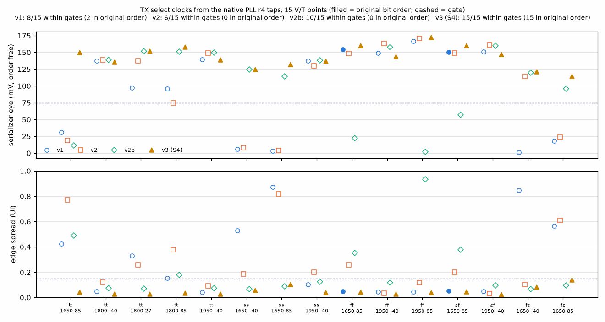
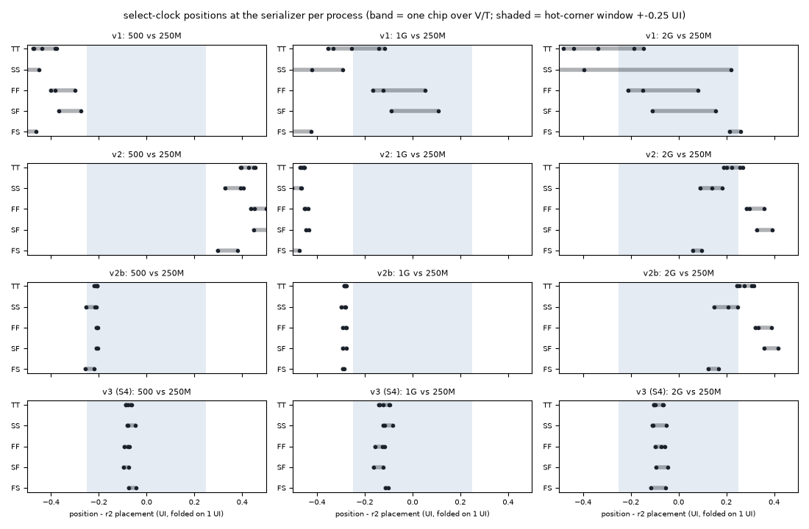
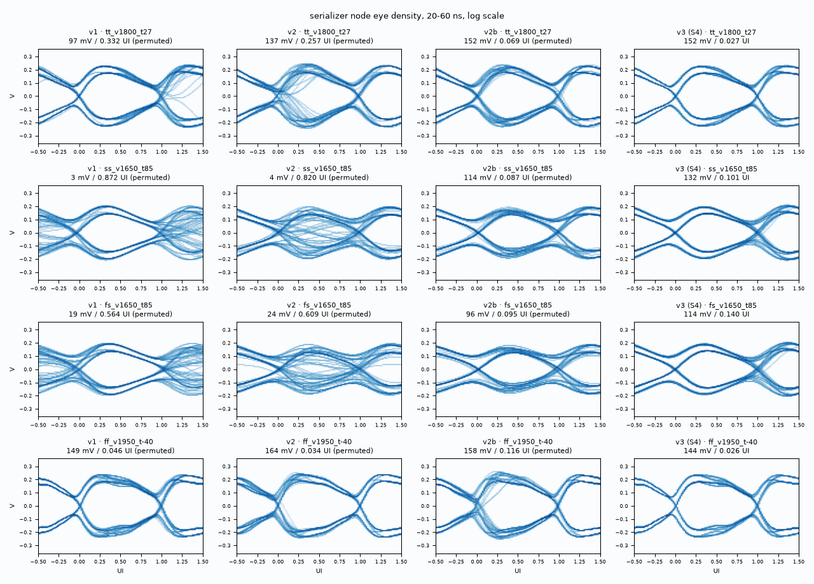
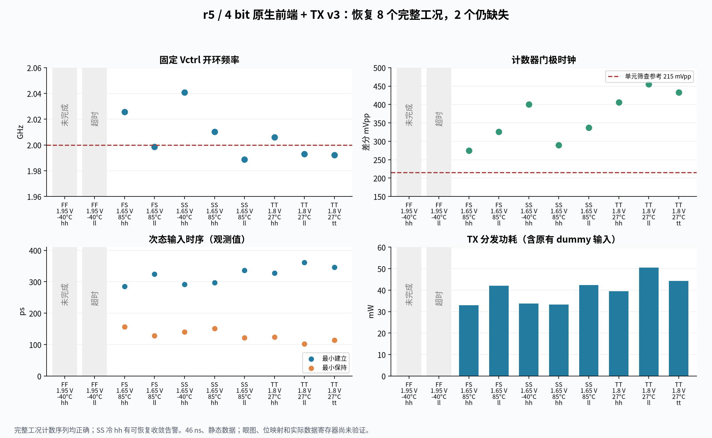

# TX 时钟分发

> **当前修订**：TX r2 `serdes_cml_clock_distribution_tx_lowov`（[网表](../../analog/tx/clock_distribution/spice/cml_clock_distribution_tx_lowov.spice)，[配置](../../config/tx_working_revision.toml)）。2 GHz 支路比 v0.1 多两级 CML buffer。
> **关键数字**：v0.1 时钟源 + 名义 trim [100, 500, 160, 270] fF 时，加载后相位 0 / 0.162 / 0.320 / 0.982 UI（目标 0 / 0.16 / 0.32 / 1.0 UI）。
> **主要缺口**：r2 在原生 PLL r4 时钟下失败（I-07）。候选分发 v3 在 15 个 r4 时钟回放 V/T 点上按原始位序全部满足；r5＋真实偏置/PDK R 原生联合 bench 已有 8 个完整静态点连续计数，2 个 FF 冷角未完成。新实际字入口＋完整TX已做末级时序改进：extra2g=3在TT/FS的256 bit眼图与位映射满足，SS冷角动态在跑。45条件、内部摆幅I-17及功耗优化仍待验证。

## 当前v3局部迭代

同步计数器/2G复制结构保留，2GHz输出前extra中间级由1→3；末级MUX尺寸不变。原样电压切片、实际级数对照、完整TT/FS回归及其边界见[末级改进](tx_final_retime.md)。内部c2g摆幅超过400mVpp，短切片联合比较输出尾宽与R后，Wtail16/R240在TT/FS局部为344–369mVpp，保留输出极性，但关闭提前约10–13ps；尚待完整TX确认。以下r2参数和旧源记录作为基线保留，状态/置换表不套到v3。

## 电路

四路选择时钟各自从固定的 PLL 节点取出，经两级非反相 CML：第一级后挂微调电容，第二级负责扇出，直接驱动串化器的本地时钟源跟随器。

| 时钟 | 源节点 | 微调（每端，另有 2 fF 基值） | 扇出驱动 Wn / Wtail / R | 负载 |
|---|---|---:|---|---:|
| 250 MHz | 支路 0 的 ÷8（d08p/n） | 100 fF | 64 / 64 µm / 100 Ω | 8 组 |
| 500 MHz | 支路 2 的 ÷4（d24p/n） | 500 fF | 40 / 32 µm / 200 Ω | 4 组 |
| 1 GHz | 支路 3 的 ÷2（d32p/n） | 160 fF | 24 / 16 µm / 400 Ω | 2 组 |
| 2 GHz | 抽出 b0 的反极性（b0n/b0p） | 270 fF | 两级额外 buffer（24 / 16 µm / 400 Ω）+ 32 / 24 µm / 300 Ω | 3 组 |

微调级统一为 Wn = 20 µm、Wtail = 12 µm、R = 400 Ω。微调电容为理想电容。相位路由和极性是固定配置，没有自动相位选择或校准逻辑。

TX r2 的两级额外 2 GHz buffer 同时驱动末级锁存器和最终 MUX：在 FS/1.65 V/85 °C 对照中，局部时钟相对源后移约 0.166 UI（约 42 ps），外部 2 GHz 差分摆幅 360 → 528 mVpp，给末级锁存器留出更多建立时间。见 [TX 串化器](tx_serializer.md)。

## 已验证结果

### v0.1 源（当前 TX r2 的全部验证都用它）

原生闭环 PLL 的 TT 记录，保留每个过零时刻，理想化为 400 mVpp、20 ps 边沿的 CML 源，再接真实 MOS 分发和串化器负载。相位以加载后 250 MHz 下降沿为 0：

| 时钟 | 测得相位 | 差分峰峰值 | 平均共模 |
|---|---:|---:|---:|
| 250 MHz | 0.0000 UI | 498.1 mV | 1.651 V |
| 500 MHz | 0.1621 UI | 490.6 mV | 1.658 V |
| 1 GHz | 0.3199 UI | 474.5 mV | 1.668 V |
| 2 GHz | 0.9817 UI | 456.7 mV | 1.645 V |

v0.1 分发电源轨功耗约 14.42 mW。来源：[实际时钟分发](../history/physical_clock_distribution_results.md)。

### r3 源相位核对

r3 的级间 buffer 位于部分抽头之前，各路受影响不同：250 MHz 前多 2 个 buffer，500 MHz 前多 1 个，1 GHz 前没有但负载变了，2 GHz 不变。用 r3 原生 TT 记录（码 5、Vctrl = 1.179193 V、约 1.999215 GHz、开环）理想化后接同一分发和负载，trim 不变：

| 时钟 | 目标 | v0.1 源 | r3 源，旧极性 | r3 源，1 GHz P/N 对调 |
|---|---:|---:|---:|---:|
| 250 MHz | 0.000 | 0.0000 | 0.0000 | 0.0000 |
| 500 MHz | 0.160 | 0.1620 | 0.0523 | 0.0523 |
| 1 GHz | 0.320 | 0.3200 | 2.0943 | 0.0957 |
| 2 GHz | 1.000 | 0.9823 | 0.7658 | 0.7655 |

1 GHz 的约 2 UI 偏差是分频器启动状态（半个 1 GHz 周期），对调 P/N 只对这一次启动有效。去掉这个粗相位后，1 GHz → 2 GHz 的相对相位只变了约 1.9 ps，但 500 MHz 和 2 GHz 相对 250 MHz 字时钟的位置都变了，旧 trim 不再适用。来源：[相位核对](../history/tx_clock_phase_audit.md)、[数据](../data/tx_clock_phase_audit.json)。

## 启动状态与调序

TX 四路时钟取自三条独立 prescaler，上电状态彼此独立。以 250 MHz（字时钟）为参照，500 MHz 落后 0–3 个 VCO 周期、1 GHz 落后 0–1 个，共 8 种状态。2 GHz 直接取自 VCO，没有状态。

**每种状态只造成字内固定的位重排，眼图不受影响。** 在 r2 bench 上把对应时钟的冻结边沿整体延后整数个 VCO 周期，复现全部 8 种状态，跑 6 个压力工况（[bench](../../analog/tx/serializer/tb/clock_states/run.py)）：

- 串化器眼图 116.6–153.7 mV，散布 0.028–0.120 UI；
- 8 种状态对应 8 种不同置换，在 6 个工况、3 个观测节点上完全一致；
- 相邻两位始终一起移动，两个半字各自做同一种 4 对置换，不跨字。

置换表见 [serializer_state_permutations.hex](../../digital/tx/tb/data/serializer_state_permutations.hex)。

**解法：启动检测 + 输入侧调序。**

| 部分 | 内容 | 验证 |
|---|---|---|
| 状态检测器 [tx_clock_state_detector](../../analog/tx/clock_distribution/spice/tx_clock_state_detector.spice) | 3 个 CML 触发器：用支路 2 的 ÷4、÷2 和支路 3 的 ÷2 边沿去采样支路 0 的 ÷4/÷2，k500 = 2a + b，k1g = c；采样时钟先经 CML buffer；静态 CMOS 读出 | 6 工况 × 8 状态，48/48 正确且静态；最小采样余量 a 168/283、b 162/299、c 231/225 ps（建立/保持） |
| 调序 [tx_word_remap](../../digital/tx/README.md) | 3 bit 状态选 8 张表之一，16 个 4 选 1 加一级寄存器 | 8 个实测状态，512 个字全部恢复原序；Verilator lint 无告警 |
| 端到端 | 输入按逆置换预排后跑整链 | TT/SS 热/FS 热 × 8 状态，24/24 顺序正确且满足规格；FS 热角 1024 bit：500 MHz 滞后偶数周期 0.115 UI、奇数周期 0.127 UI |

调序后，1 GHz 的状态对电气时序没有影响；500 MHz 滞后奇数个周期的状态稍差（它的选择沿与 250 MHz 数据变化错开 2 UI），但仍在规格内。

检测器设计中踩过的两个坑：直接用分频抽头当触发器时钟，摆幅不够，锁存器会变透明；用打拍器的弱保持管（W20），FS 热角会发生主从穿透。现在用 buffer 恢复时钟摆幅，并保留分频器的强保持（W80）。

## 原生 PLL r4 时钟

**结论：r2 分发在原生时钟下不成立，失败分两类。** SS 冷角只是位置（分频延迟随工况漂移）；热角即使位置完全对准也失败，因为 PLL 分频抽头在热角很弱，而 r2 分发两级的增益在热角只有约 1.5，RC trim 还在衰减。

### 方法

PLL r4 前端（VCO 开环、固定 Vctrl）+ TX r2 + 检测器的联合仿真（[native_clock](../../analog/tx/serializer/tb/native_clock/run.py)）每点约 13 分钟。为便于迭代，录下前端送给分发的 8 个单端抽头，切一个稳态 250 MHz 周期、时间缩放到 4 ns，作为周期 PWL 源在 TX 单独 bench 里回放（[clock_replay](../../analog/tx/serializer/tb/clock_replay/run.py)，每点约 5 分钟）。位置有三种取法：保持原生相对位置（native）；源端对齐 r2 理想源（calibrated）；串化器输入端对齐同工况 r2 标定 run（target，先跑 28 ns 测误差再修正）。native 回放与联合仿真对照：TT 152.6 vs 152.8 mV、SS 热 100.9 vs 107.1 mV / 0.186 vs 0.188 UI；SS 冷两者都失败（6.1 vs 7.1 mV）。

### 抽头与分发链幅度（差分 mVpp；源 → 第一级 → 串化器输入）

| 工况 | 250M | 500M | 1G | 2G |
|---|---|---|---|---|
| 理想源（任一角） | 400 → ~340 → 430–540 | 400 → ~335 → 425–516 | 400 → ~345 → 441–508 | 400 → ~255 → 526–655 |
| TT 原生 | 498 → 376 → 511 | 449 → 350 → 490 | 365 → 332 → 466 | 466 → 233 → 638 |
| SS 冷原生 | 388 → 349 → 528 | 345 → 313 → 497 | 258 → 279 → 447 | 493 → 231 → 654 |
| SS 热原生 | 418 → 342 → 427 | 315 → 278 → 380 | 206 → 203 → 301 | 356 → 186 → 488 |
| FS 热原生 | 390 → 331 → 419 | 277 → 252 → 353 | **151** → 154 → **236** | 270 → 152 → 433 |

原生抽头的过零斜率 0.5–3 mV/ps，理想源是 20 mV/ps；FS 热角 1 GHz 抽头已落到内部 150 mVpp 下限。第一级后的 RC trim（500 MHz 500 fF、2 GHz 270 fF）本来就是靠拖慢边沿实现延迟：单级筛选中 500 MHz 去掉 trim 后延迟 185 → 44 ps、斜率翻倍。

### 串化器结果（128 bit）

| 工况 | 理想源（r2 标定） | native | calibrated | target |
|---|---|---|---|---|
| TT | 150.4 mV / 0.042 UI | 152.6 / 0.067 | 149.9 / 0.042 | 150.2 / 0.043 |
| SS 1.65 V −40 °C | 123.4 / 0.054 | **6.1 / 0.453** | 123.5 / 0.059 | 123.6 / 0.060 |
| SS 1.65 V 85 °C | 125.5 / 0.079 | 100.9 / **0.186** | 113.5 / **0.180** | 121.5 / 0.144 |
| FS 1.65 V 85 °C | 121.3 / 0.095 | **30.4 / 0.518** | **30.1 / 0.344** | **75.3 / 0.258** |

native 为不依赖位序的眼图（乱序），其余为按序合同的裕量。calibrated 下串化器输入端位置比标定 run 晚 0.04–0.08 UI（慢边沿经分发多出的延迟），target 把它修到 0。时序窗口（理想源、单轴平移，热角）：500 MHz −0.5 ~ +0.1、1 GHz ±0.25、2 GHz −0.1 ~ +0.3 UI；同一个固定修正无法同时满足 TT 和 FS 热（[recenter](../../analog/tx/serializer/tb/clock_states/recenter.py)）。

### 分发 v1：恢复时钟质量

[dist_v1](../../analog/tx/serializer/tb/clock_replay/variants/dist_v1.spice)（实验变体，未采用）：500 MHz 与 1 GHz 第一级负载 400 → 600 Ω，后面加一级 Wn 40 / Wtail 16 µm / 600 Ω，再接 r2 扇出级；去掉全部 RC trim。代价约 +1.3 mA。串化器处 500M/1G 恢复到 600–636 / 536–595 mVpp。尺寸来自单级筛选（[stage_screen](../../analog/tx/serializer/tb/clock_replay/stage_screen.py)，录制抽头驱动候选链，每点几秒）：FS 热角 1 GHz 抽头 151 mVpp 经 r2 两级只到 226 mVpp、0.74 mV/ps，加这一级后 497 mVpp、2.67 mV/ps。

| 工况 | v1，逐工况对准（target） | v1，固定设置（fixed） | v1，固定设置，2G 再晚 0.2 UI |
|---|---|---|---|
| TT | 154.9 mV / 0.038 UI | 154.5 / 0.052 | 151.1 / 0.058 |
| SS 1.65 V −40 °C | 127.6 / 0.051 | 127.6 / 0.051 | 126.6 / 0.056 |
| SS 1.65 V 85 °C | 132.4 / 0.068 | 130.7 / 0.099 | 130.0 / 0.071 |
| FS 1.65 V 85 °C | 125.4 / 0.073 | 124.3 / **0.144** | 125.4 / 0.072 |

"固定设置"是每路一个与工况无关的延迟（相对原生走线，分频时钟按一个 VCO 周期取模，整周期部分属于启动状态、由调序处理），取 4 个工况的极小极大中心。它留下的位置误差正比于两路之间分频级数之差：每个分频级（锁存器 clk→q）在这 4 点间漂 25–40 ps，CML buffer 每级只漂 3–6 ps。250M/500M/1G/2G 在 VCO 之后分别有 3/2/1/0 个分频级，所以 2G 相对 250M 漂得最多（0.48 UI）。2G 窗口不对称：偏晚宽容（TT 晚 0.44 UI 仍 0.058 UI），热角偏早不行，所以固定设置把 2G 往晚放。

**FF 1.95 V −40 °C 推翻了固定设置。** 工作点：码 5、Vctrl 1.174 V（Kvco 约 244 MHz/V，[调谐扫描](../../analog/pll/top/tb/pvt_r4/tuning.py)），抽头 440–547 mVpp。位置逐工况对准时 150.8 mV / 0.029 UI；套用上面 4 点的固定设置（2G 再晚 0.2 UI）后，剩余误差 500M/1G/2G 为 −0.17/−0.42/−0.88 UI，眼图健康（不依赖位序 153.9 mV / 0.100 UI）但**位序变了**：2G 晚了近一个 UI，末级 2:1 选到另一个锁存器。这种重排随工作条件变化，调序处理不了。5 个点一起做极小极大，剩余误差跨度 500M/1G/2G 为 0.22/0.55/0.92 UI（各 ±一半），热角 2G 会早 0.46 UI，没有可用的固定设置。漂移仍与分频级数之差成正比（FF 冷角相对 4 点中心：1D/2D/3D 为 −0.17/−0.42/−0.88 UI）。结论：必须让各路在 VCO 之后的分频级数相同（重新打拍）。

### 分发 v2：重新打拍

**结论：打拍把同一工艺内随电压/温度的摇摆从 0.22–0.38 UI 压到 ≤ 0.10 UI；剩下的是落位和跨工艺偏移。** 一颗芯片的工艺固定，只有 V/T 在变，所以按工艺分组看摇摆带；跨工艺的差别是每颗芯片一个常数。

[dist_v2](../../analog/tx/serializer/tb/clock_replay/variants/dist_v2.py)（实验变体，网表生成器）：250M/500M/1G 各经一个 CML 触发器（`serdes_cml_dff_lowov`，保持管 W20）重新打拍，触发器时钟取自 2G buffer 主干。打拍后每一路都是"一个 2G 边沿 + 一次 clk→q + 一级 post buffer"，分频级的延迟不再进入相对时序。输入级与 v1 相同，共用边界条件 `pll_r4_taps@tx_in_v1`（15 个 V/T 点：TT 1.8 V −40/27/85 °C、1.95 V −40、1.65 V 85；SS 1.65 V −40/85、1.95 V −40；FF 1.95 V −40/85、1.65 V 85；FS 1.65 V −40/85；SF 1.65 V 85、1.95 V −40）。

摇摆带：同一工艺各 V/T 点的串化器输入时钟叠在一起，以 250M 下降沿为参照、扣掉启动状态（整 VCO 周期），每路边沿扫过的宽度（[wobble](../../analog/tx/serializer/tb/clock_replay/wobble.py)，UI）：

| 工艺（点数） | v1 500M / 1G / 2G | v2 500M / 1G / 2G |
|---|---|---|
| TT (5) | 0.10 / 0.24 / 0.33 | 0.06 / 0.01 / 0.08 |
| SS (3) | 0.09 / 0.23 / 0.38 | 0.08 / 0.04 / 0.10 |
| FF (3) | 0.10 / 0.22 / 0.29 | 0.06 / 0.01 / 0.07 |
| FS (2) | 0.10 / 0.13 / 0.04 | 0.08 / 0.04 / 0.04 |
| SF (2) | 0.09 / 0.20 / 0.26 | 0.07 / 0.01 / 0.06 |

1G 相对 2G 的延迟拆分（v2 探测，ps）：打拍时钟（ckbuf + 触发器内跟随器）47–80，clk→q 51–81，post 29–44。合计在同一工艺内变化 ≤ 15 ps，跨工艺 57 ps（0.23 UI，FF 冷最早、FS 最晚）。打拍器建立/保持全部点 ≥ 205 / ≥ 95 ps。代价是功耗：分发 26–35 mW，r2 约 14 mW。

v2 默认落位不对：500M/1G 相对 250M/2G 比 r2 标定早 0.44–0.69 UI，15 点里 9 点眼图失败（低压热角与 TT 27 °C）。

v2b（`dist_v2.py` 预设 `v2b`）：2G 输出提前一级、250M 打拍时钟提前一级、500M/1G 打拍时钟推后两级。15 点里 10 点满足（v2 为 6 点），同一工艺内摇摆带 ≤ 0.10 UI；仍失败的是 85 °C 的 TT 1.65/1.8 V、FF 1.65/1.95 V、SF 1.65 V。这是跨工艺落位问题：2G 不经过 clk→q，而打拍后的三路都经过，两者 PVT 走向不同，见下一节。

## 时钟构造：结构比较

**结论：选择时钟应当由同一相位时钟上的同步计数器产生，2G 经过同结构的 clk→q 复制单元。** 这样四路都是"同一 VCO 沿 + 一次 clk→q"，组成相同、PVT 下自然对消；只剩失配、复制跟踪误差和对中所加 buffer 的漂移。现有的逐级 ÷2（不论是否打拍）都把分频级的漂移留在某一对关系或打拍器窗口里。

方法见 [结构时序平衡分析](../verification/methods.md#结构时序平衡分析)；脚本 [clock_structures.py](../../analog/tx/clock_distribution/theory/clock_structures.py)，元件参数由 v2b 探测和原生抽头拟合（[fit_elements.py](../../analog/tx/clock_distribution/theory/fit_elements.py)）。拟合给出一个关键事实：buffer 与逐级 ÷2 热了变慢（β = +0.029 / +0.062），低过驱打拍触发器的 clk→q 热了变快（β = −0.047）。路径组成不同就一定会漂。

组合 MUX 树（现有串化器），w = 0.5 UI（热角窗口 ±0.25 UI），45 个 PVT 点：

| 方案 | 最差裕量 | λmax | 单芯片带宽 | 全散布 | 启动态 | 最紧的一项 |
|---|---:|---:|---:|---:|---:|---|
| S0 现状：三支路独立预分频 | −6 ps | 0.77 | 0.15 UI | 0.38 UI | 8 | 250M→500M |
| S1 单链逐级 ÷2 | −11 ps | 0.83 | 0.17 | 0.48 | 1 | 500M→1G |
| S2 单链 + 2G 主干打拍（v2b 型） | 31 ps | 1.66 | 0.04 | 0.13 | 1 | 500M→1G |
| S3 单链 + VCO 相位打拍 + 2G 复制 | −6 ps | 0.95 | 0.01 | 0.06 | 1 | 250M 打拍器 |
| **S4 同步二进制计数器 + 2G 复制** | **24 ps** | **≥ 4** | **0.01** | **0.06** | **1** | 1G→2G |
| S5 Johnson 计数器 + 2G 复制 | 24 ps | ≥ 4 | 0.01 | 0.06 | 64 | 1G→2G |

- λmax 是所有元件 PVT 变化同时放大、重新对中后仍满足的倍数；S4/S5 到上限 4 仍满足。最差裕量不高是因为 w 取了热角值，并且 VCO 相位 0.25 UI 一档、对中有量化余差。
- S2 的瓶颈是打拍器窗口：250M 的 D 端带着三级 ÷2 的漂移，反推约束 D 延迟只能再慢 10%。S3 用 VCO 相位给打拍器定时钟，相位一档 62.5 ps 太粗，250M 打拍器窗口放不下。
- S4 反推约束（旋钮不动）：clk→q 延迟可放大 4.1 倍、逻辑门 3.6 倍，计数器反馈（clk→q + 2 级门 + 建立）在 500 ps 内余 251 ps，所以触发器和门都有 shrink 空间；对中用的 buffer 延迟只能放大 1.5 倍；失配可到参考值（非共享实例 3%）的 2.8 倍。S5 去掉了逻辑门，但三组计数器彼此独立，需要同步复位，÷8 组有非法态。
- 锁存边界树下所有方案都更宽松（S0 λmax 3.38），但 S4/S5 仍最稳，且裕量最大（39 ps）。

适用范围：元件参数来自 15 个 V/T 点的拟合（D 的 TT 绝对值为假设）；不含抖动、电源噪声和版图寄生；窗口取零延迟串化树结论，目标偏移取 r2 理想源落位。

### S4 电路：分发 v3

**结论：15 个原生 V/T 点全部按原始位序满足规格，不需要启动检测和调序；同一工艺内摇摆带 ≤ 0.06 UI。** 待补：功耗优化，FS 热角散布（0.140 UI）离门限最近。

电路：
- 计数器 [tx_clock_counter.spice](../../analog/tx/clock_distribution/spice/tx_clock_counter.spice)（`serdes_tx_sync_counter8`）：3 个主从触发器（低过驱锁存器，保持管 W20）共用一对时钟跟随器（W240），三位是同一个时钟沿；次态 d0 = /q0、d1 = q0 ? /q1 : q1、d2 = q0 ? (q2⊕q1) : q2，只用 3 个 CML 2:1 选择器，不需要额外的静态电平。8 个状态都合法，位间关系固定。
- 分发 [dist_v3.py](../../analog/tx/serializer/tb/clock_replay/variants/dist_v3.py)：2G 抽头 → 两级主干 → 计数器时钟驱动（72/48/133，是复制单元驱动的 3 倍，RC 相同）和复制单元驱动（24/16/400）。2G 经 `serdes_cml_clk_replica_lowov`（静态高/低电平由一个小 CML 级产生）。四路各经一级相同的隔离 buffer，再按对中级数（500M 2 级、1G 4 级、2G 1 级）到扇出级（尺寸同 r2）。250M/500M/1G 的 PLL 抽头不再使用，只保留原输入级作负载，以便沿用录制的边界条件。

验证（`pll_r4_taps@tx_in_v1`，15 个 V/T 点）：
- 计数器探测（[counter.py](../../analog/tx/serializer/tb/clock_replay/counter.py)）：15 点都稳定计数；三位 clk→q 58–104 ps，同一点三位相差约 6 ps 以内；次态建立 ≥ 305 ps、保持 ≥ 88 ps。串化器输入处相对 r2 理想落位的误差：500M −0.05~−0.10、1G −0.08~−0.16、2G −0.04~−0.12 UI，15 点合计散布 ≤ 0.08 UI（v2b 仅跨工艺就有 0.23 UI）。
- 眼图（`run.py word`：数据跟随串化器输入处的 250M 字时钟，与 TT r2 标定 run 的相对关系相同，即 CMOS 理想发数）：按原始位序 15/15 满足，串化器裕量 121.6–173.1 mV（最差 FS 1.65 V −40 °C），散布 0.023–0.140 UI（最差 FS 1.65 V 85 °C 0.140、SS 1.65 V 85 °C 0.101），远端 ≥ 156.9 mV。
- 计数器起始态：无噪声仿真中启动态由求解器决定，两次长度不同的仿真可能起在不同状态（FS 1.65 V −40 °C 一次相差 4 UI，表现为字边界整体移 4 位、串行顺序完好）。bench 里用 `.ic` 把三位置 0（相当于同步复位）后重跑，该点按序 121.6 mV / 0.081 UI，TT 对照结果不变。实际电路中数据由 c250 发出，没有这个问题。
- 功耗：分发 38–51 mW（r2 约 14，v2b 约 33），含三路只为保持录制负载的假输入级。FS 热角计数器内部时钟只有 265 mVpp。结构层反推 clk→q 延迟可放大约 4 倍，可以缩小触发器尾电流和时钟驱动。

11-06 按全窗口严格递增检查复查上述计数器探测：14/15 在 14–30 ns 内连续计数；FS 低压热角窗口开头有一次 `3→0` 错步，约 14.85 ns 后稳定。原有“15 点稳定计数”是稳态口径，尚未证明启动过程；这不覆盖另一次数据眼图运行的结论。[原始波形复查记录](../history/clocking_progress_20261106.md#测量与运行工具改进)。

### 各版本对比（15 个原生 V/T 点）

| 版本 | 门槛内（不计位序） | 其中原始位序 | 四路位置的全点跨度 500M / 1G / 2G | 分发功耗 |
|---|---:|---:|---|---|
| v1（原生位置，无固定延迟） | 8 | 2 | 0.29 / 0.67 / 0.85 UI | 17–21 mW |
| v2（2G 主干打拍） | 6 | 0 | 0.22 / 0.08 / 0.33 UI | 26–35 mW |
| v2b（v2 落位修正） | 10 | 0 | 0.05 / 0.02 / 0.29 UI | 28–37 mW |
| **v3（S4：同步计数器 + 2G 复制）** | **15** | **15** | **0.05 / 0.08 / 0.07 UI** | 38–51 mW |

v1/v2/v2b 的四路时钟取自三条独立预分频，启动态造成的字内重排由调序处理，所以"不计位序"是它们的可比口径；v3 不需要调序。跨度是相对 r2 理想落位的误差在 15 点上的最大减最小（含跨工艺）。

数据与其余图（远端眼图、时钟波形、功耗、首批 4 个原生点的对中方式、单路平移窗口）：[retrospective.py](../../analog/tx/serializer/tb/clock_replay/retrospective.py)，输出在 `results/analog/tx/serializer/clock_replay/retrospective/20261031T155741Z/`。这些版本的回放波形已删除，汇总保留。

### r5 / 4 bit 原生联合仿真（2026-11-06，静态数据）

[r5_v3.py](../../analog/tx/serializer/tb/native_clock/r5_v3.py)把 r5 四位 VCO 前端、v3 分发、串化器和输出级放在同一 deck，真实偏置与 PDK 电阻覆盖两侧。原始 10 个压力工况中，8 个波形完整且连续计数，FF 1.95 V −40°C 的 hh 未完成、ll 超时。8 点计数器门极时钟 275–455 mVpp，次态建立/保持观测最小 284.9 / 102.6 ps，分发功耗 33.0–50.5 mW。

SS 低压热 hh 原计数失败来自沿后 100 ps 固定读数与约 101 ps clk→q 重叠；现改为相邻有效沿中点采样，全窗口逐步检查，并保留独立时序测量。[波形和状态序列](../figures/tx/clock_distribution/tx_v3_native_r5_counter_sequence.png)展示该点。原生相位按实测 UI 计算，避免固定 250 ps 折叠开环频差。

当前并行输入是静态电平，只验证时钟计数和加载；没有测动态串化眼图或位映射，不能把上述 8 点记为 TX 功能/规格通过。来源、告警、缺失点和恢复命令见[记录](../history/clocking_progress_20261106.md)。

## 适用范围

- "已验证结果"与"启动状态"两节的源是理想化的 TT 记录；"原生 PLL r4 时钟"一节的源是 VCO 开环固定 Vctrl 的前端，只覆盖 4 个工况点，没有锁定环路和噪声。
- 回放不含 TX 分发输入对抽头的负载回馈（录下的电压已包含 r2 输入级的负载）；改动输入级后要回到联合仿真复验。
- 微调电容为理想元件；trim 只在 TT 标定，不按角重校。

## 待解决

- 热角时钟质量：分发 v1 在 4 个原生点上已恢复，待接入正式修订并做 45 条件复验（I-07）。
- 分发 v3（S4）转正式修订前：功耗从 38–51 mW 降下来（触发器尾电流、计数器时钟驱动、去掉假输入级）；FS 热角散布 0.140 UI 留出余量；补齐 45 条件的 V/T 点；PLL 前端 + v3 联合仿真确认（I-07）。采用后三支路预分频的 TX 抽头和启动检测/调序可以去掉（I-01）。
- 数据输入接口：所有 bench 都把 CMOS 数据理想地对齐到 250M 字时钟；实际发数延迟随 PVT 漂移，需要进入结构分析（`serdes_flow.balance`）。
- 检测码到状态的锚点在原生前端下确认（TT 码 111 ↔ 状态 (3,1)），检测器接入启动监督 RTL，用后关断（[问题清单](../status/open_issues.md) I-01）。
- 时钟分发附加抖动进入 TX 抖动预算（I-05）。
