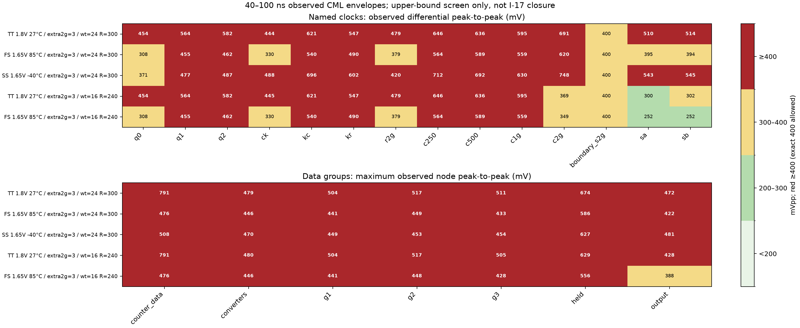

# TX 内部 CML 摆幅收敛

**extra3 的三个完整 TX 压力点虽满足串化眼图门槛，内部摆幅仍广泛超过 400 mVpp。** 最终 c2g 输出的 WT16/R240 在完整TT/FS中减至369/349mVpp，但FS边沿散布失败、不采用；计数器、其他时钟支路、数据树和保持节点需要分别收敛，I-17 保持打开。

## 直接观测

以下是 extra2g=3、输出 WT24/R300 的基线。单位均为差分 mVpp；每组数据取其中最大的节点，不表示每个节点都具有相同幅度。

| 条件 | c2g | c250 / c500 / c1g | 数据转换器最大 | g1 / g2 / g3 最大 | 末级 held 最大 |
|---|---:|---:|---:|---:|---:|
| TT 1.8 V 27°C | 691.20 | 646.42 / 636.30 / 594.58 | 479.48 | 504.15 / 517.49 / 511.43 | 673.67 |
| FS 1.65 V 85°C | 619.95 | 564.21 / 589.34 / 559.34 | 446.49 | 440.94 / 448.50 / 433.28 | 586.27 |
| SS 1.65 V −40°C | 747.96 | 711.68 / 692.11 / 630.14 | 470.04 | 449.45 / 453.39 / 454.44 | 626.63 |

三点计数器 q1/q2 均超过400；q0只在TT超幅。数据转换器16个输出、g1八个、g2四个、g3两个和末级两个保持节点，三点均观察到超幅。计数器 d/m 是数据状态，不能混入周期时钟下限判定。图中 `boundary_s2g` 是规定的理想输入，不是电路输出的资格结论。

图中另两行是WT16/R240的TT/FS完整确认。除c2g外，本地sa/sb也降至约300/302mV与252/252mV；held仍约629/556mV，计数器、转换器和g1–g3的超幅没有消除。幅度减小同时改变时钟驱动与再生时序，FS散布0.18025UI失败；[完整尺寸对照](tx_final_retime.md#缩摆幅的完整tx确认)给出眼图与逐边沿复核。

完整逐节点差分极值、峰峰值、共模范围与时间均值，以及时钟完整周期中最小摆幅，保存在[数据](../data/tx_cml_envelope.json)和[索引](../../results/catalog/tx_cml_envelope.json)。时钟下限按最弱完整周期观察；数据节点的下限不评分。有限码型观察可以证明本窗口发生过超上界，不能证明未观察到的码型、失配和PVT均符合。

## 边界与来源

测试台含真实偏置、PDK R tt、v3计数/复制分发、16位捕获与两组保持、转换器、r2数据树、实际驱动及RLC16；上游为理想2GHz、400mVpp、30ps边沿，计数器辅助初态，控制为Icarus输出回放。它不是PLL原生时钟、物理控制延时或上电试验。

统一观察40–100ns。先检查120ns波形完整性、执行与deck身份、事件/生产者来源，再独立复算捕获、保持、RTL标签及连续计数。原120ns来源依次为 `parallel_serializer/20261107T100515.229352Z_d90f2835`、`20261107T100515.224129Z_ed0ba659`、`20261107T103131.308549Z_aaefb4bc`，新尺寸为`20261107T155507.514155Z_71459865`和`20261107T155507.523830Z_505b46a3`，前缀均为 `results/analog/tx/`。串化眼图结论见[完整TX](tx_parallel_serializer.md)，与本处摆幅符合性分开记录。

## 下一步尺寸约束

先从实际超幅的非再生时钟支路建立带真实扇出的局部卡，分别测尾流和负载电阻的小扰动，校准幅度、共模与延迟灵敏度；计数器、非再生数据树、再生保持节点分开处理。减阻会同时削弱再生和提前关闭，不能把全树统一缩小。若幅度与时序无法配平，应同步比较隔离驱动或分离再生增益与输出幅度的结构。

具体工作边界和历史失败约束见[局部尺寸工作方案](../work_packages/deliveries/tx-cml-sizing-next.md)。先局部复现、再选参和压力角确认，最后回完整TX核对位映射、眼图与各节点摆幅；不得以降低400mVpp要求闭合问题。
