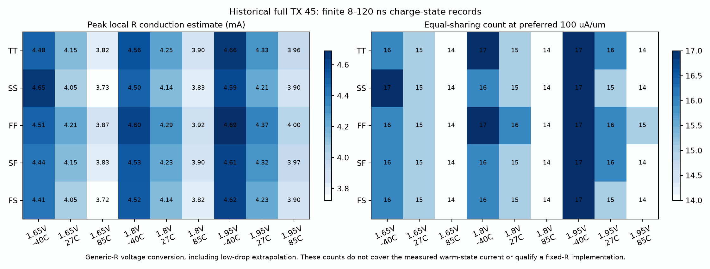
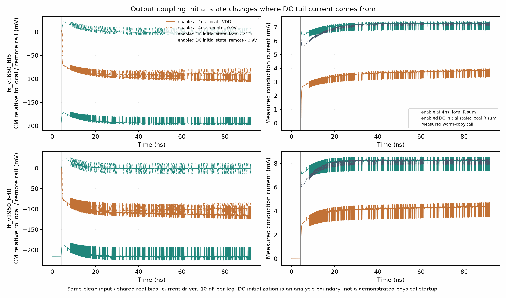

# TX AC耦合状态与端接电流规划

**现有完整TX的45点证明了8–120ns使能/电荷历史下的眼图，尚未覆盖完整TX在耦合建立后的工作状态。** 局部配对实验显示，已使能DC初始状态会显著提高本地50Ω端接承担的电流。新实验的干净输入眼图仍满足局部门槛，未证明旧45点失败，也未完成采用源的稳态资格。

## 从旧45点能读出什么

来源为当前采用的extra5、输出WT16/R240、pre120/WT60/out192，理想2GHz、真实偏置和通用PDK R tt。每条完整源均重新经过原collector检查，并核对冻结电路、原始波形、执行deck及哈希。

输出在4ns前关闭，4.1ns打开；每腿AC电容10nF，远端每腿50Ω到0.9V。记录从8ns到120ns。对10–20、50–60、100–110ns三窗统计：45条件的晚窗远端共模为0.8042–0.8148V，明显低于0.9V；远端VCM端口持续向链路提供电流。早窗到晚窗，本地共模下降15.64–16.83mV。因此不能将短记录直接外推为耦合建立后的本地电阻电流。

用旧通用50Ω的DC卡按`I=(VDD−Vpad)/R(T)`估算，−40/27/85°C阻值为52.5017/52.0897/53.4718Ω；实测0.1/0.25/0.5V下为线性。45条件两腿峰值最大4.690mA，RMS最大3.149mA，单腿平均耗散最大0.521mW。全部90腿都进入低于0.1V的卡外区间，部分瞬间反向，所以这批首先记为导电电流规划估计；不含寄生位移电流。

`Ilocal−Iremote`给出的尾流仅是忽略pad/信道净储能后的KCL估计，不是测得的MOS电流。远端VCM电流积分也不能直接命名为某只AC电容的电荷。两个离线脚本的交付与集成者复跑完整一致。

## 局部配对实验

两份相同当前driver共用干净400mVpp、20ps、VDD−120mV共模输入和一份真实参考，各自连接完整pad/package/10nF/RLC16/远端端接：

- `enable_4ns`：DC时关断，4–4.1ns使能。
- `enabled_DC`：在平衡输入的DC解中已使能，AC电容从该平衡DC解的电荷开始。

输入平衡至7ns，8ns开始既有64bit训练及256bit载荷，另保留16bit尾段，仿真至92ns。新bench直接保存两只本地电阻的`rbody[i]`及输出尾管`id`。FS1.65V/85°C、FF1.95V/−40°C两点均完成冒烟与完整仿真。

| 条件 | 模式 | 整段单腿导电峰值 mA | 晚窗远端共模 V | pad有符号裕量 mV / 散布 UI |
|---|---|---:|---:|---:|
| FS热 | 4ns使能 | 3.732 | 0.81292 | 173.33 / 0.006362 |
| FS热 | 已使能DC初始 | 5.447 | 0.89926 | 173.04 / 0.006400 |
| FF冷 | 4ns使能 | 4.705 | 0.80230 | 201.78 / 0.003061 |
| FF冷 | 已使能DC初始 | **6.619** | 0.89919 | 201.70 / 0.003093 |

四分支pad与remote的干净输入检查、位映射均满足所用局部门槛。两初始状态下，晚窗尾管电流几乎相同，本地电阻承担的电流却不同；这是不能由短窗本地电流替代稳态规划的直接证据。新测得的通用R导电电流与旧DC换算在这两点的最大差小于9e−15A，也校准了该模型在低压降区的换算；该结论不移植到新定宽卡。

两份driver共享真实偏置，支路1使能会扰动公共偏置，vbias在记录内仍有变化。因此`enabled_DC`指初始DC电荷状态，不表示整个92ns所有状态完全稳态，更不证明物理上电能到达该状态。该bench也没有实际串化器的源阻抗和波形ISI。

## 对物理电阻选择的影响

[SkyWater的P+精密多晶电阻说明](https://github.com/google/skywater-pdk/blob/main/docs/rules/device-details/res_high/index.rst)给出的模型电流范围为每微米宽500µA，并建议优先控制在100µA/µm以内。这是模型适用范围与推荐使用值，不能当作AC峰值/RMS的完整EM或热签核规则。本次用导电峰值作保守规划筛选。

假设2.85µm单元完全均流：

| 所用电流边界 | 5 / 6 / 8并时µA/µm | 按500粗算最少支数 | 按推荐100粗算最少支数 |
|---|---:|---:|---:|
| 旧45短记录4.690mA | 329 / 274 / 206 | 4 | 17 |
| 新FF已使能初态6.619mA | 464 / 387 / 290 | 5 | **24** |

这些整数只解电流等分约束；旧4支仍不满足50Ω网络的几何下限，[并联卡](fixed_load_resistors.md)已证明至少5支才有匹配旧TT电气值的合法长度。24支不是新规格，也不是已采用网络；源/负载、真实参考跟踪、固定卡电压系数、失配均流、寄生、走线/接触和热仍需联合验证。若以推荐电流区间为设计目标，可比较更多2p85并联与较宽5p73单元；后者需独立卡片及DRC，不复制2p85系数。

## 下一步与证据

下一步在当前采用的真实串化器边界保留正确初态/训练历史并补充偏置观测，再检查完整TX的耦合建立状态；新物理电阻比较同时带入电流、R/参考跟踪和C代价。无需每一步先跑整个SerDes长仿真。完整RX/CDC、原生时钟、噪声失配和上电条件仍按主计划推进。

- [数据](../data/tx_coupling_state.json)与[索引](../../results/catalog/tx_coupling_state.json)保存全部45点审计、两点新配对、电流规则来源和哈希。
- 有限窗口脚本：`verification/analysis/tx_termination_current.py`、`verification/analysis/tx_coupling_state.py`；各有交付与复跑结果，路径写在发布数据中。
- 新campaign：`results/analog/tx/output_driver/coupling_state/20261112T043742.580713Z_66e65343`；测试台`analog/tx/output_driver/tb/coupling_state/run.py`，先逐点1.001ns冒烟，再完整92ns；可按工况续跑。
- 发布器`verification/plotting/tx_coupling_state.py`重读新原始波形，重算电流、共模、眼图与位映射，并复查旧45点审计身份；两项配对结构测试通过。
