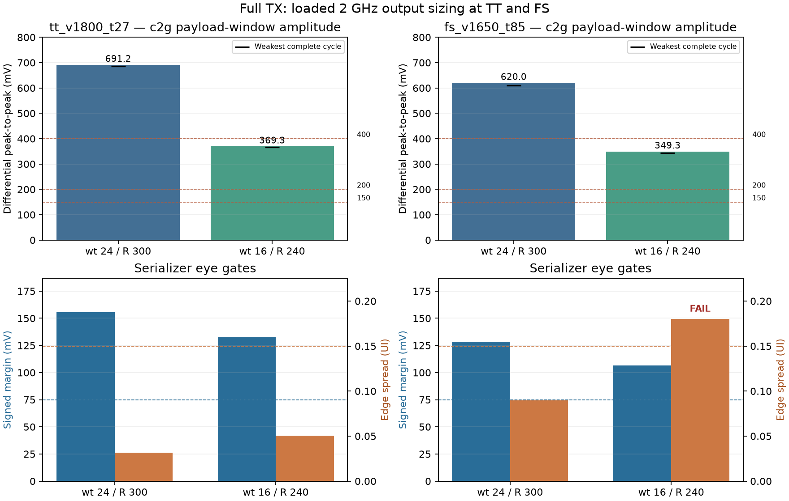
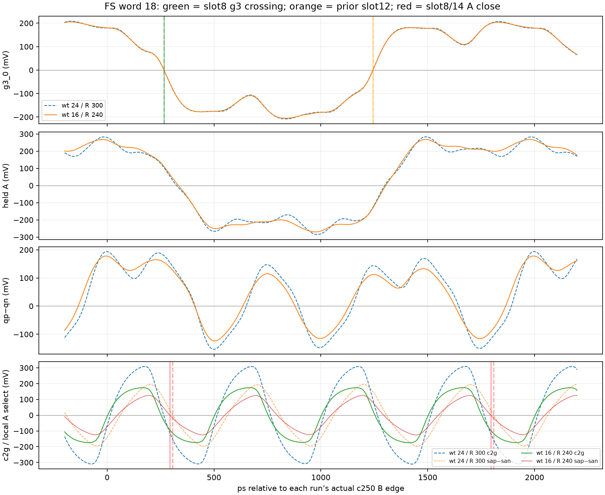
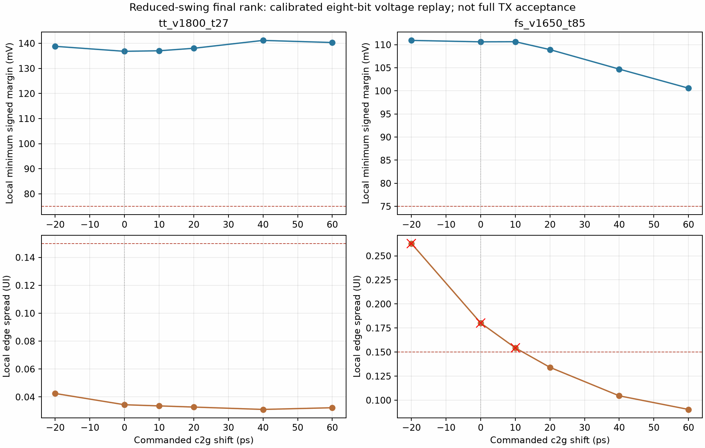
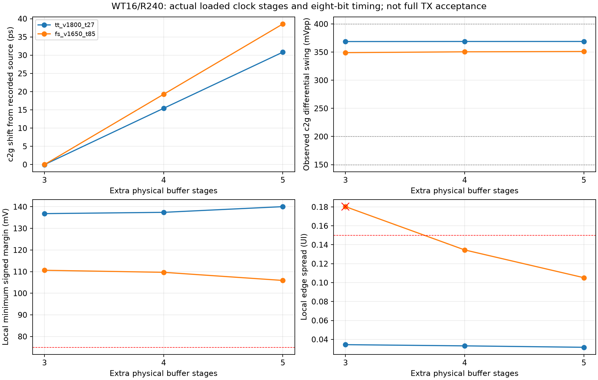
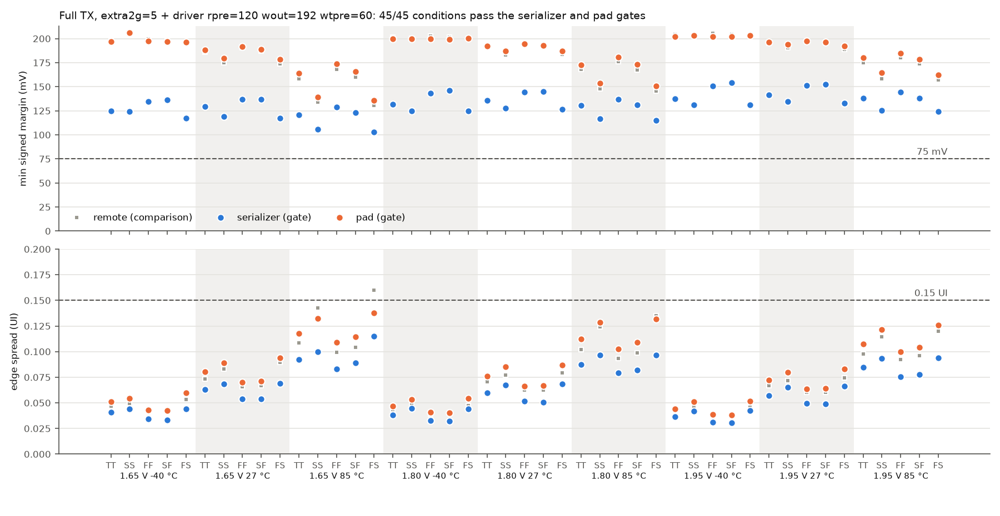

# TX 末级重定时与 2 GHz 时钟改进

**当前候选为extra2g=5、最终输出WT16/R240，加输出级预驱动120 Ω/尾60 µm、输出对W192：完整TX在45个MOS条件下串化器和焊盘都满足75 mV / 0.15 UI，全部256位零错、位序正确；最差为FS 1.65 V 85 °C（串化器103.1 mV / 0.115 UI，焊盘136.0 mV / 0.138 UI）。** 范围是理想2 GHz源、PDK电阻tt、计数器初态；PLL原生时钟、电阻角、失配/噪声、内部超幅（I-17）和guard物理时序仍未闭合。原extra3已在完整TX的TT/FS/SS三点恢复眼图，但内部摆幅超上界；只把输出改为WT16/R240后，完整FS散布0.18025UI失败，局部相位重配后选extra5。

根因追踪始于原FS异常半字：g3_0过零晚于本地A保持关闭约5–6ps，保持节点随后缓慢翻转。下文依次给出原样校准、相位卡、实际缓冲级及完整链边界，区分各次证据的参数和适用范围。

## 观察与校准

完整原电路追加内部观测，结束于60 ns：FS为`parallel_trace/20261107T054507Z`，TT为`20261107T054616Z`。32–58 ns所有原有公共电压与原120 ns记录的误差均为0，电路、数据、负载及初态未变。bit 232不在60 ns追踪范围内，未外推内部结果。

| 条件／事件 | g3_0目标极性过零，相对半字沿 / ps | 本地A关闭 / ps | 关闭时g3_0有符号差分 / mV |
|---|---:|---:|---:|
| FS 1.65 V 85°C，bit48 | 274.11 | 267.75 | −10.32 |
| FS 1.65 V 85°C，bit104 | 272.46 | 267.30 | −8.68 |
| TT 1.8 V 27°C，bit48 | 200.54 | 248.55 | 122.02 |
| TT 1.8 V 27°C，bit104 | 200.04 | 248.41 | 124.26 |

bit48为A半字起点、bit104为B半字起点，两者均为末级A锁存器承载的偶数位。首级A/B分组与末级A/B锁存器不是同一层次。这里的“关闭”按`sap-san`下降过零定义；有限时钟斜率和再生过程仍在继续，表内时间差不是完整建立时间门槛或统计裕量。

## 末级允许窗

按固定内部端口切出末级锁存/选择、实际驱动和RLC16负载，保留4 ns前史及2 ns后继，固定3.5–5.8 ns评价窗。4个零偏移基线的qp/qn及两组保持节点均在5 mV内复现；最大误差0.097 mV。20个偏移点仅移动两根记录的c2g，数据与偏置不动。

| FS事件 | 原输出采样 / mV | c2g后移40 ps / mV | A保持差分：原值→后移40 ps / mV |
|---|---:|---:|---:|
| bit48 | 19.34 | 132.66 | 47.92 → 234.44 |
| bit104 | 68.03 | 182.19 | 54.34 → 240.75 |

输出时间采用原训练相位加命令偏移，未拟合载荷相位；保持时间参考原关闭加命令偏移后200 ps，候选本地关闭没有另测，故只是条件比较。TT两个事件在0…120 ps区间仍保持正确极性。偏移为−80 ps的坏波形也保留在图与数据中。

证据为`final_retime/20261107T094213Z`的4个原样、20个偏移case；[数据](../data/tx_final_retime_window.json)、[索引](../../results/catalog/tx_final_retime_window.json)。早先`055531Z`四基线成功，但首个负偏移smoke遇到近重合PWL拐点而截断，另行保留，未补成通过。

## 从相位参数到实际缓冲级

沿用既有S4同步计数器/复制结构和[结构平衡研究](tx_clock_distribution.md)，局部校准末级数据/时钟窗口。新增中间级放在2 GHz输出驱动器之前，未在重负载末端串小缓冲。每个实验的源端都是相同iso输入级24/16 µm、400 Ω，输入负载签名一致。

三种额外中间级数为1/2/3；另有iso与out，因此总缓冲数为3/4/5。三支路是同一理想电压激励下的独立数学实验，各自保留实际末级和下游负载，不是拟议芯片上并联三条路径。count1对c2g、qp/qn及保持节点的最大原样误差0.1115 mV。

| FS事件 | extra=1 输出 / mV | extra=2 输出 / mV | extra=3 输出 / mV | extra=3 实测c2g后移 / ps |
|---|---:|---:|---:|---:|
| bit48 | 19.29 | 118.89 | 136.89 | 39.06 |
| bit104 | 67.98 | 168.67 | 186.08 | 38.98 |

局部结果来自`final_clock_chain/20261107T094939Z`，[数据](../data/tx_final_clock_chain.json)、[索引](../../results/catalog/tx_final_clock_chain.json)。这组加载下，一个中间级的相位增量约TT15.7 ps、FS19.5 ps，与旧通用B元素卡的37 ps不能直接互换；后续模型须保留加载/偏置身份。extra=3先用于确认功能，PPA与extra=2再比较。

该clock-chain局部实验的c2g差分摆幅，FS约583–617 mVpp，TT约681 mVpp及以上；原级数也已超过400 mVpp接口政策。增加级数不是摆幅修复，I-17仍须独立闭合。后续需联合约束输出R/尾流、幅度、源跟随器工作点和延迟，不以功能恢复替代幅度符合性。

## 2 GHz输出摆幅与时序联合选参

extra3保留原输出Wn32/Wtail24/R300时，c2g仍达610–689 mVpp，超过内部400 mVpp上界。以已校准的r2g切片做三支路独立数学实验，全部保持extra3和输入对Wn32，只比较输出24/300、18/240、16/240（尾宽µm／负载名义Ω）。实际负载电阻按PDK high_po、R tt建模，不是理想R。四个原样基线对旧切片extra3八个节点最大误差5.56 µV，输入复现均在200 µV门槛内。

| 条件／事件 | 原c2g / mVpp | W16/R240 c2g / mVpp | c2g下降沿变化 / ps | W16/R240局部输出样点 / mV | g3过零早于实际A关闭 / ps |
|---|---:|---:|---:|---:|---:|
| FS bit48 | 610.21 | 344.08 | −11.55 | 111.37 | 19.69 |
| FS bit104 | 616.97 | 347.61 | −11.58 | 174.80 | 20.83 |
| TT bit48 | 685.61 | 366.83 | −9.69 | 149.55 | 71.24 |
| TT bit104 | 689.43 | 369.11 | −9.68 | 201.97 | 71.55 |

W18/R240在TT仍414.60–417.12 mVpp，未满足400上界，保留作趋势对照。W16/R240在这四个局部事件中落入200–400 mVpp设计区间，并保留正极性输出和保持状态；并未获得完整TX资格。减幅同时把A实际关闭提前约10–13 ps，FS关闭时g3差分从53–57 mV降到33–36 mV，不能只看幅度达标。尾节点电压已保存，但无Vdsat测量，不声称完成饱和余量分析。

[数据](../data/tx_final_clock_swing.json)、[索引](../../results/catalog/tx_final_clock_swing.json)来自`final_clock_swing/20261107T103804.761471Z`，显式边界`tx_final_clock_output_sizing_v1`。源为旧两条件事件的理想电压，忽略上游阻抗/反馈。首次完整链尝试虽然两条120ns完成，但实际捕获时钟比probe事件偏约1ns，入口边界检查拒绝评分。18ns短对照复现原动态波形，静态probe补齐四个独立元数据源后计数和相位匹配；额外强制master零态则出现两次无效递增，不采用。详见[初态与图拓扑诊断](../work_packages/deliveries/tx-sizing-clock-epoch.md)。probe源拓扑修复7386cde保持原IC和电路，两新48ns探针通过后重新登记事件。

输出样点为原训练中心，加“本次候选c2g下降沿−源切片count1下降沿”，包含原extra1→3的31–39 ps改进；不得漏加这段延时，也不使用载荷拟合。交越必须在固定窗口中唯一，交越间隔不是完整建立裕量。先前未经校准的RC/gm各半模型仅为敏感性示例；选参依据是此次实际加载与关闭沿测量。

## 缩摆幅的完整TX确认

**WT16/R240的c2g满足观察窗幅度筛查，但FS热角串化边沿散布失败，尺寸不采用。** 修复源图拓扑后，TT/FS均完成120ns并通过捕获、两组保持、RTL事件标签及175个计数采样；22个有效字、256载荷零错，训练/marker/缺失或额外交越均为0，位映射为自然0–15。这些功能结果不能覆盖0.15UI散布门槛。

| 条件 | c2g窗口峰峰值 / mV | c2g最弱完整周期 / mV | 串化器裕量 / mV | 串化器散布 / UI | 眼图判定 |
|---|---:|---:|---:|---:|---|
| TT 1.8 V 27°C | 369.31 | 365.77 | 132.38 | 0.05047 | 满足 |
| FS 1.65 V 85°C | 349.27 | 342.78 | 106.35 | **0.18025** | **失败** |

时钟测量为实际序列起点+64UI至+320UI的载荷窗，UI固定250ps；两种极性边沿数、周期误差<1%及200–400mVpp观察筛查均满足。输出训练相位不拟合载荷。TT三测点眼图满足；FS焊盘/远端的比较screen散布为0.21195/0.23129UI，同样失败。

运行固定为`parallel_serializer/20261107T155507.514155Z_71459865`和`20261107T155507.523830Z_505b46a3`，前缀`results/analog/tx/`。[独立四运行对照数据](../data/tx_clock_output_confirmation.json)、[索引](../../results/catalog/tx_clock_output_confirmation.json)核对原样WT24/R300与新候选，保留所有通过和失败。

FS新全局极端在同一B半字：bit302/slot14的0→1最早，bit296/slot8的1→0最晚（位号含训练，载荷内分别为238/232）。原WT24/R300同位残差约−0.0416/+0.0380UI，新候选为−0.0873/+0.0929UI；不仅是一个半字起点整体延迟。见[逐边沿复核](../work_packages/deliveries/tx-clock-output-edge-review.md)。下一步须在减幅边界上校准本地时钟/再生及数据相关延迟，再选相位和尺寸，不能直接外推原大摆幅切片。

按各自实际B沿对齐，slot8的g3目标交越新旧约266.18/266.13ps，本地A关闭约293.08/306.64ps；输入过零基本不变，关闭提前约13.6ps，g3到held的目标交越间隔增加约8.6ps。slot14关闭也提前约13.5ps，但slot12/14同为1，不能将此前slot12的g3上升误作slot14的新事件；slot14独立输入到保持的交越传播时间不评分。[数据与测量定义](../data/tx_clock_output_edge_detail.json)保留两事件与实际关闭沿的对应关系。这些观察尚不足以单独归因全部散布，后续局部切片必须同时覆盖半字起点和沿用偶支路值的选择事件。

其他内部节点仍大量超幅，见[逐节点摆幅与分层尺寸约束](tx_cml_amplitude.md)。这组确认既不关闭I-17，也不成为全角工作修订。

## 减幅后的局部相位重配

**在当前减幅边界上，FS半字的散布可通过后移选择时钟恢复；这仍只是八位局部证据。** 从上述完整TT/FS各切出word18的B半字，保留前4ns历史和后2.5ns，末级锁存/选择、实际驱动与RLC16均保留，只把录制c2g两极一起平移。9个源的电压PWL误差有界10µV，原样输入复现门槛200µV；qp/qn、A/B保持及本地选择端在3.5–6.45ns的原样最大误差，TT/FS为0.0559/0.0258mV，逐边沿误差均小于0.01ps。原FS局部0.18025UI被复现后才解释偏移结果。

| c2g命令偏移 / ps | TT八位最小裕量 / mV | TT八位散布 / UI | FS八位最小裕量 / mV | FS八位散布 / UI |
|---:|---:|---:|---:|---:|
| −20 | 138.81 | 0.04251 | 110.93 | **0.26287** |
| 0 | 136.82 | 0.03444 | 110.62 | **0.18025** |
| +10 | 137.04 | 0.03361 | 110.64 | **0.15438** |
| +20 | 138.03 | 0.03277 | 108.93 | 0.13414 |
| +40 | 141.17 | 0.03107 | 104.71 | 0.10454 |
| +60 | 140.32 | 0.03229 | 100.59 | 0.09040 |

12个局部点的八位均无采样错误、缺失或额外交越；红色项因散布失败，不能以位中心正确降格通过。c2g观察窗仍约TT369/FS349mVpp，没有通过恢复原大摆幅来换取散布。相位采用原完整运行的训练相位加命令偏移，UI固定250ps，不在这八位上重新拟合。位296–303覆盖slot8和slot14两种事件；slot14仍是沿用偶支路值，未制造虚假的新g3交越。

来源为`reduced_phase_window/20261107T163519.276862Z_6d47b1a8`，前缀`results/analog/tx/`；边界`tx_reduced_final_word18_phase_v1`。[独立复算数据](../data/tx_reduced_phase_window.json)、[索引](../../results/catalog/tx_reduced_phase_window.json)、[测试台](../../analog/tx/input_register/tb/final_retime/native_window.py)保存完整来源/负载身份、输入及执行快照，按工况续跑；每角一个deck合并偏移点，冒烟单独缩短一个瞬态。

后移20ps在本局部开始满足门槛，40ps的散布余量更大但位中心裕量有所下降；两档作为实际缓冲级实验的目标，电压源平移本身不代表电路已实现。同一r2g输入负载下的实际extra3/4/5确认见下一节。

## 减幅下的实际缓冲级确认

**实际extra4/5恢复了受检FS半字的局部门槛；当时选择extra5进入完整TX确认。** 后续已完成[45条件确认](#45条件完整tx2026-11-08)。本局部实验保持输出WN32/WT16/R240，r2g后第一隔离级与中间级均24/16µm、400Ω。三条分支是同一理想录制输入下的独立数学实验，均加载原末级、驱动与RLC16，不是芯片上并联三条路径；每条第一隔离级的输入负载签名均与完整源相同。

原样extra3对完整源的c2g、qp/qn、两组保持和本地sap/san最大误差，TT/FS分别0.104/0.040mV，绝对输出过零误差0.029/0.020ps；校准时没有用时钟相位补偿隐藏绝对交越误差。下面时钟增量是相对记录c2g下降沿的中位差，输出采样相位取原完整训练相位加该增量，不由载荷拟合。

| 条件 | extra级数 | 实际c2g增量 / ps | c2g / mVpp | 八位最小裕量 / mV | 八位散布 / UI |
|---|---:|---:|---:|---:|---:|
| TT | 3 | −0.03 | 368.75 | 136.82 | 0.03444 |
| TT | 4 | 15.42 | 368.91 | 137.42 | 0.03317 |
| TT | 5 | 30.82 | 368.94 | 140.05 | 0.03166 |
| FS低压热 | 3 | −0.02 | 349.04 | 110.62 | **0.18029** |
| FS低压热 | 4 | 19.27 | 350.52 | 109.68 | 0.13455 |
| FS低压热 | 5 | 38.56 | 351.09 | 105.92 | 0.10522 |

六个分支均无八位采样错误、缺失或额外交越；原FS仍因散布失败。extra5的最弱完整时钟周期摆幅TT/FS约368.38/349.79mVpp，c2g观察筛查满足200–400mVpp。extra5在此FS局部比extra4留出更多散布余量，作为完整字流确认候选；附加功耗/噪声、其他PVT和其他内部超幅节点仍未关闭。

将前述相位卡按实际时钟增量分段线性插值，FS的extra4/5预测散布为0.13561/0.10668UI，实测0.13455/0.10522UI，偏差约−0.26/−0.37ps。预测未使用输出载荷拟合，也没有超出相位卡范围；这仅校准本码型和加载边界上的相位模型，不扩大PVT/码型覆盖。

[独立复算数据](../data/tx_native_reduced_clock.json)、[索引](../../results/catalog/tx_native_reduced_clock.json)来自`native_reduced_clock/20261107T164517.822006Z_16514531`，前缀`results/analog/tx/`，子边界`tx_reduced_final_word18_clock_stages_v1`。原求解完整，但汇总的NumPy布尔值导致JSON序列化失败；错误另记`analysis_error.json`，原plan、源码/执行快照和波形不变。独立采集器用归档测量代码重算并仅归一化标量类型；修正后的脚本与原归档所有科学指标逐项一致，没有重跑仿真。较早两个仅准备目录因源码变化失效，没有执行，不作证据。

extra5随后分别完成TT/FS的48ns时钟探针：23次计数采样连续、末段字时钟1ps稳定性门满足；按各自记录重新登记事件并运行RTL生产者后，120ns动态确认分别为`parallel_serializer/20261107T170534.584797Z_533f8f18`和`20261107T170534.588144Z_51e1e33e`。评价见下节；[运行索引](../../results/catalog/tx_reduced_clock_full_confirmation.json)与四运行比较采集器保留extra3的原失败。

## extra5的完整TX确认（2026-11-08）

**三个压力点的串化器输出都满足门槛：TT 135.75 mV / 0.0600 UI，FS 1.65 V 85 °C 102.73 mV / 0.1151 UI，SS 1.65 V −40 °C 124.08 mV / 0.0437 UI。** 每点22个有效字、256位载荷零错，训练、marker、位映射按原序，计数、捕获、两组保持和RTL标签都正确，无多余或缺失交越。

| 条件 | c2g载荷窗峰峰值 / mV | 串化器裕量 / mV | 串化器散布 / UI | 焊盘散布 / UI | 远端散布 / UI |
|---|---:|---:|---:|---:|---:|
| TT 1.8 V 27 °C | 369.9 | 135.75 | 0.0600 | 0.0776 | 0.0712 |
| FS 1.65 V 85 °C | 351.4 | 102.73 | 0.1151 | 0.1584 | 0.1802 |
| SS 1.65 V −40 °C | 391.8（最弱完整周期388.4） | 124.08 | 0.0437 | 0.0562 | 0.0517 |

- 规格门槛在串化器输出；2026-11-08起焊盘也是门槛，远端只作比较（[规格](../overview/spec.md#验收门槛)）。r2输出级下FS热角焊盘/远端为0.158 / 0.180 UI。焊盘多出的部分是串化器输出幅度ISI在输出级两级缓冲中的累积；输出级候选（预驱动120 Ω/尾60 µm、输出对W192）在完整TX上把FS焊盘降到0.138 UI，串化器节点不变，见[TX输出级](tx_output_driver.md#串化器到焊盘的散布增量2026-11-08)。远端0.160 UI属信道。
- 和只改输出尺寸的extra3相比，FS散布0.1803 → 0.1151 UI，裕量106.35 → 102.73 mV；TT基本不变（[TT/FS对照数据](../data/tx_reduced_clock_full_confirmation.json)，[图](../figures/tx/ingress/tx_reduced_clock_full_confirmation.png)）。
- 流程与TT/FS相同：48 ns时钟探针（23次计数连续，字时钟周期偏差在1 ps门内）→登记字时钟时间表→RTL生成数据→120 ns动态。SS冷角为`parallel_serializer/20261107T181342.431277Z_826110f5`（探针）和`20261107T182054.943768Z_e576538e`（动态），TT/FS见上节。

## 45条件完整TX（2026-11-08）

**45/45通过串化器与焊盘门槛。** 配置：extra2g=5、WT16/R240，输出级覆盖`rpre=120 wtpre=60 wout=192`（[输出级](tx_output_driver.md#串化器到焊盘的散布增量2026-11-08)）。每个条件按单点流程独立完成：48 ns负载字时钟探针→登记时间表→RTL数据→120 ns动态；每点22个有效字、256位载荷，计数、捕获、两组保持、RTL标签、三处位映射全部正确，零错误、无多余/缺失交越。TT、FS 1.65 V 85 °C、SS 1.65 V −40 °C三点是同配置的已有单点，核对来源哈希后收编，其余42点新跑。

| 节点 | 最小裕量 / mV | 最大散布 / UI | 差分峰峰值 / mVpp |
|---|---:|---:|---:|
| 串化器（门槛） | 103.1（FS 1.65 V 85 °C） | 0.1152（同） | 353–474 |
| 焊盘（门槛） | 136.0（同） | 0.1379（同） | 376–494 |
| 远端（比较） | 130.5（同） | 0.1601（同，唯一超过0.15 UI的点） | 362–519 |

散布由温度主导（串化器 / 焊盘）：85 °C 15点为0.076–0.115 / 0.100–0.138 UI，27 °C为0.049–0.069 / 0.064–0.094 UI，−40 °C为0.031–0.045 / 0.038–0.060 UI；同温下低压、FS/SS更差。焊盘摆幅45点中35点高于400 mVpp目标（冷角最高494），10点低于（热角低压最低376）；规格的幅度容差尚未定义，超幅的另一面是I-17。

编排：[pvt45.py](../../analog/tx/input_register/tb/full_serializer/pvt45.py)，活动`results/analog/tx/full_pvt45/20261107T200334Z`（每条件的探针/动态目录在其`state/`），[数据](../data/tx_full_pvt45.json)。4路并行共约4.6 h；单点动态12–18 min（中位16 min），探针约6 min。

## 范围与下一步

局部源是记录的g3两对数据、时钟、偏置及VDD，忽略上游源阻抗和受扰反馈；早期切片为TT/FS各两个事件，减幅后重配另覆盖word18的B半字八位，均无MC/噪声。固定训练相位加时钟增量的采样只用于局部比较，**不是串化器规格通过**，也没有证明全部位的边沿散布满足0.15 UI。内部时钟摆幅的既有I-17问题仍开。

此前extra=3改进归属T02选择时钟分发，T03末级尺寸保持不动。完整TX重新登记TT/FS各自负载字时钟并完成120 ns动态载荷。TT为155.68 mV/0.03137 UI，FS为128.29 mV/0.08961 UI；训练、marker、位映射、计数、捕获/保持均正确，原FS额外交越消失，见[完整比较](tx_parallel_serializer.md)。该阶段保存各级内部节点；SS低压冷角随后完成120ns，137.61mV/0.03607UI，训练/位序/捕获保持均正确。完整FS旧失败保留；extra3阶段仅覆盖三点，后续extra5及输出级候选的45条件结果见上。物理guard/blank的SS时序问题独立处理。

入口：[完整追踪](../../analog/tx/input_register/tb/full_serializer/trace.py)、[末级平移](../../analog/tx/input_register/tb/final_retime/window.py)、[实际时钟链](../../analog/tx/input_register/tb/final_clock_chain/run.py)。所有路径前缀为`results/analog/tx/`；两种切片均先显式登记来源，再运行和校准。
