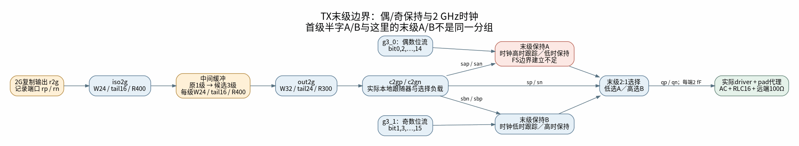
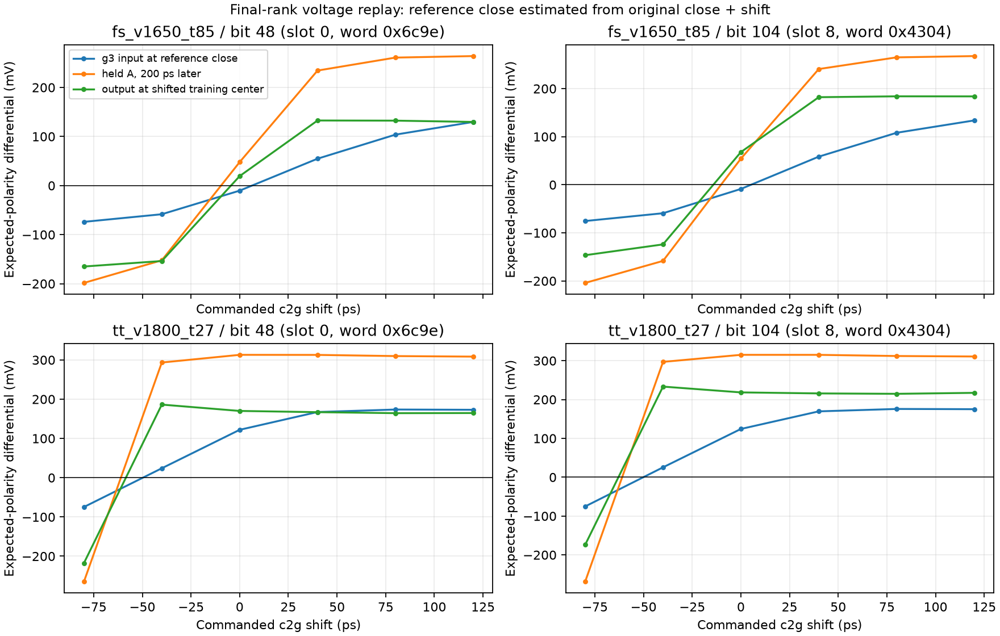
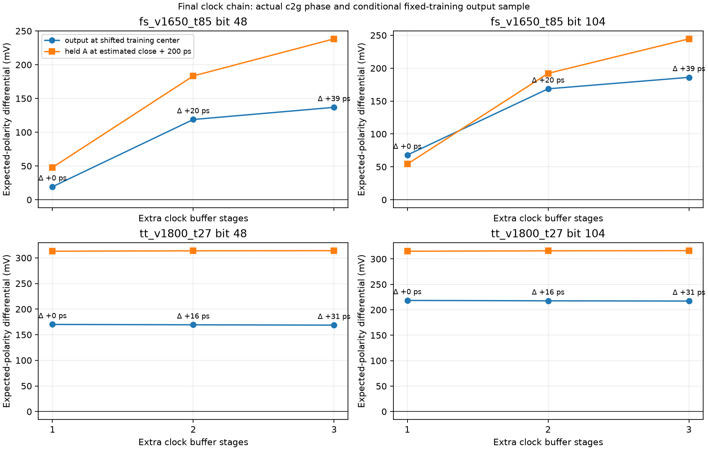
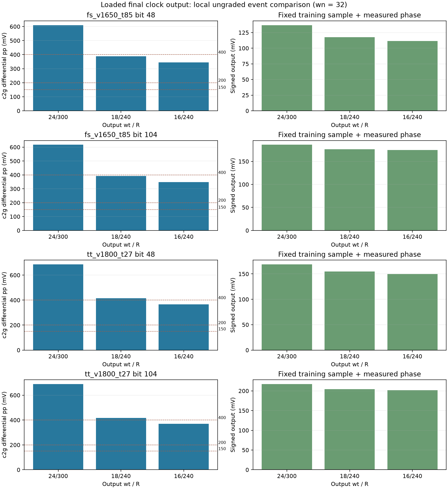

# TX 末级重定时与 2 GHz 时钟改进

**FS 热角的两个异常半字起点存在建立时间不足：g3_0 过零晚于本地 A 保持关闭约5–6 ps。** 保持节点随后缓慢翻转。末级原样切片复现了该行为；推迟关闭可恢复这两个事件。采用实际中间缓冲级的局部实验也确认改善，extra2g=3已在完整TX的TT/FS/SS三点恢复眼图门槛，尚未采用为全角工作修订。

## 观察与校准

完整原电路追加内部观测，结束于60 ns：FS为`parallel_trace/20261107T054507Z`，TT为`20261107T054616Z`。32–58 ns所有原有公共电压与原120 ns记录的误差均为0，电路、数据、负载及初态未变。bit 232不在60 ns追踪范围内，未外推内部结果。

| 条件／事件 | g3_0目标极性过零，相对半字沿 / ps | 本地A关闭 / ps | 关闭时g3_0有符号差分 / mV |
|---|---:|---:|---:|
| FS 1.65 V 85°C，bit48 | 274.11 | 267.75 | −10.32 |
| FS 1.65 V 85°C，bit104 | 272.46 | 267.30 | −8.68 |
| TT 1.8 V 27°C，bit48 | 200.54 | 248.55 | 122.02 |
| TT 1.8 V 27°C，bit104 | 200.04 | 248.41 | 124.26 |

bit48为A半字起点、bit104为B半字起点，两者均为末级A锁存器承载的偶数位。首级A/B分组与末级A/B锁存器不是同一层次。这里的“关闭”按`sap-san`下降过零定义；有限时钟斜率和再生过程仍在继续，表内时间差不是完整建立时间门槛或统计裕量。

## 末级允许窗

按固定内部端口切出末级锁存/选择、实际驱动和RLC16负载，保留4 ns前史及2 ns后继，固定3.5–5.8 ns评价窗。4个零偏移基线的qp/qn及两组保持节点均在5 mV内复现；最大误差0.097 mV。20个偏移点仅移动两根记录的c2g，数据与偏置不动。

| FS事件 | 原输出采样 / mV | c2g后移40 ps / mV | A保持差分：原值→后移40 ps / mV |
|---|---:|---:|---:|
| bit48 | 19.34 | 132.66 | 47.92 → 234.44 |
| bit104 | 68.03 | 182.19 | 54.34 → 240.75 |

输出时间采用原训练相位加命令偏移，未拟合载荷相位；保持时间参考原关闭加命令偏移后200 ps，候选本地关闭没有另测，故只是条件比较。TT两个事件在0…120 ps区间仍保持正确极性。偏移为−80 ps的坏波形也保留在图与数据中。

证据为`final_retime/20261107T094213Z`的4个原样、20个偏移case；[数据](../data/tx_final_retime_window.json)、[索引](../../results/catalog/tx_final_retime_window.json)。早先`055531Z`四基线成功，但首个负偏移smoke遇到近重合PWL拐点而截断，另行保留，未补成通过。

## 从相位参数到实际缓冲级

沿用既有S4同步计数器/复制结构和[结构平衡研究](tx_clock_distribution.md)，局部校准末级数据/时钟窗口。新增中间级放在2 GHz输出驱动器之前，未在重负载末端串小缓冲。每个实验的源端都是相同iso输入级24/16 µm、400 Ω，输入负载签名一致。

三种额外中间级数为1/2/3；另有iso与out，因此总缓冲数为3/4/5。三支路是同一理想电压激励下的独立数学实验，各自保留实际末级和下游负载，不是拟议芯片上并联三条路径。count1对c2g、qp/qn及保持节点的最大原样误差0.1115 mV。

| FS事件 | extra=1 输出 / mV | extra=2 输出 / mV | extra=3 输出 / mV | extra=3 实测c2g后移 / ps |
|---|---:|---:|---:|---:|
| bit48 | 19.29 | 118.89 | 136.89 | 39.06 |
| bit104 | 67.98 | 168.67 | 186.08 | 38.98 |

局部结果来自`final_clock_chain/20261107T094939Z`，[数据](../data/tx_final_clock_chain.json)、[索引](../../results/catalog/tx_final_clock_chain.json)。这组加载下，一个中间级的相位增量约TT15.7 ps、FS19.5 ps，与旧通用B元素卡的37 ps不能直接互换；后续模型须保留加载/偏置身份。extra=3先用于确认功能，PPA与extra=2再比较。

该clock-chain局部实验的c2g差分摆幅，FS约583–617 mVpp，TT约681 mVpp及以上；原级数也已超过400 mVpp接口政策。增加级数不是摆幅修复，I-17仍须独立闭合。后续需联合约束输出R/尾流、幅度、源跟随器工作点和延迟，不以功能恢复替代幅度符合性。

## 2 GHz输出摆幅与时序联合选参

extra3保留原输出Wn32/Wtail24/R300时，c2g仍达610–689 mVpp，超过内部400 mVpp上界。以已校准的r2g切片做三支路独立数学实验，全部保持extra3和输入对Wn32，只比较输出24/300、18/240、16/240（尾宽µm／负载名义Ω）。实际负载电阻按PDK high_po、R tt建模，不是理想R。四个原样基线对旧切片extra3八个节点最大误差5.56 µV，输入复现均在200 µV门槛内。

| 条件／事件 | 原c2g / mVpp | W16/R240 c2g / mVpp | c2g下降沿变化 / ps | W16/R240局部输出样点 / mV | g3过零早于实际A关闭 / ps |
|---|---:|---:|---:|---:|---:|
| FS bit48 | 610.21 | 344.08 | −11.55 | 111.37 | 19.69 |
| FS bit104 | 616.97 | 347.61 | −11.58 | 174.80 | 20.83 |
| TT bit48 | 685.61 | 366.83 | −9.69 | 149.55 | 71.24 |
| TT bit104 | 689.43 | 369.11 | −9.68 | 201.97 | 71.55 |

W18/R240在TT仍414.60–417.12 mVpp，未满足400上界，保留作趋势对照。W16/R240在这四个局部事件中落入200–400 mVpp设计区间，并保留正极性输出和保持状态；并未获得完整TX资格。减幅同时把A实际关闭提前约10–13 ps，FS关闭时g3差分从53–57 mV降到33–36 mV，不能只看幅度达标。尾节点电压已保存，但无Vdsat测量，不声称完成饱和余量分析。

[数据](../data/tx_final_clock_swing.json)、[索引](../../results/catalog/tx_final_clock_swing.json)来自`final_clock_swing/20261107T103804.761471Z`，显式边界`tx_final_clock_output_sizing_v1`。源为旧两条件事件的理想电压，忽略上游阻抗/反馈；W16/R240进入完整链候选后，两条120ns波形完成，但实际捕获时钟比probe事件偏约1ns，入口边界检查拒绝评分；不能写为完整TX通过。18ns短对照复现原动态波形，静态probe补齐四个独立元数据源后计数和相位匹配；额外强制master零态则出现两次无效递增，不采用。详见[初态与图拓扑诊断](../work_packages/deliveries/tx-sizing-clock-epoch.md)。probe源拓扑修复已提交7386cde，原IC与电路保持不变；两新48ns探针通过，已重新登记事件并启动完整TT/FS。当前[运行索引](../../results/catalog/tx_clock_output_confirmation.json)只记待评价，不记通过。上游缓冲及其余节点的超幅问题仍开，不能用一个c2g端口的局部改善关闭I-17。

输出样点为原训练中心，加“本次候选c2g下降沿−源切片count1下降沿”，包含原extra1→3的31–39 ps改进；不得漏加这段延时，也不使用载荷拟合。交越必须在固定窗口中唯一，交越间隔不是完整建立裕量。先前未经校准的RC/gm各半模型仅为敏感性示例；选参依据是此次实际加载与关闭沿测量。

## 范围与下一步

局部源是记录的g3两对数据、时钟、偏置及VDD，忽略上游源阻抗和受扰反馈；只含TT/FS两条件、两个事件，无MC/噪声。固定训练相位加实测时钟增量的采样只用于局部比较，**不是串化器规格通过**，也没有证明全部位的边沿散布满足0.15 UI。内部时钟摆幅的既有I-17问题仍开。

extra=3改进归属T02选择时钟分发，T03末级尺寸保持不动。完整TX已重新登记TT/FS各自负载字时钟并完成120 ns动态载荷。TT为155.68 mV/0.03137 UI，FS为128.29 mV/0.08961 UI；训练、marker、位映射、计数、捕获/保持均正确，原FS额外交越消失，见[完整比较](tx_parallel_serializer.md)。新运行同时保存各级内部节点。SS低压冷角随后完成120ns，137.61mV/0.03607UI，训练/位序/捕获保持均正确。完整FS旧失败保留，改进未获得全45 PVT资格。物理guard/blank的SS时序问题独立处理。

入口：[完整追踪](../../analog/tx/input_register/tb/full_serializer/trace.py)、[末级平移](../../analog/tx/input_register/tb/final_retime/window.py)、[实际时钟链](../../analog/tx/input_register/tb/final_clock_chain/run.py)。所有路径前缀为`results/analog/tx/`；两种切片均先显式登记来源，再运行和校准。
