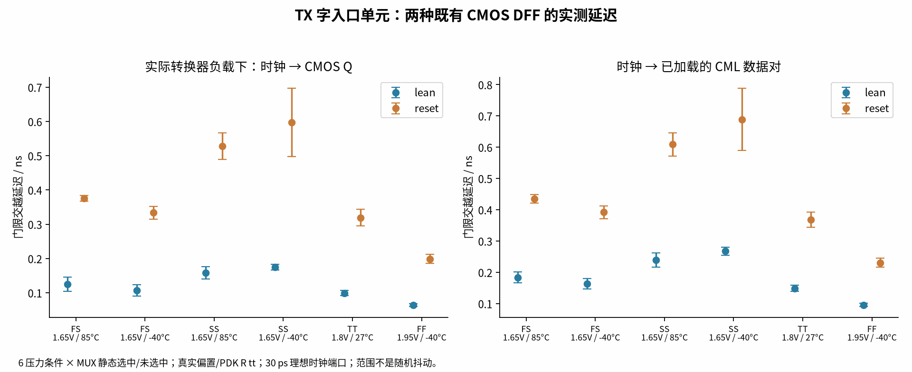

# TX 并行字入口：单元时序与结构选择

**无复位的精简静态 CMOS DFF 作为数据捕获的优先候选；已据此实现完整字捕获＋两组8位互补保持。** 六个压力条件下，单元的时钟到加载CML数据对为91–281 ps，复位型为216–788 ps；两种都有完整正确捕获。完整字原型的边界、启动问题与实际字时钟验证见[字捕获与分组保持](tx_word_capture.md)；[完整TX候选](tx_parallel_serializer.md)已测TT，电路仍待扩角定型。

## 已知边界

既有串化树顶层仍没有接入新入口寄存器。旧native数据按分发输入`src250`下降沿+78.3 ps、再以16个实测UI外推；r5_v3只保持一个静态字。两者不能提供新入口的动态契约。[事实提取与review](../work_packages/reviews/WP-002.md)记录具体接线与源文件引用。

当前单元card同时放置既有`serdes_cmos_dff`与`serdes_cmos_dff_reset`，各自驱动实际CMOS→CML转换器和实际首级MUX的输入晶体管。转换器输出负载由该MUX提供；MUX输出以每端5 fF作为下游代理。Q端另有2 fF线电容。MUX选择固定在选中/未选中两种状态；不是完整串化器的动态选择。

使用真实带隙/电流分配与PDK电阻tt；时钟端口为250 MHz、30 ps理想斜坡。每例24 ns，数据约在捕获沿前1 ns到达。无复位单元的首个存储状态由后续捕获覆盖；不能证明真实上电字流有效。建立/保持孔径、实际时钟扇出、失配与噪声未测。

## 测量

六条件 × 选中/未选中共12例完整，两个单元共120次捕获均正确。额外从raw逐次检查CMOS Q和CML差分在捕获后1 ns内都恰有一次门限交越，没有额外交越。

| 条件 | lean 时钟→Q / ps | lean 时钟→CML / ps | reset 时钟→CML / ps |
|---|---:|---:|---:|
| TT 1.8 V 27°C | 91–107 | 139–158 | 344–393 |
| SS 1.65 V −40°C | 166–183 | 254–281 | 589–788 |
| SS 1.65 V 85°C | 140–177 | 216–262 | 572–646 |
| FS 1.65 V −40°C | 91–123 | 147–180 | 371–413 |
| FS 1.65 V 85°C | 104–146 | 166–201 | 421–449 |
| FF 1.95 V −40°C | 60–68 | 91–100 | 216–245 |

表中范围合并上升/下降数据和两种静态选择负载。工况之间的绝对延迟变化不是随机抖动，也不能直接与串化器输出的0.15 UI散布门槛比较。

精简DFF每个上升沿的输入电荷等效电容约5.7–8.7 fF，16路约91–139 fF，尚不含线、额外launch单元和余量。旧时钟接收器的20 fF输出边界不能直接当作此负载已通过；实际字时钟接收/缓冲需单独设计。

## 结构与待定契约

比较两条路径：

1. 同时捕获16位并直接驱动转换器。需测出实际串化树的允许更新窗，并使时钟接收/缓冲、clk→q和转换延迟在所有角落入该窗。当前单元数据可以约束所需窗宽，不能证明该窗已存在。
2. 先捕获完整字，再让两组8位分别在首级MUX未选中时透明、选中前保持。目标是保留完整字的一致性并扩展数据建立时间；必须检查同沿新字捕获与另一组关闭的保持竞争。增加launch单元后DFF负载会改变，不能搬用本card的clk→q最小值证明保持。

WP-004已用`serdes_flow.balance`复核固定更新窗模型：精简型所需CML窗至少约190ps，复位型约572ps，真实公共窗仍未知。目前选择第二条做局部原型；数据已在PHY字时钟域，上游CDC另行实现。复位/valid、字延迟、相位对齐和完整串化跨字映射继续在原型中收口。

单元入口：[run.py](../../analog/tx/serializer/tb/ingress_card/run.py)，默认6压力条件、最多2 worker；按工艺角合并deck、先1 ns冒烟、按目标终点续跑。新运行保留独立目录与电路快照。现有精简/复位单元均未改尺寸，本轮只做有实际负载的选择依据。

数据：[小快照](../data/tx_ingress_card.json)，[原始结果索引](../../results/catalog/tx_ingress_card.json)。重画：[tx_ingress.py](../../verification/plotting/tx_ingress.py)。
