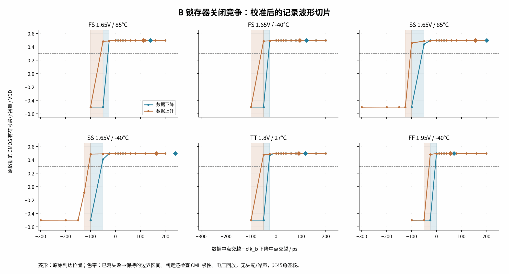

# TX B 组关闭竞争：带负载的记录波形切片

**六压力条件、两个数据方向的12组保持边界均已夹住；正常到达位置距离首个已测保持点最少70.45 ps。** 目标是把完整 bank 的关闭→数据交越间隔，转换为具有实际晶体管响应的确定性约束。记录波形切片未包含源阻抗变化、失配或噪声，不转为完整入口/45角保持签核。

## 切片与边界

上游固定为 `results/analog/tx/staggered_ingress/20261106T202607Z` 的完整16位 bank。每个条件分别选择**数据上升和下降方向中正常交越间隔最小的事件**，取该 lane 的 B 锁存器、CMOS→CML转换器、伙伴A转换器和一个实际首级MUX为下游。Q/伙伴线电容各2 fF，MUX输出每端5 fF，与原bench一致；偏置与PDK电阻tt继续用实际电路。

登记的边界是 `tx_staggered_b_launch_cut_v3`，见[边界目录](../../config/boundary_conditions.json)。复制的端口为实际CLK/CLK_b、伙伴A数据、选择sp/sn和内部h数据，包含原有接收器、反相器、16路负载形成的相对延迟与波形。脚本逐实例核对源deck与消费端输入级签名，并验证源raw/deck、物理依赖和PDK身份；没有“最新运行”查找或负载不匹配覆盖。

每个片段从目标B选择沿前4 ns开始，到选择沿后1.9 ns结束，共5.9 ns。起点B透明，由输入确定正确初态；保留前一个完整字周期，让锁存器、转换器、MUX的动态状态建立。只在目标选择沿前100 ps开始评估所需保持窗口，预历史不作为有效输出。

## 校准与扫描定义

首先不移动任何数据，回放正常边界。每个条件/方向都将Q、转换器两端和MUX两端与完整bank比较；所需窗口内的最大单端误差必须≤5 mV，才能开启该组扫描。12组全部通过，最大约3.07 mV。输入逐路对原记录比对，误差>200 µV的运行拒绝分析。

为避免ngspice控制指令的参数数量限制，PWL使用垂直误差≤10 µV的简化；超过短列表长度时改用向量装载。仍保留端点，不做时钟缩放、极性拟合或按角重新对中。长列表的实际电压源回归及简化误差边界已有测试。

扫描保持CLK/CLK_b、伙伴和选择端原样，仅平移记录的h数据。横轴为：

`Δ = 新数据VDD/2交越 − CLK_b下降VDD/2交越`

Δ是有符号的门限参考；晶体管的实际关闭不等于CLK_b的50%时刻，因此测得的所需保持边界可以为负。判定要求原数据在整个目标所选窗口内，CMOS有符号裕量>0.3 VDD、CML差分极性正确。不是只看末尾存储位，也不是只看MUX中点。

原始bench评估关闭沿附近的保持；独立收集器从B选择前100 ps一直检查到选择后1.9 ns，两种判定在粗扫中一致。边界函数要求同时观察失败和保持，且高Δ侧不能再失败；缺失、不单调或没有夹住的扫描不强行给出完整边界。

## 证据与使用

粗扫固定为 `results/analog/tx/hold_aperture/20261106T210129Z`：12个原样校准＋156个平移点，六条件各两方向。SS上升方向在−100 ps仍保持；`20261106T211416Z`只补这两组，各增加−300/−200/−150/−125 ps及自身原样校准，共2个校准＋8个平移点。两批合计14个校准、164个平移工况，全部达到实际瞬态终点；提前数据引起的失败和中间态原样保留。

| 条件 | 下降数据：最后失败 → 首次保持 / ps | 上升数据：最后失败 → 首次保持 / ps | 正常到达距首次保持点最小值 / ps |
|---|---:|---:|---:|
| TT 1.8 V 27°C | −50 → −25 | −100 → −50 | 141.29 |
| SS 1.65 V −40°C | −100 → −50 | −125 → −100 | 262.77 |
| SS 1.65 V 85°C | −100 → −50 | −125 → −100 | 251.44 |
| FS 1.65 V −40°C | −50 → −25 | −100 → −50 | 145.06 |
| FS 1.65 V 85°C | −50 → −25 | −100 → −50 | 161.56 |
| FF 1.95 V −40°C | −25 → 0 | −50 → −25 | 70.45 |

每个方向都取该方向的正常到达与自身边界比较，再在角内取较小值；不把上升方向55.62 ps的正常交越间隔与下降方向的边界混算。上述距离只相对首个已测保持点，不假定样点之间无失效窄区，也不作为随机抖动、统计失配或版图后裕量。源阻抗/Miller反馈、其他事件形状、输入DFF建立保持和完整串化的0.15 UI/75 mV仍需各自验证。

数据、来源哈希、每点判定及边界见[小数据](../data/tx_launch_hold_aperture.json)，[结果索引](../../results/catalog/tx_launch_hold_aperture.json)。[绘图/独立收集器](../../verification/plotting/tx_hold_aperture.py)无参数仅凭小JSON重画。改变数据尺寸、反馈强度、时钟形状/负载、源阻抗或失配模型后，需要重新校准和测量；这里两种事件形状不覆盖所有码型。

独立收集器核对归档源文件/消费端/边界哈希，从raw重新提取关闭与数据交越，并在完整目标所选窗口重测CMOS/CML保持；164点与bench判定无分歧。补扫要求自己的校准，重复offset不会按“最新一次”覆盖。全仓库73项测试通过，包含长PWL电压源真实输出、平移/简化误差与非单调边界拒绝。

实现：[加载切片](../../analog/tx/input_register/spice/launch_hold_slice.spice)、[运行入口](../../analog/tx/input_register/tb/hold_aperture/run.py)。新campaign先 `--baseline-only`；同一campaign再 `--resume`，脚本拒绝未校准的平移运行。`--conditions`、`--events`和`--offsets-ps=…`限定局部补扫，最多2 worker，按完整瞬态终点续跑。
