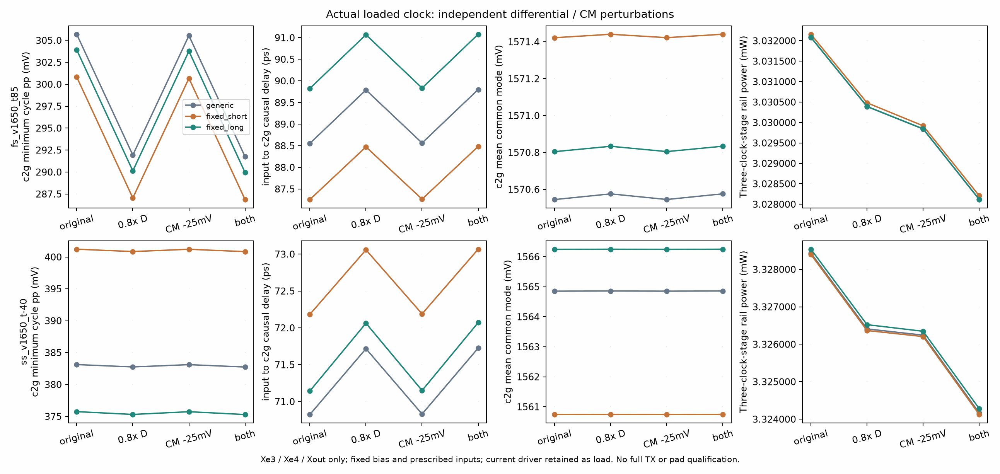
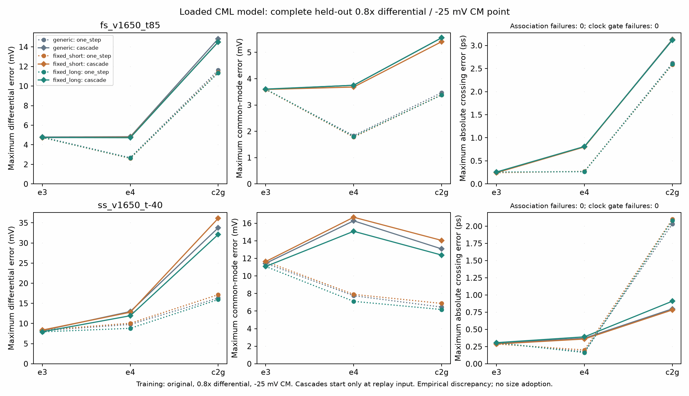
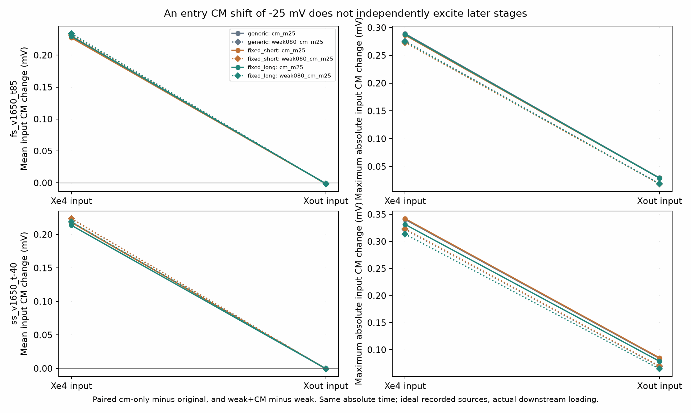
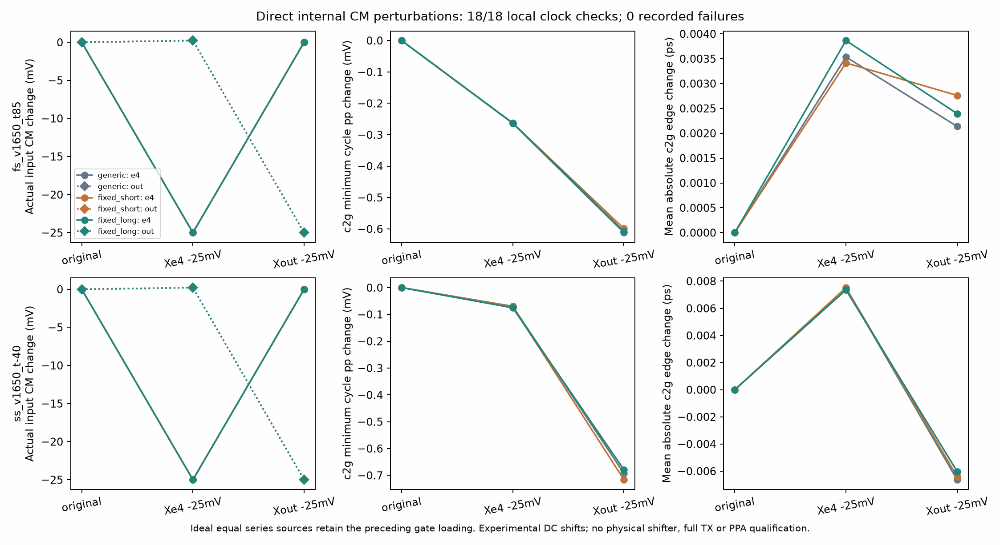

# TX 实际负载下的弱输入与共模卡

**两角四种输入、三种电阻实现的24条分支均满足本卡完整边沿及150mV幅度底线；七参数模型的组合留出误差仍不足以支撑选尺寸。尚不采用新尺寸。** 这张卡补齐Xe3→Xe4重负载→Xout的当前driver边界，承接[尺寸规划](tx_buffer_sizing.md)、[强输入宽度卡](tx_buffer_heavy.md)和[完整消费方需求](tx_retime_demand.md)。

## 电路与适用边界

- 来源是两条完整TX的分级WT14.4/15.6、R320候选记录，FS1.65V/85°C与SS1.65V/−40°C；它们用于研究弱输入，其中FS完整眼图未满足规格，并非采用的uniform extra5配置。
- 在`e2g_2`切开，保留Xe3/Xe4（WN24、WT15.6）、Xout（WN32、WT16）、实际末级保持/MUX，以及当前pre120/WT60/out192输出级、pad/package和RLC16负载。三个时钟级的负载与消费方都参与求解。
- 数据、输入时钟、bias与VDD使用明确登记的理想PWL。更换第一级电阻时负载签名会变化，登记为有意的电压源回放；未包含上游输出阻抗、bias反馈和共享电源响应。
- 共模扰动只施加在切口`e2g_2`，后两级输入共模由前级自然产生；没有直接独立扫描Xe4/Xout的输入共模。后级共模灵敏度的可辨识性仍有限。
- 三条独立数学分支只改变这三个时钟单元的电阻：原通用卡；短定宽2p85单只（R320 L1.64µm、R240 L0.83µm）；长定宽2p85双并联（R320每只L4.60µm、R240每只L3.15µm）。NF和WN/WT不变，后级仍使用冻结通用电阻。
- 定宽卡显式采用[接触立方项修正副本](fixed_poly_ac_overlay.md)，源PDK和默认库不变。本轮仅电阻tt角；几何合法与单点传递不代表无源全角资格。

输入四点为原样、差分×0.8、共模−25mV、两者组合；前3点预先指定为模型训练，组合点留出检验。原SS回放输入本身有2.86mV短暂超轨，基线如实保留；所有新增扰动均检查轨内。对内部幅度仍区分400mV目标和150mV硬底线，未采用新的上界。

## 基线校准

仿真6.5ns，保留word18 B边沿前4ns输入历史；受检窗口3.5–6.4ns。单端电压按原绝对时间比对Xe3、Xe4、c2g、qp/qn、两组保持与选择节点；门槛5mV。每一级上、下沿都独立配对，绝对沿误差门槛2ps。

| 条件 | 最大单端差 mV | Xe3 / Xe4 / c2g绝对沿差 ps |
|---|---:|---:|
| FS热 | 0.04515 | 0.00446 / 0.01255 / 0.01370 |
| SS冷 | 0.32717 | 0.01716 / 0.02300 / 0.02141 |

另外逐一要求核心输入窗3.5–6.2ns的每个边沿在200ps内有唯一因果输出；输出观察至6.4ns。这样首个/最后一个缺沿不会被剩余连续边沿掩盖。完整边沿与最小周期幅度分别记账，微小周期噪声不能算时钟通过。

| 条件 | 实现 | c2g最小周期pp mV | 输入→c2g平均传播 ps | 三时钟级电源 mW |
|---|---|---:|---:|---:|
| FS热 | 通用 / 短定宽 / 长定宽 | 305.695 / 300.830 / 303.919 | 88.553 / 87.254 / 89.824 | 3.03208 / 3.03216 / 3.03209 |
| SS冷 | 通用 / 短定宽 / 长定宽 | 383.120 / 401.213 / 375.743 | 70.824 / 72.183 / 71.143 | 3.32844 / 3.32840 / 3.32854 |

传播为核心窗上、下沿均值的平均，不取模周期。功耗只含三个时钟级的VDD×I，不含输入/bias理想源、上游时钟、串化器、driver或PLL，不能代替完整TX功耗。电阻变更在两条件下方向不同，不能由名义阻值或单一电容比例推全角。


## 差分与共模分离结果

八个完整点均完成6.5ns，三分支的每一级及输入→c2g均通过核心窗的完整因果边沿检查。下面列原通用电阻分支；三种实现的完整对照见图和[小数据](../data/tx_loaded_clock.json)。

| 条件 | 输入扰动 | c2g最小周期pp mV | 输入→c2g平均传播 ps |
|---|---|---:|---:|
| FS热 | 原样 / 差分×0.8 / 共模−25mV / 组合 | 305.695 / 291.930 / 305.543 / 291.749 | 88.553 / 89.790 / 88.563 / 89.800 |
| SS冷 | 原样 / 差分×0.8 / 共模−25mV / 组合 | 383.120 / 382.750 / 383.109 / 382.736 | 70.824 / 71.717 / 70.831 / 71.726 |

差分减弱对FS幅度影响明显，SS在该范围的幅度变化很小；两角的传播都增加约1ps。输入共模降低25mV的单独影响仅约0.01ps，但受检尾管余量下降约22mV；不能由此推断更大共模区间也不敏感。

所有输入管与尾管VDS−VDSAT均为正。跨四输入、三实现、三时钟级的最小尾管余量为FS349.33mV、SS434.11mV，输入管最小为490.71/535.48mV。三时钟级平均电源功率范围为FS3.0281–3.0322mW、SS3.3241–3.3285mW；本轮没有尺寸变量，微小变化不构成PPA选型。



## 预登记模型与留出结果

每个条件、每种电阻实现、每一级分别拟合，WN/WT固定。模型以差分D、共模C及VDD为输入，参数共7个：

```text
A = A0 exp[kcm(C−Cref) + k2(D²−D2ref)]
g = g0 sqrt(A/A0) exp[kg(C−Cref)]
目标差分 = A tanh(gD/A)；目标共模 = VDD−A/2
输入先经过非负显式延迟，再用同一正时间常数的一阶滤波得到差分和共模输出。
```

1ps采样，先前输入历史使模型建立；仅原样、差分×0.8、共模−25mV三点参与残差、初值及多起点选择，组合点完整留出。单步使用实测本级输入；三级级联只从`e2g_2`开始，后级不重置为实测值。Cref、D2ref仅由训练基线计算。此处g、τ和显式延迟是波形代理参数，不是器件gm或提取的独立RC。

| 条件 | 单步 / 级联最大差分误差 mV | 单步 / 级联最大共模误差 mV | 单步 / 级联最大绝对沿误差 ps |
|---|---:|---:|---:|
| FS热 | 11.621 / 14.834 | 3.604 / 5.556 | 2.618 / 3.131 |
| SS冷 | 17.157 / 36.127 | 11.638 / 16.682 | 2.100 / 0.910 |

表中跨三种电阻和三个受检输出取最大值，不同列可来自不同一级。组合点没有交越关联失败、完整边沿/幅度失败或模型预测超轨。18个优化器均收敛，但**12个拟合触及预设参数边界**：FS首级显式延迟接近0，FS末级kcm/kg和SS后两级kg触边。SS较小的级联交越误差伴随更大的电压误差，存在各级误差抵消的迹象，不能作为逐级模型改进或普遍优于单步的证据。

这次试验说明将差分和共模绑定到同一饱和值与时间常数的简化仍有明显不足；具体误差机制需再核查。不能放宽参数边界后继续把已看过的组合点称作独立留出。现有FS级联3.13ps误差已超过消费方约0.74ps的已观测窄余量，**本模型不用于宣布尺寸可行**，也不形成保证界或统计区间。器件余量、尾流与功耗来自晶体管波形，均未作为代理模型预测输出。



## 下一步

[WP-TX-CM-001交付复核](../work_packages/deliveries/WP-TX-CM-001.md)已量化这一缺口：入口−25mV扰动，在Xe4输入仅约+0.21…+0.23mV均值变化，在Xout输入小于0.002mV；均不是后级独立的25mV扫描。执行与集成者复跑的72输入、36配对和全部预测指标一致，未重新拟合旧留出点。



原组合点的fixed_long末级实测/预测波形：[FS](../figures/tx/ingress/tx_loaded_cm_fs_waveforms.png)、[SS](../figures/tx/ingress/tx_loaded_cm_ss_waveforms.png)。

`loaded_stage_cm/20261111T175916.434499Z_a555bbcc`在Xe4/Xout输入两腿各串相等的理想DC源，保留实际前后级。两角全部三分支零偏基线已复现：最大单端差FS5.53nV、SS18.22nV；最大沿差均小于0.000001ps。三种输入×两角×三种R的18条分支均通过局部完整边沿及150mV底线，发布器重读全部原始数据并逐项复算。此源只用于诊断，不是可实现的电平移位器；记录的VDD轨功耗也不含注入源能量。

| 条件 | 直接移动Xe4输入−25mV：c2g最小周期pp变化 mV / 平均绝对沿变化 ps | 直接移动Xout输入−25mV：c2g最小周期pp变化 mV / 平均绝对沿变化 ps |
|---|---:|---:|
| FS热 | −0.264…−0.263 / +0.0034…+0.0039 | −0.612…−0.599 / +0.0021…+0.0028 |
| SS冷 | −0.075…−0.070 / +0.0073…+0.0076 | −0.716…−0.679 / −0.0067…−0.0060 |

范围跨三种R和两个极性；各支实际被测输入均值变化接近−25.000mV，双腿理想源电压误差小于1nV。最小尾管余量为FS349.65/SS434.88mV，输入管最小490.71/535.48mV。本范围内的真实DC共模影响很小，未支持旧拟合里后级kg=20/V的强依赖；这说明该系数不宜解释为真实共模增益。结果不代表更大共模区间、AC共模/供电注入或全PVT资格。



直接卡[小数据](../data/tx_direct_stage_cm.json)、[索引](../../results/catalog/tx_direct_stage_cm.json)与`analysis/measurement.r2/summary.json`保留全部测量和源身份。新点为模型诊断/训练数据，未计为新的独立模型留出。

继续比较共模独立动态、输入电容馈通和模式相关负载等候选机制；目前仍是待检验假设，新模型须使用新增独立留出条件。尺寸主线回到当前采用的uniform extra5与完整TX负载，将合法电阻、真实参考及角点跟踪一起验证，再求WN/WT/R可行区。失败分级候选上的代理模型只是局部工具，不替代采用配置的实现与规格验证。

本卡还不提供完整载荷位映射/焊盘眼图资格、真实参考电阻跟踪、尺寸可行域、其他PVT、失配噪声或PEX。模型误差须与消费方仅0.74ps的已观测窄余量比较，不能直接据此采用尺寸。

## 证据与复算

Campaign：`results/analog/tx/loaded_clock_card/20261111T171205.027336Z_8881ed25`。边界ID：`tx_loaded_clock_20261111T171205_027336Z_8881ed25`。保留冻结电路、明确输入、每点冒烟与完整仿真、原始波形/终点/日志/哈希；中断后只补缺失点。

[基线小数据](../data/tx_loaded_clock_baseline.json)、[完整对照索引](../../results/catalog/tx_loaded_clock.json)和[模型索引](../../results/catalog/tx_loaded_clock_model.json)指向独立复算结果。完整测量为`analysis/measurement.r3/summary.json`，复核为`review/20261111T174430.556183Z_29ee993e/summary.json`，模型为`model/20261111T174505.452906Z_84e06f0b/summary.json`。两处发布器重读原始波形并复算指标；模型发布器按保存参数重演所有预测。测试台与发布器不改已有源记录。

```bash
uv run python analog/tx/input_register/tb/loaded_clock_card/run.py --resume results/analog/tx/loaded_clock_card/20261111T171205.027336Z_8881ed25
uv run pytest -q tests/test_pwl_sources.py tests/test_clock_transfer.py tests/test_loaded_clock_card.py
OPENBLAS_NUM_THREADS=1 OMP_NUM_THREADS=1 uv run python analog/tx/clock_distribution/theory/loaded_buffer_model.py --review results/analog/tx/loaded_clock_card/20261111T171205.027336Z_8881ed25/review/20261111T174430.556183Z_29ee993e/summary.json
```
