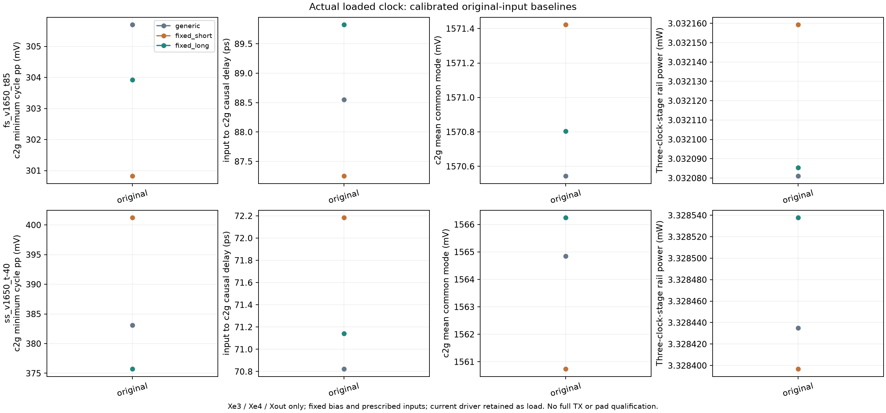

# TX 实际负载下的弱输入与共模卡

**局部测试台已在FS热角、SS冷角复现原完整TX的受检节点与绝对时钟沿，随后运行差分幅度与共模分离的对照。尚不采用新尺寸。** 这张卡补齐Xe3→Xe4重负载→Xout的当前driver边界，承接[尺寸规划](tx_buffer_sizing.md)、[强输入宽度卡](tx_buffer_heavy.md)和[完整消费方需求](tx_retime_demand.md)。

## 电路与适用边界

- 来源是两条完整TX的分级WT14.4/15.6、R320候选记录，FS1.65V/85°C与SS1.65V/−40°C；它们用于研究弱输入，其中FS完整眼图未满足规格，并非采用的uniform extra5配置。
- 在`e2g_2`切开，保留Xe3/Xe4（WN24、WT15.6）、Xout（WN32、WT16）、实际末级保持/MUX，以及当前pre120/WT60/out192输出级、pad/package和RLC16负载。三个时钟级的负载与消费方都参与求解。
- 数据、输入时钟、bias与VDD使用明确登记的理想PWL。更换第一级电阻时负载签名会变化，登记为有意的电压源回放；未包含上游输出阻抗、bias反馈和共享电源响应。
- 三条独立数学分支只改变这三个时钟单元的电阻：原通用卡；短定宽2p85单只（R320 L1.64µm、R240 L0.83µm）；长定宽2p85双并联（R320每只L4.60µm、R240每只L3.15µm）。NF和WN/WT不变，后级仍使用冻结通用电阻。
- 定宽卡显式采用[接触立方项修正副本](fixed_poly_ac_overlay.md)，源PDK和默认库不变。本轮仅电阻tt角；几何合法与单点传递不代表无源全角资格。

输入四点为原样、差分×0.8、共模−25mV、两者组合；前3点预先指定为模型训练，组合点留出检验。原SS回放输入本身有2.86mV短暂超轨，基线如实保留；所有新增扰动均检查轨内。对内部幅度仍区分400mV目标和150mV硬底线，未采用新的上界。

## 基线校准

仿真6.5ns，保留word18 B边沿前4ns输入历史；受检窗口3.5–6.4ns。单端电压按原绝对时间比对Xe3、Xe4、c2g、qp/qn、两组保持与选择节点；门槛5mV。每一级上、下沿都独立配对，绝对沿误差门槛2ps。

| 条件 | 最大单端差 mV | Xe3 / Xe4 / c2g绝对沿差 ps |
|---|---:|---:|
| FS热 | 0.04515 | 0.00446 / 0.01255 / 0.01370 |
| SS冷 | 0.32717 | 0.01716 / 0.02300 / 0.02141 |

另外逐一要求核心输入窗3.5–6.2ns的每个边沿在200ps内有唯一因果输出；输出观察至6.4ns。这样首个/最后一个缺沿不会被剩余连续边沿掩盖。完整边沿与最小周期幅度分别记账，微小周期噪声不能算时钟通过。

| 条件 | 实现 | c2g最小周期pp mV | 输入→c2g平均传播 ps | 三时钟级电源 mW |
|---|---|---:|---:|---:|
| FS热 | 通用 / 短定宽 / 长定宽 | 305.695 / 300.830 / 303.919 | 88.553 / 87.254 / 89.824 | 3.03208 / 3.03216 / 3.03209 |
| SS冷 | 通用 / 短定宽 / 长定宽 | 383.120 / 401.213 / 375.743 | 70.824 / 72.183 / 71.143 | 3.32844 / 3.32840 / 3.32854 |

传播为核心窗上、下沿均值的平均，不取模周期。功耗只含三个时钟级的VDD×I，不含输入/bias理想源、上游时钟、串化器、driver或PLL，不能代替完整TX功耗。电阻变更在两条件下方向不同，不能由名义阻值或单一电容比例推全角。



## 待完成

收齐两角四点后，复核完整边沿、周期幅度、输入管及尾管VDS−VDSAT、共模和三时钟级功耗。按预先记录的七参数模型分别拟合每一级及每种电阻实现，报告组合留出点的一步误差和三级级联误差，不用内部实测输出重置级联。

本卡还不提供完整载荷位映射/焊盘眼图资格、真实参考电阻跟踪、尺寸可行域、其他PVT、失配噪声或PEX。模型误差须与消费方仅0.74ps的已观测窄余量比较，不能直接据此采用尺寸。

## 证据与复算

Campaign：`results/analog/tx/loaded_clock_card/20261111T171205.027336Z_8881ed25`。边界ID：`tx_loaded_clock_20261111T171205_027336Z_8881ed25`。保留冻结电路、明确输入、每点冒烟与完整仿真、原始波形/终点/日志/哈希；中断后只补缺失点。

[基线小数据](../data/tx_loaded_clock_baseline.json)、[索引](../../results/catalog/tx_loaded_clock_baseline.json)指向独立复算结果。测试台与发布器不改已有源记录。

```bash
uv run python analog/tx/input_register/tb/loaded_clock_card/run.py --resume results/analog/tx/loaded_clock_card/20261111T171205.027336Z_8881ed25
uv run pytest -q tests/test_pwl_sources.py tests/test_clock_transfer.py tests/test_loaded_clock_card.py
```
