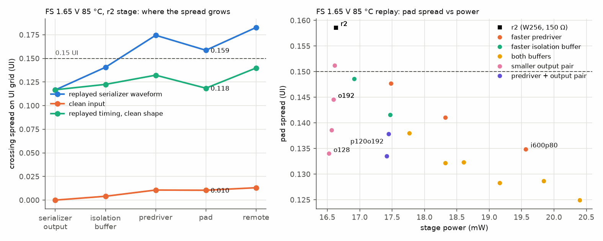

# TX 输出级（r2）

> **当前修订**：TX r2 `serdes_tx_cml_line_driver_lowvt_enable`（[网表](../../analog/tx/output_driver/spice/cml_line_driver_lowvt_enable.spice)，[配置](../../config/tx_working_revision.toml)）。相对 v0.1 只改了尾偏置使能传输门。
> **关键数字**：45 条件从禁用初态启动全部正常；使能后最晚 2.413 ns 尾偏置进入 1% 误差带；启用线电流 7.51–8.02 mA，关闭残流 ≤ 1.15 nA。
> **主要缺口**：焊盘/封装/ESD 为代理参数；无 FFE；电源与回流理想。
> **工作候选（2026-11-08）**：预驱动 120 Ω / 尾 60 µm、输出对 W192，实例参数覆盖（`rpre=120 wtpre=60 wout=192`），网表默认仍为 r2。完整 TX（extra5）FS 1.65 V 85 °C 焊盘散布 0.158 → 0.138 UI，TT/SS 不变，+0.8 mW。见[串化器到焊盘的散布增量](#串化器到焊盘的散布增量2026-11-08)。
> **耦合状态补充（2026-11-12）**：当前候选已完成理想源/通用R tt下完整TX 45点，但4ns使能、10nF/腿、8–120ns的记录包含充电历史。[局部初态对照](tx_coupling_state.md)直接测得端接导电峰值可由旧短窗估计4.69mA提高到已使能DC初态下6.62mA；干净输入眼图仍满足。实际串化器源下的耦合建立状态、定宽R和完整启动继续补，不将新局部结果当作整链资格。

## 电路

| 部分 | 参数 |
|---|---|
| 隔离 buffer | W = 12 µm、尾 12 µm、600 Ω |
| 预驱动 | W = 48 µm、尾 48 µm、150 Ω；独立电源 `vdd_pre` |
| 输出对 | LVT W = 256 µm、16 指 |
| 尾管 | W = 172 µm、L = 0.5 µm、16 指（约 8 mA） |
| 源端 | 两只 50 Ω 上拉到 `vdd_out` |
| 使能门（r2） | N-LVT W2/L0.15 + P-LVT W32/L0.35（4 指，井接 VDD）；关断时下拉 W1 |

双端端接时每端交流负载约 25 Ω，Vdiff,pp ≈ 2 × I_tail × 25 Ω，400 mVpp 约需 8 mA。`tx_en` 低时关闭线尾电流（预驱动不掉电），给 AC 耦合链路提供对称的直流起始状态。

**为什么改使能门。** v0.1 的传输门在 SS/1.65 V/−40 °C 下给尾管栅极充电过慢：30 ns 约 0.817 V、90 ns 约 0.922 V（目标约 1.060 V），96 ns 内未进入 1% 误差带，远端最小裕量只有 31.78 mV。理想钳位定位后恢复到 151 mV。r2 改用低阈值 N/P 传输门（比较 Wp = 16/32/64 µm，选 32 µm），不强制钳位。另有两个未采用的候选：独立井偏置开关 (`../../analog/tx/output_driver/spice/cml_line_driver_biaswell_candidate.spice`, retired in `retired_legacy_vars_20261120.json`)、源端 footer (`../../analog/tx/output_driver/spice/cml_line_driver_footer_candidate.spice`, retired in `retired_legacy_vars_20261120.json`)。来源：[TX PVT](../history/tx_pvt.md)。

## 已验证结果

### r2 独立输出级与 DC（45 条件）

| 项目 | 结果 |
|---|---|
| 从禁用直流态启动，4 ns 使能，256 bit | 45/45 功能 |
| 尾偏置进入 1% 误差带（最晚） | 6.413 ns（使能后 2.413 ns）；SS 冷角约 2.107 ns |
| 启用直流线电流 | 7.51–8.02 mA |
| 关闭残流 | ≤ 1.15 nA（预驱动仍耗电） |

来源：[TX r2 记录](../history/tx_optimization.md)、[数据](../data/tx_optimization.json)。

### 名义特性（v0.1 输出核心，TT，理想 400 mVpp 输入）

| 夹具 | 远端差分峰峰值 | 最小位中心裕量 | 边沿散布 | 错误 |
|---|---:|---:|---:|---:|
| 匹配信道 | 399.3 mV | 194.9 mV | 0.0053 UI | 0/256 |
| RC 损耗示例 | 351.0 mV | 168.7 mV | 0.0083 UI | 0/256 |

稳态功耗：预驱动约 4.82 mW + 线输出约 14.10 mW ≈ 18.92 mW，独立偏置参考另 1.53 mW。输入每端有效电容约 17.49 fF（2 GHz，平衡 1.68 V 工作点）。来源：[输出级与链路路线](../history/tx_output_stage_and_link_plan.md)。

### 接 PCB

v0.1 串化器 + 输出级接 C2 6 dB 时，远端采样眼高比近无损下降约 59%，总峰峰值只降约 7%——总摆幅不能代替采样裕量。r2 在 4 个选定工况接 C2 全部零错误，最小远端裕量 54.81 mV（FS/1.65 V/85 °C），见 [TX 串化器](tx_serializer.md)、[信道模型](channel_model.md)。

## 串化器到焊盘的散布增量（2026-11-08）

**焊盘比串化器多出的散布来自串化器输出的幅度 ISI 在两级近线性缓冲中的累积，不是输出级自身的数据相关抖动。** extra5 完整 TX 的 FS 1.65 V 85 °C 点，串化器 0.115 UI → 焊盘 0.158 UI。同一输出级接干净输入只加 0.010 UI；接串化器的实际过零时刻、但用干净波形，也只加 0.003 UI。只有回放串化器的实际波形（位中心只到满幅的 55–85%，沿速 1.35–2.45 V/ns）才复现 +0.042 UI：隔离 buffer（增益约 1.1）+0.024，预驱动（约 1.2）再 +0.034，输出对接近全开关、恢复 −0.016。逐沿配对（130 个载荷跳变）显示增量与串化器自身残差相关 0.68（窄脉冲被进一步压窄），与前序游程相关 0.45（游程 1 之后约提前 0.02 UI）。

**改法：加快预驱动、减小输出对栅负载。** 预驱动 150 → 120 Ω、尾 48 → 60 µm（摆幅不变），输出对 W256 → W192；隔离 buffer 不动，串化器节点的负载因此不变。完整 TX 三个压力点：

| 条件 | 焊盘散布 r2 → 候选 / UI | 焊盘裕量 / mV | 焊盘 pp / mV | 远端散布（比较） / UI | 串化器 |
|---|---:|---:|---:|---:|---|
| TT 1.8 V 27 °C | 0.0776 → 0.0763 | 194.3 → 192.4 | 427 → 428 | 0.0712 → 0.0705 | 135.7 mV / 0.0599 UI，不变 |
| FS 1.65 V 85 °C | **0.1584 → 0.1379** | 137.7 → 136.0 | 385 → 376 | 0.1802 → 0.1601 | 103.1 mV / 0.1152 UI，不变 |
| SS 1.65 V −40 °C | 0.0562 → 0.0545 | 208.1 → 205.9 | 477 → 482 | 0.0517 → 0.0493 | 124.0 mV / 0.0438 UI，不变 |

三点均 22 个有效字、256 位零错、训练/marker/位映射原序，计数、捕获、保持、RTL 标签正确。单级回放对 FS 的预测是 0.138 UI，与完整 TX 的 0.1379 一致。代价：FS 焊盘摆幅 385 → 376 mVpp（W192 的过驱动更高，开关略不完整），输出级功耗约 16.6 → 17.4 mW（FS）。远端仍 0.160 UI，属于信道，只作比较。

### 方法

单级 bench [`analog/tx/output_driver/tb/ddj`](../../analog/tx/output_driver/tb/ddj/run.py)：只放输出级，外围与完整 TX 相同（qp/qn 各 2 fF、焊盘 200 fF、封装 0.3 Ω / 0.5 nH、AC 10 nF、RLC16、远端 50 Ω 到 0.9 V），实际偏置、PDK 电阻，单点约 25–40 s。三种输入：干净 NRZ（可调共模、沿、幅度）；串化器实际过零时刻 + 干净波形；完整 TX 串化器输出的电压回放（边界 `tx_extra5_serializer_output_v1`，三点，PWL 误差 0.2 mV）。输入在工作点平衡、1 ns 后进入首位，否则 AC 电容会一直保持首位的直流差分（完整 TX 中远端均值在 7 mV 以内，即平衡）。

回放校准（r2 输出级，对完整 TX）：焊盘过零时刻差峰峰 0.29 / 0.43 / 0.20 ps（FS / SS / TT），散布 0.159 / 0.056 / 0.077 UI 对 0.158 / 0.056 / 0.078。电平误差 8.8 / 16.7 / 5.0 mV，超过 5 mV 波形门槛：它与符号相关（SS 焊盘为正时 −10.4 mV、为负时 +10.95 mV），即回放摆幅小约 2.5% / 5%，不在沿上。完整 TX 没有保存 vbias，原因未测；候选是共享 vbias 上其他尾管的反冲。因此回放只用于时序结论，裕量以完整 TX 为准。

尺寸图（FS 回放，焊盘散布 / 功耗）：预驱动 120 / 100 / 80 Ω 为 0.148 / 0.141 / 0.135 UI、17.5 / 18.3 / 19.6 mW；隔离 buffer 450 / 300 Ω 为 0.149 / 0.142；输出对 W224 / 192 / 160 / 128 为 0.151 / 0.145 / 0.139 / 0.134，功耗不变，焊盘摆幅 383 / 380 / 374 / 364 mVpp；两级合用约为两者之和略少。TT 与 SS 回放下这些变体的焊盘散布不变（±0.002 UI）。改隔离 buffer 会改变串化器负载，回放不再可信，未作为候选。

45 条件单级检查（干净输入，共模 VDD − 80 mV，r2 对候选）：45/45 功能正常；输出级自身散布 ≤ 0.010 → ≤ 0.006 UI；焊盘裕量 183–207 → 180–205 mV（每点 −2.2 至 −3.6 mV）；焊盘摆幅 394–481 → 390–497 mVpp，最低是 FS/SS 1.65 V 85 °C（390），最高是 FF 1.95 V −40 °C（497）；功耗 +0.8 至 +1.2 mW。数据：[tx_output_driver_ddj.json](../data/tx_output_driver_ddj.json)；完整 TX 运行：`results/analog/tx/parallel_serializer/20261107T19181{5.971080Z_4478c5e0,2.302165Z_70bed8e9,09.308741Z_fc64e6a1}`（TT/FS/SS），探针 `20261107T1908{34.490889Z_6f3a9e94,32.443952Z_50390fa5,36.513627Z_d12721c4}`；`full_serializer/run.py probe --driver-params` 把覆盖参数写进探针边界，动态运行继承。

## 适用范围

- 焊盘 200 fF、封装 0.5 nH、AC 每端 10 nF、远端偏置 0.9 V 都是探索参数，不是提取或真实 ESD 单元。
- 电源理想；未测电源阻抗、回流电感、PSRR 和偏置反向扰动。
- 400 mVpp 是目标幅度，PVT 幅度容差尚未定义。
- 当前候选已有完整TX 45条件的有限使能/电荷历史记录；实际源的耦合建立状态、物理定宽R、噪声失配和启动资格另计，见[状态与电流补证](tx_coupling_state.md)。

## 待解决

- 焊盘/ESD/封装模型，供电与回流（[问题清单](../status/open_issues.md) I-29）。
- FFE（主抽头 + 一后游抽头的预留方向）在确定信道和 RX 眼图需求后再定。
- 链路级远端/CTLE 后眼图门槛（I-20）。
