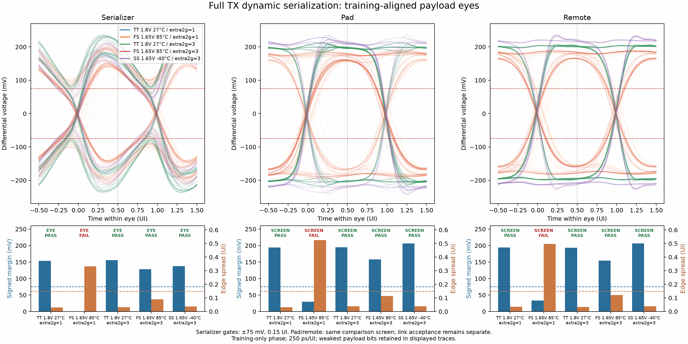

# TX 字入口、时钟分发与完整串化

**新字入口接实际v3完整TX后，末级选择时钟改进已在TT、FS低压热角及SS低压冷角恢复串化器眼图门槛。** FS原实现0.52 mV/0.333 UI失败；2 GHz路径额外中间缓冲从1增至3级后，128.29 mV/0.08961 UI，额外交越、训练/marker错误均消失。TT回归155.68 mV/0.03137 UI。原失败保留为对照；当前仅为三条件、各256 bit确定性工作态验证，内部时钟摆幅、全PVT、启动、失配和噪声仍未闭合。

## 电路和边界

物理链路为：理想 2 GHz 差分源 → v3 同步计数器/复制分发 → 实际 250 MHz 字时钟接收/缓冲 → 16 位精简 DFF → 两组互补保持 → 16 路 CMOS→CML → r2 四级选择树/末级重定时 → 实际 r2 线驱动 → 焊盘/封装代理及 RLC16。采用真实带隙/电流分配、PDK 电阻 tt；Q 线负载为 2 fF。与首级试验不同，MUX 输出已加载后续电路，没有使用首级输出的 5 fF 代理。

2 GHz 源为规定的理想 400 mVpp、30 ps 边沿，共模 VDD−0.25 V；其余三个源仅驱动 v3 保留的输入负载。当前没有接入 VCO/PLL。同步计数器带已记录的 `.ic` 工作态辅助；偏置采用 DC 工作点，不是电源斜坡启动。线驱动由bench在4–4.1 ns开放，之后常开，未由guard或启动质量判据控制blank。焊盘、ESD 和封装为代理，不是提取寄生。

上游已在 PHY 字时钟域。先在同一物理负载、静态数据条件记录字时钟，再按登记的事件边界运行真实 `tx_ingress_control` RTL，生成数据与 A/B 标签 PWL；动态 SPICE 验证实际捕获沿距事件模型不超过 100 ps、输入在捕获前后各 500 ps 稳定，以及捕获字和选中半字。数据变动相对下降沿固定后移 100 ps，不从串行输出拟合输入发数相位。

guard 的数据选择及标签是 **RTL 输出波形回放**，尚无标准单元路径延迟或实际模拟标签接收器。标签只说明输入字有效，不能直接作为线驱动使能。系统 FIFO/CDC、clock_good 生成、复位释放及训练/开放协议另行实现。

75 mV / 0.15 UI是串化器评分门槛，2026-11-08起焊盘也按同一门槛评分；RLC16远端使用相同数值作比较screen，图中单独标出，不能替代尚未定下的链路级接收门槛。下文早期结果中焊盘仍标作比较screen，按当时规则记录。

## 已测结果

下表为extra2g=1的原实现；改进结果另列，旧失败不重新评分。

| 条件 | 测点 | 载荷错误位数 / bit | 位中心最小有符号裕量 / mV | 边沿散布 / UI | 位映射 |
|---|---|---:|---:|---:|---|
| TT 1.8 V 27°C | 串化器 | 0 / 256 | 153.71 | 0.02930 | 0–15 |
| TT 1.8 V 27°C | 焊盘 | 0 / 256 | 194.30 | 0.03235 | 0–15 |
| TT 1.8 V 27°C | RLC16 远端 | 0 / 256 | 193.89 | 0.03437 | 0–15 |
| FS 1.65 V 85°C | 串化器 | 0 / 256 | 0.52 | 0.33258 | 0–15；额外交越2次 |
| FS 1.65 V 85°C | 焊盘 | 0 / 256 | 29.42 | 0.52529 | 0–15 |
| FS 1.65 V 85°C | RLC16 远端 | 0 / 256 | 33.58 | 0.49765 | 1–16纯延时；训练标记1错 |

TT 固定为 `results/analog/tx/parallel_serializer/20261107T044921Z`，完成 120 ns。22 个有效字包含 64 bit 训练、256 bit 载荷及 32 bit 尾保护；计数器在完整帧内 175 个采样均连续。还检查预热后 idle 字与退出过程，27 次捕获的输入数据均正确；26 个完整半字窗口通过，末个 idle 的 B 窗口超出仿真终点，记为未评分，不补成通过。所有 22 个有效字具有完整保持窗口。

FS固定为`20261107T051545Z`，完整120 ns，求解约843 s。22个有效字捕获、选中半字保持、RTL事件标签对齐和完整帧计数通过。串化器未过规格并存在额外交越，焊盘/远端比较screen也失败，远端另有训练标记错误。位中心零错和纯延时位序诊断不覆盖这些失败；该原实现结论保持失败；后续内部追踪和局部切片已定位末级建立时间不足，见下文。

已有raw的逐位诊断将低裕量集中到slot 8：三个节点最差载荷样点均为bit 232，bit 104/296也低；串化器其他槽最小111–133 mV，TT各槽154–164 mV。FS远端marker错误位为48，也在slot 0的帧边界，不能只按“bit 8相关”排除其他路径。变化输入的Q与转换器`din_b`最近交越分别领先半字选通至少约1.137/1.100 ns，但这不是完整路径建立裕量。后续已检查末级保持关闭，首级半字A/B与末级奇偶A/B按不同层次区分；[诊断交付与定义](../work_packages/deliveries/tx-parallel-diagnostic.md)。集成者独立复跑为`results/analog/tx/parallel_diagnostic/20261107T053454Z`，与首轮逐槽数据一致。

SS 1.65 V −40°C只完成48 ns静态数据时钟探针`20261107T051615Z`，连续计数和末段字时钟周期满足事件录制门槛，动态生产激励已登记准备。该结果不补成SS动态通过。首次进程中断没有完整raw，原目录保留；断点续跑在`run.r2`完成。

逐位检查的相位只由训练得到，UI 固定 250 ps，不用载荷拟合频率或相位；`bit_mapping` 另作位序诊断。图中的眼图从训练相位对齐。位中心与散布是确定性短码型测量，不是 BER 或随机抖动结果。

[小数据](../data/tx_parallel_serializer.json)和[索引](../../results/catalog/tx_parallel_serializer.json)记录原 raw、实际 deck、probe、RTL 事件清单与各自 SHA。采集器独立重读 raw、重算逐位检查和位映射，再核对 summary；输入保持、标签及计数器字段的引用来源另行注明。

## 迭代选择与未完成事项

旧 r2 依靠独立分频器的八状态置换表，当前 v3 的三个计数位由同一计数序列约束；二者状态语义不同。当前只在实测边界确认 identity。旧 `tx_word_remap` 及新 `tx_ingress_preprocessor` 保留为 legacy 适配器，不插入当前 v3 数据路径。详见[返工分类复核](../work_packages/deliveries/tx-rework-review.md)。

[末级建立时间诊断与短切片](tx_final_retime.md)确认FS的g3过零晚于末级A关闭5–6 ps。原样切片复现后，先做记录时钟平移，再比较实际缓冲级；选择extra2g=3进行完整TX确认，末级MUX尺寸未变。该改进挂在T02选择时钟分发下，T03保留局部允许窗证据。

| extra2g=3 条件 | 串化器裕量 / mV | 串化器散布 / UI | 焊盘比较screen / mV、UI | 远端比较screen / mV、UI |
|---|---:|---:|---|---|
| TT 1.8 V 27°C | 155.68 | 0.03137 | 194.48、0.03931 | 193.40、0.03388 |
| FS 1.65 V 85°C | 128.29 | 0.08961 | 157.60、0.11354 | 154.36、0.12091 |
| SS 1.65 V −40°C | 137.61 | 0.03607 | 206.60、0.03872 | 206.04、0.03783 |

三点均完成120 ns、22有效字、256载荷零错、175个计数采样连续；27次捕获正确、26个完整半字窗口保持正确（末个idle窗口超终点记未评分），标签事件对齐。训练/marker错误、缺失和额外交越均为0，三测点位映射均为自然0–15。输出相位仍只由训练确定，未拟合载荷。

TT改进为`parallel_serializer/20261107T100515.229352Z_d90f2835`，FS为`20261107T100515.224129Z_ed0ba659`，求解分别约957/869 s。各自使用重新录制的48 ns静态字时钟边界（`095618Z`、`095655Z`）；新的动态deck同时保存内部节点。独立采集器验证归档hash、完整终点并重算眼图与位映射，图例明确区分extra=1/3。

SS低压冷角也完成120 ns动态验证：`parallel_serializer/20261107T103131.308549Z_aaefb4bc`，约731 s，使用extra3探针`20261107T102256.665455Z_13ffdb28`重新登记事件、运行Icarus生产者后接入；捕获/保持/计数/标签和三测点自然位序均正确，训练/marker/缺失或额外交越为0。其pad/remote峰峰值约481/468 mV，超过400目标/上界，内部幅度也未整体闭合；表中只评分眼图/位序。

随后安排其余MOS、长码型、hh/ll、源阻抗/失配/噪声和45 PVT。同一改进尚未成为全角资格结论。内部时钟摆幅I-17保持开；guard需完成实际接口参数与SS时序迭代，之后接驱动blank和有效字启动协议。原生PLL时钟采用已登记负载边界单独复核。

随后为降低c2g超幅而测试输出WT16/R240（extra3不变）：TT/FS均完成120ns，捕获/保持/计数、自然位序、训练和256bit载荷正确；TT眼图132.38mV/0.05047UI满足，FS为106.35mV/**0.18025UI**而失败，不采用该尺寸。c2g载荷窗峰峰值约369/349mV，其余内部超幅仍开。见[缩摆幅完整对照](tx_final_retime.md#缩摆幅的完整tx确认)和[逐节点幅度图](tx_cml_amplitude.md)。

## 复跑入口

电路：[capture_serializer16.spice](../../analog/tx/input_register/spice/capture_serializer16.spice)。测试：[full_serializer/run.py](../../analog/tx/input_register/tb/full_serializer/run.py)。每点 `probe → prepare → RTL producer → run`；probe 和 run 的源、负载、布线与计数器初态签名必须一致。`run --resume <campaign>` 保持已渲染快照，只补缺失或截断的运行；完整波形只生成新的分析记录，不再启动仿真。

图：[tx_parallel_serializer.py](../../verification/plotting/tx_parallel_serializer.py)，重复 `--collect <campaign>` 可合并固定条件，只读原结果。尚未完成或不一致的输入会被记录并使命令失败，不丢掉失败项。
