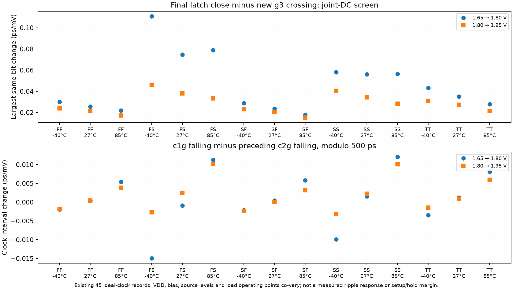

# TX供电与相对时序：旧45点的直流筛选

**已复算当前完整TX的45条原始波形，形成15组同工艺/同温的三电压比较。** 同位号“末级关闭−新g3交越”的最大相邻电压斜率为0.1108ps/mV，出现在FS/−40°C、bit296的1.65→1.80V段。它用于选择局部补测角，不是固定quiet供电下的小信号Kd或纹波验收。

每组有64个三电压共同、唯一关联的新输入事件，覆盖偶/奇两支路和上/下两方向各16个。每条原始波形的另外66个串化转换沿沿用同一支路上一位的数据，不分配虚构的新g3交越。本轮实际核对2880个新输入事件；仅统计原载荷中伴随串化输出转换的事件，不覆盖全部可能码型。

## 相同事件随电压怎样移动

下表使用同一bit296（偶支路、新值为0），不是把不同电压各自的最差位混在一起：

| 工艺/温度 | 1.65V，关闭−g3 ps | 1.80V ps | 1.95V ps | 两段斜率 ps/mV |
|---|---:|---:|---:|---|
| FS/−40°C | 75.45 | 92.07 | 98.91 | +0.1108 / +0.0456 |
| FS/85°C | 66.96 | 78.77 | 83.47 | +0.0788 / +0.0314 |
| SS/−40°C | 89.17 | 97.90 | 103.96 | +0.0582 / +0.0404 |

这两个相邻区间的斜率明显不同，不能把跨300mV的平均值当作±5mV扰动的线性系数。相对时钟量`c1g下降−前一个c2g下降`也逐周期测量，45周期/点；其相邻电压斜率最大绝对值0.01491ps/mV，同样在FS冷角。它是模500ps的静态相位间隔，不是绝对路径群延迟。

这组结果说明后续补测不应只选FS热角：FS冷角虽在既有完整TX眼图门槛内，仍是相对时序供电敏感的压力点。FS热保留最紧眼图/建立关系，SS冷保留幅度及加载压力；三者优先补局部分域小扰动及动态响应。

## 事件关联与范围

先从训练确定相位、按原位号还原实际串化交越，再找其之前250ps内唯一的实际本地关闭沿。A为偶支路、sap−san下降；B为奇支路、sbp−sbn上升。g3目标方向交越在`[关闭−500ps, 关闭+250ps]`内必须唯一；新值由`bit[k] != bit[k−2]`判断。非唯一则记未定，不选最近点补齐。

两支路g3数据一同更新，但奇支路稍后才关闭。原FS波形中bit69的有效g3比奇支路关闭早367.4ps，用统一±250ps窗口会漏掉它。这里扩大的是被动观测窗口，未移动输入或电路；旧[两点极值图](tx_retime_demand.md#最差边沿的物理区别)继续保留原有窗口及未定记录，不追改历史结果。

固定源为`full_pvt45/20261107T200334Z`：extra5各中间级WT16/R400、输出WT16/R240，driver pre120/WT60/out192；理想2GHz、真实偏置、PDK R tt、初始化计数器、RTL控制事件回放。逐点复用原完整TX独立重算器，核对实际源/快照、执行/终点、字入口、计数、原眼图与自然映射，并保存raw/summary/deck等身份；45点的序列身份一致。

该三电压变化同时改变全TX供电、真实偏置、上游理想时钟共模/CMOS电平及负载工作点。可能存在共同变化抵消；不能把这些斜率当作VCO quiet固定、仅宿主单独扰动时的AC PSRR，也不能拿它与PLL反馈的2.1ps/mV作同边界优劣比较。60–412ps的被动交越间隔不是实测setup/hold余量；完整45点功能资格仍受原边界限制。

下一张局部卡在固定登记输入/负载下分别扰动宿主与偏置，记录关闭、数据到达和输出交越；用±5/±10mV核对非线性，再挑关键频率校准复数响应。缓冲链sizing同时加入相对时序导数，不从本次粗差分直接求新尺寸。PLL反馈与参考副本的独立复核见[供电延迟报告](pll_timing_supply_review.md)。

[分析器](../../verification/analysis/tx_relative_timing_screen.py)、[数据](../data/tx_relative_timing_screen.json)、[索引](../../results/catalog/tx_relative_timing_screen.json)。运行`uv run python verification/analysis/tx_relative_timing_screen.py`只读旧结果，分析/源码快照追加到新目录；不启动ngspice。
