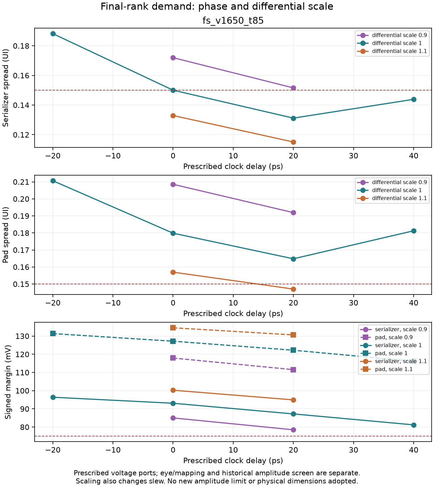
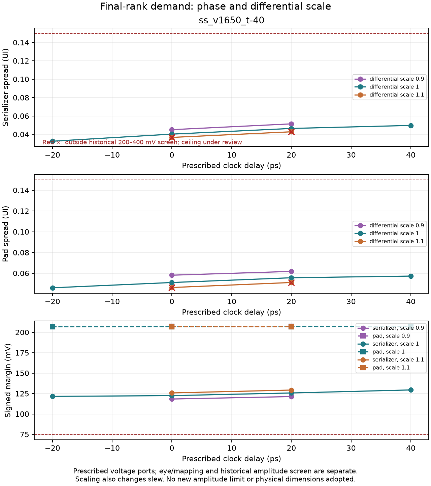
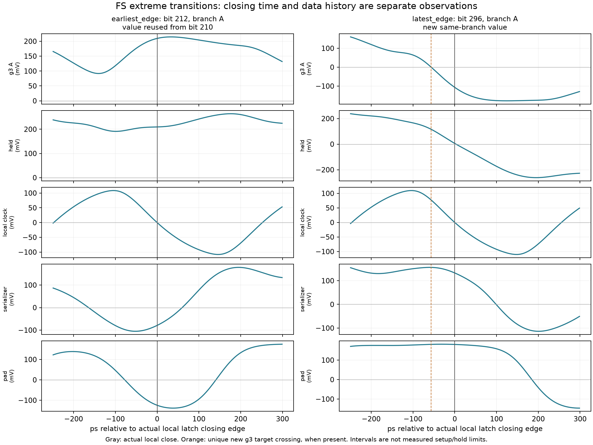
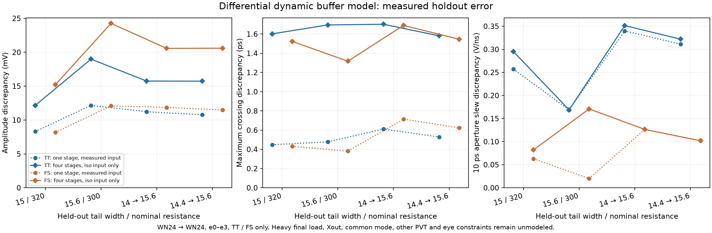

# TX：先建立末级需求，再求缓冲器尺寸

**FS/SS完整载荷需求卡各八点已完成，物理尺寸尚未选定。** FS只在“+20ps、差分×1.1”这个受检点两端门槛同时满足，焊盘余量仅0.74ps；SS八点眼图及位序均满足，其中两点输入424mVpp偏离原400mV目标。内部上界正在[复核](cml_swing_target.md)，该幅度本身不作为物理失败证据。TT/FS前四级动态模型也已有真正留出验证。下一步补重负载末级、共模及其余压力角，再把各角允许输入范围映射到共同物理尺寸。

## 消费方边界与原样复现

消费电路保留实际末级偶/奇保持与MUX、当前 pre120Ω/WT60µm/out192µm 驱动，以及2fF串化节点、200fF焊盘、封装、10nF隔直、RLC16通道和100Ω远端负载。输入是新完整 FS 热角、SS 冷角保存的 g3 两对、c2g、两路偏置和VDD。直接负载逐行核对，晶体管、PDK R及源快照均绑定身份。

回放整个保存历史及256bit载荷；前加250ps的首值保持，并从电气空闲启用驱动。前缀只建立状态，不作启动证明。原始串化器、偶/奇保持、本地选择和焊盘共12个单端波形，在完整载荷窗须≤5mV误差；串化与焊盘每个绝对转换沿须≤2ps误差，之后才允许扰动。训练相位重算仍只使用训练段，UI固定250ps；另外独立检查16位映射。

| 条件 | 最大单端误差 mV | 串化最大绝对沿误差 ps | 焊盘最大绝对沿误差 ps | 基线结果 |
|---|---:|---:|---:|---|
| FS 1.65V/85°C | 0.516 | 0.0087 | 0.1875 | 校准通过；原焊盘散布失败仍复现 |
| SS 1.65V/−40°C | 0.932 | 0.0125 | 0.1327 | 校准通过；自然位序正确 |

[数据](../data/tx_retime_demand_baseline.json)、[索引](../../results/catalog/tx_retime_demand_baseline.json)固定 `retime_demand/20261111T065010.025374Z_05fb2e30`。基线校准成功不表示候选通过：FS串化0.150044UI、焊盘0.179851UI，仍不满足门槛；SS眼图满足，源缓冲链各节点的幅度适用范围与余量仍待复核。

## 需求卡的变量与判据

预声明八点：原样；仅相位−20/+20/+40ps；仅差分倍率0.9/1.1；+20ps分别配0.9/1.1。缩放保持瞬时共模和过零，但同比改变差分slew，因此没有把幅度与slew当作两个独立变量。相位移动两个c2g端，其他输入不动。

倍率和相位增量都相对各角的原始记录。相同倍率不是跨PVT通用的晶体管尺寸参数；比较各角需求时须换算为实际幅度、slew、共模及数据/时钟关系。最终共同尺寸的每角模型输出应分别落入对应消费方区域，不能仅因同一个归一倍率不通用就判结构无解。

每点测串化器与焊盘的256bit功能、训练/marker、缺沿/额外交越、75mV裕量、0.15UI散布及独立位映射；时钟完整周期200mV设计目标和原400mV上界另查。`clock_200to400_observation`、`local_demand_screen`保留旧筛查含义；当前眼图/位序看`outputs.meets_eye_and_mapping`，不能把旧幅度筛查越界直接解释成物理失败。即使消费方窗口满足，也只是所记录数据/偏置/负载下的输入需求，实际缓冲链的源阻抗、偏置反馈、共模变化和PVT仍须回归。

每个“条件×需求点”独立deck，完整终点与成功执行记录同时成立才复用。缺执行记录、截断或失败尝试可回退较早有效结果；成功记录的参数或deck身份不符直接拒绝。对应[恢复测试](../../tests/test_tx_retime_demand.py)已有10项无仿真故障检查。

### FS八点实测

| 时钟延迟 ps | 差分倍率 | 串化裕量 mV | 串化散布 UI | 焊盘裕量 mV | 焊盘散布 UI | 两端需求筛查 |
|---:|---:|---:|---:|---:|---:|---|
| 0 | 1.0 | 93.08 | 0.15004 | 127.17 | 0.17985 | 失败 |
| −20 | 1.0 | 96.39 | 0.18822 | 131.36 | 0.21065 | 失败 |
| +20 | 1.0 | 87.22 | 0.13119 | 122.21 | 0.16481 | 焊盘失败 |
| +40 | 1.0 | 81.20 | 0.14388 | 116.14 | 0.18126 | 焊盘失败 |
| 0 | 0.9 | 85.02 | 0.17200 | 117.93 | 0.20855 | 失败 |
| 0 | 1.1 | 100.24 | 0.13294 | 134.53 | 0.15696 | 焊盘失败 |
| +20 | 0.9 | 78.49 | 0.15159 | 111.53 | 0.19192 | 失败 |
| +20 | 1.1 | 94.94 | 0.11508 | 130.64 | 0.14703 | 此受检点满足 |

全部点的256bit、训练/marker、缺沿/额外交越和独立自然位序正确，失败仍按眼图规格保留。原c2g约307.50mVpp，倍率1.1时约338.25mVpp，完整周期下限及400mV上界均满足。相位或幅度单独改变都未使两端同时满足；延迟从20增至40ps也不是单调改善。

该点焊盘散布距离门槛仅`(0.15−0.14703195)×250ps=0.742ps`。它是一个受检可行输入点，没有形成带模型误差保护的可行区域，更不等于实际缓冲链已实现该输入。前四级模型的约1.7ps经验交越误差和未建的末级/共模仍须处理，不能把这个边界点直接当作设计定心结果。

[数据](../data/tx_retime_demand_fs_surface.json)、[索引](../../results/catalog/tx_retime_demand_fs_surface.json)固定FS分段campaign的分析 `20261111T072832.336897Z`。独立发布时逐点重算全部原始量，并补充位映射及输入时钟幅度筛查；不只采集满足门槛的点。

### SS对照与联合规划

SS八点的256bit、位序和两端眼图均满足，串化散布0.0325–0.0514UI、焊盘0.0460–0.0618UI。原c2g为385.86mVpp，倍率0.9为347.28mVpp，倍率1.1为**424.45mVpp**。后者两个点越过旧400mV筛查，图中红叉保留该历史含义；目前没有证据表明424mV本身造成失败，也尚未补齐它的器件余量、应力和噪声资格。

[数据](../data/tx_retime_demand_ss_surface.json)、[索引](../../results/catalog/tx_retime_demand_ss_surface.json)固定SS分段campaign `retime_demand/20261111T072051.838757Z_46c5f09d`、分析 `20261111T074045.597791Z`。两角完整周期下限也单独计算，并非仅检查窗口峰峰值。

规划含义是同时检查弱条件增益与强条件余量。仅凭SS的424mV不能否决统一增益方向；倍率又是相对各自源记录定义的，不能当成共同物理尺寸。物理模型需要同时描述输入对宽、尾电流、R与负载对增益、饱和、共模和延迟的影响，并让每角输出分别落入其需求区域。还须补每mV宿主扰动的相对时序变化；目前重负载、共模及供电延迟缺项，尚无带足够误差保护的联合尺寸解。

## 最差边沿的物理区别

末级A/B是偶/奇位分支，和字入口A/B半字不同。新FS最早串化沿bit212沿用bit210在同一偶分支的值，不能再给它找一个“新g3到达”。最晚沿bit296确为新值：g3交越早于实际本地关闭56.34ps，g3到保持节点交越间隔59.33ps。它与沿用值的选择传播属于不同事件。

这些都是对应位序下的被动观测，不是建立/保持门限；56ps不能直接记成setup余量。需求扫描要同时检查新数据和沿用值，输出级也要按相同bit配对。[数据](../data/tx_retime_demand_events.json)、[独立重算器](../../verification/analysis/tx_retime_demand_events.py)还保留SS极值，以及没有实际转换的最差中心位，后者不强行赋予关闭归因。

## 缓冲器动态模型：已建部分和误差

由真实加载切片建立差分一阶模型：`τ(R)·dy/dt + y = A(WT,R)·tanh(g(WT,R)·vin(t−td)/A)`。初始物理比例为饱和幅度随WT·R、增益随√WT·R、时间常数随R；每角拟合幅度、增益、时间常数及非零延迟。它是校准的近似，不把名义R当作已测实际阻值。

训练使用原16/400及均匀12.8、14、14.4/R320；15/R320、15.6/R300和两组分级尾宽完全留出。单级预测使用该级实测输入；四级预测只从实测iso起步，后级不再灌入实测内部节点。1ps网格，先自行收敛2.5ns，再评价4.0–6.4ns。

| 条件 | 拟合RMS mV | 留出单级最大幅度误差 mV | 留出四级最大幅度误差 mV | 留出四级最大交越误差 ps |
|---|---:|---:|---:|---:|
| TT 1.8V/27°C | 2.72 | 12.15 | 18.98 | 1.70 |
| FS 1.65V/85°C | 2.24 | 12.09 | 24.26 | 1.69 |

适用范围只有WN24驱动WN24的e0–e3，两条件、固定录制电压边界。e4的WN32重负载、Xout、共模、其他PVT、功耗、噪声/失配尚未建模。留出误差是经验偏差，不能用拟合RMS充当预测保护带，也不是统计误差上界。

[模型源码](../../analog/tx/clock_distribution/theory/buffer_dynamic_model.py)、[数据](../data/tx_buffer_dynamic_model.json)、[重算与绘图](../../verification/plotting/tx_buffer_dynamic_model.py)保存训练/留出分组、全部原始身份和逐级误差。当前模型不输出物理尺寸的可行判定。

## 计算成本与激励实现

原全历史基线各442/457s，九源PWL合计约29.4/32.9万个节点。已检查的本机ngspice47源码中，PWL求值从首点线性查找；这是实现线索，不代替运行剖析。[离线成本数据](../data/tx_retime_pwl_cost.json)同时记录压缩容差与逐顶点误差。

新[串联分段渲染器](../../analog/tx/input_register/tb/retime_demand/series_pwl.py)沿用原10µV全局压缩，再把每条PWL精确拆成串联贡献。已结束段利用端点保持快速返回，未开始段为0；分段之和在全部联合断点误差≤1pV。96个额外理想电压源只表示激励，不属于设计电路。原ngspice二进制、DUT及测量门槛均不变，旧基线和原runner保持可复算。

FS分段基线实测92s，单端0.516mV、两端最大绝对沿0.188ps，原型功能和原散布失败均复现；[独立数据](../data/tx_retime_demand_series_baseline.json)固定 `retime_demand/20261111T071341.192430Z_78244032`。SS也完成分段基线，99s、单端0.932mV、原自然位序复现，见[数据](../data/tx_retime_demand_ss_series_baseline.json)。当时整机并发由4变为3，不能把全部耗时差都归于渲染器。[串联重建测试](../../tests/test_tx_series_pwl.py)覆盖节点、区间、短输入和串联方向。

下一步扩展需求卡的共模与其他压力角，补物理动态模型缺项、供电相对延迟与留出验证，建立联合可行区和模型误差保护带。最后才挑尺寸，并在真实加载链和压力角完整TX中确认。
