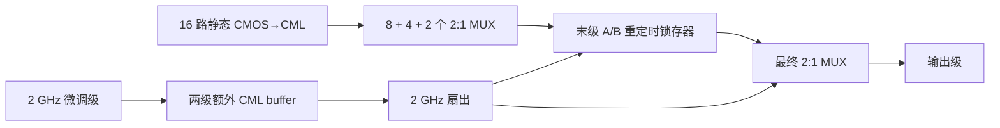

# TX 16:1 CML 串化器（r2）

> **当前修订**：TX r2 `serdes16_cml_tree_retimed_lowov`（[网表](../../analog/tx/serializer/spice/serializer16_retimed_lowov.spice)、[单元](../../analog/common/cml_mux/spice/cml_lowov_cells.spice)、[配置](../../config/tx_working_revision.toml)）。
> **关键数字**：45 条件全链功能 45/45；串化器满足 75 mV / 0.15 UI 草案 36/45 → 45/45；128 bit 下最小裕量 120.52 mV、最大散布 0.0953 UI。
> **主要缺口**：FS/1.65 V/85 °C 的 1024 bit 记录中串化器散布 0.1149 UI、远端 0.1469 UI，接近 0.15 UI；时钟源仍是 v0.1 TT 记录；没有并行字捕获寄存器。

## 电路

位序与配对见 [架构](../overview/architecture.md#串化分配)。选择端为差分 CML 时钟，经本地 LVT 源跟随器降共模后驱动选择对；各级由尾电流和负载重建输出共模。末级：A 在 B 被选中时跟踪，A 被选中时保持；B 相反。

| 部分 | 参数 |
|---|---|
| 数据管 / 选择管 | LVT W = 40 / 96 µm |
| MUX 尾管 | W = 72 µm、24 指、L = 0.5 µm，接本地逻辑偏置 |
| 负载 | 中间级 500 Ω、最终输出 400 Ω（理想电阻） |
| 末级锁存器 | 尾管 W = 144 µm、24 指；保持管 W = 40 µm；负载每端 300 Ω |
| 本地时钟源跟随器 | W = 80 µm；下拉 W = 4 µm |
| 逻辑偏置 `serdes_tx_logic_bias` | 每棵树一份，参考电流约为原比例的 1/6，真实 N/P 镜；源跟随器仍用全局偏置 |
| 输入 | 16 路 [cmos_to_cml_data](../../analog/common/cmos_to_cml/spice/cmos_to_cml_data.spice) |

### r2 改了什么、为什么

- **逻辑尾偏置与源跟随器偏置分开，尾管加宽 6 倍。** 旧版 SS 冷角两只末级锁存器尾节点只有约 64–104 mV，而 Vdsat 约 245 mV；FS 低压热角尾节点约 126–148 mV，Vdsat 约 381 mV。宽尾管在低过驱动下给出所需电流。尾宽 6 → 8 倍后 FS 动态收益接近消失。来源：[TX PVT](../history/tx_pvt.md)。
- **末级保持管 80 → 40 µm、负载 200 → 300 Ω。** 加大保持管（160/240 µm）虽提高静态再生增益，但电容与跟踪/保持电流竞争使动态锁存出错。
- **2 GHz 加两级 buffer。** 只给最终 MUX 的选择时钟加 buffer 会留下窄脉冲；同时移动锁存器和 MUX 的 2 GHz 时钟后，A 支路"数据交越 → 跟踪转保持"的中位间隔约 0.250 → 0.417 UI。
- 偶数边界且 A 支路刚更新的组合曾造成 0.03–0.14 UI 的晚边沿（旧 1024 bit 记录）；根因是末级锁存器的跟踪/恢复与上游到达时刻耦合。来源：[串化时序溯源](../history/serializer_timing_root_cause.md)。

## 已验证结果

测试边界：v0.1 TT PLL 边沿记录理想化后接真实 MOS 时钟分发；输入字按已知时刻到达；前 64 bit 训练定相，负载 128 bit 不参与拟合；输出接真实输出级、固定 RLC16 信道。定义见 [测量约定](../verification/measurement_conventions.md)。

### 45 条件前后对照（同一 128 bit）

| 工况 | 串化最小裕量 / mV（旧 → 新） | 边沿散布 / UI（旧 → 新） | 远端最小裕量 / mV（旧 → 新） |
|---|---|---|---|
| TT / 1.8 V / 27 °C | 140.71 → 150.44 | 0.0384 → 0.0417 | 192.78 → 192.33 |
| SS / 1.65 V / −40 °C | 51.96 → 123.40 | 0.0968 → 0.0540 | 31.78 → 191.76 |
| SS / 1.65 V / 85 °C | 13.66 → 125.52 | 0.2998 → 0.0789 | 32.07 → 157.18 |
| FS / 1.65 V / 85 °C | 3.96 → 121.30 | 0.4488 → 0.0953 | 10.67 → 152.74 |

全网格：最小串化裕量 120.52 mV（FS/1.65 V/−40 °C），最大散布 0.0953 UI（FS/1.65 V/85 °C）。来源：[TX r2 记录](../history/tx_optimization.md)、[数据](../data/tx_optimization.json)。

### 1024 bit 长记录（300 ns）

| 工况 | 节点 | 错误 / 多余 / 缺失 | 最小裕量 | 散布 |
|---|---|---|---:|---:|
| TT / 1.8 V / 27 °C | 串化器 | 0 / 0 / 0 | 146.96 mV | 0.0508 UI |
| FS / 1.65 V / 85 °C | 串化器 | 0 / 0 / 0 | 117.82 mV | 0.1149 UI |
| FS / 1.65 V / 85 °C | 焊盘 | 0 / 0 / 0 | 153.51 mV | 0.1425 UI |
| FS / 1.65 V / 85 °C | 远端 | 0 / 0 / 0 | 150.82 mV | 0.1469 UI |

同一工况 128 bit 的串化散布是 0.0953 UI，1024 bit 增到 0.1149 UI：更长码型暴露了更多码型相关散布，128 bit 网格低估了这一项。来源：[数据](../data/tx_optimization.json)。

### 固定 6 dB PCB（C2，无 RX/均衡）

| 工况 | 旧远端错误 / 128 | 新远端错误 / 128 | 新远端最小裕量 |
|---|---:|---:|---:|
| TT / 1.8 V / 27 °C | 0 | 0 | 81.23 mV |
| SS / 1.65 V / −40 °C | 0 | 0 | 81.42 mV |
| SS / 1.65 V / 85 °C | 6 | 0 | 57.58 mV |
| FS / 1.65 V / 85 °C | 9 | 0 | 54.81 mV |

### 功耗与面积（TT，同一 128 bit 窗口）

| 项目 | v0.1 → r2 |
|---|---|
| 串化核心 + 时钟 + 偏置 | 41.27 → 43.22 mW |
| 含 16 路输入转换和输出级的总和 | 约 69.21 mW（r2） |
| SS 冷角同口径 | 31.81 → 36.01 mW（含恢复的尾电流） |
| MOS 栅面积 ΣWL：串化核心 / 时钟分发 / 输出 | 1144.4 → 2129.3 / 164.0 → 194.4 / 213.65 → 224.25 µm² |

## 观察

r2 眼图中，串化器内部节点的码型相关 ISI 明显：孤立位的峰值远低于长连码，眼形不对称；远端经输出级限幅后眼图干净得多。见 [前后眼图](../figures/tx/optimization/tx_optimization_before_after_eyes.png)。这说明内部节点带宽仍是限制，远端干净不代表内部裕量宽裕。

## 适用范围

- 时钟源是 v0.1 TT 有限记录，不是 r3，也不是实时 PLL。
- 负载 R/C、封装、端接和合成 PCB 取固定名义值；外部 0.85 mA 理想参考进入真实镜。
- 无噪声、失配、统计 BER、ESD、版图寄生、供电扰动；零错误是有限码型、已知相位的电压采样结果。
- 没有真实并行字捕获寄存器。

## 待解决

- FS 热角长码型散布接近 0.15 UI，需要长码型复验与改进（[问题清单](../status/open_issues.md) I-06）。
- 接入 r3 原生时钟、重标 trim（I-07）。
- 并行字捕获寄存器（I-19）。
- 理想负载电阻 → PDK 电阻（I-02）。
- 内部节点 ISI（I-27）。
