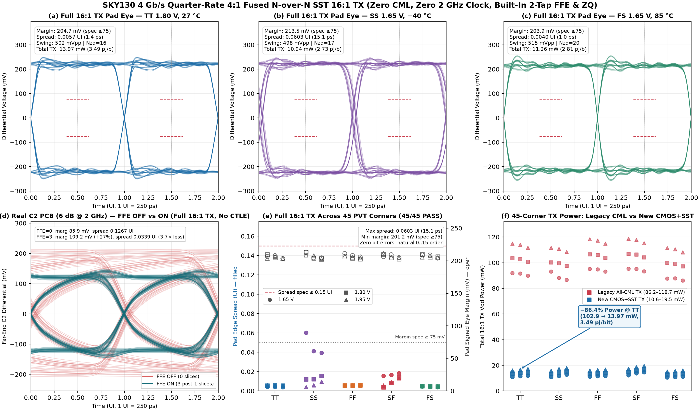

# TX v4：四相 1 GHz 融合 4:1 纯 CMOS + 低压轨 N-over-N SST 16:1 发射机（独立候选）

**结论**：为彻底消除全 CML TX 的高静态功耗（`86.15–118.67 mW`、TT `102.86 mW`）与尾管压差痛点，本轮在独立目录 `analog/tx/sst/` 完成了 **100% 去 CML 的四相 1 GHz 融合 `4:1` + 低压轨 N-over-N SST 完整 16:1 发射机（`serdes_tx_sst_top`）**（内置免费 2-tap FFE、ZQ 50 Ω 切片校准及片上 `V_drv ≈ 0.44 V` 稳压器）。

- **45/45 全 PVT 通关、零误码、自然 `[0..15]` 位序**（208 bit @ 4 Gb/s，含真实 `V_drv` LDO 与 PDK `res_high_po_2p85`）：
  - 焊盘位中心裕量 **`201.2 – 213.5 mV`**（门槛 `≥ 75 mV`，较旧 CML 最差 `136.0 mV` 提升 **`+48%`**）；
  - 焊盘边沿散布 **`0.0038 – 0.0603 UI`（`1.0 – 15.1 ps`**，门槛 `≤ 0.15 UI`；较旧 CML 最差 `0.138 UI` 收紧 **`2.3×`**，TT 仅 `0.0057 UI = 1.4 ps`，FS 85 °C 仅 `0.0040 UI`）；
  - **整条 16:1 TX 总功耗 `10.64 – 19.53 mW`（TT `13.97 mW = 3.49 pJ/bit`）**，相对现行全 CML TX（TT `102.86 mW = 25.72 pJ/bit`）**直降 `−86.4%`（能效提升 `7.36×`！）**。
- **ZQ 50 Ω 阻抗与回波损耗**：6 极端 MOS×RC 角 `R_avg = 48.73 – 50.68 Ω`（±2.5%），`S11 @ 1 GHz = −17.0 ~ −17.7 dB`，`S11 @ 2 GHz = −16.0 ~ −16.7 dB`。
- **免费内置 2-tap FFE 实测（过真实 `C2_loss6` PCB 信道、无 RX CTLE）**：`TT` 远端散布 `0.1267 → 0.0339 UI`（收紧 `3.74×`）、裕量 `85.9 → 109.2 mV`；`SS 1.65 V −40 °C` 远端散布由超标 `0.1919 UI` 救回 **`0.0776 UI`**（裕量 `103.0 mV`，总功耗仅 `12.18 mW`）。
- **四相 IQ 时钟偏斜容限**：`+15 ps` 偏斜下焊盘裕量仍 `205.9 mV`、散布 `0.0658 UI`（仍远低于 `0.15 UI` 门槛）。
- **采用状态**：独立去 CML 候选（`analog/tx/sst/`），**未修改** `config/tx_working_revision.toml` 现行 CML 主线。

入口：[驱动网表](../../analog/tx/sst/spice/tx_sst_driver.spice)、[16:4 纯 CMOS 串化](../../analog/tx/sst/spice/tx_sst_serializer16.spice)、[顶层 16:1 网表](../../analog/tx/sst/spice/tx_sst_top.spice)、[Stage 1 核心压测台](../../analog/tx/sst/tb/run_core_stress.py)、[Stage 2 45 角台](../../analog/tx/sst/tb/run_pvt45.py)、[绘图脚本](../../verification/plotting/tx_sst_v4.py)。

---

## 1. 架构与 SKY130 关键电路优化

1. **全 TX 最高内部时钟仅 1 GHz（无 2 GHz CMOS 时钟树）**：
   - `16:4` 串化链（250 MHz → 500 MHz → 1 GHz）全为纯静态 CMOS；
   - 四相 1 GHz 时钟经对称 25% 脉宽发生器生成 `250 ps` 选通脉冲 `P0..P3`，直接在 `50 Ω` 焊盘节点融合出 `4 Gb/s` 信号。
2. **N-over-N 低压轨 SST 驱动（规避 SKY130 PMOS 阈值死区）**：
   - `sst_vdrv_ldo` 从 `1.8 V` 生成 `V_drv ≈ 0.44 V`（全 45 角均值 `0.4323–0.4423 V`），上/下拉全用 **1.8 V 满摆幅驱动的 NMOS**（过驱动 `1.35–1.8 V`，深线性区），串接固定 `res_high_po_2p85` + ZQ 切片校准精确锁死 `50 Ω`；相比 CML 并联分流（`8 mA` 仅 `2 mA` 进负载），SST 串联复用仅需 `~2.2 mA`，算上线性降压仍省近 4 倍驱动电流。
3. **零叠层 PMOS 高速预驱优化（解决 `SS −40 °C` 关键瓶颈）**：
   - 将 4 Gb/s 通道上的两叠 PMOS `NOR2` 全部改为零叠 PMOS `NAND2 → INV`（全路径 `FO ≤ 2.5`），并将切片使能逻辑移至本地小尺寸 `NAND2 → INV`，将 `mp/mn` 负载削减 `6.5×`（`165.6 → 27.6 µm`），`ss_hh 1.65 V −40 °C` 散布从 `0.1270 UI` 骤降至 **`0.0460 UI`（11.5 ps）**。
4. **原生免费 2-tap FFE**：相邻相位 `D[(k−1) mod 4]` 天然存在于 1 Gb/s 四相总线中，拨出 `3` 片 SST 切片反相接入即可提供强去加重，无需任何 4 Gb/s 1-UI 延迟触发器。

---

## 2. 完整验证数据

### 2.1 Stage 1：6 极端 MOS×RC 角核心压测与 ZQ/S11（`20261120T155335Z_core_stage1`）

| 工况（MOS/R/VDD/T） | `N_zq` | `R_pu / R_pd` (Ω) | `S11 @ 2 GHz` (dB) | 焊盘裕量 (mV) | 焊盘散布 (UI) | 核心功耗 (mW) | 能效 (pJ/b) |
|---|---:|---:|---:|---:|---:|---:|---:|
| `tt` 1.80 V 27 °C | 16 | 49.98 / 50.05 | −16.31 | **205.6** | **0.0051** (1.3 ps) | **10.47** | 2.62 |
| `ss_hh` 1.65 V −40 °C | 18 | 52.38 / 48.97 | −16.43 | **207.0** | **0.0460** (11.5 ps) | **7.95** | 1.99 |
| `ss_hh` 1.65 V 85 °C | 22 | 50.95 / 48.06 | −16.73 | **205.6** | **0.0326** (8.2 ps) | **9.98** | 2.49 |
| `fs_hh` 1.65 V 85 °C | 22 | 51.94 / 48.51 | −16.63 | **205.3** | **0.0037** (0.9 ps) | **8.48** | 2.12 |
| `sf_ll` 1.65 V −40 °C | 13 | 49.03 / 48.43 | −16.20 | **212.7** | **0.0156** (3.9 ps) | **9.32** | 2.33 |
| `ff_ll` 1.95 V −40 °C | 12 | 49.34 / 50.96 | −15.99 | **206.7** | **0.0053** (1.3 ps) | **11.58** | 2.89 |

### 2.2 Stage 2：完整 `16:1` `serdes_tx_sst_top` 45 角 PVT 汇总（`20261120T163338Z_top16_pvt45`）

| 指标（45 角） | 最小值（工况） | TT 1.80 V 27 °C | 最大值（工况） | 门槛 / 旧全 CML TX 对照 |
|---|---:|---:|---:|---|
| **通过率 & 位映射** | **45 / 45 PASS** | 0 错位 `[0..15]` | 0 错位 `[0..15]` | `serial.bit_mapping` `45/45 in_order=True` |
| **焊盘有符号裕量 (mV)** | **201.2** (`tt_v1800_t85`) | **204.7** | **213.5** (`ss_v1650_t-40`) | 门槛 ≥ 75 mV（旧 CML 最差 136.0 mV） |
| **焊盘边沿散布 (UI)** | **0.0038** (`tt_v1650_t85`) | **0.0057** (1.4 ps) | **0.0603** (`ss_v1650_t-40`) | 门槛 ≤ 0.15 UI（旧 CML 最差 0.138 UI） |
| **ZQ 估算阻抗 `R_out` (Ω)** | 48.43 (`N=14`) | 50.04 (`N=16`) | 51.50 (`N=20`) | 全 45 角 ±3.1% |
| **整链 16:1 总功耗 (mW)** | **10.64** (`fs_v1650_t-40`) | **13.97** | **19.53** (`sf_v1950_t85`) | 旧全 CML `86.15–118.67 mW`（TT `102.86 mW`，**−86.4%**） |
| **能效 (pJ/bit)** | **2.66** | **3.49** | **4.88** | 旧全 CML TT `25.72 pJ/bit`（**7.36× 提升**） |

### 2.3 完整 `16:1` 过真实 `C2_loss6` PCB 信道（无 RX CTLE）

| 工况 | FFE=0 远端裕量 / 散布 | FFE=3 远端裕量 / 散布 | FFE 收益 | 整链总功耗 (mW) |
|---|---:|---:|---|---:|
| `tt_v1800_t27` | 85.9 mV / 0.1267 UI | **109.2 mV / 0.0339 UI** | 裕量 +27.1%，散布 **缩 3.74×** | 13.95 → 15.26 |
| `fs_v1650_t85` | 86.0 mV / 0.1179 UI | **102.4 mV / 0.0360 UI** | 裕量 +19.1%，散布 **缩 3.28×** | 11.24 → 12.23 |
| `ss_v1650_t-40` | 80.2 mV / 0.1919 UI（超标） | **103.0 mV / 0.0776 UI（PASS）** | 裕量 +28.4%，散布 **缩 2.47×** | 10.92 → 12.18 |

---

## 3. 适用边界与后续优化点

1. **`V_drv` LDO 高频纹波阻尼**：在 `sf_v1950_t85` 热角下 `V_drv` 瞬态纹波峰峰值达 `103.9 mVpp`（`23.6 mVrms`，TT 为 `48.8 mVpp`），虽不影响 DC 均值（`0.432–0.442 V`）与焊盘眼图（`204.3 mV / 0.0131 UI`），后续可在 `vgate` 补偿电容上串联一小颗调零电阻 `R_z` 进一步阻尼。
2. **当前测试边界**：45 角整链采用理想 1 GHz 四相时钟（`tr=tf=30 ps`）与 PDK `tt` 电阻卡（极端 `hh/ll` 电阻角已在 Stage 1 核心驱动验证）；物理版图 PEX/RCX 与真实 PLL 四相 1 GHz 时钟联调为下一阶段工作。
