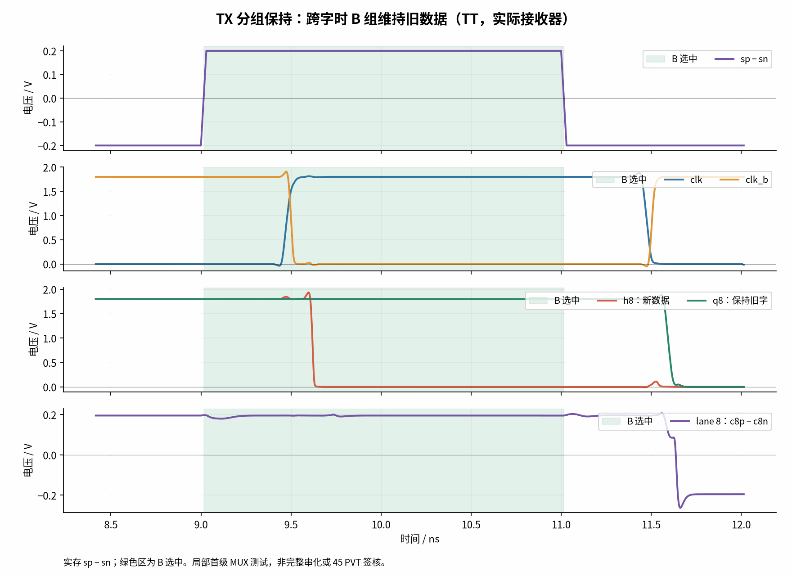

# TX 完整字捕获与分组保持原型

**16 位同步捕获＋两组 8 位互补保持已有电路，实际字时钟接收/缓冲下六个压力条件全部通过。** 首级重组共48字、768 bit；B关闭切片完成12组边界。随后接入实际v3与完整串化/驱动，[末级选择时钟改进后TT/FS热角眼图满足](tx_parallel_serializer.md)，原FS失败保留；捕获/保持正确。控制仍为RTL波形回放，物理路径与驱动blank待完成。

## 模块边界

输入是**已经处于 TX PHY 字时钟域**的 16 位数据，不是任意异步系统总线。系统侧的 FIFO/CDC、速率匹配和满空处理是上游接口工作；本电路没有实现这些功能。数据寄存器不带复位。[入口保护RTL](../../digital/tx/README.md)已实现真实下降沿预热、空泡与A/B标签，但尚未接入模拟数据选择、标签时序或实际线驱动blank，启动屏蔽链仍未完成。

电路依次为精简静态 CMOS DFF 同沿捕获、两级真实反相器、互补透明锁存器、既有 CMOS→CML 转换器、首级 CML MUX。A 组为 lane 0–7，B 组为 lane 8–15；每个 MUX 配对 lane i 与 lane i+8。8 个 MUX 输出每端 5 fF，仅代理下一级负载；Q 另加 2 fF 线电容。使用真实带隙/电流分配与 PDK 电阻 tt。

输出契约是**被选中的半字有效**。两个半字在不同时间更新，不能把 16 个 launch 输出当作任意时刻都代表同一个字的普通并行总线。后续串化器应遵循相同的首级选通极性。

## 结构选择依据

[单元 card](tx_ingress.md)表明精简 DFF 的加载 CML 延迟约 91–281 ps，复位型约 216–788 ps。WP-004 对固定公共发数相位的区间模型给出：只考虑已测条件的延迟变化，精简型需要至少约 190 ps 的 CML 允许更新窗，复位型约 572 ps；实际串化树的公共允许窗尚未测出。

互补保持结构将各组的数据更新放到未选中半周期，避免依赖所有角都相同的一次窄窗发数。它增加锁存器、时钟负载及同沿保持竞争，尺寸仍需局部优化。

| 事件 | A 组 | B 组 |
|---|---|---|
| CMOS 字时钟上升，捕获字 k | 透明，接收字 k | 关闭，继续保持字 k−1 |
| CML 选择时钟下降 | 选择 A，读字 k 的低 8 位 | 未选中，随后透明接收字 k |
| 下一 CML 选择时钟上升 | 未选中，随后可接收字 k+1 | 选择 B，读字 k 的高 8 位 |

真实接收器使 CMOS 事件晚于 CML 选择事件，实际延迟与占空比必须重新测量。B 组关闭与下一字捕获同沿，两级数据反相器用于推迟新数据，不能只凭拓扑推断保持安全。

原型的本地时钟反相器 WN/WP=8/16 µm；数据延迟反相器为 1/2、2/4 µm。launch 为传输门静态锁存器，输入传输门 1/2 µm，弱反馈传输门 0.42/0.42 µm。现阶段是起始尺寸，不代表 PPA 最优选择。

## 已完成的局部实验

理想 CMOS 与 CML 选择时钟同源，250 MHz、30 ps 斜坡。输入数据在初次捕获前约 1 ns 已建立；8 个受检字为 A55A、5AA5、0000、FFFF、0FF0、F00F、1234、ECA7，第 9 字只为最后一次保持竞争提供后继激励。每例仿真 36 ns。

| 条件 | 首级重组 | B 关闭交越→下一数据交越最小间隔 / ps |
|---|---|---:|
| TT 1.8 V 27°C | 8/8 字正确 | 87.35 |
| SS 1.65 V −40°C | 8/8 字正确 | 153.14 |
| SS 1.65 V 85°C | 8/8 字正确 | 146.16 |
| FS 1.65 V −40°C | 8/8 字正确 | 91.20 |
| FS 1.65 V 85°C | 8/8 字正确 | 107.50 |
| FF 1.95 V −40°C | 8/8 字正确 | 53.87 |

每个所选输入从选择沿前 100 ps 到后 1.9 ns 检查 CMOS 符号裕量 >0.3 VDD、CML 差分符号正确；MUX 输出在选中后 1 ns 取样。B 组每个预期翻转都另测内部 h 与 clk_b 的交越。表内间隔仅是门限交越诊断，**不是锁存器孔径或可用保持裕量**。

证据固定为 `results/analog/tx/staggered_ingress/20261106T200647Z` 的计划、保存 deck 和 summary；分析脚本随后改进，不追认旧脚本已具备新检查。[Terra 只读复核](../work_packages/deliveries/staggered-review.md)确认局部接线/位序，同时指出旧测量可能忽略缺失交越。现行脚本已将预期交越缺失或多次交越视为分析失败，真实时钟模式按保存的 CML 选择端交越划窗；3 项故障注入回归通过。

实际字时钟版本使用既有 250 MHz `pvt_candidate` 接收器，加 8/16、24/48 µm 两级 CMOS 缓冲，驱动整个 16 位捕获/保持 bank。输入仍是理想 CML 源，其相位、共模和摆幅是本地测试边界，不代表已经接回原生 PLL/v3。

首次实际接收器 TT 试验 `20261106T202119Z` 完成 36 ns，但首字失败：保存的 DC 工作点中 clk=1.8 V，DFF 存储为 0；接收器的边沿恢复锁存器已处于高态，第一下 CML 上升没有产生新的 CMOS 捕获沿。独立抽取首级字为 `0000,5AA5,0000,FFFF,0FF0,F00F,1234,ECA7`，仅首字不符。严格分析另报首个预期 h8 翻转缺失。该结果保留为失败，不用于满足首字要求。

后续 bench 显式预留一个 4 ns 字周期，再捕获受检首字：输入首字保持到 8 ns 后才切换，首个受检字从第二个 CML 上升周期捕获。每例改为 40 ns。这定义了实验的有效字起点；后续入口保护RTL的预热语义与此对应，物理接入仍待做。所有压力角按同一预热约定通过，没有按各角重新移动字映射。

## 实际字时钟与完整 bank 的结果

固定 campaign 为 `20261106T202607Z`；六条件均完成 40 ns，每例 8/8 字正确。全部 48 个预期 B 数据翻转/条件均恰有一次交越，关闭→数据最小间隔保持为正。接收器、两级缓冲和真实 bank 在同一 deck；CML 源仍为规定的 400 mVpp、30 ps 理想波形。

| 条件 | CML 上升→CMOS bank 时钟 / ps | B 关闭→新数据最小间隔 / ps | bank 时钟 10–90% 上升 / ps |
|---|---:|---:|---:|
| TT 1.8 V 27°C | 460–462 | 91.29 | 52–57 |
| SS 1.65 V −40°C | 1173–1176 | 162.77 | 91–99 |
| SS 1.65 V 85°C | 843–846 | 154.97 | 82–89 |
| FS 1.65 V −40°C | 898–900 | 95.06 | 43–46 |
| FS 1.65 V 85°C | 632–634 | 111.56 | 50–53 |
| FF 1.95 V −40°C | 281–283 | 55.62 | 34–38 |

整 bank 的上升沿输入充电等效约 152–189 fF，TT 为 166–179 fF。算法在每个实际 CMOS 中点交越前后各 400 ps 积分零伏探针流入 bank 的电流，再除以 VDD；它包含该窗口的动态耦合，不是线性电容提取。共享测量函数为 `loading.rising_edge_load`，同时检查唯一的 10%/90% 交越和完整积分窗口。上表传播延迟及间隔也不作为随机抖动或孔径评分。

绿色区内首级选择 B，内部 h8 已更新为下一字，q8 仍保持旧字；离开 B 区并等到实际 CMOS 下降后，q8 才更新。图与表的输入来源、哈希、失败对照保留在[小数据](../data/tx_staggered_ingress.json)，[结果索引](../../results/catalog/tx_staggered_ingress.json)。重画入口：[tx_staggered.py](../../verification/plotting/tx_staggered.py)，无参数只读小 JSON，不依赖大波形。

断点续跑已验证：TT 先行，其余五点续跑；最终再次 `--resume` 没有启动新仿真，只重测完整结果。最多两路并发。全仓库 67 项软件测试通过，包含选通参考、缺失翻转、截断时间与时钟负载积分的故障注入/解析回归。

## 验收与后续

这组首级试验不提供输入建立/保持扫描、全45 PVT、hh/ll、失配、噪声、真实有效字启动或提取线负载资格。后续关闭切片和完整串化结果分别见[保持边界](tx_launch_hold.md)与[整链接口验证](tx_parallel_serializer.md)；不能把首级读数替代完整链75 mV / 0.15 UI评分。

1. 实际字时钟接收/缓冲六压力条件已通过；外发 [WP-005](../work_packages/WP-005-tx-staggered-waveform-audit.md) 独立复核原始字流与失败对照，仿真配额0。
2. [关闭竞争切片](tx_launch_hold.md)已完成六角、两方向164个平移点；正常到达距已测保持点最小70.45ps。两级数据延迟暂保留；源阻抗、失配/噪声和其他形状继续验证。
3. 入口保护RTL的149项行为断言、lint与通用结构检查通过；标准单元初步映射暴露SS时序不足，见[可行性记录](../work_packages/deliveries/tx-ingress-timing.md)。标签与驱动blank分开设计，真实接口负载/路径时序仍待验证。
4. 实际v3时钟与完整树的TT动态位序为identity，不接旧r2 remap；继续按固定映射扩角，再做统计/噪声。

实现：[数据捕获/保持](../../analog/tx/input_register/spice/word_capture16_staggered.spice)、[字时钟接收/缓冲](../../analog/tx/input_register/spice/word_clock_receiver.spice)。运行：[run.py](../../analog/tx/input_register/tb/staggered/run.py)，`--clock receiver --run-only tt_v1800_t27` 先试 TT；同一 campaign 用 `--resume` 只补缺项，输入身份改变必须另建 campaign。默认最多 2 worker。
