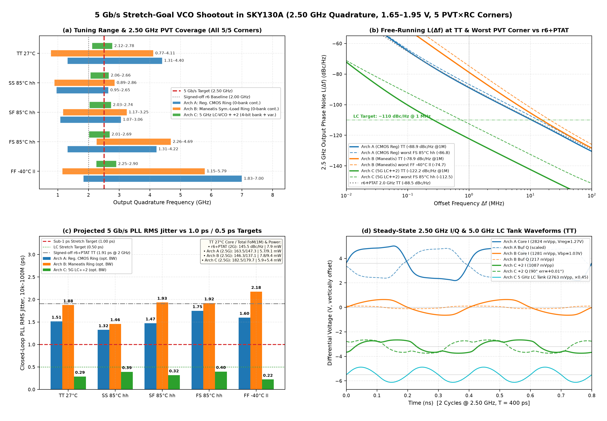

# 5 Gb/s 拓展目标 VCO 架构对比报告（`2.50 GHz` 正交，SKY130A `1.65–1.95 V`）

**结论**：在完全隔离的 `analog/pll/vco_5g/` 目录下（零改动已签核 4 Gb/s 主线网表与 `config/*_working_revision.toml`），全部采用真实 SKY130A PDK 器件，在 **5 个 `PVT × RC` 角点**（`TT 1.80 V 27 °C tt`、`SS 1.65 V 85 °C hh`、`SF 1.65 V 85 °C hh`、`FS 1.65 V 85 °C hh`、`FF 1.95 V −40 °C ll`）上对面向 **5 Gb/s 半速（`2.50 GHz` 正交）**、宽调谐、多电压（`1.65–1.95 V`）及亚皮秒抖动目标的三类下一代 VCO 架构完成同口径横向实测，并与已签核 4 Gb/s 基线 **VCO r6 + PTAT**（`2.00 GHz`：`L(1 MHz) = −88.5 dBc/Hz` TT，PLL 抖动 `1.91 ps` TT / `2.29 ps` 最差）对比：

- **Arch C（5.0 GHz 互补交叉耦合 LC-VCO + 正交 `÷2` 分频器）全面击穿所有亚皮秒与相噪目标，是 5 Gb/s 性能冠军**：
  - 基于 SKY130A `met4 || met5` 实际片阻与氧化层参数物理推导的三匝对称八角电感（`L_eff = 2.33 nH`，`5 GHz` 实测 `Q = 7.13` TT / `5.20` hh 85 °C / `10.96` ll −40 °C）+ 4-bit 差分 MIM 粗调阵 + `cap_var_lvt` 变容 + 高速 CML 正交 `÷2`，**5/5 角点干净锁定 `2.500 GHz` I/Q**（正交误差 `≤ 0.27 ps / 0.25°`，`|DCD| ≤ 0.031%`），`20 MHz` 电源推动 **`|Kvdd| = 2.5–92.4 MHz/V`**（TT `33.3 MHz/V`）。
  - 含 `noisy=1` 变容 `rg`、电感热噪（ISF 实测与解析 `4 k T / R_p` 全角吻合至 **`0.02–0.15 dB`**）、4-bit 开关阵及 `÷2` 附加底噪后，`2.50 GHz` 输出 **`L(1 MHz) = −112.5 .. −126.1 dBc/Hz`**（TT **`−122.25 dBc/Hz`**，5/5 角点超越 `< −110 dBc/Hz` 门槛 `2.5–16.1 dB`）；核 / 整机 `FoM(1 MHz)` 达 **`174.6–184.9` / `172.6–182.0 dBc/Hz`**（TT `182.5 / 179.7 dBc/Hz`），与解析 Leeson 预测吻合至 `0.9–2.3 dB`。
  - 5 Gb/s 闭环 PLL RMS 抖动（10 kHz–100 MHz，最优带宽 `0.8–1.2 MHz`）低至 **`0.22–0.40 ps`**（TT **`0.29 ps`**，5/5 角点远低于 `0.50 ps` 目标；即便拉宽至 `10 MHz` 环形带宽仍仅 `0.64–0.89 ps < 1.0 ps`），**5 Gb/s CDR `14.07σ` 仅 `0.196–0.200 UI`**（相对 `0.500 UI` 留 `60%` 裕量）。唯一代价是电感面积（`~210 × 210 µm²`）与 `25–30%` 总调谐带宽需保留 4-bit 粗调。
- **Arch A（供电稳压伪差分 CMOS 反相器环振，4 级 / 8 相）是最佳无电感、零电容阵小面积方案**：
  - 本地 PMOS 稳压器（`V_reg = 1.50 × V_ctrl`，零 `V_ctrl` 直流电流）+ `L = 0.15 µm` 伪差分 CMOS 反相器环实现 **零粗调阵 `94%–117%` 全连续调谐**（TT `1.31–4.40 GHz`、SS 1.65 V 85 °C `0.95–2.65 GHz`），5/5 角点覆盖 `2.50 GHz`，满摆幅 **`2.56–3.24 Vpp`**，无需分接环路滤波即在 4/5 角点取得 **`|Kvdd(20 MHz)| = 49.7–147.6 MHz/V`**（TT `60.9 MHz/V`，较未分接 r6 改善 `19 dB`；仅 SS 1.65 V 85 °C 因稳压压差缩至 `180 mV` 升至 `545 MHz/V`）。
  - 发现关键物理规律：CMOS 环核本征相噪极优（`−101.6 .. −104.8 dBc/Hz @ 1 MHz`，核 `FoM = 162.6–163.7 dBc/Hz`，较 r6 优 `~18 dB`），但在零粗调阵下高达 `+3.4 .. +8.8 GHz/V` 的 `Kvreg` 将 `9–12 nV/√Hz` 本地稳压器噪声放大为总相噪的 `95%–97%`，使整机 `L(1 MHz)` 落在 **`−86.8 .. −91.5 dBc/Hz`**（TT **`−88.93 dBc/Hz`**，整机 `FoM = 145.9–149.3 dBc/Hz`，在频率高 `25%` 下仍优于 2 GHz r6+PTAT）。5 Gb/s PLL 抖动 **`1.32–1.75 ps`**（TT **`1.51 ps`**，较 4 Gb/s r6 降低 `~21%`），5 Gb/s CDR `14.07σ = 0.276–0.298 UI`（全部过关）；若后续增加 2–3 bit 粗调降 `Kvreg`，可直接向 `< 1.0 ps` 逼近。
- **Arch B（Maneatis 自偏置对称负载环振，4 级 / 8 相，`pfet_lvt` + 副本伺服 OTA）在 SKY130A 下相噪与动态 PSRR 明显落后**：
  - 虽然 5/5 角点实现 `70%–137%` 连续调谐（TT `0.77–4.11 GHz`、SS 1.65 V 85 °C `0.89–2.86 GHz`）且副本伺服将摆幅低端精准钳位在 `Vbp` 误差 `6–17 mV` 内，但 `Vbn` 伺服灵敏度极高（`Kb = +4.3 .. +18.4 GHz/V`），伺服 OTA 噪声（`13.4–15.4 nV/√Hz @ 1 MHz`）占总 1 MHz 相噪 **`77%–90%`**，将 `L(1 MHz)` 恶化至 **`−74.7 .. −85.6 dBc/Hz`**（TT **`−78.89 dBc/Hz`**，整机 `FoM = 133.6–142.8 dBc/Hz`）。
  - 地参考下 `20 MHz |Kvdd|` 高达 `4794–9969 MHz/V`；即便采用 Maneatis 原生电源参考环路滤波（`α = 1`），`20 MHz |Kvdd|` 仍为 `195–428 MHz/V`（TT `202 MHz/V`，劣于 Arch A `3.3×`、劣于 Arch C `6×`）。5 Gb/s PLL 抖动 `1.46–2.18 ps`（TT `1.88 ps`），综合性价比低于 Arch A 与 Arch C。

入口：[复现脚本](../../analog/pll/vco_5g/tb/shootout.py) · [Arch A 网表](../../analog/pll/vco_5g/spice/ring_cmos_reg.spice) · [Arch B 网表](../../analog/pll/vco_5g/spice/ring_maneatis.spice) · [Arch C 网表](../../analog/pll/vco_5g/spice/lc_5g_div2.spice) · [4 Gb/s 基线 r6+PTAT 报告](pll_vco_r6_perf.md)

---

## 1. 架构总览与 TT 27 °C / 最差角横向对照

| 指标（除 r6 基线为 `2.00 GHz / 4 Gb/s` 外，其余均为 `2.50 GHz / 5 Gb/s`） | 基线 r6 + PTAT（已签核 `2.0 GHz`） | **Arch A**：稳压 CMOS 环振 | **Arch B**：Maneatis 对称负载环振 | **Arch C**：`5 GHz` LC-VCO + 正交 `÷2` |
|---|---|---|---|---|
| 拓扑与粗调需求 | 4 级电阻 CML + 5-bit 阵 | 4 级伪差分 CMOS + PMOS LDO，**0-bit 连续** | 4 级 `pfet_lvt` 对称负载 + 副本 OTA，**0-bit 连续** | 互补 `nfet_lvt+pfet_lvt` 5 GHz LC + 4-bit MIM 阵 + CML `÷2` |
| 5/5 PVT 覆盖 `2.50 GHz` | `2.00 GHz` 45/45 | **5/5 PASS** | **5/5 PASS** | **5/5 PASS** |
| 调谐范围（TT / 最窄角 FTR） | `78%–102%`（5-bit） | `1.31–4.40 GHz`（`108%` / `94%` 连续） | `0.77–4.11 GHz`（`137%` / `70%` 连续） | `2.12–2.78 GHz`（`27%` / `25%` 4-bit；单码变容 `2.4–5.1%`） |
| 核 / 输出摆幅（TT, mVpp diff） | `490` / `550` | **`2824`** / `3739` | `1281` / `217`（轻缓冲） | `2763`（5G 腔）/ **`1087`**（2.5G I/Q） |
| 核 / 核+偏置(或÷2) / 整机功耗（TT, mW） | `7.86` / `8.4` / `11.85` | `5.68` / `9.05` / `12.69` | `7.77` / `9.40` / `10.30` | `5.89` / **`11.27`**（含 ÷2）/ `11.27` |
| `|Kvco|` @ `2.50 GHz`（TT / 全角, MHz/V） | `744` / `542–1039` | `8223` / `4722–13180` | `6856` / `4375–9728` | **`102`** / `33–184` |
| `20 MHz |Kvdd|`（TT / 全角, MHz/V） | `529`（未分接）/ `78`（分接） | **`60.9`** / `49.7–545.4` | `7059`（地）/ `202`（VDD参考 `195–428`） | **`33.3`** / **`2.5–92.4`** |
| `L(1 MHz)` @ 输出（TT / 最差角, dBc/Hz） | `−88.5` / `−86.1` | **`−88.9`** / `−86.8`（核本征 `−103.1`） | `−78.9` / `−74.7`（核本征 `−87.3`） | **`−122.2`** / **`−112.5`**（5/5 `< −110`） |
| `L(100 kHz / 10 MHz)`（TT, dBc/Hz） | `−65.3` / `−109.2` | `−64.8` / `−109.6` | `−50.8` / `−105.4` | **`−100.3`** / **`−142.4`** |
| `FoM(1 MHz)` 核 / 整机（TT, dBc/Hz） | `145.5` / `144.0` | `163.5` / **`147.3`** | `146.3` / `137.1` | **`182.5`** / **`179.7`** |
| 5 Gb/s PLL `J_rms` `10k–100M`（TT / 最差, ps） | `1.91` / `2.29`（4G） | **`1.51`** / `1.75`（`10–18 MHz` BW） | `1.88` / `2.18`（`12–25 MHz` BW） | **`0.29`** / **`0.40`**（最优 `0.8–1.2 MHz`；`10M` 下 `0.64–0.89`） |
| 5 Gb/s CDR `14.07σ`（TT / 最差, UI, 门槛 `0.500`） | `0.283` / `0.296`（4G） | **`0.285`** / `0.298` (PASS) | `0.306` / `0.328` (PASS) | **`0.197`** / **`0.200`** (PASS，60% 裕量) |

---

## 2. 分角点详测数据（5 个 `PVT × RC` 角点）

### 2.1 Arch A：供电稳压伪差分 CMOS 反相器环振（`vco5g_ring_cmos_reg`）

| 工况 | 调谐范围 (`GHz` / `FTR%`) | `Vctrl` / `Vreg` (V) | `Kvco` / `Kvreg` (MHz/V) | 核摆幅 (mVpp) | 核 / 核+LDO / 整机功耗 (mW) | `20 MHz |Kvdd|` (MHz/V) | `L(100k / 1M / 10M)` (dBc/Hz) | `FoM` 核 / 含LDO | 5G PLL `UGB` / `J_rms` (ps) | 5G CDR `14.07σ` (UI) |
|---|---|---:|---:|---:|---:|---:|---|---:|---|---:|
| `tt_v1800_t27:tt` | `1.31–4.40` (`108%`) | `0.843 / 1.270` | `+8223 / +5526` | `2824` | `5.68 / 9.05 / 12.69` | `60.9` | `−64.8 / −88.9 / −109.6` | `163.5 / 147.3` | `15.4 MHz` / **`1.51`** | `0.285` |
| `ss_v1650_t85:hh` | `0.95–2.65` (`94%`) | `0.977 / 1.466` | `+4722 / +3376` | `3237` | `8.60 / 10.40 / 13.55` | `545.4` | `−67.9 / −91.5 / −112.2` | `163.4 / 149.3` | `10.3 MHz` / **`1.32`** | `0.276` |
| `sf_v1650_t85:hh` | `1.07–3.06` (`96%`) | `0.900 / 1.355` | `+6276 / +4221` | `2939` | `7.05 / 9.34 / 12.46` | `139.0` | `−66.2 / −89.7 / −110.3` | `162.6 / 147.9` | `12.3 MHz` / **`1.47`** | `0.288` |
| `fs_v1650_t85:hh` | `1.31–4.22` (`105%`) | `0.766 / 1.157` | `+7841 / +5271` | `2557` | `4.73 / 7.37 / 10.44` | `147.6` | `−63.9 / −86.8 / −107.3` | `163.7 / 146.1` | `18.4 MHz` / **`1.75`** | `0.298` |
| `ff_v1950_t-40:ll` | `1.83–7.00` (`117%`) | `0.769 / 1.162` | `+13180 / +8844` | `2562` | `4.18 / 8.34 / 12.68` | `49.7` | `−62.4 / −87.2 / −108.0` | `163.3 / 145.9` | `18.5 MHz` / **`1.60`** | `0.287` |

- **1 MHz 噪声归因**：本地稳压器（`9.0–12.1 nV/√Hz @ 1 MHz`）经大 `Kvreg` 占 `95.3%–97.3%`，主 PMOS 热噪占 `1.5%–2.7%`，主 NMOS 热/1/f 合计占 `< 1.6%`。

### 2.2 Arch B：Maneatis 自偏置对称负载环振（`vco5g_ring_maneatis`）

| 工况 | 调谐范围 (`GHz` / `FTR%`) | `Vbp` / `Vrep` / `Vbn` (V) | `Kvco` / `Kb` (MHz/V) | 核摆幅 (mVpp) | 核 / 核+偏置 / 整机功耗 (mW) | `20 MHz |Kvdd|` 地 / VDD (MHz/V) | `L(100k / 1M / 10M)` (dBc/Hz) | `FoM` 核 / 含伺服 | 5G PLL `UGB` / `J_rms` (ps) | 5G CDR `14.07σ` (UI) |
|---|---|---|---:|---:|---:|---:|---|---:|---|---:|
| `tt_v1800_t27:tt` | `0.77–4.11` (`137%`) | `1.027 / 1.014 / 0.843` | `−6856 / +10336` | `1281` | `7.77 / 9.40 / 10.30` | `7059 / 202.1` | `−50.8 / −78.9 / −105.4` | `146.3 / 137.1` | `22.2 MHz` / `1.88` | `0.306` |
| `ss_v1650_t85:hh` | `0.89–2.86` (`105%`) | `0.717 / 0.711 / 0.940` | `−4375 / +4252` | `1563` | `10.28 / 11.97 / 13.17` | `4794 / 428.2` | `−58.0 / −85.6 / −110.8` | `149.9 / 142.8` | `12.3 MHz` / `1.46` | `0.285` |
| `sf_v1650_t85:hh` | `1.17–3.25` (`94%`) | `0.754 / 0.744 / 0.782` | `−6160 / +10322` | `1451` | `8.19 / 9.66 / 10.65` | `6350 / 195.2` | `−51.5 / −79.4 / −105.6` | `146.6 / 137.5` | `18.3 MHz` / `1.93` | `0.319` |
| `fs_v1650_t85:hh` | `2.26–4.69` (`70%`) | `1.105 / 1.088 / 0.849` | `−5309 / +8053` | `882` | `5.88 / 7.05 / 7.70` | `5513 / 206.5` | `−52.4 / −80.2 / −105.6` | `147.5 / 139.7` | `18.2 MHz` / `1.92` | `0.317` |
| `ff_v1950_t-40:ll` | `1.15–5.79` (`134%`) | `1.274 / 1.257 / 0.795` | `−9728 / +18394` | `1109` | `6.40 / 8.18 / 8.98` | `9969 / 235.3` | `−46.5 / −74.7 / −101.9` | `144.6 / 133.6` | `25.4 MHz` / `2.18` | `0.328` |

- **1 MHz 噪声归因**：副本伺服 OTA 输出 `Vbn`（`13.4–15.4 nV/√Hz @ 1 MHz`）经极高 `Kb` 占 `77.4%–90.0%`，尾管 1/f 占 `7.2%–9.2%`，尾管/输入对热噪合计占 `2.4%–10.4%`。

### 2.3 Arch C：5.0 GHz 互补 LC-VCO + 正交 `÷2`（`vco5g_lc_div2`）

**SKY130A `met4 || met5` 对称八角电感物理推导（`vco5g_ind_oct_2n2`）**：
- 基于 `sky130A.tech` 实测 BEOL 参数：`met5`（厚 `1.26 µm`，`R_sh = 29 mΩ/sq` nom / `36` max / `21` min）与 `met4`（厚 `0.36 µm`，`R_sh = 47 mΩ/sq` nom / `56` max / `38` min，`areacap = 8.42 aF/µm²`）密集 `via4` 并联（`R_sh,dc = 17.9 mΩ/sq`）。
- 几何尺寸：三匝对称八角螺旋，`D_out = 210 µm`、线宽 `W = 12 µm`、间距 `S = 4 µm`（`D_in = 122 µm`、`D_avg = 166 µm`、`ρ = 0.265`、总长 `1650 µm = 137.5 sq`）。修正 Wheeler 公式得 `L_diff = 2.18 nH`（两半对称电感 `L1 = L2 = 0.87 nH`、互感系数 `K12 = 0.25`，计入匝间寄生后 `5 GHz` 实测 `L_eff = 2.33 nH`）；直流串联电阻 `2.81 Ω`（含 `met3` 跨桥 `0.35 Ω`），计入 `5 GHz` 铝趋肤/邻近与衬底涡流倍增（`δ_Al = 1.18 µm`，`~2.4×`）得 `R_s,eff(5 GHz) = 6.80 Ω`（`tc1 = 3.2e-3 /°C`，按 RC 角缩放 `1.00 / 1.22 / 0.75`）；氧化层与无屏蔽 `~10 Ω·cm` 硅衬底 `π` 网络 `C_ox = 72 fF/port`、`C_s = 16 fF`（`f_SRF = 14.2 GHz = 2.8× f0`）、`R_sub = 420 Ω || C_sub = 20 fF`。实测 `5.0 GHz` 差分品质因数 **`Q_ind = 7.13`**（TT，`R_p = 532.9 Ω`）、**`5.20`**（hh 85 °C，`393.9 Ω`）、**`10.96`**（ll −40 °C，`810.8 Ω`）。

| 工况 | 调谐范围 (`GHz` / `FTR%` / 变容连续) | `Q_ind` / `R_p` (Ω) | 码 / `Vctrl` (V) / `Kvco` (MHz/V) | 5G 腔 / 2.5G I/Q 摆幅 (mVpp) | 核 / `÷2` / 整机功耗 (mW) | `20 MHz |Kvdd|` (MHz/V) | `L(100k / 1M / 10M)` @ 2.5G (dBc/Hz) | 5G 电感 ISF vs `4kT/Rp` / Leeson(`F=2.5`) | `FoM` 核 / 整机 | 5G PLL `J_rms` 最优 / `@10M` (ps) | 5G CDR `14.07σ` (UI) |
|---|---|---:|---|---:|---:|---:|---|---|---:|---|---:|
| `tt_v1800_t27:tt` | `2.12–2.78` (`27%` / `4.1%`) | `7.13 / 533` | `5` / `0.807` / `+102` | `2763 / 1087` | `5.89 / 5.38 / 11.27` | `33.3` | **`−100.3 / −122.2 / −142.4`** | `−122.92 vs −122.94` / `−124.5` | **`182.5 / 179.7`** | **`0.29`** (`0.8M`) / `0.79` | **`0.197`** |
| `ss_v1650_t85:hh` | `2.06–2.66` (`26%` / `2.8%`) | `5.20 / 394` | `3` / `0.791` / `+59` | `1576 / 700` | `3.41 / 2.65 / 6.06` | `92.4` | **`−94.3 / −116.5 / −136.9`** | `−116.19 vs −116.23` / `−117.4` | **`179.1 / 176.6`** | **`0.39`** (`0.8M`) / `0.89` | **`0.198`** |
| `sf_v1650_t85:hh` | `2.03–2.74` (`30%` / `2.4%`) | `5.20 / 394` | `4` / `0.901` / `+33` | `1911 / 939` | `4.04 / 3.74 / 7.77` | `56.5` | **`−97.0 / −117.9 / −138.0`** | `−117.39 vs −117.42` / `−119.1` | **`179.8 / 176.9`** | **`0.32`** (`0.8M`) / `0.83` | **`0.197`** |
| `fs_v1650_t85:hh` | `2.01–2.69` (`29%` / `4.0%`) | `5.20 / 394` | `3` / `0.711` / `+184` | `1073 / 564` | `3.85 / 2.27 / 6.11` | `54.8` | **`−92.4 / −112.5 / −132.5`** | `−112.68 vs −112.71` / `−114.1` | **`174.6 / 172.6`** | **`0.40`** (`1.2M`) / `0.80` | **`0.200`** |
| `ff_v1950_t-40:ll` | `2.25–2.90` (`25%` / `5.1%`) | `10.96 / 811` | `9` / `1.005` / `+57` | `4003 / 1286` | `8.75 / 8.24 / 16.99` | `2.5` | **`−100.4 / −126.1 / −146.9`** | `−129.41 vs −129.26` / `−130.4` | **`184.9 / 182.0`** | **`0.22`** (`0.8M`) / `0.64` | **`0.196`** |

- **1 MHz 噪声归因（TT）**：交叉耦合 NMOS 热噪 `48.0%`、电感热噪 `21.4%`、交叉耦合 PMOS 热噪 `17.7%`、`noisy=1` 变容 `rg` `4.4%`、4-bit MIM 开关阵 `3.8%`、NMOS 1/f `3.5%`、尾流源经 `10 GHz` Hegazi–Rael–Abidi 尾滤波后仅占 `0.6%`；`÷2` 附加相噪底噪 `−157.5 .. −174.6 dBc/Hz @ 10 MHz`，在 `≤ 100 MHz` 偏移下可忽略。

---

## 3. 架构选型建议与适用边界

1. **追求 5 Gb/s 亚皮秒抖动（`< 0.50 ps`）与极低相噪（`< −110 dBc/Hz @ 1 MHz`）→ 选用 Arch C（`5 GHz` LC-VCO + 正交 `÷2`）**：在 `11.3 mW` TT 总功耗（低于 r6+PTAT 的 `11.85 mW`！）下将闭环抖动压降 **`6.6×`**（`1.91 → 0.29 ps`），20 MHz 电源推动低至 `33 MHz/V`；后续若投入物理实现，需以 EM 场仿真（OpenEMS / FastHenry）复核 `met4||met5` 八角电感在真实硅衬底上的 `Q` 值及 10 GHz 尾滤波电感占位。
2. **面积受限、拒绝片上电感且需多电压宽连续调谐 → 选用 Arch A（供电稳压伪差分 CMOS 环振）**：零粗调电容阵即覆盖 `94%–117%` 连续范围，TT `1.51 ps` 抖动与 `60.9 MHz/V` 20 MHz PSRR 均全面优于 r6+PTAT 与 Arch B；若叠加 2–3 bit 粗调降 `Kvreg` 并优化稳压器压差，有望以纯环振突破 `< 1.0 ps`。
3. **适用边界**：本对比为原理图级验证（环振含 `12 fF/node` 走线预算，输出负载均为 `30 fF/pin`，Arch C 电感为基于 `sky130A.tech` 推导的集总 `π` 模型，不含版图提取 RCX/EM 与失配 MC）；5 Gb/s PLL 闭环综合统一采用 `250 MHz` 参考（`N = 10`）、已实测 `CP v4 (200 µA)` 噪声谱与 `−123.1 dBc/Hz` 带内底噪，5 Gb/s CDR 沿用 `16-bit` bang-bang 模型（`UI = 200 ps`，`TICK = 3.2 ns`，`edge = 7.2 ps`）。`FF −40 °C ll` Arch C ISF 使用 `cshunt = 1e-18` 以抑制 `-40 °C` 结二极管陡拐点步长收敛问题（频偏 `+3.3%`，对 `h_rms` 影响 `< 0.25 dB`）。完整结果归档于 `results/analog/pll/vco_5g/shootout_20261123/`。
