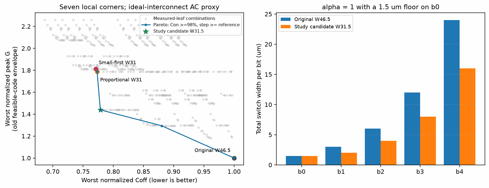

# VCO bank：目标、工艺不确定性与不劣解

**先把校准后的功能、调谐窗口、幅度和噪声作为约束，再求关断寄生与导通损耗的Pareto前沿。当前不能给SS×hh赋出现率。** 硬件宽度、逐芯片选码及全局/局部变异要分开建模。原先“小位优先”是一个方向，不是预先确定的最优结构。

已有14个实测叶的有限目录可以先给出一个研究候选：五位总开关宽度 **1.5/2/4/8/16µm，总31.5µm**，普通SVT；保住最低位的原宽度，其余位按容量比例减宽。它在本轮七局部角的旧码包络AC代理中是一个不劣点，不是已校准的r6替代方案。[数据](../data/vco_bank_optimization.json)、[索引](../../results/catalog/vco_bank_optimization.json)、[分析入口](../../verification/analysis/vco_bank_optimization.py)。

## 不确定性究竟是什么

| 层次 | 表示 | 处理方式 |
|---|---|---|
| 硬件设计变量 | 五位总W、nf、指宽、MIM形状/数量、编码 | 流片前确定，受几何/模型分箱约束；Ron是随偏置变化的结果 |
| 全局工艺 | MOS、无源R/C、VAR容量曲线、寄生等全局参数g | 当前按库的明确组合做鲁棒覆盖，不给工艺角均分概率 |
| 局部偏差 | 器件失配δ、空间梯度及相关项 | 用实际失配模型/协方差；布局系统梯度另外建模，不能全部当独立随机量 |
| 运行条件 | 电压、温度、负载、波形摆幅 | 同一颗芯片跨条件变化；不是重新抽一组局部失配 |
| 校准动作 | 启动时选码及允许的温漂重选策略π，PLL调Vctrl | 必须与实际可实现策略一致；不能每个仿真点事后挑最好码代替保码策略 |

本机 `sky130.lib.spice` 在SS段引用MOS的 `corners/ss.spice`，并默认引用典型R/C文件；另有 `ss_hh`、`ss_ll` 等段明确替换无源文件。hh表示这组库中的**高R/高C**文件，并不是“所有MOS开关Ron偏高”；SS对MOS阈值、迁移率等的影响是另一层。VAR若指变容器，其 `cnwvc_*` 曲线参数也随MOS角变化，不能只改变MIM或电阻。所读模型的快照与SHA256已保存到本次结果目录。[上游MOS角](https://github.com/google/skywater-pdk-libs-sky130_fd_pr/blob/main/models/corners/ss.spice)、[上游高R/高C参数](https://github.com/google/skywater-pdk-libs-sky130_fd_pr/blob/main/models/r%2Bc/res_high__cap_high.spice)。

**存在SS_hh组合不提供P(SS∩hh)，分开include也不证明统计独立。** 本机这些确定性角文件没有提供可据以计算该概率的联合分布、协方差及角点事件定义。物理上可以相关，方向和强弱须由代工厂统计模型或硅片数据确定；不能因“都慢”就认为它们常一起出现，也不能假定等概率或独立相乘。135条件是覆盖网格，不是135颗随机芯片。当前保留MOS×无源角组合；若以后得到可信联合分布，可另求期望代价/CVaR等，但不据猜测删除覆盖条件。

全局与局部同时处理的标准思路是角点鲁棒设计加局部统计设计；局部器件面积增大通常减小失配，但相关部分不按独立平方和平均。[Boyd等，统计尺寸设计](https://web.stanford.edu/~boyd/papers/pdf/stat_design_ML06.pdf)。本项目具体模型和容差区间口径见[统计方法](../verification/statistics.md)。

## 目标及约束的顺序

真正的系统问题是：在允许的校准策略下，每颗受检芯片跨规定运行条件都能锁到2GHz、提供合格幅度/边沿，并满足噪声预算；随后减少功耗与面积。不能把Coff或支路Q单独当最终目标。

记x为硬件、g为全局角、δ为局部偏差、e为电压/温度/负载，h为同时满足系统规格的各项余量。逐芯片启动选码后保码的约束结构应为：

\[
\forall g:\quad
P_{\delta\mid g}\!\left[
\exists\ b=\pi(\text{校准观测}),\quad
\forall e,\quad\exists V_\mathrm{ctrl}\in\mathcal V_\mathrm{CP}(e):
\ h(x,g,\delta,e,b,V_\mathrm{ctrl})\ge0
\right]\ge Y_\mathrm{target}.
\]

这里π必须可实现且受可观测量限制，不能知道芯片隐藏参数后“神选码”。如果架构允许温漂重选码，需显式改变π并验证切码；不能不声明就把量词换成每个温度各自选码。实际算法可能选错可用码，所以“存在可用码”只是可实现性的必要条件，还须检查算法能否选到。Ytarget为项目待分配的联合良率目标，本轮没有擅定数值或声称达到。

局部设计阶段可用两项代理目标：

\[
F_C=\max_{g,e} C_\mathrm{off}(x,g,e),\qquad
F_G=\max_{g,e} G\bigl(x,g,e,\pi(\cdot)\bigr).
\]

Coff影响慢端最高频率、动态负载及所需驱动；G表示耗散，是幅度/功耗/噪声相关的代理，**不是整环功耗或相噪**。两者同时越小越好；面积和总宽作为附加约束/次目标。约束包括调谐两端及重叠、码步长、CP窗口、幅度、器件应力、启动/切码与噪声。没有这些约束时，让开关接近断路会使部分G变小，却使电容失去作用。

若以单值表示鲁棒程度，适合用“最小标准化余量”，例如名义码步长ΔC在局部失配下：

\[
\sigma_{\Delta C}^{2}=s^T\Sigma s,\qquad
M_\mathrm{step}=\Delta C_\mathrm{nom}
-k\sqrt{s^T\Sigma s}-E_\mathrm{model}.
\]

s是该码步对局部参数的灵敏度，Σ含相关性，Emodel为已测模型/提取误差保护带。可报告可靠性指数 `(ΔCnom−Emodel)/σΔC`；它比单报Q或平均步长更接近需要保住的功能。k须按联合事件、样本/置信要求确定，不能机械设3后称为整芯片3σ良率；非线性、非正态、离散换码处还要用真实MC检验。当前叶数据没有对应灵敏度/Σ，故本轮不填造失配余量或yield。

## 全低Ron、全高Ron为何不足以找最坏点

它们是设计范围的两个端点，不是全部最坏情形。二进制15→16的步长为 `C4−C3−C2−C1−C0`；最大位偏小、小位一起偏大，才是压缩该步长的局部方向。所有电容同向变化通常只缩放步长。开关Ron分配也存在相反方向，不能只测全部强、全部弱。

即使纯串联RC，令 `χ=ωRonC`，则：

\[
C_\mathrm{eff}=\frac{C}{1+\chi^2},\quad
G=\frac{\omega C\chi}{1+\chi^2}.
\]

G在χ=1处最大，并不在整个电阻轴上单调。当前不少叶处于χ<1区域，不能借这个解析反例声称本电路已经越过峰值；它说明一般情况下端点不能包住所有损耗。完整电路还会因选码/工作点改变而切换最坏角。

## 最优、不劣与合适的旋钮

A方案若在全部目标上不差于B，且至少一项更好，则B被支配。没有其他可行方案能这样改进A，A就是Pareto不劣解；通常是一组点。只有明确损耗上限、面积/噪声预算或偏好后，才有某个具体问题的“最优”。离散指宽/指数组合及码切换会造成非凸集合，任意加权求和可能漏掉不劣点。[Boyd与Vandenberghe，第4.7节](https://web.stanford.edu/~boyd/cvxbook/bv_cvxbook.pdf)。

采用ε约束更容易审查：**给定允许的耗散上限εG，最小化Coff，同时保持其他约束**。扫描εG即可得到前沿；不先编造“寄生×0.6＋损耗×0.4”权重。εG是研究预算，实际可接受值须从环振幅度/功耗/噪声校准后推导。

一个有解释力的粗模型为 `Coff≈ΣpkWk`、`Gs≈Σask/Wk`；ask包含角s下的容量、Ron系数和导通位。对于 `min ΣpkWk, s.t. Gs≤εs`，内部解满足：

\[
W_k=\sqrt{\frac{\sum_s\lambda_s a_{sk}}{p_k}}.
\]

λs是**卡住设计的约束的拉格朗日乘子，不是该角的出现概率**。这正是概率未知时仍可合理分配开关的原因：给敏感且限制余量的支路花宽度。只有一个全开工况、pk相同且Coff近似线性时，才退化为Wk∝Ck、各位近似同RC/Q。实测低Q、窄宽效应、AD/AS与浮动底板非线性都需要写回代理模型。

初期不必直接搜索五个任意Ron，先用两个旋钮和一个最低位保护值：

\[
W_k\propto (2^k)^\alpha,\qquad\sum_kW_k=S,\qquad W_0\ge W_\mathrm{floor}.
\]

- **S**：总开关宽度，控制总寄生/面积与导通能力的交换。
- **α**：宽度分配指数。α=1近似等RC；α<1相对加强小位、放松大位；α>1相对加强大位；α=0为各位相同绝对W。
- **Wfloor**：小器件的最低可用宽度，兼顾合法折指、窄宽效应、导通与局部失配。不是直接把所有位卡在PCell最小值。

触及宽度下限后，剩余预算按同一幂律重新分配；实际nf/指宽/网格另作离散合法化。[公共参数化与Pareto工具](../../src/serdes_flow/robust_sizing.py)。幂律是低维研究族，不保证覆盖所有不劣点；最终仍可回到五维搜索。

## 已有数据能支持到哪里

固定使用上一轮14种真实SVT/MIM叶、9块原规划形状、相位DC1.5V、7局部角、20MHz/2GHz的数据，枚举叶组合；总W不超过原46.5µm，得到560组，不插值、不加仿真。530组在两个频点受检32码名义单调。每组都是理想互连导纳叠加；没有新完整bank版图/块间耦合/分布RC。b1两半底板独立，原证据边界见[电容融合报告](../layout/capacitor_fusion.md#按实际选码分配开关宽度)。

本轮两个目标均归一化后逐角取最坏值：

\[
J_C=\max_s\frac{C_{0,s}}{C_{0,s}^\mathrm{ref}},\quad
J_G=\max_s\frac{\max_{b\in B_s^\mathrm{old}}G_s(x,b)}
{\max_{b\in B_s^\mathrm{old}}G_s(x_\mathrm{ref},b)}.
\]

Bsold是**原r6该角所有可用码**，不只挑一个最佳码，也不当出现概率。它比只看码3或16更保守，但新几何可能改变可用码集，所以仍是待校准的选码包络。另记录全32码的最坏G比值，未用它替换实际校准政策。

为展示如何按预算选点，单列一个研究切片：全开C保留≥98%、各条件两个频点的最小步长不低于对应原对照，得到11组、4个不劣点。**98%、步长对照和JG≤1.5是研究筛选参数，不是新增规格或已批准的损耗容限。** 同时保存全开保留0/95/98/99%与步长比例0/0.5/1的12个切片；例如不设保留/步长保护时名义单调集有34个不劣点，不能将一个切片的4点说成全局前沿。

| 五位实际总W（µm） | 总W | 最坏Coff比JC | 最坏旧码包络G比JG |
|---|---:|---:|---:|
| 1 / 2 / 4 / 8 / 16 | 31.0 | 0.773 | 1.787 |
| **1.5 / 2 / 4 / 8 / 16** | **31.5** | **0.779** | **1.439** |
| 1.5 / 3 / 6 / 12 / 16 | 38.5 | 0.880 | 1.294 |
| 1.5 / 3 / 6 / 12 / 24，原对照 | 46.5 | 1.000 | 1.000 |

研究预算JG≤1.5时，该有限切片中最小JC点为S31.5/α1/Wfloor1.5。相对原对照总宽少32.3%，受检每角Coff均减少至少22.1%，全开C保留最少98.72%，两个频点的最小码步长未低于对照；JG最坏增加43.9%，限制项为FF高压冷ll旧可用码20–24中的码24。**这个43.9%不是整机功耗或相噪上升43.9%，也不是已经接受的损耗。**

与S31均匀减宽相比，仅增加b0的0.5µm便使JG从1.787降到1.439，JC只从0.773升到0.779，形成值得优先校准的折中点。前轮激进小位优先候选在本次较宽的旧码包络下JG约1.811、全开C最低保留97.11%，没有进入98%切片；没有因此改写其原码3局部收益。

图中连线只帮助查看有限点的取舍，不代表已验证的连续插值。所有指标均为代理表征，不提供135全角功能、局部失配良率、完整相噪或真实校准资格。采用网表/工作修订/已安装版图均未改。

后续验证顺序仍服从项目[执行计划](../status/prelayout_plan.md)：本模块先用候选和原对照校准实际bank/ring的窗口、幅度、码集与噪声，再做必要的压力角与配对局部MC；有模型反例再更新代理、重求前沿。不存在“把这560组全跑整机长仿真”的要求。
