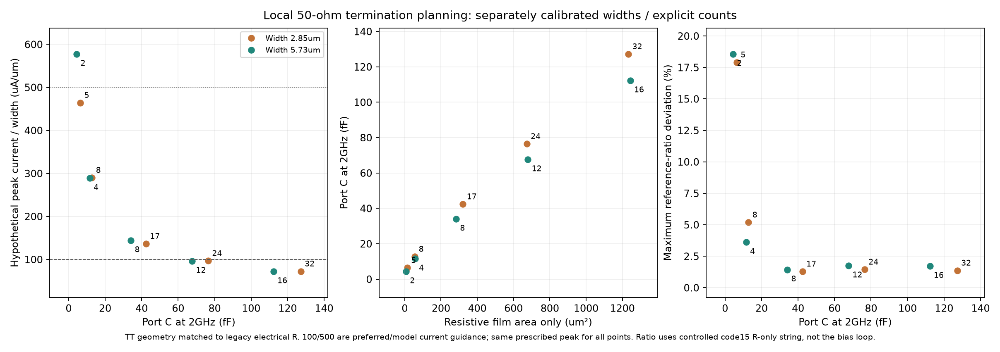
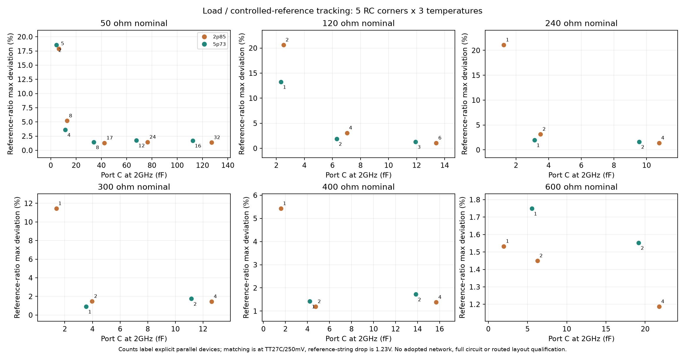

# 宽度与并联数：物理负载联合规划

**宽卡比较已完成，尚未采用新网络。** 按[局部耦合初态](tx_coupling_state.md)6.619mA峰值规划，2p85×24与5p73×12都落在推荐电流密度附近；后者端口电容低约11.5%，膜面积却相近，参考比值偏差也略大。宽度翻倍、支数减半不意味着电容减半；下一步须接完整参考及实际电路边界。



## 当前交付与适用范围

新[器件卡](../../analog/common/devices/tb/passive_card/wide_load_card.py)完成45个网络、2700行无源记录：36个固定候选、6个通用基线、3个参考代理；不改变生产DUT、PDK或采用修订。分别校准1p41、2p85、5p73的`A+B·L+C/L`曲线，允许接触系数C为负，几何只在实测长度域内求解，长度网格0.01µm。共享[规划器](../../src/serdes_flow/poly_geometry.py)与旧campaign使用的规划器分开维护，避免改写历史输入身份。

负载目标为当前通用卡的50/120/240/300/400/600Ω名义值所对应的TT实际阻值；50Ω比较2p85的5/8/17/24/32并及5p73的2/4/8/12/16并。完整覆盖5个RC角、三温及10/100/250/500mV负载压降。1Hz小信号阻值对±100µV DC微分的最大相对差3.90e−9；全部DC/LF/RF实部为正，端口等效电容非负。2GHz端口导纳另记，串联参考含分布RC，高频实部不要求等于DC斜率。

参考比较采用受控1.23V跨压的112kΩ＋16×780Ω电阻串，另外比较固定1p41的单段/八段主电阻。每个RC/温度下对应四个负载压降的参考行重复同一个1.23V状态，不是四种独立参考压降。其余修调段理想旁路，**没有带隙闭环、修调MOS、镜像管或实际I·R输出资格**。几何面积只计电阻膜，不计接触头、保护环和布线。

2p85/1p41使用已验证的[立方导数模型副本](fixed_poly_ac_overlay.md)。5p73原卡立方底数非负，保持原模型；本轮亦通过低频AC/DC微分检查。其校准接触系数C为−0.06347Ω·µm，规划器不能强制C为正。

## 电流边界如何使用

PDK给出的500µA/µm模型区间与推荐≤100µA/µm是使用指导，不是新的SerDes门槛，也不是交流EM签核方法。以6.619mA峰值、理想均流作规划：

| 组合 | 总膜宽 µm | 假设峰值电流/宽度 µA/µm |
|---|---:|---:|
| 2p85 × 8 | 22.80 | 290.3 |
| 2p85 × 24 | 68.40 | 96.8 |
| 5p73 × 12 | 68.76 | 96.3 |

表中的电流密度由同一个局部峰值推算；换电阻网络会改变负载电容、实际摆幅和电流，尚不能当作新网络的全PVT电流上界。宽度约翻倍、支数约减半时，总膜宽近似相同；匹配同一电阻值所需的膜长度/面积也会约束寄生，电容不应先假定减半。

## 所测取舍与候选范围

下表C为TT/27°C/250mV负载压降下的2GHz端口等效电容，不含布线。跟踪列为`Rload/Rref`相对TT值的最大偏离，参考用八段主电阻代理，负载压降固定250mV、参考固定1.23V，跨5RC×三温；不是实际摆幅误差。

| 名义目标 Ω | 实现 | 每支L µm | 端口C fF | 最大比值偏离 % |
|---|---|---:|---:|---:|
| 50 | 2p85 × 8 | 2.45 | 12.80 | 5.19 |
| 50 | 5p73 × 4 | 2.49 | 11.53 | 3.62 |
| 50 | 2p85 × 24 | 9.84 | 76.47 | 1.45 |
| 50 | 5p73 × 12 | 9.87 | 67.66 | 1.75 |
| 120 | 2p85 × 6 | 5.40 | 13.40 | 1.07 |
| 120 | 5p73 × 3 | 5.41 | 11.92 | 1.30 |
| 240 | 2p85 × 2 | 3.15 | 3.50 | 3.16 |
| 240 | 5p73 × 1 | 3.17 | 3.14 | 1.97 |
| 300 | 2p85 × 2 | 4.24 | 3.97 | 1.48 |
| 300 | 5p73 × 1 | 4.26 | 3.54 | 0.91 |
| 400 | 2p85 × 2 | 6.04 | 4.74 | 1.19 |
| 400 | 5p73 × 1 | 6.05 | 4.21 | 1.42 |
| 600 | 2p85 × 1 | 4.19 | 1.97 | 1.53 |
| 600 | 5p73 × 1 | 9.62 | 5.54 | 1.75 |

50Ω的2p85×24/5p73×12膜面积分别673.1/678.7µm²；宽单元的收益主要是本卡端口电容与支数，面积没有减半。旧通用50Ω端口C仅8.36fF，这两组约为其8–9倍，仍须核对实际消费方。2p85×8/5p73×4电容小得多，但按同一局部峰值的假设电流密度约290µA/µm，需明确是否接受该使用区间并补热/均流检查。5p73×2虽几何合法，按该峰值已达578µA/µm，超出所引PDK模型电流范围，不进入这一边界下的后续候选。

低阻的最短网络跟踪并不好：50Ω的2p85×5与5p73×2最大比值偏离17.9/18.6%，120Ω最少支数为20.6/13.3%。增加并联数后的偏差也不是严格单调下降。较宽单元不必统一用于所有负载；600Ω只看所测C/代理比值时2p85单只更有利，仍须补各负载实际电流。



三个代理串TT/27°C实际总阻值为通用124566.27Ω、固定单段124586.95Ω、固定八段124569.51Ω。各段在250mV下校准后，串内实际压降不同，未强行声称所有偏置点精确等值。换参考实现也会改变比值结论：50Ω/5p73×12相对通用、固定单段、固定八段的偏离分别1.35/2.02/1.75%，故先保留合理候选，接完整带隙、trim MOS与镜像后再定。

## 独立原语版图复核

Terra和集成者分别在新目录调用本机Magic生成2p85、5p73的L10µm原语，`guard=1, doports=1`。两次均完整DRC 0、LVS匹配且无属性差错；提取为独立三端`B/R1/R2`，电阻实际使用两端及体端，保护环标签在衬底接触层。按端口、器件和参数比较两次结果，未要求带生成时间的文件逐字相同。

[复核数据](../data/layout_fixed_resistor_review.json)、[索引](../../results/catalog/layout_fixed_resistor_review.json)、[可复跑脚本](../../verification/analysis/layout_fixed_resistor_review.py)。这是孤立L10原语的构建检查；待选长度、完整并联网络、均流走线、EM、自热和PEX仍须另验。

## 复跑入口与后续验收

完成目录`results/analog/common/devices/wide_load_card/20261112T050902.564688Z_ea0db703`固定源码、计划及模型身份；6个短deck串行完成，总计约148秒，按RC角续跑。6项几何/拓扑测试通过。

```bash
uv run pytest -q tests/test_poly_geometry.py tests/test_wide_load_card.py
uv run python analog/common/devices/tb/passive_card/wide_load_card.py --resume results/analog/common/devices/wide_load_card/20261112T050902.564688Z_ea0db703
```

[发布器](../../verification/plotting/wide_load_card.py)已重新读取全部标量raw，重做校准和几何，核对2700行覆盖、数值符号、执行deck/日志及原语复核证据；[数据](../data/wide_load_card.json)与[索引](../../results/catalog/wide_load_card.json)保留身份。只据联合比较缩小候选；采用前仍需真实参考、当前完整电路边界、全PVT与实际网络版图验证。
