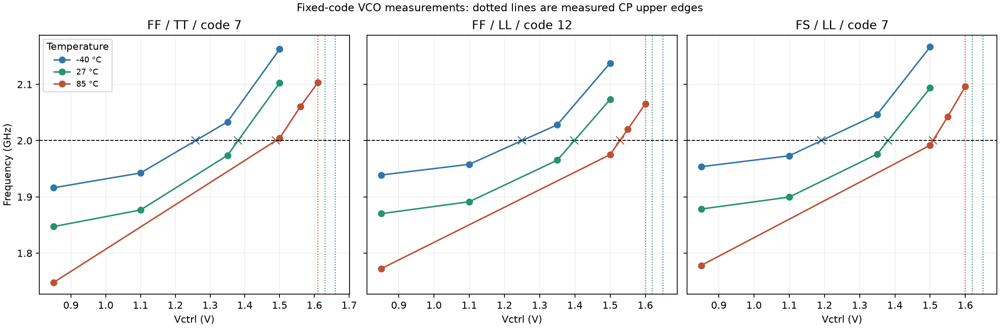
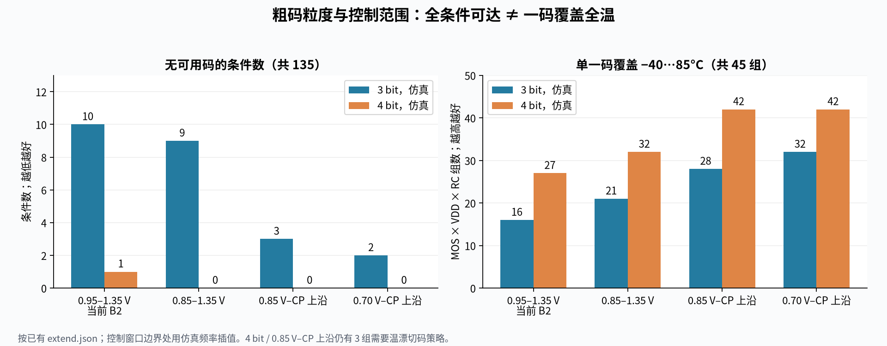
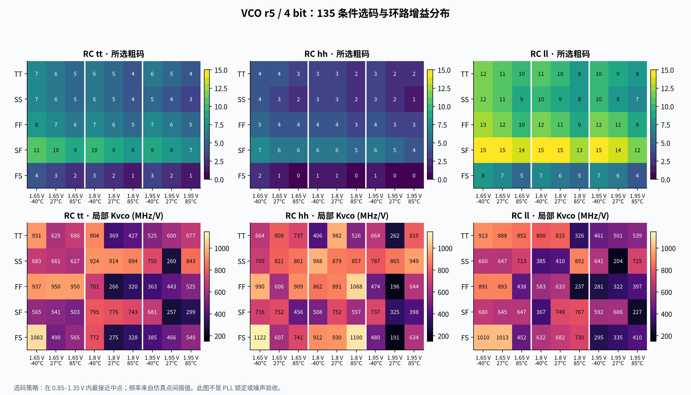
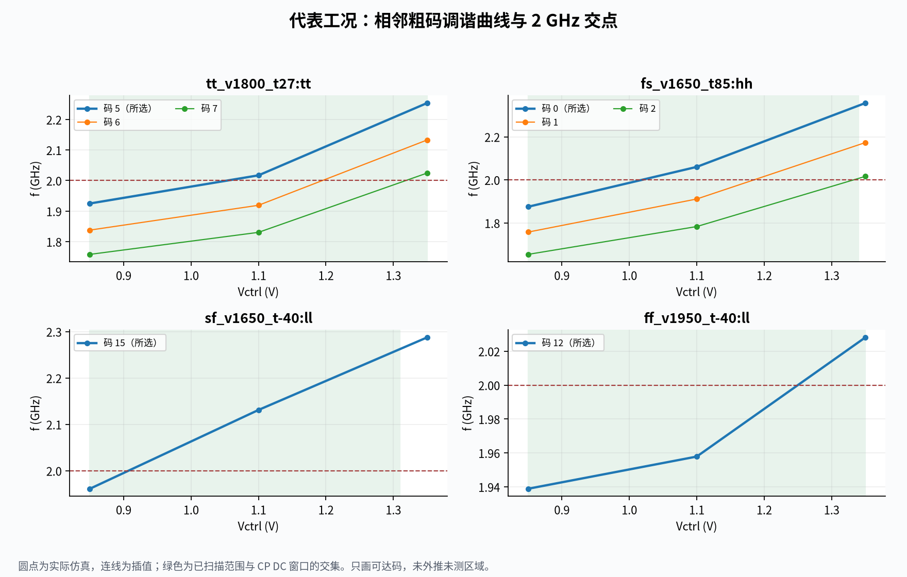
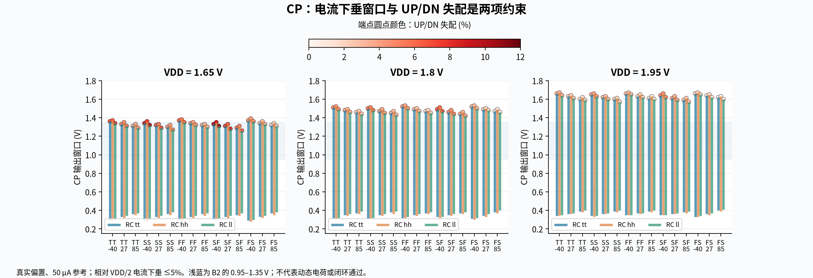
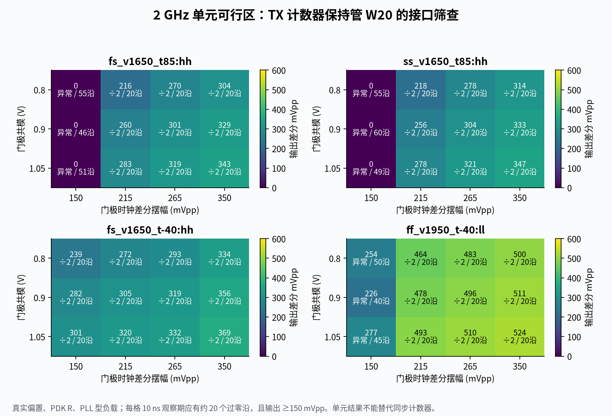
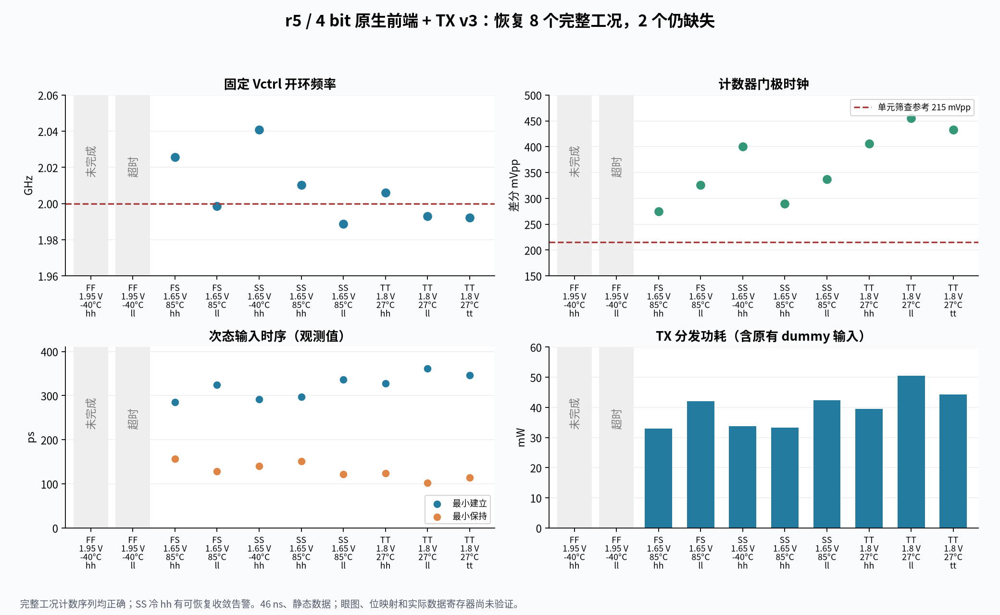
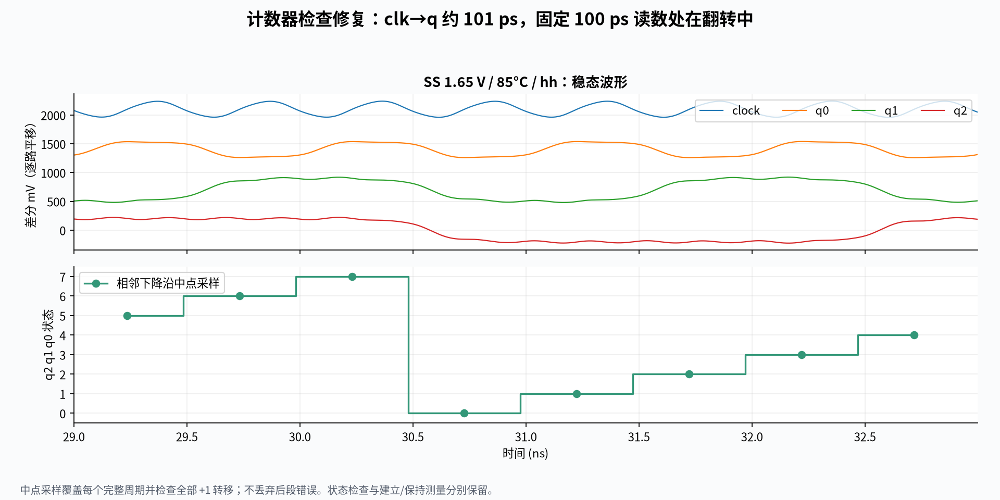

# 时钟链路图集

这批图展示最近的 VCO 工作区、CP 窗口、分频单元和 r5＋TX v3 联合仿真。先看范围，再看数值；原生联合仿真目前只有静态数据，不能当作串化器眼图或闭环 PLL 验收。

数据、复现与下一步见[记录](../../history/clocking_progress_20261106.md)。[返回图目录](../README.md)。

## VCO：调得到与能保持是两件事

4 bit、0.85 V到CP上沿内，135条件存在可用码。11-06原图确认42/45组固定码跨三温；11-07补测另外3组的共同候选码后为45/45组。原来的三组是采样覆盖不足，不能据此判为必须增加码位或切码。

[补测边界和数值](../../design/pll_vco.md#固定码三温补测2026-11-07)、[小数据](../../data/vco_cp_edge_fill.json)。以下控制窗口图保留11-06原统计，当前结果由补测补充。

下面的码按控制窗口中点选择。局部 Kvco 191–1122 MHz/V，说明“频率可达”之后还需要按环路增益选择工作点。它与原生 bench 中按最大斜率选择的码表是不同策略。

## CP：输出余量与上下拉匹配

窗口按各支路相对 VDD/2 的电流下垂 5% 计算，点色表示 UP/DN 失配。窗口足够宽仍可能有约 11% 的支路失配，需要实际开关电荷和环路验证。

## ÷2：摆幅与翻转都要看

W20 保持管的单元在部分 150 mVpp 输入下会停止再生或发生异常翻转；只看输出峰峰值会漏掉 FF 冷角错误。215 mVpp 是这组离散扫描的可用参考点，不是全项目通用门槛。

## 原生 r5＋TX v3：8 个完整，2 个缺失

8 个完整工况均连续正确计数，门极时钟 275–455 mVpp，分发功耗 33.0–50.5 mW；FF 冷角的 hh 未完成、ll 超时。SS 冷 hh 曾出现 singular-matrix 告警，但波形完整、指标有限，告警保留在数据中。

SS 热 hh 的 clk→q 约 101 ps，原先沿后 100 ps 采样误判计数失败。现在在相邻有效沿中间采样，并检查整个观察窗的每次递增，不跳过后段错误；时序与波形质量另行测量。

