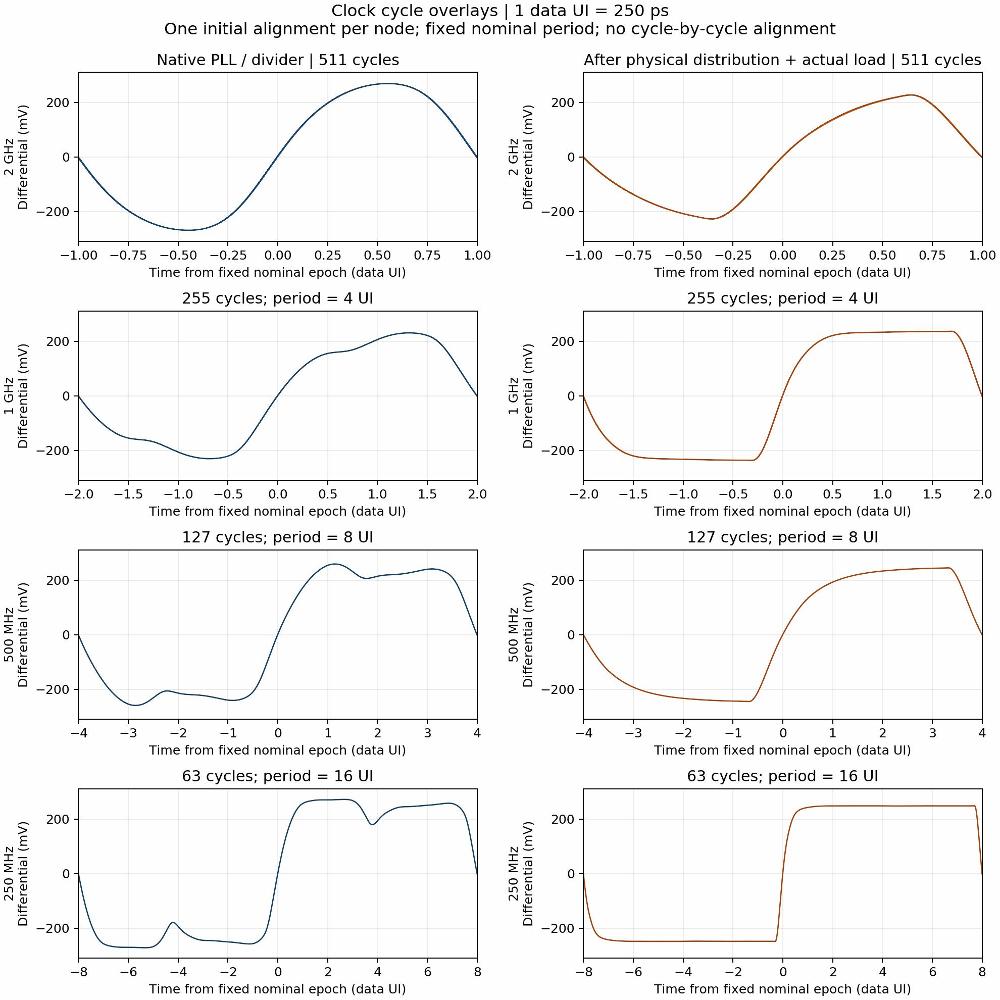
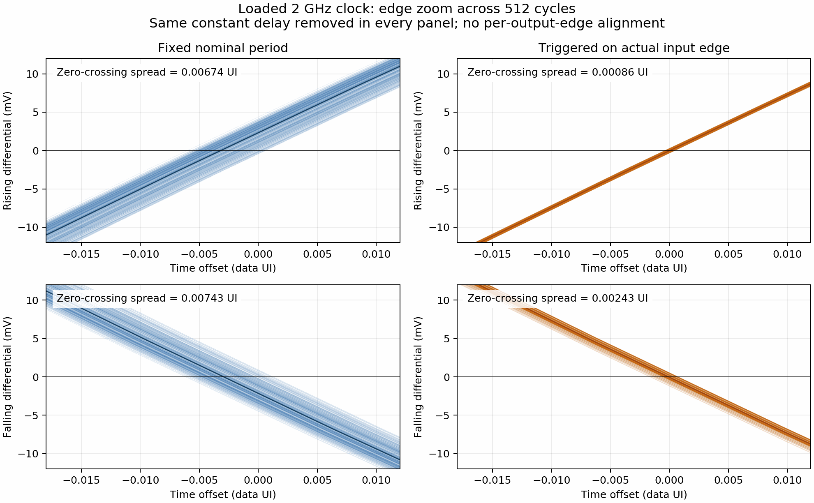

# 时钟周期叠图与边沿散布

使用现有原生PLL记录和实际buffer驱动串化器的波形，无新增SPICE仿真。仅分析64个负载字，窗口为字时基起点后64–1088 UI；所有横轴采用数据UI，1 UI=250ps，2GHz时钟周期为2 UI。

**2GHz负载端时钟过零散布约0.00743 UI；数据边沿散布为0.16248 UI。参考实际2GHz发射时钟后，数据延迟散布仍为0.16208 UI。** 因此，本窗口的共同频率/相位漂移不足以解释大部分数据边沿散布。不能据此把剩余量全部归因于某一只MUX，仍需逐级延迟、码型和建立时间检查。

## 周期叠图

左列为PLL原生抽出/分频节点，右列为理想源经过真实预驱动、电容微调、扇出buffer及实际串化负载后的输出。两列各自只作一次初始上升沿对齐；此图用于比较形状及散布，未显示两列的绝对传播延迟。其间的源理想化仍与[实际分发报告](physical_clock_distribution_results.md)一致。

叠图固定使用标称周期，不逐周期拉伸或重对齐，也不拟合频率。频差会表现为累积横移；同极性边沿厚度反映确定性过零时间变化；上、下降沿不同可提示占空比失真。全周期图的线束很薄，须放大过零区才看得清。

## 2GHz过零放大

左列固定标称周期，保留源频差累积和源时序变化。右列由每个独立观测到的输入时钟边沿触发，输出只减去所有周期、两种极性共同使用的一个常数传播延迟；没有以输出自己的边沿逐次对齐。因此右列显示分发路径传播延迟的变化，未将输出散布强行抹去。这个触发处理仅用于诊断，不修改数据眼图、训练延迟或判决参考。

| 时钟 | 输出上升沿TIE峰峰值/UI | 输出下降沿TIE峰峰值/UI | 输入触发后的上升沿延迟变化/UI | 输入触发后的下降沿延迟变化/UI | 输出10–90%上升时间/UI |
|---|---:|---:|---:|---:|---:|
| 250 | 0.00558 | 0.00541 | 0.00002 | 0.00138 | 0.581 |
| 500 | 0.00585 | 0.01130 | 0.00014 | 0.00660 | 1.507 |
| 1g | 0.00649 | 0.00823 | 0.00007 | 0.00362 | 0.515 |
| 2g | 0.00674 | 0.00743 | 0.00086 | 0.00243 | 0.619 |

TIE以各节点窗口内第一个上升沿建立固定标称时基，下降沿按半周期位置计算；两种极性的散布分开统计。上述不同参考的峰峰值不能相减来分配抖动贡献。

2GHz输出上升沿10–90%时间约0.619 UI，下降沿约0.619 UI，波形确实圆缓。这里的10%/90%按各周期极值中位数定义，适用于该CML波形，不能直接等同于CMOS轨到轨边沿规范。过零时间稳定与边沿快速是两个独立性质；慢时钟可能经CML选择管的有效切换阈值、输入码型和建立时间影响数据延迟，但本次叠图未单独证明其贡献。

这段2GHz输出平均频率约2.0000104GHz，约+5.18ppm；固定标称时基因此保留少量累积漂移。当前结果支持优先检查串化路径的码型相关延迟和建立时间，而不是把数据眼图散布直接解释成PLL没有锁准。原0.15 UI暂设比较线及数据判决结果保持不变。

## 记录与适用范围

这是无随机瞬态噪声的TT确定性波形叠加，过零采用保存点线性插值；极小数值包含求解器和保存精度影响，不是统计抖动、相位噪声、BER或PVT保证。当前源边界理想化了幅度/斜率并隔离PLL与分发网络的负载回灌，因此结论限于这个回放接口。

[完整数值及输入SHA256](../data/clock_overlay_audit.json)。原运行目录的raw/clock_overlay_*.npz保存周期叠图数组，raw/clock_overlay_edges_*.tsv保存输入/输出边沿及传播延迟，raw/clock_2g_edge_zoom_ui.npz保存放大图数组；图及数值副本均附于原运行目录。

进一步只调整数据眼图折叠UI的±200ppm扫描及1UI起点平移对照见[折叠UI微调](eye_fold_ui_sweep.md)。

原生多相VCO、四路分频链及实际分发边沿的统一250ps时基套叠见[多频多相时钟套叠](pll_multiphase_clock_overlay.md)。
