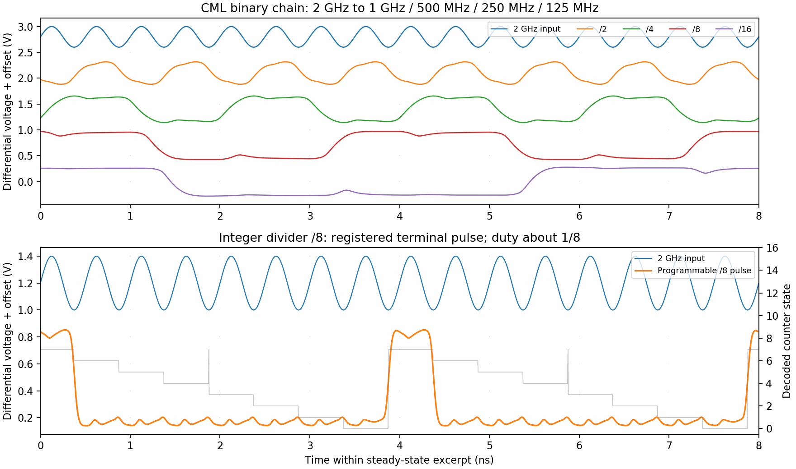

# CML 分频器原型与验证记录

本页保留早期全 CML 探索。当前已改为三级固定 CML ÷8 后接 CMOS M=1–16，
默认 M=1；不再使用本页的全 CML 整数计数器或第四级 ÷16。
当前架构和结果见 [混合分频记录](hybrid_divider_results.md)。

已实现两个晶体管级支路：二进制 /2、/4、/8、/16 时钟链，以及整数 1–16 的同步反馈分频器。
默认工作点为 2 GHz ÷8=250 MHz。二进制支路输出近 50% 占空比；整数反馈支路对 N>1
输出约一个输入周期宽的注册脉冲，适合边沿 PFD。两者用途不同。

用户已确认：参考规划为 50–500 MHz，低参考用于低线速，因此保持 N=1–16。
没有参考预分频时 fVCO=N×fref；250 MHz×8=2 GHz，50 MHz×8=400 MHz，500 MHz×4=2 GHz。
这些组合还要受 VCO 实际调谐范围限制，当前阵列尚未证明覆盖 400 MHz。
50–500 MHz 为参考接口规划；后续已完成 PFD 在 500 MHz 近零相差的复位和接口抽测，
见 [PFD 记录](pfd_cmos_results.md)。实际 CP 脉宽、电荷建立和大相差捕获仍待联调。

## 实现及共模处理

源码在 [divider/spice](../../analog/pll/divider/spice)，独立测试台在
[tb/functional](../../analog/pll/divider/tb/functional)。
基本锁存器由电阻负载、上层数据/再生差分对、下层时钟转向对和尾电流管组成。
两个相反时钟控制的锁存器构成主从 DFF，反相输出回授到 D 输入构成 ÷2。
锁存器的再生增益及级联功耗取舍可参考
[Sam Palermo, Divider Circuits，p.6–15](https://people.engr.tamu.edu/spalermo/ecen620/lecture12_ee620_dividers.pdf)。

上层数据输入保持高共模 CML；下层时钟转向对使用本地 LVT 源跟随器降共模，
避免把约 1.63 V 的时钟门电压直接用于下层堆叠而损失电压余量。
每一级的输出电平重新由本级 VDD、尾电流与负载建立，近似
`VCM,out = VDD − Itail×R/2`，不会沿级联链不断累减一个 VGS。
下一级接收的是高共模差分输出，再由自己的时钟输入移位器适配。

最终 ÷2 单元在 TT、2 GHz、400 mV 差分峰峰值、输入共模 1.632 V、每端 5 fF 下：

| 指标 | 测量 |
|---|---:|
| 输出频率 | 1 GHz |
| 输出差分峰峰值 | 441.58 mV |
| 输出平均共模 | 1.67048 V |
| 内部移位时钟平均共模 | 0.96478 V |
| 主/从尾管最小漏电压 | 0.33421 / 0.33426 V |
| 单元功耗，不含单独理想参考源 | 2.150 mW |

尾管漏电压是余量观测，不是已完成所有器件饱和区判定。输入范围和 PVT 顺从范围仍需系统扫描。
内部时钟支路摆幅不强制等于 VCO 的 400 mVpp；各接口仍需逐项验证。

单元保留主锁存器 mp/mn 观测口。该 TT 测试中，mp 对 qp 的正向零交叉相位为 269.45°，
等价于相反方向约 90.55°。这仅为轻负载单元观测，不能把主从两端未经等负载缓冲就视为已合格四相输出。

## 二进制链

最终链使用每级 Wdata=20、Whold=80、Wclock=64、Wtail=12 µm，Rload=600 Ω；
时钟源跟随器 W=40 µm，电流镜参考为 0.85 mA。沟道长度和指数量见网表。
早期较小的再生对在部分角落、高温或较慢输入下丢失状态；最终配置增大了保持强度与时钟转向能力。

TT、1.8 V、27°C、2 GHz 正弦输入、差分 400 mVpp、共模 1.632 V，
四个抽头每端均有 5 fF，且前三个抽头还带下一级真实晶体管输入负载：

| 抽头 | 输出频率 | 差分摆幅 | 占空比 |
|---|---:|---:|---:|
| /2 | 999.996 MHz | 433.09 mVpp | 49.9950% |
| /4 | 499.999995 MHz | 513.42 mVpp | 49.9988% |
| /8 | 250 MHz | 544.29 mVpp | 49.99994% |
| /16 | 125 MHz | 558.73 mVpp | 50.0000% |

四级全部活动的总功耗为 **8.711 mW**，不含单独偏置参考源的 1.53 mW。
这不是只装三级 ÷8 的功耗。各级输出共模约 1.6705、1.6682、1.6674、1.6669 V。
最大步长从 2 ps 减到 1 ps 后，÷8 频率和占空比保持一致；首级频率变化约 0.0114 ppm。
首级周期内存在确定性波形变化，不能用这些无噪声瞬态结果声称已测随机抖动。

最终参数已验证 2 GHz 下 TT/SS/FF/SF/FS、1.8 V、27°C 的四个分频抽头，
以及 TT、125°C 的 2 GHz 点。另验证 TT 在 27°C 和 125°C、400 MHz 输入下
产生 200/100/50/25 MHz。它们是离散测试点，不是完整 400 MHz–2 GHz 连续范围或全 PVT 笛卡尔积验证。

**边界：**50 MHz、400 mVpp 正弦直接输入仍误计数，不能声称最低输入达到 50 MHz。
缓慢过零时两锁存器的时钟转向/保持余量需要继续改善，或使用有明确定义输入灵敏度的限幅级。
这一条件不同于 50 MHz 参考、400 MHz VCO、反馈 ÷8；后者的分频器输入为 400 MHz。

## 整数 1–16 反馈支路

`pll_cml_divider_programmable` 是四位同步递减计数器：计数非零时减一，到零时重装 N−1。
额外 DFF 注册零检测，避免直接把多位组合译码毛刺送到 PFD。
计数、MUX、XOR、AND、配置转换和输出均为实际 CML 晶体管电路，未用理想行为触发器替代。
内部时钟带强 CML 扇出缓冲；静态互补 CMOS 配置位只转换一次。

配置 n3…n0 编码 N−1，nb3…nb0 为其互补：0000=/1，0111=/8，1111=/16。
/1 通过静态输出 MUX 选择缓冲后的输入，其余代码输出注册终端脉冲。
配置仅允许在 PLL 反馈关闭时改变；当前没有动态无毛刺切比或确定相位复位端口。

全部 16 个 N 已在 TT、1.8 V、27°C、2 GHz 正弦输入、400 mVpp、1.632 V 共模、
输出每端 5 fF 下逐一完成晶体管级瞬态。每个 N 均检查了分频周期以及内部四位计数的递减/重装顺序，
没有观察到稳态计数错误。N=16 对应 125 MHz，N=3 对应 666.667 MHz，N=15 对应 133.333 MHz。
完整各点及 run_id 见 [CSV](../data/cml_divider_points.csv)。

默认 ÷8 的输出为 250 MHz、差分约 712.55 mVpp、共模约 1.62645 V、占空比约 12.543%。
功耗 **29.119 mW**，不含单独理想参考源；目前仍有明显功耗优化空间，/1 也未关闭计数器电流。
÷8 另有 SS、FF、FS、27°C 和 TT、125°C 的 2 GHz 抽测，以及 TT、27°C 的
400 MHz→50 MHz 抽测。其他 N 的这些角落/低频组合尚未逐一验证。
通用 DFF 保留 Whold=20、Wclock=24 µm 的独立尺寸，不使用二进制链的最终参数。
÷8 的最大步长从 2 ps 减到 1 ps 后，输出频率保持 250 MHz，占空比变化约 0.0000018 个百分点。

矢量图：[SVG](../figures/clocking/dividers/cml_divider_waveforms.png)。灰色计数曲线由四位组合解码，
跳变期间的尖峰不代表注册反馈输出也存在这些毛刺；两者分开检查。

## 测试、归档和未完成项

使用 ngspice 47、SKY130A `c6d73a35f524070e85faff4a6a9eef49553ebc2b`，hs a 兼容模式、KLU。
每次保留网表/依赖快照、SHA256、原始波形、完整日志、run.json 与 metrics.json。
频率取后半段窗口的差分上升零交叉插值平均周期；摆幅小于 1 mVpp 或少于三个有效边沿时不报告频率。
比例正确还要求逐周期检查，不能只看平均 FFT 峰值。
整数计数状态每输入周期取一次样，并从八个固定采样相位中选择最小差分余量最大的一个，
再逐个比较递减/重装关系；这不是 setup/hold 裕量扫描。

主结果位于 `results/analog/pll/divider/functional/`。主要运行前缀：

- `20261027T140105Z_*_chain_final_*`：最终二进制链；
- `20261027T135919Z_*_chain_hold80_clock64_hot_*`：同参数高温/低频点；
- `20261027T140136Z_*_div2_final`：最终 ÷2 单元电气观测；
- `20261027T134751Z_*_programmable_n*`：整数扫描，N=8 基准为 `20261027T134545Z_*_programmable_n8_initial`；
- `20261027T135919Z_*_programmable_n8_*`：补充角落/低频。

探索阶段一次把预期 400 MHz 写为 `400M`，实际 SPICE 解释为 0.4 Hz；该运行已标记激励错误，
不计入 MHz 覆盖。正确测试使用 `400Meg`。早期小保持尺寸的失败也保留，不作为最终参数覆盖。

`pll/top/tb/vco_divider/` 已有实际 VCO、四相缓冲/接收器、分频器和反馈接收器测试台，
但目前瞬态收敛失败，**没有可信的完整耦合联调指标**。早期网表还修正过 VCO 与分频抽头同名节点的误连接；
修正后的运行仍存在数值问题，失败快照均保留。源跟随器输出、内部寄生电感等路径仍待定位。
数值收敛辅助手段参考 [ngspice 用户手册](https://ngspice.sourceforge.io/docs/ngspice-manual.pdf)，
尝试改变初值/积分方法不能当作已经验证电路能正常启动。

加入分频器后，单个 VCO 相位的负载增加。后续要比较分支缓冲及各相匹配负载，
重新测频率、相位、摆幅和反向扰动；此前“一个接收器可直接接 VCO”的结论不能外推到新扇出。
当前不声称完成耦合负载、PFD 接口最小脉宽、完整 PLL 锁定、噪声、失配、提取后或确定性字对齐验证。
电阻负载和外部参考电流仍为理想元件；所有设计规格 verdict 保持 ungraded。

粗码 ±1 搜索、变容覆盖、迟滞和冻结策略另见 [VCO 粗调校准](vco_coarse_calibration.md)。
