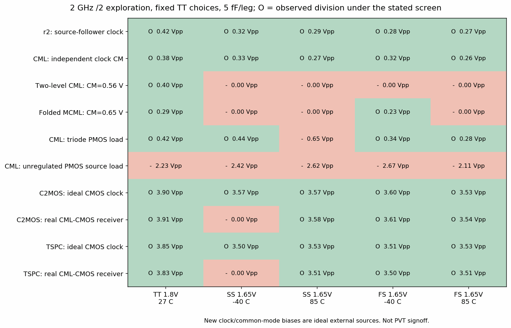
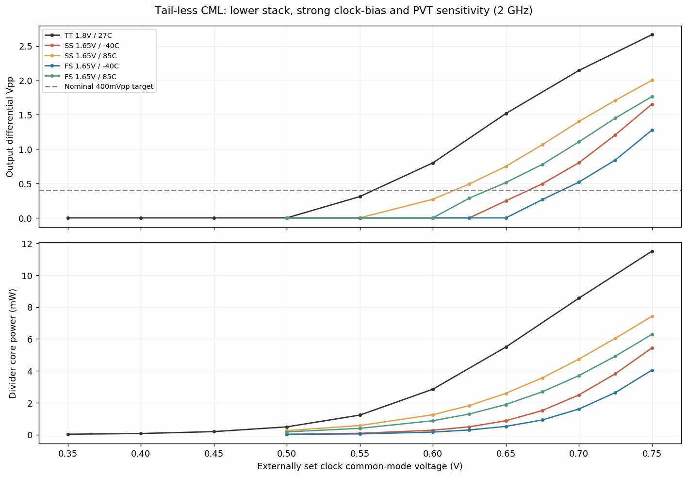
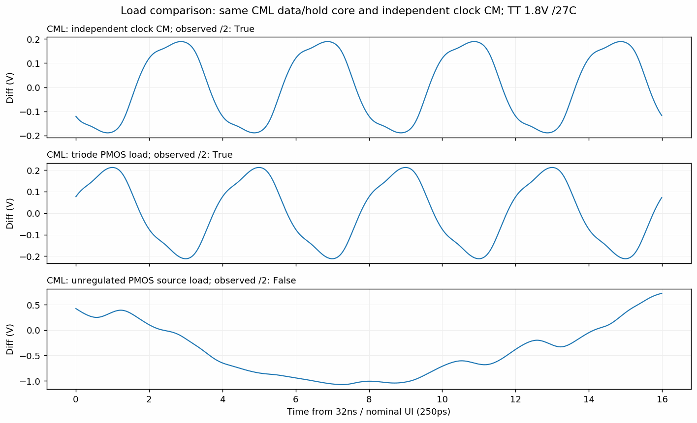
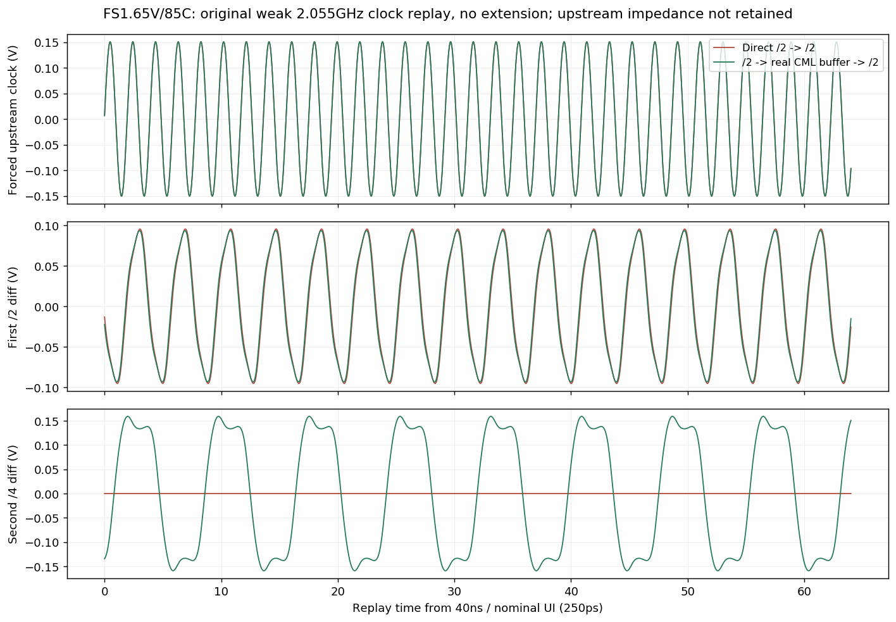

# 锁存器与分频器结构探索

2026-10-29。按“都试试、主要观察边界”的要求，建立独立探索电路，保留 lowov r2 工作设计和冻结发布。数值入口为 [JSON](../data/cml_latch_topology_experiments.json)，campaign (`results/analog/pll/divider/topology_exploration/20261029T140545Z`)保留每个网表、偏置、日志、波形和生成命令。

本轮比较的是候选可行性和接口敏感性，不进行产品资格判定。没有实现新的 replica 共模伺服或 CMFB，候选时钟共模和 PMOS 负载栅偏置由外部理想源提供；电流偏置沿用真实 MOS 镜，folded 支路有独立 PMOS 二极管参考。没有体正偏、失配、随机噪声或提取寄生，也没有重跑完整 PLL。

## 测试如何分层

1. TT 调参：39 个点，观察时钟共模、PMOS 尺寸/栅偏置、动态 CMOS 尺寸的作用。
2. 固定 TT 设置后跨角：10 种电路/接口组合，TT/1.8 V/27°C，SS 与 FS 的 1.65 V/−40、85°C，频率 0.5/1/2/2.5 GHz，共 200 个记录。
3. 允许角上重新调节：91 个点，扫描两层 CML 时钟偏置、folded 时钟共模/镜尺寸、SS 热角 PMOS 负载尺寸；与固定设置的结果分开保存。
4. 数据 DFF：五种 CML 内核、五个条件，25 个记录；输入 16 个 0、16 个 1 和 96 个 LFSR 位，共 128 bit，比较后 120 bit，同时测采样点幅度与采样相位。
5. 实际 FS 时钟电压回放：先取上轮原生 32–64 ns 的两根 buffer 输出；再用原始 8–64 ns 记录补充较长的启动/稳态观察，均不延拓。驱动两级真实 ÷2，比较有无级间 CML buffer，共 18 个记录。

单元输入是 300 mVpp、高共模的理想 CML 正弦，先经真实 CML buffer，再进入各候选。输出每端 5 fF；这项单元加载不能冒充三级 prescaler 的加载。独立共模接口每端 200 fF 耦合电容、50 kΩ 偏置电阻，仅用于时钟，数据保持 DC 耦合。动态 CMOS 同时测试理想 15 ps CMOS 时钟和现有真实 CML→CMOS 转换器。

观察标记要求至少三个输出周期、各周期相对 ÷2 理论值偏差 <5%，CML 差分摆幅至少 150 mVpp；CMOS 差分摆幅至少 0.4 VDD。它们是本轮筛查方法，**不是新产品规格，也没有把名义 400 mVpp 目标撤掉**。实际数值、额外过零和幅度均保留，不以模拟器正常退出代表电路成功。

## 固定设置下的 2 GHz 结果

表中的计数仅覆盖上述五个选定条件，不能读成 45 点 PVT 或完整 PLL 结论。

| 候选 | 固定 TT 设置 | 观察到 ÷2 的条件数 | 主要发现 |
|---|---|---:|---|
| 当前 lowov r2 | 原源跟随接口 | 5/5 | 对照单元保持工作；不消除既有真实前端回接缺口 |
| 静态 CML、独立时钟共模 | 0.95 V | 5/5 | 单元可行，但 AC 耦合对前级的加载需要单独回接 |
| 两层、去独立尾源 CML | 0.56 V | 1/5 | TT 约 397 mVpp；四个低压 SS/FS 条件没有有效分频 |
| 基本 folded MCML | 时钟共模 0.65 V、镜 W20 | 2/5 | TT 和 FS 冷角可分频，其他角需调整 |
| PMOS 电阻式负载 | W16/L0.5，栅 0 V | 4/5 | SS 热角出现错误周期；幅度大不代表正确锁存 |
| 固定栅偏置 PMOS 上拉，尝试高阻负载 | W16/L0.5，栅 0.4 V，20 kΩ 弱上拉并联 | 0/5 | 未控制共模，出现大幅度及错误周期；不是优化过的有源负载设计 |
| C²MOS、理想 CMOS 时钟 | 单元尺寸 scale=1 | 5/5 | 晶体管内核可行 |
| C²MOS、真实转换器时钟 | 同上 | 4/5 | SS 冷角的时钟转换接口失败 |
| TSPC、理想 CMOS 时钟 | 9T 核心加输出反相器 | 5/5 | 晶体管内核可行 |
| TSPC、真实转换器时钟 | 同上 | 4/5 | 同样暴露 SS 冷角转换器缺口 |

动态 CMOS 的成功说明它们值得继续做，不表示已经解决全速 CML→CMOS 接口、任意数据时序、停止/重启、最低频率、输出过冲或多相导出。理想时钟与实际转换器结果分开，避免把接口失败归到内核。

## 两层 CML：偏置跟踪是关键

TT 的时钟共模从 0.55 V 增到 0.60 V，输出约从 310 增到 800 mVpp，核心功耗从约 1.22 增到 2.85 mW。没有独立尾源后，不能只用固定栅电压期待跨角电流和摆幅保持一致。

重新扫描偏置后，四个 SS/FS 低压冷热角都能找到 2 GHz ÷2。例如 SS 冷角 0.65 V 时约 248 mVpp，0.675 V 时约 496 mVpp；FS 冷角约在 0.675 V 才进入本轮观察幅度区间。原固定 0.56 V 的失败记录保留。这支持继续研究电流/摆幅 replica 偏置，不支持把一个理想固定共模直接应用到生产网表。

folded 候选调低时钟共模并扫描镜尺寸后，所有选定角也能找到 ÷2，但 SS/FS 热角最好的一些测点仍仅约 176/185 mVpp。TT 默认核心约 2.53 mW，高于独立共模静态 CML 的约 1.43 mW；折叠支路和镜输出都耗电，不能认为减少堆叠必然降低功耗。这里的基本镜没有加入文献中的压差均衡结构，也未使用体正偏。

功耗数值只表示该单元和指定加载：数据另列接口功耗、参考夹具功耗；理想 CMOS 时钟扫描额外记录时钟源功率。未设计的 bias servo、CMFB、电源参考，以及上游真实时钟树功耗不能忽略后拿来比较系统能效。

## 电流镜很好，为什么仍会选电阻负载

“复制偏置电流”和“把高速差分电流变为电压”是两个设计任务。我们当前本地偏置镜、folded 时钟电流镜、CML→CMOS 的差分转单端增益级都用了电流镜；并非回避 PMOS 或电流镜。

电阻负载便于预测：理想完全转向近似下，单端高低电平差约 I·R，差分峰峰值约 2I·R，输出共模约 VDD−I·R/2。R 同时参与增益和输出 RC。真实电阻仍有面积、热噪声和工艺变化，当前理想 R 没有替这些问题完成签核。

PMOS 可作至少三种不同负载：

- **线性区 PMOS 电阻。** 可用栅偏置调整等效电阻，但电阻依赖输出电压、PVT，并带来器件电容。本轮 TT W12、16、24 µm 有正确 ÷2，W8 或 W32 µm 的测点失效；不能一味增加或减小拉力。
- **饱和区电流源负载。** 可提供高输出电阻和增益，但要给它压差，并处理上下电流不匹配、输出共模和电容充放电。这里的固定栅偏置上拉没有 CMFB，且没有保证整个周期都饱和；其失败不能证明所有有源负载结构差。
- **电流镜型差分转单端负载。** 适合把两路电流合成一个单端信号。普通不对称连接不宜直接替换需要对称双输出的两只 CML 电阻；需要按目标输出形式重新设计。

SS 热角将 PMOS 电阻式负载从 W16 调到 W20/W24，÷2 可恢复，输出约 294/222 mVpp。这个结果支持负载可调，但尚不能当作数据锁存也通过：下节展示了两者的差别。电阻与 triode PMOS 都是常见 MCML 负载，文献有直接的[延迟建模比较](https://www.sciencedirect.com/science/article/abs/pii/S0026269219307955)。

## 任意数据为什么值得另测

五种 CML DFF 在 TT、计入传播延迟后的共同采样点 1.35T，120 bit 均无符号判决错误。较早的 0.85T 对部分版本太早；原初记录和后续相位重分析均保留，不能把时序参考选错算成电路无法存储。

| 固定设置的 DFF | 共同采样点 1.35T 的观察 |
|---|---|
| 当前 r2 | 五条件均 0/120 错误，最小中心差分幅度约 104–203 mV |
| 独立时钟共模 | 五条件均 0/120，约 149–218 mV |
| 两层 CML，固定 0.56 V | 四个角虽然按正负号可读对，幅度只有约 0.4–36 mV，不能记作有效接收 |
| folded 默认设置 | SS 冷角最小中心幅度约 24 mV；其他点的短模式可读，不等于每拍翻转的 ÷2 能跑 |
| PMOS 电阻式负载 | SS 冷/热角分别 33/32 个错误；本次相位扫描也未找到同时无错误且有 50 mV 幅度的采样点 |

50 mV 是探索时显示幅度缺口的参考线，不是新的 CML 接口规格。所有最小幅度、误码位置对应数据和相位扫描保存在 JSON；120 bit 不能用于宣称统计 BER。建立/保持时间、失调、任意长连码、完整移位链以及 CMOS 数据读出仍需独立测试。动态 CMOS 本轮只做分频，未扩展到任意数据 DFF。

## 最有用的级间回放结果

从上轮 FS/1.65 V/85°C 的实际前端取两段原始波形：弱幅度测点约 2.055 GHz、buffer 差分约 301 mVpp；健康幅度测点约 1.927 GHz、约 404 mVpp。回放没有延拓，也没有保留原上游源阻抗；输出负载和被测分频电路均为真实 MOS。

| 接法 | 弱波形 ÷2 / ÷4 | 健康波形 ÷4 |
|---|---|---|
| 当前 r2 两级直连 | 约 190 mVpp / 基本为零 | 正常，约 285 mVpp |
| 当前 r2，中间加真实 CML buffer | 约 187 / 318 mVpp | 正常，约 354 mVpp |
| 独立时钟共模，两级直连 | ÷2 可观察，÷4 失效 | ÷4 仍失效 |
| 独立时钟共模，中间加 buffer | ÷4 仍失效 | ÷4 恢复 |

当前 r2 加 buffer 后，弱波形的两级核心功耗约从 3.44 增至 4.19 mW，增量约 0.75 mW。首级输出摆幅并没有提高，但后级恢复，支持在级间增加时钟幅度恢复/驱动隔离的方向。这里的 buffer 是已有真实 `serdes_cml_buffer`，输入管总宽 W24 µm；没有通过理想增益源驱动后级。

初始 32 ns 回放中，加 buffer 的 ÷4 建立较晚，因此另用原生 8–64 ns 的 56 ns 长记录复核。较早部分仍保留实际 VCO 的频率建立过程，最终仅比较对应原生 48–64 ns 的窗口：弱波形加 buffer 后观察到 8 个 ÷4 周期，两个相邻 8 ns 窗口的差分摆幅分别约 317.6/317.7 mVpp；直连仍基本为零。下图采用该较长复核的尾段。

独立共模候选单元能过，级联仍可能失败，说明新增 AC 接口的输入负载、信号衰减和驱动必须同时评估。这是有明确隔离边界的接口证据；尚不等同于已改变原生 VCO 负载后，完整 PLL 也已恢复。下次可先回接“r2 加级间 buffer”这一小改动，而无需同时重构所有锁存器。

## 后续取舍

优先保留当前静态 r2，继续级间 buffer 与时钟共模接口的组合；PMOS 电阻式负载作为可调负载候选。两层 CML 值得配 replica 偏置，folded 值得保留为低压比较，但本轮没有显出足以直接换主线的优势。动态 CMOS 的内核结果积极，实际转换器 SS 冷角仍需修复；它也不能自动替代 RX 的多相 CML 采样结构。

电路源原位于 `analog/pll/divider/spice/exploratory/latch_candidates.spice`，单元 TB 原位于 `analog/pll/divider/tb/topology_exploration/{tb_explore_ngspice.cir.in,case.toml}`（已于 2026-11-20 归档至 `results/maintenance/divider_retirement/20261120/files/`，见 [divider_retirement_20261120.md](divider_retirement_20261120.md)）。两层 CML 依据 [Gira Fig.7](https://iris.cnr.it/bitstream/20.500.14243/511962/1/2021_ELECTRONICSMDPI.pdf)，基本 folded 依据 [Centurelli Fig.2a](https://iris.uniroma1.it/retrieve/e383532c-03c0-15e8-e053-a505fe0a3de9/Centurelli_0.5V-frequency_2021.pdf)，TSPC 对照采用 [JLPEA 2023 Fig.5b](https://www.mdpi.com/2079-9268/13/3/43)的连接形式。所有尺寸均为本项目探索起点，没有移植文献的工艺性能结论。
