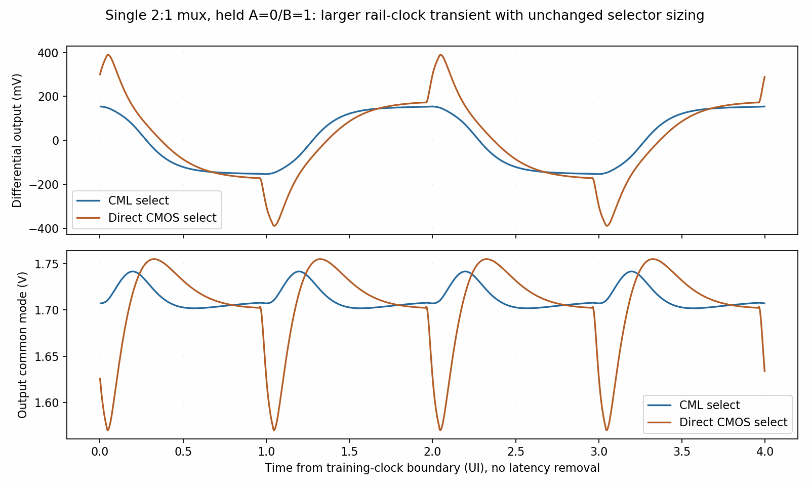
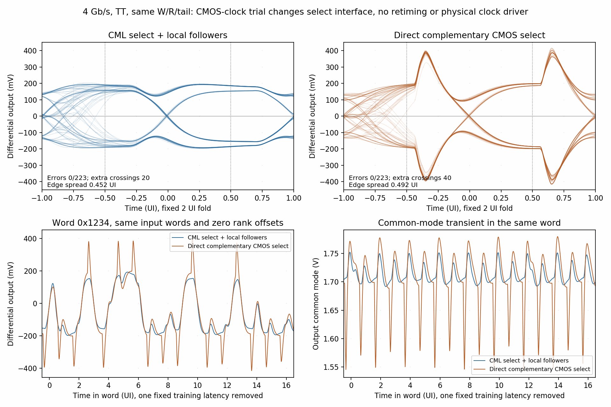

# 理想 CMOS 时钟驱动电流舵：首轮对照

此方向已由用户决定停止，以下仅保留历史；当前继续CML选择及PLL时钟回放。

本轮使用ngspice47、SKY130 TT、1.8V、27°C，完成单级静态/动态测试及16:1树短向量对照。
结论：直接互补CMOS时钟可以实现方向选择，但沿用原CML单元的尺寸、尾源和负载，没有得到更好的延迟或树级眼图。
这只是一个未经CMOS驱动优化的起点，不表示CMOS选择拓扑本身较差。

## 实现与比较边界

- CMOS选择单元 (`../../analog/common/cml_mux/spice/cml_mux2_cmos_select.spice`, retired in `retired_legacy_vars_20261120.json`)保留原有四只数据管、两只选择管和公共尾源，去掉本地选择端源跟随器及其偏置支路。
- 选择端由理想互补0–1.8V源直接驱动：sp高选B、sn高选A。数据端和输出仍为CML。
- CMOS选择树 (`../../analog/tx/serializer/spice/serializer16_tree_cmos_select.spice`, retired in `retired_legacy_vars_20261120.json`)保留8+4+2+1结构与d0先出位序，没有重定时锁存器或并行字捕获。
- 对照版本保留原来的CML选择电平和本地源跟随器。两者Wdata=40µm、Wselect=64µm、Wtail=12µm，尾管L=0.5µm。
- 单级R=400Ω；树中间级R=500Ω、末级400Ω，输出每端20fF。外部偏置参考仍为0.85mA。
- 各级时钟均50%占空比，边沿完整转换长度0.08 UI，四级相位偏移全部为零，不进行相位优化。
- 本轮比较的是选择接口变化，没有复刻参考图的每支路独立尾源、50Ω负载和约3.7mA偏置，也没有恢复已删除的导入figures。

原先沿用CML是为先衔接已有VCO差分时钟、复用偏置/共模接口，减少首轮集成变量；并非完成两种选择方式比较后认定CML最优。
实际可以从VCO抽出后通过CML→CMOS得到选择时钟，但仍需核对多路转换延迟、互补偏斜、占空比及分发负载。
本次源是理想电压源，未接PLL或真实转换器/CMOS驱动树，没有随机相噪、频偏或失配。

## 单级结果

CMOS版本八种静态A/B/选择状态均正确，最小有符号差分电压约184.3mV。
动态测试复用已有独立数据激励，输入提前0.5 UI准备；训练后按固定标称UI判决119位。
同一常数延迟从训练段提取，后续不逐位调相。

| 单级动态指标 | CML选择+跟随器 | CMOS直接选择 |
|---|---:|---:|
| 位中心错误 | 0/119 | 0/119 |
| 固定训练选择延迟 | 0.279 UI | 0.367 UI |
| 最小有符号电压裕量 | 148.9mV | 167.8mV |
| 额外零交越 / 漏跳变 | 0 / 0 | 0 / 0 |
| 波形最大值到最小值，含瞬态 | 497.6mV | 810.7mV |

峰峰值包括切换尖峰，不能当作稳态平台摆幅；静态平台仍约为差分±184mV。
直接CMOS驱动时选择管工作点与内部节点换流改变，同时更大的栅电压变化会增强寄生耦合。
本轮观察到更大的差分和共模瞬态，但未分离各个电容/内部节点对瞬态的贡献。

## 16:1树的同相时钟对照

两版使用相同的16路实际CMOS→CML数据输入单元和相同16字序列：两个0xAAAA训练字，随后边界码及随机字。
在固定4Gb/s UI=250ps下，训练只移除一个常数延迟；眼图仍为2 UI窗口、2 UI步进，左偶数位、右奇数位。
有限记录末端留出保护区，两版都判决相同的223个位中心。

| 树级指标 | CML选择+跟随器 | CMOS直接选择 |
|---|---:|---:|
| 位中心错误 | 0/223 | 0/223 |
| 固定训练延迟 | 0.302 UI | 0.399 UI |
| 最小有符号电压裕量 | 79.3mV | 29.5mV |
| 匹配数据跳变的确定性散布 | 0.452 UI | 0.492 UI |
| 额外零交越 | 20 | 40 |
| 未匹配的预期跳变 | 0 | 0 |
| 波形差分峰峰值，含尖峰 | 400.7mV | 831.8mV |
| 所列电源轨合计，不含真实时钟驱动 | 36.06mW | 28.28mW |

移除跟随器降低了所列电源轨功耗，但当前没有实际CML→CMOS转换、时钟驱动或分发网络，不能据此断言完整方案更省电。
另外保存了理想时钟源的净输出能量：源可以回收寄生电容能量，该数不等同于实际CMOS驱动器的CV²f功耗。
两版波形都有额外零交越，因此0个位中心错误不等于串化时序已通过。
该对照未使用此前已有的相位补偿或末级重定时，不能拿它直接否定那些版本的已有记录。

后续若采用CMOS选择，应重新选择开关尺寸、尾源工作点和负载，再分配级间建立时间；本轮未进行额外优化扫描。
主配置仍保留先前重定时CML候选，未自动切换到本次CMOS试验版本。

## 结果与失败记录

单级运行位于`results/analog/common/cml_mux/cmos_select/`，树级运行位于`results/analog/tx/serializer/cmos_select/`。
汇总见[对照CSV](../data/cmos_select_comparison.csv)，每次运行有激励/电路快照、输入SHA256、日志、逐位判决、边沿配对及眼图数据。

首轮静态夹具误用了不同的选择源名称，树级功耗导出漏保存部分时钟电压，导致未导出波形。
这三次记录保留为测试台失败并排除；更正激励源名/保存向量后重跑的静态及两棵树才用于上表，未以修改数值精度掩盖问题。
