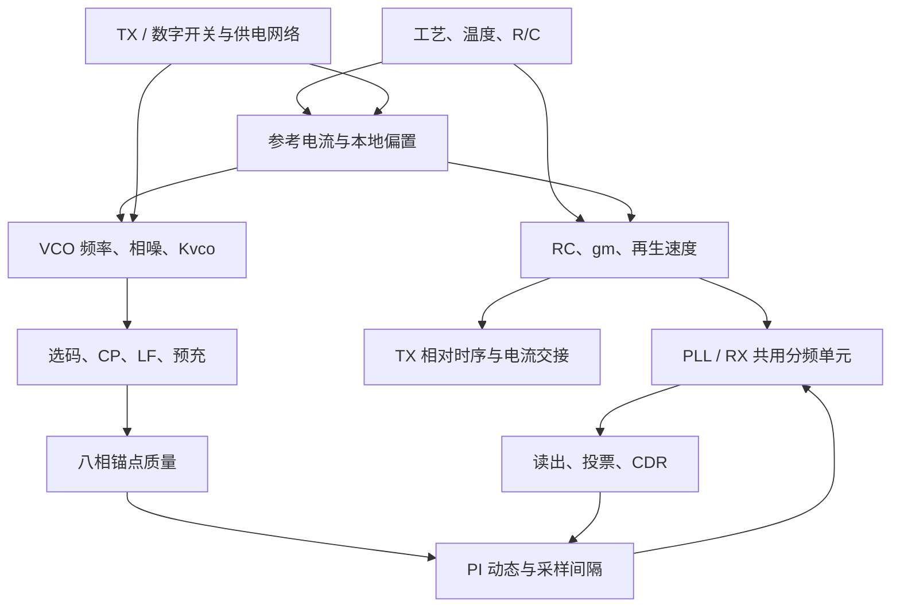

# 设计合理性与困难工况评估（2026-11-06）

**结论：整体架构有成立的证据，不需要整体推倒；当前最难收敛的是时钟接口与低压 CML 堆叠，其次是 PLL 的调谐、环路、供电联合设计。部分困难来自真实电路余量，部分来自测试边界和约束口径。45 个 MOS PVT 的功能要求本身没有显示出必须放宽的证据。**

| 优先级 | 对象 / 压力条件 | 已有证据 | 判断与下一步 |
|---|---|---|---|
| P0 | RX 读出 ÷2，FS 1.65 V 85 °C、hh | 输入 411 mVpp，输出仅 76 mVpp，不能持续翻转；SS 同条件输出 148 mVpp | 确定的功能/幅度问题。先闭合分频单元的共模、时钟换向、再生速度，再跑读出 MC；PLL ÷8 复用同一单元，必须联动回归 |
| P0 | TX 原生时钟分发 | r2 理想时钟 45 点通过，原生源下 SS 冷角中心裕量约 7 mV；FS 热角即使逐工况调位置仍有 0.258 UI 散布 | 路径结构和时钟质量问题。优先完成已有 v3 同步计数器方案，继续修旧固定 RC trim 收益低 |
| P0 | PLL 调谐与 CP/B2 接口 | r5 的部分噪声工作点接近码端，但 FF 冷角相邻码补测在 B2 范围内跨过 2 GHz | 不能由“选到码 7”推出量程不够。先做每角可行工作区与选码，再决定是否增加位数 |
| P1 | PLL 带宽、相噪与供电 | k=2 已满足现有随机抖动模型门槛；k=4 更低噪声但最差相位裕量约 44°；实际 200 µA CP/LF 尚未闭环验证 | 噪声、稳定性、CP 余量和电源抵消耦合；应比较 k=2/3/4 的完整实现 |
| P1 | PI/CDR、校准与读出动态 | 静态 PI 已有真实偏置压力角结果；长时频偏通过的是行为采样模型，晶体管联调主要是短时 TT | 架构可保留，重点补跨扇区、回卷、实际 PLL 锚点、生产 KP 与校准后动态 |
| P1 | 全局 bias 与上电 | 恒 I·R、修调、135 条件上电已有证据；最慢建立约 16.3 µs | 偏置方案合理，但恒摆幅不等于恒速度；需闭合 ready、超时及共享参考的动态扰动 |
| P2 | CTLE 与线驱动 | 1.05 V 共模解决了 CTLE 的低压余量；C2 压力测试可通过 | 当前不是首要瓶颈；应补真实偏置/RC/端接与链路边界，暂缺增加 DFE 或整体改架构的依据 |

## 证据范围

- 本评估核对网表、RTL、现行设计文档及其已有结果；新增的是七个 VCO 工作点的线性环路敏感性计算，以及 FF 高压冷角的六点开环相邻码实验。没有重跑全 PVT、闭环、相噪或 MC，没有修改 DUT 和验收门槛。
- 数字与电路的证据分开：行为模型通过不代表晶体管实现通过；工作点不收敛记为未判定，截断仿真不算通过；无噪声短码流不证明 BER。
- r5 是 VCO 候选，现有 CP/LF 仍是 50 µA / 40 pF / 2 pF；TX v3 是候选。当前工作树还包含 AC 耦合分频器等探索修改，旧结果不自动适用于这些修改。
- 本文的 `hh/ll` 沿用脚本命名，但实际是 PDK 的电阻、电容联合角，见后文。实验记录索引：[design_coupling_review_20261106.json](../../results/catalog/design_coupling_review_20261106.json)。

## 第一批：已经可以改变设计优先级的结论

### 1. RX 分频失败是真问题，但“尾节点只有 0.2 V”还不是充分根因

[RX 探针记录](../design/rx_pi_sampler.md#真实偏置--pdk-电阻2026-11-05)给出了很有用的对照：

| FS 1.65 V 85 °C | 分频输入 | 跟随器后摆幅 / 共模 | 分频输出 | 尾节点电压 |
|---|---:|---|---:|---|
| hh，失败 | 411 mVpp | 219 mVpp / 0.856 V | 76 mVpp | 0.205–0.223 V |
| ll，通过 | 442 mVpp | 271 mVpp / 0.850 V | 265 mVpp | 0.192–0.212 V |

通过条件的尾节点反而更低，因此不能只用绝对尾电压解释失败。应同时量 **VDS−VDSAT、实际尾电流、时钟导向比例、锁存器再生增益/时间和负载**。hh 下真实参考电流降低，电阻增大；部分物理电容也增大。I·R 近似不变，RC、gm 和时钟换向能力仍然改变。

建议先在单个 ÷2 上，用登记过的输入边界和真实输出负载，分别扰动输入共模、摆幅和本地偏置，找出“持续 ÷2 + ≥150 mVpp + 正确边沿数”的可行区。至少保留 FS 热 hh、SS 热 hh、FS 热 ll 三组对照。SS 热 hh 的零错字不能抵消 148 mVpp 未达 150 mVpp 的事实。

当前 AC 耦合/独立共模候选值得继续，与原源跟随器路径并排比较。候选若采用 100 kΩ 分压、比例 0.7、2 pF 去耦，分压等效电阻约 21 kΩ，时间常数约 42 ns；从 DC 工作点开始的几十 ns 仿真不能证明上电建立。需要单独检查建立过程、PI 停启和跨扇区时的漏计/多计。修好后同时回归 PLL ÷8，避免共用单元只在 RX 夹具上成立。

原采样器低压问题已有更完整的结构性证据：45 点中 21 点尾管余量不足，最差 −225 mV；源跟随器加宽只改善约 80 mV，而需要 200–280 mV。低过驱动尾管 + AC 时钟扩大共模可行区是合理修正。不能把采样器的成功直接推广到含反馈的 ÷2。

### 2. TX 应收敛到已有的同步路径方案

[TX 分发记录](../design/tx_clock_distribution.md)说明，r2 的 250M/500M/1G/2G 路径经过不同数量的分频级，clk→q 随 PVT 的变化无法由一套固定 RC 延迟抵消。热角还叠加弱时钟和慢过零；单纯调相位不足以恢复功能。

已有结构比较和 v3 实验支持“同步 CML 计数器共用时钟 + 2G clk→q 复制单元”：15 个原生 V/T 点最差中心裕量 121.6 mV、散布 0.140 UI。这是可行方向，但 0.140 对 0.150 UI 的余量仍小，且不是最新真实偏置、RC 与 r5 源的全覆盖。

下一步先补实际输入字寄存器与负载、原生源、45 点确定性验证，再按已有时序预算缩尺寸。当前 38–51 mW 的分发功耗值得优化，但不应直接按电流比例缩小所有级。旧 dummy 支路仍参与负载对称；删除前必须更新源边界和八相负载。

TX 末级长连码凹口来自选择交接时电流中断、共模及尾节点变化。已有减负载 R 的实验使裕量约 121 → 88 → 39 mV，未解决尾管问题。若要降低摆幅，应联动改变时钟交接和堆叠条件，不宜只压 R。线驱动的固定外部 100 Ω 端接也不随片内 high_po 电阻角同比变化，不能直接沿用内部恒 I·R 的幅度结论。

### 3. FF 冷角补测推翻了“必须码 7，因此量程到头”的解释

新增实验：当前 r5、真实偏置、PDK ll、FF 1.95 V −40 °C，四个抽出 buffer 各接 30 fF 代理；每点 24 ns，完整性检查要求波形到达 24 ns，频率取保存窗口后半段。

| Vctrl | 码 6 频率 | 码 7 频率 |
|---|---:|---:|
| 1.05 V | 1.97249 GHz | 1.85572 GHz |
| 1.20 V | 1.99653 GHz | 1.87605 GHz |
| 1.35 V | 2.05073 GHz | 1.92236 GHz |

码 6 在 1.20–1.35 V 内跨过 2 GHz；因此旧的码 7 / 1.475 V 是一个工作点选择，不是这个角必需的控制电压。当前噪声脚本的选码窗口是 0.7–1.5 V，它寻找接近 2 GHz 的点，并不优化 CP/B2 余量或相邻码重叠。码 6 新工作点的噪声、Kvco 和供电系数还要重测，不能搬用码 7 的数字。

建议按每个工况建立三个范围：VCO 可调区、CP 有效电荷/余量区、B2 可达预充区。稳态工作点首先落在前两者的交集中；B2 不必等于最终锁定电压，但偏差必须有捕获验证支持。已有 ±40 mV 预充误差验证，不能自动覆盖 1.35 → 1.475 V 的 125 mV 偏差。CP 在 SS 1.65 V 热角、1.4 V 时 UP/DN 为 40.8/49.3 µA；这也不能直接拿来判定 FF 1.95 V、1.475 V 不可用，应逐角检查。

4 bit 可作为改善码间重叠、失配与选点余量的方案。原 3 bit 最大 7 个单位电容，15 个半单位仅是 7.5 个单位，最大电容增加约 **7.1%**，主要收益是粒度变细。先证明缺的是重叠、最大/最小电容还是 CP 合规范围，再决定阵列与开关尺寸。

## 第二批：模块之间的主要耦合

### 4. VCO 的 r5 改动合理，PLL 不宜直接定死 k=4

r5 优先减小变容管和阵列开关的损耗，比全局加电流更有依据：压力角摆幅和相噪同时改善。但 Kvco 增大，使同一 CP/LF 的带宽及供电敏感性也改变。现行噪声模型中，k=1 的 CDR 后 14.07σ 最差 0.563 UI，k=2 为 0.425，k=4 为 0.323；现行门槛是 0.50 UI，所以 **k=4 并非唯一满足模型门槛的选择**。

以七个已测 Kvco 复算现有线性模型：

| 缩放 k | Icp / Ci / Cf | UGB | 相位裕量 | 额外增加 0.5 ns 路径延迟后的最小裕量 |
|---|---|---|---|---:|
| 2 | 100 µA / 20 pF / 1 pF | 8.53–11.35 MHz | 51.9–57.3° | 49.8° |
| 3 | 150 µA / 13.33 pF / 0.667 pF | 12.79–17.02 MHz | 47.8–54.3° | 44.7° |
| 4 | 200 µA / 10 pF / 0.5 pF | 17.06–22.70 MHz | 43.7–51.2° | 39.6° |

模型**已经含 2 ns 的 PFD 采样延迟**；表中额外 0.5 ns 仅为敏感性假设，不是测得遗漏。另一个独立的示意 R/C 扰动网格，使 k=2/3/4 最小裕量约 48.9/44.9/41.0°，不是 foundry 合格角结果。常见 PLL 设计以约 45–60° 留稳定性和瞬态余量，可作参考，不能把 44°直接判为必然不稳定。[ADI PLL 设计与调试](https://www.analog.com/en/resources/analog-dialogue/articles/design-debug-a-pll-circuit.html)

建议比较 k=2、3、4，并允许独立优化 Rz、Ci/Cf。对实际 CP 保持合理电流密度，检查开关和驱动级，不能只把参考电流从 50 拉到 200 µA。PFD→CP 的 ±200/0 ps 三点电荷单调并未证明近零无死区；更大的 CP 需要有限脉宽电荷、UP/DN 匹配、输出余量与参考杂散复验。优先做真实 CP/LF + 逐角 VCO plant，再选最差点做原生闭环。

LF 电容约 0.69 接 VDD 的抵消方案有 20 MHz 单音依据，但不是宽带 PSRR 证明。抵消依赖 VDD→VCO 和 Vctrl→VCO 的复数传递、物理 LF 与 CP 阻抗；各角最佳比例约 0.555–0.822。需扫扰动频率，并纳入实际电源网络、TX 开关电流与参考分配。现在的供电数字是容许纹波，不是已证明芯片纹波满足。

### 5. bias：恒摆幅与本地电流分配合理，不能用它代替动态设计

[真实偏置](../design/bias.md)的带隙 → V/I → 电流分配 → 本地二极管，避免把一个固定栅电压强加给不同工艺/温度，方向合理。修调去公共参考误差、局部镜像再做失配也是合适的层次。

但 I≈Vbg/R 只保证静态 I·R：R 上升时电流减小，RC 延迟增大、gm 和压摆能力变化，电路可能摆幅近似不变而停止再生。分配二极管缩到原面积的 1/4 会增加局部失配/闪烁噪声，需要按敏感模块单独分配面积和去耦，不宜一刀切提高全部参考电流。共享参考的误差与扰动具有相关性，不能把各支路当独立噪声直接 RSS。

上电还需核对统一时间原点：4096 个 250 MHz 周期是 16.384 µs，含分配去耦的 vbg 最慢建立记录为 16.3 µs；若从同一时刻计时只差 84 ns。ready 判据和复位释放时刻未统一验证，所以这是风险提示而非已证实超时。应先明确 ready、超时和供电斜坡，再验证“偏置 → 预充 → PLL 捕获 → RX 校准 → 训练/CDR”。

### 6. CTLE、PI 与数字 CDR：保留结构，重点补动态边界

- **CTLE**：AC 耦合允许独立选 1.05 V 输入共模，从原来最差负余量恢复到 ≥103 mV，属于合理接口修正。四档 RC 退化在 C2 上有效；缺少强证据要求立即上 DFE 或 CMFB。先确认目标信道、端接容差、真实 vcm/偏置和采样负载；更重信道若确为规格再扩结构。
- **PI**：6 个压力角 × hh/ll、真实偏置已有 64 码单调、|INL|≤0.0101 UI、|DNL|≤0.164 LSB 的结果。缺口是原生 PLL 锚点的非等间隔、加载与动态切换，不能再把工作重点放在“有没有静态单调性”上。
- **CDR**：共享 PLL、每路 PI 跟踪远端频偏是合理的。一步 7.8125 ps，±300 ppm 平均约每 26.0 ns 一步，整个 2 UI 周期约 1.67 µs；已有 120–140 ns 物理测试不足以覆盖自然频偏下的完整回卷。生产 KP=1/8 的行为闭环通过，快速物理冒烟用 KP=1，二者不能合并成同一项通过。优先补生产参数、压力角、频偏、连续跨扇区及漏计/多计检查，再接原生锚点。CDR 能移动共同采样相位，不能修复 D/E 相对间隔错误和读出位映射错误。
- **校准**：辅助对 + 电压型 DAC + 两边沿 SAR 已有合理依据，单次 SAR 在迟滞中会偏。理想选码 MC、注入失调联调、实际失配下的完整校准是三种不同证据；应选少量配对失配样本做完整启动与窗口验证，再扩大统计。四路共用输入 buffer 的相关性要保留，单路 3σ 不能直接解释为整颗接收器良率。
- **系统接口**：恢复字时钟跟随远端 ppm，输出到系统时钟域需要明确 CDC/FIFO 或握手策略；无跳变超时、训练长度、电气空闲应和协议一起定义。SS 的短训练未对齐和中断的长训练实验，不能都记成模拟电路失败。不要仅靠延长所有晶体管仿真来解决这些接口问题。

## 第三批：约束口径需要修正的地方

### 摆幅定义与 400 mVpp 的适用范围

核对时规格同时写“400 mVpp 差分上界”和“共模约 VDD−摆幅/2”，而后者对应单端峰峰摆幅。本次已修正共模公式，400 mVpp 上界保持不变。对充分换向、对称电阻负载、无额外直流负载的 CML：

\[
V_{SE,pp}=I_{tail}R,\quad V_{diff,pp}=2I_{tail}R,\quad
V_{CM}=V_{DD}-I_{tail}R/2=V_{DD}-V_{diff,pp}/4.
\]

偏置夹具的 407–426 mV 是单支路电流乘电阻的**摆幅代理**，不能直接同 400 mVpp 差分比较；实际带宽、换向程度和加载还会改变输出摆幅。线驱动的 8 mA、每腿 50 Ω∥50 Ω 则确实给出约 400 mVpp 差分。

实际 RX 时钟记录已达到约 1.01 Vpp 差分，TX 内部时钟也常超过 400 mVpp。若沿用“全部内部节点不超过 400”的硬上界，这些工作点仍有未满足项，不能只报窗口通过。需要逐节点区分外部驱动目标、内部接收最低幅度、共模/过驱动约束与器件电压应力。**这里提出厘清约束，没有授权把现有 400 mVpp 上界改宽。**

300 mVpp 栅极时钟是原设计保留的中间余量指标；曾有 198–216 mVpp 的候选在无失配条件下仍有 0.81 UI 窗口。这说明它不是普遍的物理失效线，但也不能仅凭无噪声功能通过就取消它。应由孔径、抖动、失配、寄生和再生概率反推所需幅度，再决定如何满足现有目标。

75 mV / 0.15 UI 的测量节点也应保持明确：规格表将其放在 TX 串化器输出；原始信道后、CTLE 后、采样器判决窗口另有指标。把相同门槛机械应用到每个内部节点会误判；已经包含信道与接收器确定性失真的 0.81 UI 窗口，也不应再次完整扣除同一项失真。

### “电阻角”实际包含电容角

本机 SKY130 库的 hh 调入 `res_high__cap_high`，ll 调入 `res_low__cap_low`，另有 hl、lh；[上游模型库](https://github.com/google/skywater-pdk-libs-sky130_fd_pr/blob/main/models/sky130.lib.spice)具有相同划分。因此，真实 MIM/模型寄生会随库段变化；仍用理想电容的部分则不会。

45 × tt/hh/ll 不能称为完整 RC 包络。建议先在失败机理相关的压力点加 hl/lh：分频再生、VCO 码间重叠、PLL 稳定性、PI 动态各挑点，不必马上把所有昂贵链路扫描扩大成全组合。报告同时记录 MOS、passive corner、真实/理想偏置及电容实现，避免只标“45/45”。

### 状态与收敛必须分层记录

核对时 README 等摘要仍有“偏置未接入”“物理读出未实现”“VCO 仍 r3”的旧描述，本次已同步相关摘要。这类冲突会让后续选择错误的基线。当前修订、候选、测试源、负载和覆盖应写在结果旁，并区分：已通过、明确规格失败、数值未完成、尚未验证。MC 效率问题与此有关，见[上一批工作流评估](workflow_review_20261105.md)。

## 建议执行顺序与停止条件

1. **先闭合约束和边界表**：统一摆幅定义，列出每个时钟接口的 Vcm、Vdiff、斜率、负载、周期/占空比和状态约定；PLL 列出逐角 VCO/CP/B2 范围。修正文档中已被证据推翻的“必须码 7”判断。
2. **优先解决确定性失败**：小单元完成 RX ÷2 的 hh/ll 对照和候选比较；通过后回归共享 PLL ÷8、读出，再补全角。失败点尚未消除时，不扩大整链 MC。
3. **完成已有架构改进**：TX v3 加实际数据入口与负载，验证原生相位/位映射；PLL 对 k=2/3/4 做实际 CP/LF 的稳定性、捕获与供电敏感性比较。
4. **补最短但有判别力的动态链路**：压力角 PI 跨扇区/回卷，生产参数 CDR 与 ±300 ppm，少量真实失配样本的完整校准。短测试先证明关键动作，再选点延长；全局长时行为模型继续承担系统频偏/协议扫描。
5. **最后扩大统计与 PPA**：在功能闭合的边界内，先筛敏感失配源，再跑局部配对 MC 和少量联合样本；按实测贡献优化 buffer、dummy 和偏置支路。节点数、候选数量和单样本时长都应随未解决的问题减少，而不是只增加仿真并发。

最值得立即投入的三个工作包是 **共用 ÷2 的真实偏置/RC 修复、TX v3 的实际边界收口、PLL 工作区与环路参数联合选择**。CTLE 与数字算法可继续复用，先把它们连接到可信的时钟和校准链路。

## 新增证据与复现

- 脚本：[verification/design_coupling_review.py](../../verification/design_coupling_review.py)。`uv run python verification/design_coupling_review.py` 只做线性与尺度计算；加 `--probe-vco` 跑上述六点开环实验及一个全时长先导点。输出只追加。
- 本次结果：`results/verification/design_coupling_review/20261105T125427Z/`，其中 `calculations.json` 保存每角计算，`vco_probe.json` 保存六点指标；`pilot/` 和 `ff_ll/` 保留 deck、日志、execution 和波形。目录名为 UTC 运行时间，本文日期为评估记录日期。
- 数值记录：FF 冷角工作点求解出现变容模型 `cosh` 越界，随后 dynamic/true gmin stepping 完成，六条瞬态均到达 24 ns。按完整、有限波形核对后用于开环频率括区间；不是无告警运行，也不是从零上电验证。先导与六点 deck 分别约 26.9 s、99.3 s。
- 既有证据入口：[bias](../design/bias.md)、[VCO](../design/pll_vco.md)、[PLL 环路](../design/pll_loop.md)、[TX 分发](../design/tx_clock_distribution.md)、[CTLE](../design/rx_frontend.md)、[PI/采样/读出](../design/rx_pi_sampler.md)、[数字 CDR](../design/rx_cdr_digital.md)。
