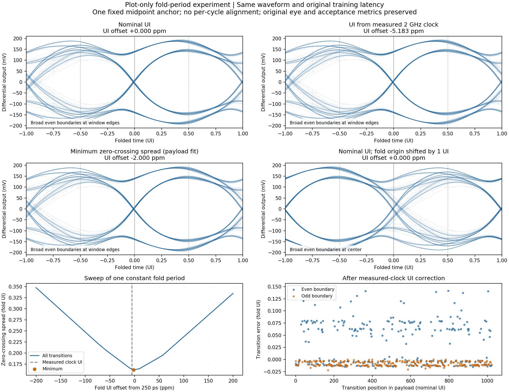

# 数据眼图折叠UI微调

按用户要求，仅对既有波形调整绘图折叠UI，没有新增电路仿真。原眼图、训练延迟、位判决和工程检查均保留。

## 调整结果

定义折叠UI = 250ps × (1 + 偏移ppm × 10⁻⁶)。围绕标称值扫描±200ppm，步长0.1ppm；使用全部负载跳变的过零时间峰峰值作为比较量。各图固定在同一个负载中点，保留原训练得到的常数延迟，只改变全局恒定周期；没有逐周期重对齐或时间伸缩。

| 绘图方法 | UI偏移/ppm | 折叠UI/ps | 过零散布/UI |
|---|---:|---:|---:|
| 标称时基 | +0.000 | 250.0000000 | 0.162476 |
| 实测2GHz频率给出的时基 | -5.183 | 249.9987042 | 0.163472 |
| 本段数据过零峰峰值最小 | -2.000 | 249.9995000 | 0.162049 |

最优微调仅使峰峰值改善约0.26%，眼图外观几乎不变。该最优值直接使用负载数据寻找，仅用于绘图诊断，不是独立测得的发送速率，也不替代原标称时基下的结果。按奇偶边界分别设置截距后的共同线性趋势约为-6.71ppm，与时钟测得的小频偏同量级；去掉这个趋势也未消除主要散布。

## 左右外观不对称的线索

标称时基下，偶数位边界的过零散布为0.15882 UI，奇数位边界为0.02205 UI。原2UI图以奇数边界为窗口中心，因此较散的偶数边界落在窗口两端，尤其容易在左侧眼睛的左边看到。右侧眼睛的外边界也是同一类偶数边界。

图中将折叠起点平移1 UI后，宽散布转到窗口中心，原来的中心窄边界转到两端。该对照更支持边界奇偶相关的波形/延迟差异，而非单一折叠频差导致的整体漂移。尚不能仅凭此图确定具体由锁存路径、选择时序或码型建立时间中的哪一项造成。

全部图沿用相同电压范围、相同波形及相同511个叠加窗口数量。起点平移对照使用相邻的偶数中心窗口。名义时基重画数组已与原始眼图数组逐点核对。

[数值、扫描方法与原输入SHA256](../data/eye_fold_ui_sweep.json)。原运行目录附有raw/eye_fold_ui_sweep.tsv和raw/eye_fold_ui_comparison.npz，可复核扫描和叠图；此操作没有改变原数据判决结果。
