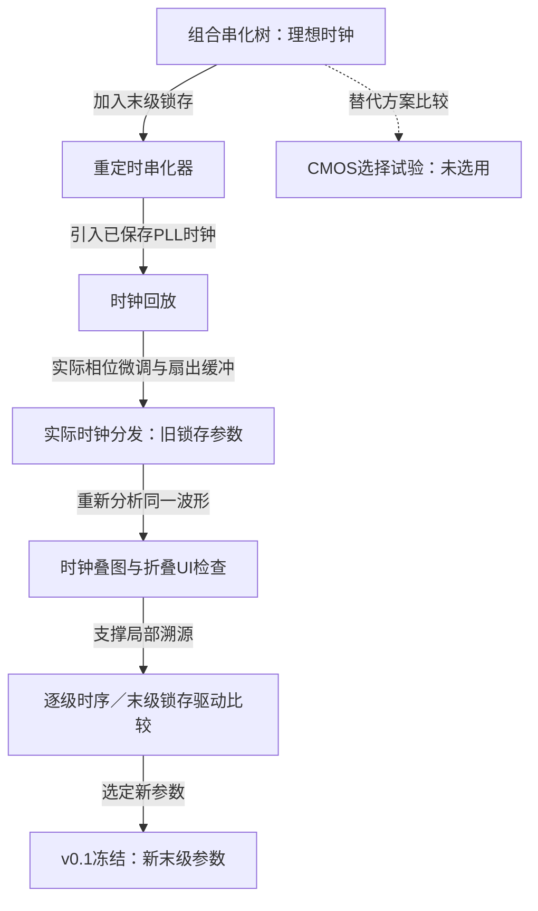

# 图、实验与设计演进的整理方案

2026-10-29。搬迁时盘点为116个PNG/SVG图文件、63组图，当时有63个case.toml定义；后续新实验的当前数量见[总索引](../figures/README.md)。PNG和SVG通常是同一组图的两种格式，不算两次实验。图片已按本文的模块／专题规则搬迁，配套[图目录索引](../figures/README.md)与专题入口页已更新。[迁移表](../data/figure_relocation_20261029.json)保留旧新路径与原始图像哈希。

## 文件按模块／专题存放，阅读按用途组织

图片实体采用以下稳定目录；同一图只存一份，PNG/SVG相邻：

```text
docs/figures/
  common/level_conversion/
  clocking/vco/
  clocking/pll/{core,startup,tracking}/
  clocking/dividers/
  clocking/distribution/
  tx/serializer/
  tx/output_driver/
  channel/characterization/
  channel/explanations/
  rx/{frontend,pi,sampler,cdr}/
  verification/mixed_signal/
  studies/{cmos_select,clock_timing,eye_folding,serializer_timing}/
```

不要只按日期分目录，也不按“是否当前”反复搬动同一张图。模块/专题决定文件位置；当前用途、历史版本、重要性和模型边界放在索引里。专项诊断可以支撑当前设计，行为模型也可以成为对应范围内的有效证据；用途类别不构成精度或重要性的自动排名。

阅读入口分四条路线：

| 路线 | 内容 | 本项目例子 |
|---|---|---|
| 当前设计依据 | 已选电路、参数及其适用范围内的表征/联调 | v0.1冻结清单、RX接口、CDR/串并、实时数模边界 |
| 设计演进 | 为何加入/替换电路，哪版结论仍有效 | 组合串化树→末级重定时→实际时钟分发→末级锁存驱动修正 |
| 专项研究 | 替代方案、局部故障定位、观察方法 | CMOS驱动电流舵、叠时钟、相位间隔、折叠UI、逐级延迟 |
| 原理说明 | 理想模型/公式说明，不作为实际电路验收 | ISI、理想均衡、升余弦示意 |

主线页面只展示支撑当前结论的少量图，其余放到专题入口。旧图在回答其原有问题时继续有效；“较早”不自动等于“过时”。

## 继承关系需要说明继承了什么

同一张图可有多种关系，应分开记录：

- `same_run`：同一运行的不同节点、窗口或画法。
- `reanalyzes`：使用旧数据重新叠图、折叠、测边沿；没有新增电路仿真。
- `compares`：围绕同一问题比较参数或替代电路。
- `changes_design`：电路/参数变化，应有新运行验证。
- `changes_test_boundary`：更换激励、回放源或加载范围，应与电路修改分开记录。
- `supersedes_within_scope`：新结果只在指定参数、窗口和指标上替代旧结果。
- `supports`：局部测量支撑上层解释，不能扩展成整条链路都已验证。

例如串化器这条线：



这张图描述设计演进和分析依赖，不表示所有箭头都是同一波形的加工，也不表示后面的测试覆盖了前面所有条件。原64字/1024bit物理时钟眼图使用旧末级设置，不能替代冻结版256bit证据；当前版本由[冻结清单](design_freeze_v0p1.md)判定。纯折叠调整不改变电路性能，理想升余弦图不证明实际通道零ISI。

## 每组图的最小记录

使用稳定的figure_id，将PNG/SVG合并记录：所属模块/专题、用途、模型视图、适用范围、报告、case定义、数值数据、运行来源，以及上面的关系。运行来源由原报告/数据清单解析，不靠文件名猜测。

首次索引见[figure_catalog.json](../data/figure_catalog.json)。其中“current_reference”表示在已注明范围内可引用，不等于全局签核；“historical_parameters”表示应随原版本阅读。“current_within_stage”也不能抹去PI锚点理想化、行为打包、加载隔离等条件。

## TB体系已有基础，缺的是实验身份和结论索引

当前已有：模块下的tb/测试问题/case.toml、共享模板和专用激励、verification/contracts，以及results中的run_id、输入快照、日志和指标。模拟/行为/提取视图与单元/集成/系统层次原本就是两个维度；63个case定义不意味着63项都已运行通过。

一份TB可被多个实验复用，一次实验可做多个参数运行，一组比较图也可汇合多个运行：

```text
设计版本＋测试定义＋实验配置 → 一个或多个run
run的节点/窗口＋分析方法   → 一组或多组figure
figure＋指标＋适用范围     → 支撑某条设计结论
```

后续应在case或独立的实验清单中补充稳定experiment_id、purpose、design_revision、scope、model_view、parent_experiments、decision和figure_ids。不要把一次诊断的旧case状态改写成今天的总设计状态；例如时序诊断case保留了当时“尚未提升为默认设计”的记录，而后续冻结清单才说明最终采用参数。

纯分析/原理说明不必为了统一目录而伪造SPICE TB：注明“已有波形重分析”或“数学构造”、输入数据与分析方法即可。共享模板继续留在原模块的tb目录，专题索引引用它，无须复制一份电路。

## 搬迁规则

116个图文件已按figure_id搬入20个专题目录，图像字节不变，PNG/SVG相邻。活动文档链接和当前清单的位置记录已更新；历史运行快照、原始数值及冻结release不改写。历史证据中的旧图片路径通过[迁移表](../data/figure_relocation_20261029.json)解析；搬迁前的活动文档清单与内容另存快照。此次不重跑电路。完整性检查见[迁移验证](../data/figure_relocation_validation_20261029.json)。
