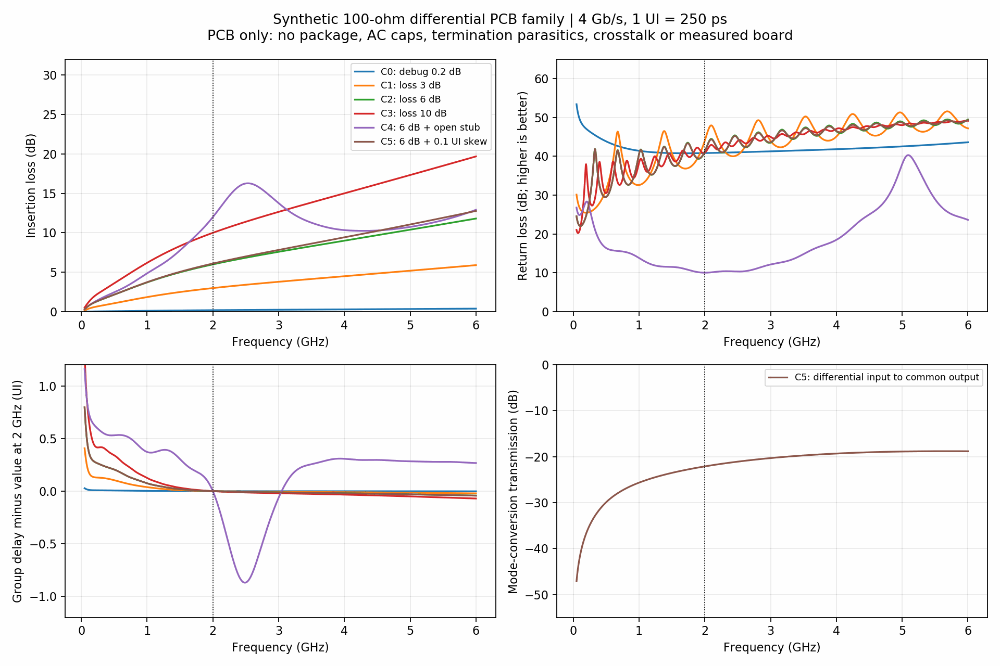
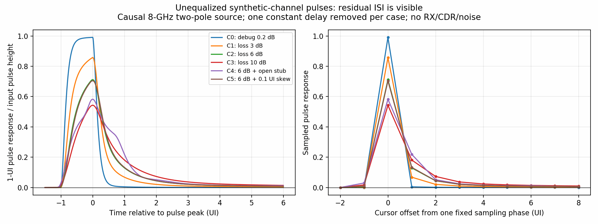

# 100 Ω差分PCB信道：RX之前的探索模型

用户确认主目标为板内/板间100 Ω差分PCB。维持4 Gb/s NRZ、250 ps/UI、2 GHz奈奎斯特频率。本轮建立可替换的合成信道族；不是具体PCB叠层、连接器或接口标准的模型，也没有改变已冻结的PLL/串化器。

此前[升余弦示意图](../figures/channel/explanations/channel_equalization_pulse_shaping.png)下半部分直接按理想升余弦公式构造，整数UI处零ISI是该公式的性质，并非实际TX通过PCB后的结果。下面的新脉冲图保留了合成通道的拖尾，没有做逆滤波或强制令相邻采样为零。

## 场景与初步判断

| 场景 | 用途 | 2 GHz插入损耗 | 2 GHz回波损耗 | 合成主线长度 |
|---|---|---:|---:|---:|
| C0_debug | 接线、极性、采样基线 | 0.20 dB | 40.83 dB | 1.00 cm |
| C1_loss3 | 温和平滑损耗 | 3.00 dB | 44.03 dB | 15.00 cm |
| C2_loss6 | 建议的RX设计起点 | 6.00 dB | 41.20 dB | 30.00 cm |
| C3_loss10 | 均衡与驱动余量挑战 | 10.00 dB | 40.91 dB | 50.00 cm |
| C4_stub | C2中点加入两端对称开路支路 | 11.99 dB | 10.05 dB | 30.00 cm主线 |
| C5_skew | C2两线加入0.1 UI相位偏斜 | 6.11 dB | 41.23 dB | 平均30.00 cm |

这些长度只适用于本次明确选择的合成介质，不能据此宣称所有30 cm FR4板都有6 dB损耗。6 dB和10 dB是探索包络建议，尚不是验收规格。C4的“6 dB”是未加支路的主线损耗，总体必须按11.99 dB记录。

C4支路单程名义相位延迟0.4 UI，长度约20.94 mm，入口串10 Ω；它模拟较长测试分支/不良布线，不能当成典型短过孔残桩。C5两线长度差约5.23 mm，2 GHz相位等效偏斜25 ps；它不是所有频率都严格25 ps的理想延迟块。C5差分输入到共模输出的Scd21在2 GHz为−22.11 dB。



回波损耗越大，匹配越好。图中的群延迟减去每条信道自身2 GHz延迟，以分离整体飞行时间与频率相关时延；原始延迟仍保留在数据中。C2、C3在2 GHz的群延迟分别约5.59 UI、9.32 UI。C4反射造成的幅度波纹和群延迟变化，不能用一个额外串联电阻完全表示。



脉冲图用1 UI矩形脉冲经过因果两实极点源响应`(1+s/(2π·8GHz))^-2`再进入信道。纵轴相对输入脉冲高度，既未逐条归一化主游标，也未加均衡。每条曲线只去掉一个固定峰值时延，采样间隔始终250 ps；不是实际CDR的输出相位。

当前参考激励若取无通道时接收端400 mVpp，则±32 UI的65个游标给出的有限长度眼开口估计为：C1约288 mV、C2约174 mV、C3约41 mV、C4约70 mV、C5约168 mV。定义是`0.4*(h0-sum(abs(hk),k!=0))`，不包含窗外尾巴、噪声、实际TX/封装/AC耦合、采样孔径和时钟误差，因此不是完整最坏眼高或BER保证。它说明通道已产生实际ISI，并不表示现有TX已在这些信道上通过验证。

原先“接收端400 mVpp”仍是接口探索目标。近无损通道约400 mVpp的现有输出级，接入有损PCB后不能继续假定远端还保持400 mVpp；需结合接收灵敏度、频谱、FFE权重与输出电流重新核算。单一2 GHz损耗也不能直接等同于所有码型的峰峰值衰减。

## 模型构造与复现参数

[参数配置](../../config/channel_family.toml)存放全部数值；[结果JSON](../data/pcb_channel_family_results.json)存放实际计算值。没有新增Python运行脚本。

每根线采用分布式阻抗、导纳，其中所有R、L、C均为正值：

```text
Z(s) = Rdc + s*Lext + Σ [Rk*s*Lk / (Rk+s*Lk)]     单位Ω/m
Y(s) = s*Cinf + Σ [s*Cdk / (1+s*Rdk*Cdk)]          单位S/m
gamma = sqrt(Z*Y), Zc = sqrt(Z/Y)
T(l) = [[cosh(gamma*l), Zc*sinh(gamma*l)],
        [sinh(gamma*l)/Zc, cosh(gamma*l)]]
S21 = 2 / (A+B/50+C*50+D)
```

三个串联的`Rk||Lk`近似有限频段内的导体损耗变化；三个并联的串联RC支路近似介质弛豫。不能把这些有限极点网络当成从真实铜箔粗糙度、介电常数或损耗角提取的模型。

Rdc=3 Ω/m、Cinf=91 pF/m；导体极点0.1/1/10 GHz，介质极点0.2/2/20 GHz、每支3 pF/m。导体Rk按`sqrt(fk/2GHz)`比例调整，用一维求根将1 m线在2 GHz的插入损耗定为20 dB；Lk=Rk/(2πfk)。Lext再使该频点`Im(Z)/Im(Y)=50²`，得到约228.112 nH/m。此时单端Zc约50.025−j0.822 Ω。各主线长度按其目标插入损耗再求根，而非简单认定dB严格正比长度。

DC单独使用串联`Rdc*l`的传输矩阵，避免0/0。C4的矩阵为半段主线、支路并联导纳、半段主线依次级联；支路输入导纳为`Cstub/(Astub+Rseries*Cstub)`。C5分别计算两线不同长度。

这是两根单端50 Ω等效线构成的100 Ω差分模型，没有互感/互容、相邻通道NEXT/FEXT或真实回流平面阻抗。C5的模式转换来自两线不对称；不能据此宣称已经覆盖所有PCB共模机制。

## 端口、格式与PCB边界

模型位于[pcb_family](../../verification/models/channel/pcb_family)：每个场景有`.s4p`和`.spice`，共享`pcb_foster_cells.spice`。

- S4p端口顺序：1=TX+、2=TX−、3=RX+、4=RX−；每端参考50 Ω，差分参考100 Ω。频率DC至12 GHz、步长5 MHz，实部/虚部格式。
- 四端口矩阵按行写入，不套用二端口历史上的S11/S21/S12/S22顺序，见[IBIS Touchstone规范](https://ibis.org/touchstone_ver2.1/touchstone_ver2_1.pdf)。
- 混模顺序dTX/cTX/dRX/cRX，差分/共模波用差/和除以sqrt(2)变换。Scd21明确指共模RX输出/差分TX输入。
- 连接顺序：真实输出级与源端50 Ω→pad/封装→AC电容→PCB→远端50 Ω/共模偏置→未来RX。PCB文件内部不再放这些外围元件。
- `.spice`调用为`Xch ap an bp bn vss pcb_c2_loss6`，先include共享单元，再include场景文件。其他场景名称见各文件。两种格式是同一PCB的替代视图，不串接使用。
- SPICE采用正值元件π单元，每单元名义相位延迟不大于UI/80。它仍是离散近似；S4p来自解析分布式模型。高频网格截止/色散不能误称为真实PCB材料效应。

当前输出级测试台仍保留旧的`diff_rlc16.spice`基线，本轮没有悄悄更换其通道或重标历史结果。

## 已完成检查及局限

[验证记录](../data/pcb_channel_family_validation.json)包含运行路径、日志、模型快照和SHA256。六个模型均完成：

1. DC至12 GHz全四端口最大奇异值不超过1+数值容差，互易性检查通过。因果性依据正值被动元件和分布式网络构造，不能仅从离散频率上的被动性推断。
2. 六个S4p文件按声明的端口、行顺序读回，复数往返误差小于1e−11。
3. ngspice47实际读取六份被动网络，均完整得到1 MHz、2.0005 GHz、4 GHz三个AC点。相对解析模型，最大幅度误差约0.0113 dB，最大相位误差约0.844°。

最初UI/40离散网络在长线4 GHz处相位误差偏大，已改为UI/80，并重新通过上述检查。首轮不完整验证目录标记为`failed_discretization_tolerance`，不用于现行证据。上述三个点的检查不等于整带瞬态或高频SPICE色散合格。

脉冲用1 ps采样、65536点FFT，矩形脉冲250点。频响按同一解析合成介质延伸到500 GHz，并乘因果源响应，没有强制截断负时间、清零尾巴或人为调相。该高频延伸是数值计算约定，不是实际板线到500 GHz的可信模型。FFT晚半窗最大残量相对冲激峰值，C0约8e−5，其余约1e−6或更低，数值保存在JSON中；后续严格时域验收仍需带宽/步长/时窗收敛检查。

上述脉冲数据只包含解析源与合成PCB。实际TX接入C0/C2/C3的首轮标称联调另见[真实TX与PCB结果](tx_pcb_channel_integration.md)，不覆盖RX/CDR、噪声、PVT或统计BER。其他通道场景尚未接入实际TX；v0.1冻结包不变。

## RX前后的推进顺序

[分层测试约定](../../verification/contracts/channel_model.toml)将模型质量、理想源脉冲、实际TX连接、RX已知相位采样、CDR闭环分别收集。

C0/C2/C3已经接入真实串化器/输出级，完成固定250 ps UI的2 UI眼图、采样、共模和窗口功耗收集，见上述TX联调记录。接下来设计终端/共模和可旁路可调CTLE，用C1/C2定增益、峰化与噪声预算；C3用于判断是否需要TX一后游FFE或RX DFE，不预先承诺tap数量。C4用于暴露反射/陷波对短均衡器的限制，C5检查RX共模和时序容忍。

串扰另建具有独立时钟/数据的aggressor及耦合路径，不能仅把S21再衰减若干dB代替。以后取得真实叠层、连接器、过孔或测量S4p时，在相同参考平面替换合成PCB，并核对端口/阻抗/DC外推/因果性/被动性；保留外围fixture和测试定义。

既不能按“USB”“以太网”的名字排序最差信道，也不能只比较长度。要在相同带宽/线速下比较插损、回波、群延迟波纹、串扰、模式转换及反射回波跨度；不同PHY还可能采用完全不同调制和均衡方法。参数化损耗、反射和独立串扰路径的建模方式可参考[MathWorks SerDes信道说明](https://www.mathworks.com/help/serdes/ug/analog-channel-loss-in-serdes-system.html)。

零ISI是理想采样目标；有噪声时强行零迫均衡可能因深衰减/谱零点放大噪声，MMSE因而允许残留ISI来折中，见[IIT Madras均衡课程](https://www.ee.iitm.ac.in/uday/notes/wsd/isi.html)。OFDM在循环前缀足够覆盖信道记忆且FFT窗口合适时处理块间ISI，并通过频域均衡处理频率选择性；不是“OFDM认为无ISI不可取”，见[循环前缀与均衡示例](https://www.mathworks.com/help/comm/gs/equalization-convolution-and-cyclic-prefix-addition.html)。
