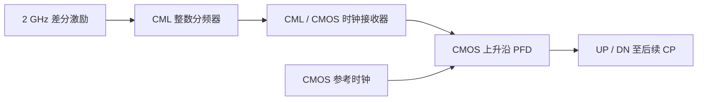
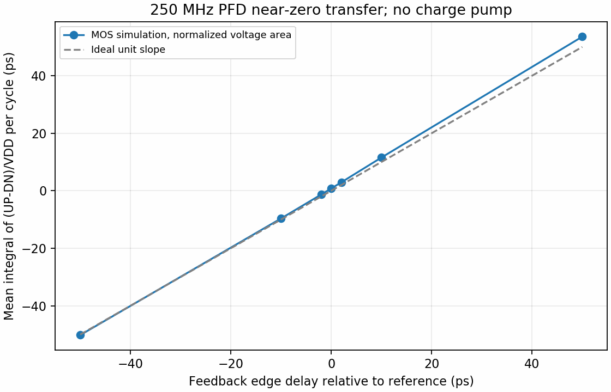
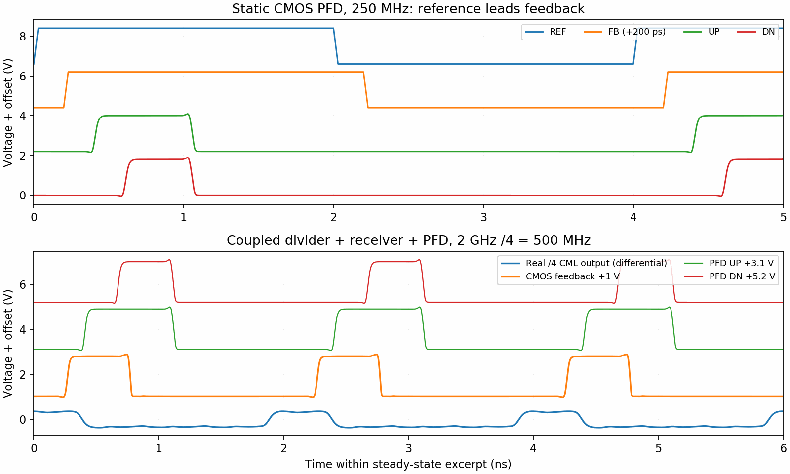

# CMOS PFD 与反馈电平转换

本页的独立 PFD 仍在使用；其中的全 CML 整数分频接口属于早期探索。
当前基准接口已改为 CML 固定 ÷8 后接 CMOS 后级，见 [混合分频记录](hybrid_divider_results.md)。

可以在反馈分频后转换为 CMOS，再进入上升沿鉴频鉴相器。已实现静态 CMOS PFD，
并完成真实 CML 整数分频器、现有 CML/CMOS 时钟接收器和 PFD 的耦合瞬态测试。
默认 2 GHz÷8=250 MHz，以及 2 GHz÷4=500 MHz 两个接口点均能传递有效边沿。

本次耦合输入为理想 2 GHz 差分源，不包含实际 VCO 或 CP，不是闭环锁定仿真。
参考端按 1.8 V CMOS 输入。上升沿 PFD 的用途及占空比特性参见
[Sam Palermo，Phase Detector Circuits，p.18–22](https://people.engr.tamu.edu/spalermo/ecen620/lecture04_ee620_phase_detectors.pdf)。
不要求先把整数反馈脉冲恢复为 50% 占空比，但接收器和 DFF 仍有最小高/低电平时间限制。

## 电路实现

入口为 [pll_pfd](../../analog/pll/pfd/spice/pfd_cmos.spice)，端口依次为
`ref fb rst_b up dn vdd vss`。依赖 [共享静态复位 DFF](../../analog/common/devices/spice/cmos_dff_reset.spice)、
[CMOS 门单元](../../analog/common/devices/spice/cmos_logic.spice) 和已有 SKY130 MOS 适配器。

两个正沿触发 DFF 的 D 固定为 1。REF 先到则 UP 脉冲较长，FB 先到则 DN 脉冲较长；
UP/DN 同时置位后，经 NAND 检测、两级反相器延迟和外部复位合并门产生公共清零。
UP 高有效对应后续 CP 注入电荷；现有 VCO 为正 Kvco，反馈偏慢时应提高 Vctrl，符号一致。

DFF 的主、从锁存器都由传输门及反相器构成，均有异步低有效复位。
只清从锁存器可能在复位释放、时钟仍为高电平时把主锁存器里的 1 再传出来；本实现清两级。
互锁时钟使能让主、从之间留有都关闭的时间。DUT 没有理想比较器、行为触发器或理想时间延迟。
`reset_cap=5f` 是两个复位延迟节点各自的理想负载预算，尚未选定版图电容器件或提取寄生。
实际 CP 负载确定后还要重定尺寸和复位时序。
后续将原 DFF 提取到 common 与 CMOS 分频器共享，PFD 保留原名称兼容包装；
`20261027T153127Z_*_shared_dff_regression` 重跑同相基准得到相同脉宽和积分差。

零相差附近刻意保留共同短脉冲。脉冲足够长与否应由实际 CP 的开关、电流建立和电荷抵消决定；
PFD 有端口响应不能证明 PFD+CP 无有效电荷死区。

## 独立 PFD 测试

测试台为 [tb_pfd_cmos_ngspice.cir.in](../../analog/pll/pfd/tb/functional/tb_pfd_cmos_ngspice.cir.in)。
ngspice 47、SKY130A、1.8 V、27°C，REF/FB 边沿 30 ps，UP/DN 各 20 fF，除标注外最大步长 1 ps。

| 参考频率与条件 | UP 平均脉宽 | DN 平均脉宽 | 每参考周期的电压时间积分差 | PFD 功耗 |
|---|---:|---:|---:|---:|
| 250 MHz，同相 | 446.03 ps | 445.28 ps | +0.798 ps | 0.554 mW |
| 250 MHz，FB 晚 200 ps | 644.91 ps | 440.24 ps | +204.54 ps | 0.555 mW |
| 500 MHz，同相 | 445.99 ps | 445.24 ps | +0.796 ps | 1.056 mW |
| 500 MHz，FB 晚 200 ps | 644.95 ps | 440.24 ps | +204.59 ps | 1.034 mW |
| 500 MHz，FB 早 200 ps | 436.36 ps | 636.87 ps | −200.43 ps | 1.031 mW |
| 50 MHz，FB 晚 200 ps | 644.89 ps | 440.27 ps | +204.50 ps | 0.111 mW |

积分指标为完整参考周期内的 `∫(UP−DN)/VDD dt`，单位为时间。它包含边沿形状，
不等于实测 CP 电荷，也不等于简单的 50% 阈值脉宽差。表中功耗只计 PFD 电源，不含激励源。
零点的小偏移和相差响应不完全理想；复位 NAND 的两个输入不是物理对称的路径。
失配、布线和输入斜率差异将另行影响静态偏移。
250 MHz 同相基准中，从 QU/QD 都置位到 CLEAR_B 拉低的平均延迟约 294.63 ps，
CLEAR_B 低电平持续约 438.98 ps。它们与端口 UP/DN 脉宽是不同的时序指标，均已单独归档。

250 MHz 下扫描 −50、−10、−2、0、+2、+10、+50 ps。±2 ps 的积分响应分别约
−1.312 ps 和 +2.924 ps；把最大步长减到 0.5 ps 后，对应变化约 0.0002–0.0003 ps。
这说明所测确定性响应对该步长减半稳定，不能解释为 2 ps 噪声分辨率或实际芯片死区保证。

频差测试使用 REF=250 MHz、FB=200/300 MHz，所测稳态窗口内分别得到正/负积分差，方向正确。
外部异步复位包括普通复位恢复，以及在两个输入仍为高电平时释放复位。
后者在 11.3–13.8 ns 的释放后静默窗口内，UP/DN 峰值约 0.105 mV，没有重计同一高电平。
这不是异步复位 recovery/removal 的完整边沿扫描。

## 500 MHz 角落抽测

同相、1.8 V、27°C，UP/DN 各 20 fF：

| 工艺角 | UP / DN 平均脉宽 | PFD 功耗 |
|---|---:|---:|
| TT | 445.99 / 445.24 ps | 1.056 mW |
| SS | 612.33 / 611.46 ps | 1.064 mW |
| FF | 343.51 / 342.80 ps | 1.066 mW |
| SF | 486.62 / 486.23 ps | 1.024 mW |
| FS | 441.25 / 440.13 ps | 1.083 mW |

这些点都观察到每个输入周期产生一次相应脉冲。另有 TT、125°C 和 TT、1.62 V、27°C
的同相 500 MHz 点，分别约 470/469 ps 和 535/534 ps；并未覆盖所有组合或失配。

**大相差边界：**500 MHz 下，FB 延迟 +1.5 ns 的启动配置最终出现等价于 −0.5 ns 的分支，
−1.5 ns 则出现等价于 +0.5 ns 的分支。观察到的周期分支切换说明复位往返时间带来捕获盲区/跳周问题，
不能只凭近零和频差方向正确就声称完整 ±2π 范围无盲区。后续要结合 CP 最小有效脉宽优化复位开销。
作为延迟负载探索，`reset_cap=0/5/15 fF` 时同相 TT 的 UP 脉宽约 408/446/520 ps，
说明 5 fF 附加负载之外还有较大的门与锁存器延迟。

## 真实分频器 → 转换器 → PFD

测试台为 tb_divider_pfd_ngspice.cir.in (`../../analog/pll/top/tb/divider_pfd/tb_divider_pfd_ngspice.cir.in`, retired in `retired_legacy_vars_20261120.json`)。
使用已有晶体管级整数 CML 计数器和原封不动的 `serdes_cml_to_cmos` 时钟接收器。
RX 输出真正驱动 PFD 输入晶体管，另外正端 5 fF、负端 20 fF；不是理想 CMOS 波形替换。
分频器 CML 输出每端另有 5 fF。

| 项目 | N=4 | N=8 |
|---|---:|---:|
| 输入 / 反馈频率 | 2 GHz / 500 MHz | 2 GHz / 250 MHz |
| CML 高电平宽度，差分零阈值 | 501.92 ps | 501.92 ps |
| CMOS 高电平宽度，0.9 V 阈值 | 501.31 ps | 501.24 ps |
| CML 正沿至 CMOS 正沿 | 385.67 ps | 385.73 ps |
| 后半窗口 CML / CMOS 边沿数 | 6 / 6 | 4 / 4 |
| 分频器功耗 | 29.110 mW | 29.118 mW |
| 时钟接收器功耗 | 1.566 mW | 1.257 mW |
| PFD 功耗，在本测试相位下 | 1.008 mW | 0.529 mW |

三项功耗均不含另一路理想参考源的 1.53 mW，也不含 VCO。
记录较短：N=4 总长 24 ns，N=8 总长 32 ns；边沿统计只证明所测窗口，没有长期漏边统计。
排除记录边界后，可配对的 CML→CMOS 边沿分别为 5 和 3 个，都只有一个对应输出边沿。
CMOS 反馈节点约 −0.038 至 1.884 V，模型中存在寄生耦合造成的短暂过冲，尚未做提取后可靠性检查。

参考与反馈没有闭环锁相，本表不要求 UP/DN 等宽。转换延迟、分频器传播延迟以及输入斜率影响
应纳入后续反馈相位与环路延迟预算。不能把 CMOS 引脚处的相差直接解释为 VCO 核心相差。

## 产物与覆盖边界

汇总数据：[CSV](../data/pfd_cmos_points.csv)。矢量图：[响应曲线](../figures/clocking/pll/core/pfd_cmos_transfer.png)、
[时序波形](../figures/clocking/pll/core/pfd_cmos_waveforms.png)。
运行目录中保留 run.json、metrics.json、完整输入快照/依赖 SHA256、日志、原始波形和逐周期积分数据。

- `results/analog/pll/pfd/functional/20261027T141425Z_*`：首次 250 MHz 基准；
- `results/analog/pll/pfd/{functional,dead_zone}/20261027T141609Z_*`：频率、相差、PVT 与复位；
- `results/analog/pll/pfd/{functional,dead_zone}/20261027T141946Z_*`：复位负载、大相差和半步长复测；
- `results/analog/pll/top/divider_pfd/20261027T142113Z_*`：已完成的 N=4/8 耦合接口。

最初较长的 N=4/8/16 联调记录触及 200 秒执行时限，没有完整波形；失败运行保留，
不从超时推断电路功能失败。N=4/8 的较短记录已完成，N=16 接口覆盖仍待补。
当前没有新增运行/分析脚本文件，TOML 仍为测试定义而非自动执行器。

独立 PFD 共 29 个确定性运行完成，两个短记录耦合接口完成，三个原始长记录超时。
设计判定保持 ungraded。CP、实际 VCO 耦合、闭环锁定、噪声、失配及版图提取均未因此得到验证。
已有 VCO 全链联调的收敛问题也没有由本次理想 2 GHz 输入测试自动解决。
