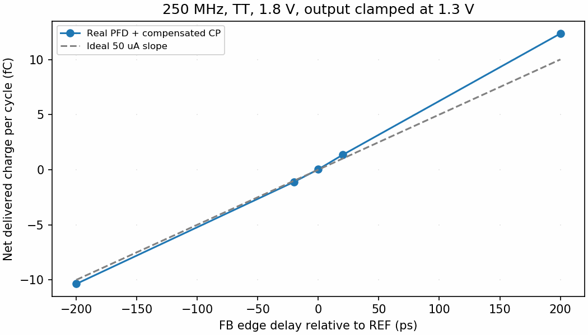
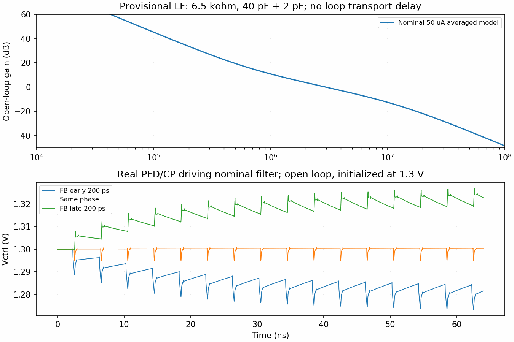

# PFD、CP 与无源环路滤波器原型

PFD 已有可用晶体管级原型，本轮补上 CP、LF，并开始按实际输出电荷联调。
**LF 的拓扑较直接，CP 并不因为晶体管少就容易做好**：静态电流匹配、输出余量、
开关电荷与驱动边沿都会影响相位误差和参考纹波。

用户关于自由 CMOS 分频的纠正已单独记录在 [时钟域定义](clock_domain_clarification.md)：
其输入为多相 CML 转换后的最高 2 GHz CMOS 时钟；本轮没有为此运行时钟分频仿真。
本页的 PFD/CP/LF 工作使用默认反馈 N=8、参考 250 MHz，不依赖该时钟分发支路重设计。

## 电路与方法

CP 入口是 [pll_cp](../../analog/pll/cp/spice/charge_pump.spice)，端口
`up dn out vbn vbp vdd vss`。PMOS/NMOS 长沟道电流镜配输出串联开关，
理想外部 N/P 参考各为 50 µA，DUT 内没有理想电流源。
电流镜尺寸 W/L 分别为 N=5/1、P=20/1 µm，输出开关 N/P 宽度 2/4 µm。

先测固定输出电压的源/灌电流，再把真实 PFD 接到开关驱动，积分完整参考周期的输出电流。
UP 为正注入，DN 为负抽取。简单 CP 的开关电荷、内部节点共享和控制边沿偏斜问题可参考
[Sam Palermo, Charge Pump Circuits，p.7–10](https://people.engr.tamu.edu/spalermo/ecen620/lecture05_ee620_charge_pumps.pdf)。

PFD 的原始门级复位结构保留；新增 CP 会改变其真实负载。
本轮主要调整 CP 上拉驱动的脉宽/边沿：最终驱动 NFET W/L=0.5/0.88 µm、PFET W/L=2/0.15 µm，
下拉侧为两级 CMOS 驱动。该固定尺寸仅在 TT、Vout=1.3 V 附近做了名义补偿，
不是自动校准，也不是跨 PVT/输出电压匹配方案。

## CP 静态结果

ngspice 47、SKY130A、VDD=1.8 V，输出扫描 0.1–1.7 V、步长 20 mV。

| 条件 | 1.3 V 上拉电流 | 1.3 V 下拉电流 | 相对电流差 | 两者均在目标 50 µA ±5% 内的扫描区间 |
|---|---:|---:|---:|---:|
| TT、27°C | 48.465 µA | 49.875 µA | −2.87% | 0.36–1.42 V |
| SS、27°C | 48.295 µA | 49.618 µA | −2.70% | 0.38–1.40 V |
| FF、27°C | 48.584 µA | 50.136 µA | −3.14% | 0.36–1.44 V |
| TT、125°C | 48.456 µA | 49.981 µA | −3.10% | 0.42–1.40 V |

相对差定义为 `(Iup−Idn)/mean(Iup,Idn)`。±5% 是工程筛选口径，尚非用户确认规格，
也不能把这个区间直接叫作 PLL 锁定范围。关断漏电的全扫描最大值在高温/高输出电压处增加，
TT、FF、TT125°C 分别约 0.36、7.32、53.3 nA；没有进行局部失配统计。

这也约束 VCO 可用细调范围：不能仍按 Vctrl 可完整到 1.8 V 计算相邻粗码重叠。
此前代码 6/7 的约 106 MHz 重叠是在不同代理负载、1.0–1.8 V 下得到，
必须在实际 CP 顺从范围与最终时钟负载下重查，当前不能宣称粗细调无缺口。

## 实际 PFD+CP 电荷响应

真实 PFD 驱动 CP，UP/DN 另各 20 fF；Vout 由理想夹具固定为 1.3 V。
在后半窗口对完整参考周期积分 `Q=∫Iout dt`，包括开关尖峰及关断期间的电流。
最初同相 Q≈+6.51 fC；最终名义驱动补偿后的结果为：

| FB 相对 REF 的时间延迟 | 每周期净注入电荷，TT、250 MHz |
|---|---:|
| −200 ps | −10.366 fC |
| −20 ps | −1.105 fC |
| 0 | +0.033 fC |
| +20 ps | +1.337 fC |
| +200 ps | +12.351 fC |

正负方向正确，所测 ±20 ps 点没有表现为平坦响应。但正负增益不完全对称，
零点接近不等于动态电荷注入已消除。基于 ±20 ps 的有限差分，局部有效 `dQ/dΔt≈61.0 µA`，
并非简单等于静态 50 µA。因此后续环路模型应使用实测有效增益。
把最大步长从 2 ps 减到 1 ps 后，同相 Q≈0.030 fC；两者相差约 0.0037 fC。
这只是无噪声确定性结果，不能视为实际电荷精度或时间分辨率。

| 同相附加条件 | 每周期净电荷 |
|---|---:|
| SS、1.3 V、27°C | −1.751 fC |
| TT、1.3 V、125°C | −1.366 fC |
| TT、Vout=1.0 V | +3.707 fC |
| TT、Vout=1.45 V | −3.512 fC |
| TT、1.3 V、500 MHz | −0.558 fC |

所以 CP 仍需改善输出电压跟踪、静态/动态匹配和注入，不能算定型。
尝试过源端开关版本，在同一初始名义条件下 Q≈+9.39 fC，静态匹配也较差，
未选用该版本。两次过窄驱动 W 的探索因无法选到合法 SKY130 模型而失败，
不进入有效结果；最终使用合法 W=0.5 µm、增加 L 的方式调整驱动。

PFD 本身此前的大相差复位恢复/跳周边界也仍存在；本轮电荷测试没有证明全相差捕获或完整环路锁定。

## LF 选择与独立验证

[pll_loop_filter](../../analog/pll/loop_filter/spice/passive_rc.spice) 为输入并联 Cfast，
另一路 Rzero 串联 Cint 到地：Rzero=6.5 kΩ、Cint=40 pF、Cfast=2 pF。
当前是理想 R/C 参数原型，尚未映射到工艺电阻、电容或提取实际 VCO 控制端负载。
两电容 CP 滤波器的零极点方法可参考
[Loop Filter Circuits](https://people.engr.tamu.edu/spalermo/ecen620/lecture09_ee620_loop_filters.pdf)。

`Z(s) = (1+s R Cint) / [s(Cfast+Cint)(1+s R Cfast Cint/(Cfast+Cint))]`。

零点约 612 kHz，高频极点约 12.85 MHz。独立 SPICE AC 与解析阻抗的最大相对差约 5.4×10⁻⁹。
独立瞬态注入 50 fC 后，最终电压变化 1.190476 mV，符合 Q/(Cfast+Cint)；
注入过程中的峰值约 24.05 mV，说明积分终值与快速扰动必须分别观察。
该两项独立测试不含 PDK 器件，不能解释为工艺无源器件已验证。

使用 N=8、名义 Icp=50 µA、Kvco=485 MHz/V 的平均模型，交越约 2.97 MHz、相位裕量约 65.34°。
Kvco 来自早期加载 VCO 在 1.300–1.306 V 的局部数据，非新时钟树下的完整调谐斜率。
若采用本轮测得的局部有效 CP 增益 61.0 µA，同一滤波器的估计变为约 3.56 MHz、64.76°。
这些计算都忽略实际传输延迟、CP 有限输出阻抗、采样非线性和 VCO 控制端负载，属于选值依据，
不是闭环晶体管级稳定性验证，也不能直接套用到所有参考频率/粗调码/PVT。

## PFD+CP 驱动 LF

以真实 PFD 和 CP 驱动上述滤波器，电容初始电压设为 1.3 V，观察 64 ns。
初值是测试条件，尚未设计物理预充电或启动控制。没有连接 VCO 或闭环反馈。

| 输入相差 | 32 ns →64 ns 的 Vctrl | 后半窗口电压峰峰值 |
|---|---:|---:|
| FB 早 200 ps | 1.28433→1.28147 V | 13.62 mV，含整体漂移 |
| 同相 | 1.300254→1.300277 V | 5.72 mV |
| FB 晚 200 ps | 1.31942→1.32284 V | 10.90 mV，含整体漂移 |

正负相差产生正确的充放电方向。同相平均净电荷接近零，仍有明显的周期内开关纹波，
不能把总电荷抵消等同于电压纹波消失。后续需要按抖动/杂散、带宽和电容面积预算权衡。
不同相差两行的峰峰值包含漂移，不应当作稳态纹波指标。

## 归档与状态

[结果 CSV](../data/pfd_cp_points.csv)、[平均模型数据](../data/pll_loop_small_signal.json)、
[配置](../../config/pll_loop_prototype.toml)。矢量图：[电荷响应](../figures/clocking/pll/core/pfd_cp_charge.png)、
[滤波响应](../figures/clocking/pll/core/pfd_cp_lf_response.png)。
块级 CP 结果在 `results/analog/pll/cp/dc/`，独立 LF 在 `results/analog/pll/loop_filter/`，
实际接口在 `results/analog/pll/top/{pfd_cp,pfd_cp_lf}/`，保存输入快照/依赖 SHA256、日志、波形和指标。
主要最终 CP 扫描为 `20261027T161726Z_*`，完成的三块开环联调为 `20261027T161935Z_*`。
初始三块测试台对零伏测量线别名设置冗余 .ic，KLU 无法建立该矩阵元素而中断；
移除多余别名初值、只保留真实电容节点初值后完成，失败快照保留。

所有设计 verdict 为 ungraded。PFD/CP/LF 已具备可检查的原型，
仍未完成真实 VCO 闭环、噪声/杂散、失配统计、无源器件映射、布局提取和宽范围匹配。
