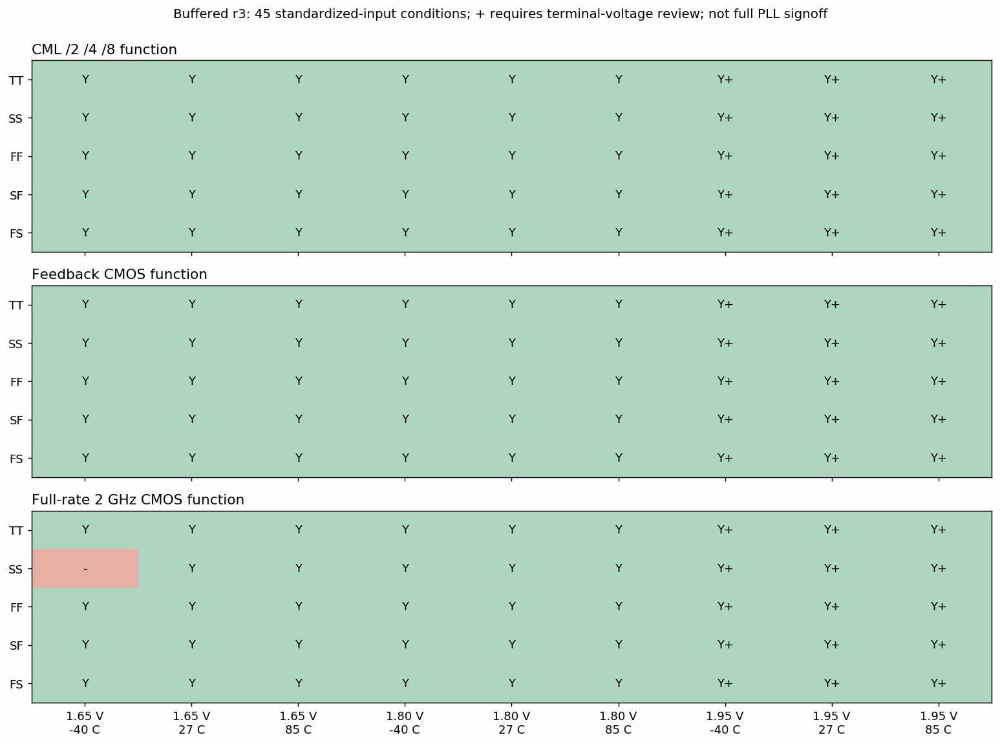
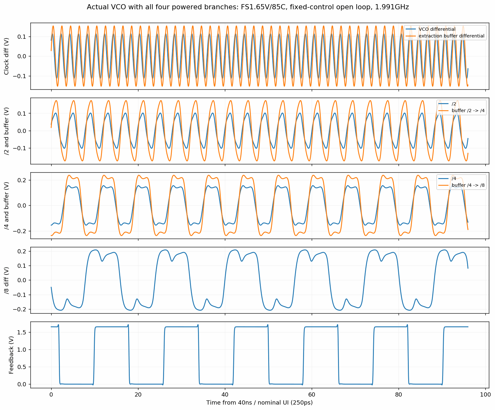
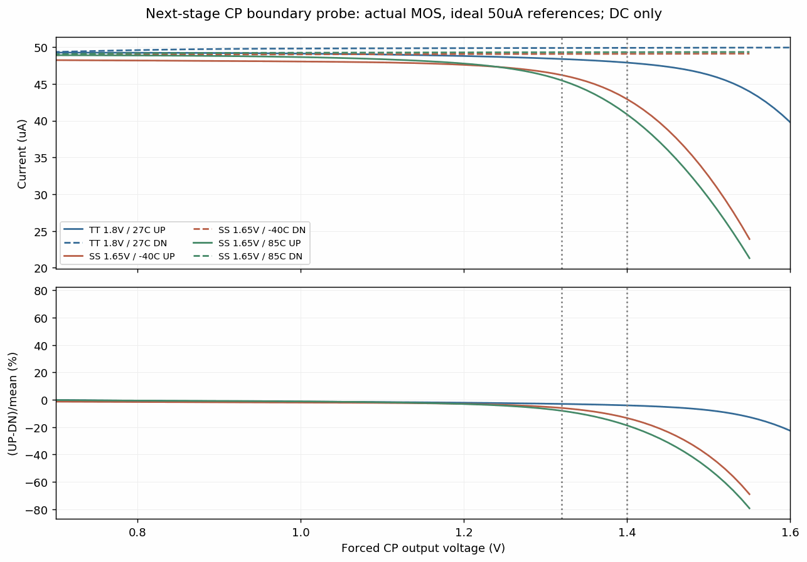

# 带级间 buffer 的 r3 分频链与时钟前端

本轮将两个真实 CML buffer 加入每个 prescaler，位置为 ÷2→÷4 和 ÷4→÷8；四条真实/供电 dummy 路径保持相同结构。工作入口见 [配置](../../config/pll_working_revision.toml)，上一版见 [r2](pll_lowov_pvt.md)。冻结 v0.1 不变。

2026-10-30 完成本轮验证。标准 2 GHz 输入下的 45 条件分频和反馈转换均有正确稳态功能，全速 CMOS 为 44/45。四个选定条件的真实 VCO 在约 2 GHz 均能驱动 CML 分频和反馈；SS 冷角的全速 CMOS 仍失败。可以以此版本推进 PFD/CP/LF，**收口范围是 VCO/CML 反馈链的本轮功能验证，不是整个时钟前端或产品 PVT 已签核**。数值见 [JSON](../data/pll_buffered_pvt.json)，全部源快照、网表和日志见 campaign (`results/analog/pll/pvt_buffered/20261029T152825Z`)。

## 标准输入的 45 条件复测

沿用 r2 的真实上游 buffer、全速接收器、三级 CML 分频、反馈接收器及加载。输入为差分 300 mVpp、共模 VDD−0.15 V 的正弦；每个 tap 每端 5 fF，两类 CMOS 输出每端 20 fF。TT/SS/FF/SF/FS × 1.65/1.80/1.95 V × −40/27/85°C。每条件 64 ns，分析 32–64 ns。

| 项目 | 结果 |
|---|---|
| ÷2/÷4/÷8 稳态周期与幅度筛查 | 45/45 |
| 250 MHz 反馈 CMOS | 45/45 |
| 全速 2 GHz CMOS | 44/45；SS/1.65 V/−40°C 失败 |
| 最小 CML tap 差分摆幅 | 约 227 mVpp，尚非全部 400 mVpp |
| 相对 r2 的每条完整支路功耗增量 | 约 1.44–1.98 mW；不含外部参考发生器 |

分频器外部端口和分频比保持不变，新增两个 buffer 都使用原全局 `vbias`。每个 prescaler 仍使用真实本地低过驱动镜；四路和供电 dummy 都有相同的新增 buffer。VCO、接收器和通用 RX latch 的器件尺寸没有在本轮改动。

## 真实 VCO 回接与粗细调选择

回接四路实际抽出、转换器、四个真实 prescaler、PFD 输入负载及供电 dummy。以下均为固定理想 Vctrl 的开环工作点，频差不是 PLL 锁定误差。

| 条件 | 电容码 / Vctrl | VCO GHz | 三级 CML / 四路反馈 | 四相全速 CMOS |
|---|---|---:|---|---|
| TT / 1.8 V / 27°C | 5 / 1.205 V | 2.0129 | 正常 | 正常 |
| SS / 1.65 V / 85°C | 6 / 1.320 V | 2.0121 | 正常 | 正常 |
| FS / 1.65 V / 85°C | 5 / 1.100 V | 1.9906 | 正常 | 正常 |
| SS / 1.65 V / −40°C | 5 / 1.112 V | 2.0019 | 正常 | 失败 |

多数记录分析 32–64 ns。FS 热角在约 34–38 ns 才建立最终 ÷8，初始 32 ns 窗口含无有效摆幅的数值过零；保留原分类，另用同一记录的 40–64 ns 确认稳态，已有五个完整 ÷8 周期。该结果不能当成上电、复位、偏置启动或闭环捕获时间的验证。

SS 冷角最初沿用码 6，在 1.32/1.55 V 分别只有约 1.936/1.970 GHz。相邻码 5 的原生扫描在 0.7/0.9/1.1 V 得到约 1.812/1.874/1.993 GHz，再以固定 1.112 V 独立确认约 2.002 GHz。改善来自粗细调工作点选择，没有再次扩大 VCO 管或电容。较低目标 Vctrl 也给 CP 上拉留下更多压差，但 CP 动态仍需单独验证。

## SS 冷角全速转换仍是功能缺口

在同一输入共模条件下追加 2 GHz 标准正弦测试：源差分摆幅 300/350/400/450 mVpp，对应上游 buffer 输出约 460/501/530/549 mVpp，只有最后一个测点的两路全速 CMOS 都工作。这个小范围扫描不能推出与共模、波形无关的最小输入规格。

SS 冷角最终实际 VCO 点的 VCO 差分约 416 mVpp、抽出 buffer 后约 537 mVpp，CML 分频和低速反馈正常，但四相全速 CMOS 均失效。这不能用“较低质量但合格”掩盖。相反，码 6 较低频率的记录曾有正常 CMOS 输出，说明需要继续检查转换器的速度、幅度、共模和动态工作点；它不是 VCO 无法起振或 CML 反馈丢分频。

## 裕量和证据适用范围

- FS/1.65 V/−40°C 的首级、第二级 master 尾管平均 VDS−VDSAT 约 −5/−4 mV。功能筛查正常，不代表模拟裕量宽裕。
- 15 个 1.95 V 条件都有 CMOS 上冲，仍需核对器件端电压；不能将端压问题作为低质量等级豁免。
- 尚未做 VCO 全 45 条件的完整粗细调、相邻码重叠映射，也未加入真实参考发生器、随机噪声、失配或版图提取。
- 新 buffer 改变反馈分频支路的延迟和功耗。冻结 v0.1 的 TX 证据保留原适用版本；若后续用 r3 时钟升级 TX，应重做选定时钟回放与串化时序核对，不自动把旧结论移到新版本。
- 现有 Xschem 层次图尚未同步新增 buffer，当前以工作 SPICE 和本轮源快照为依据。

## 器件版本与边界工况

本轮及此前最新 SS 结果均针对加宽后的版本：尾管总宽 W72 µm、24 指，输入源跟随 W80 µm；新增 buffer 输入差分管总宽 W24 µm、尾管 W12 µm。早期小管失效数据仍在独立历史记录中，不与本轮混算。

若 −40°C、SS 属于产品承诺范围，就必须满足最低功能与性能；“合格/良好/优秀”可以区分满足最低要求后的裕量，不能把丢分频、失锁或数据错误算成低等级合格。若采用低温降速，应明确声明降额模式。当前环境矩阵仍是工程探索范围，尚不是完整产品承诺。

暂定测量边界与未定义指标见 [验收参数](../../verification/corners/clocking_acceptance.toml)。其中 150 mVpp 是瞬态探索筛查门槛，不是已有噪声与失调验证支持的最终 CML 最小输入规格；400 mVpp 仍是名义目标。

## 后续 PFD / CP / LF

电路方向稳定后可以推进下一级，同时单独跟踪全速 CMOS 冷角缺口和真实参考源。优先检查 CP 在实际 VCO 需要的 Vctrl 范围内的电流顺从能力及 UP/DN 差异，再测 PFD 短脉冲经 CP 的有效电荷、复位和死区；最后回接 LF 检查捕获、带宽和预充接管。理想/物理 LF 与全局/无源工艺角应分开记录。

已经开始的 [CP 边界初探与后续顺序](pll_pfd_cp_lf_next.md)给出 TT 和 SS 冷热的 DC 扫描。SS/1.65 V/85°C、Vctrl=1.4 V 时，UP/DN 约 40.8/49.3 µA；这个差异还不能单独判定闭环失败，但指出了下一步要处理的窗口。

这与完整 PLL、相位噪声、失配及版图寄生签核是不同阶段，不要求为了开始 CP/LF 工作先重复所有整机仿真。
