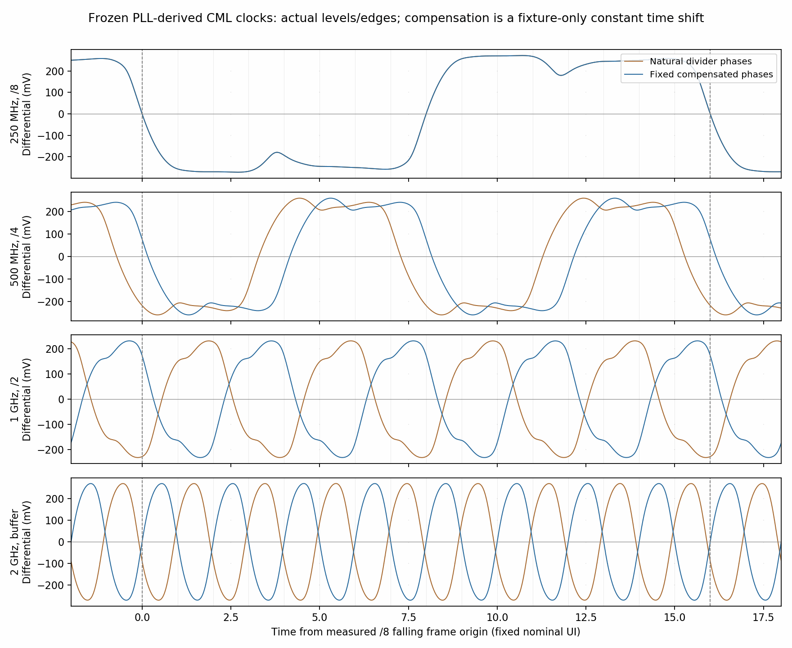
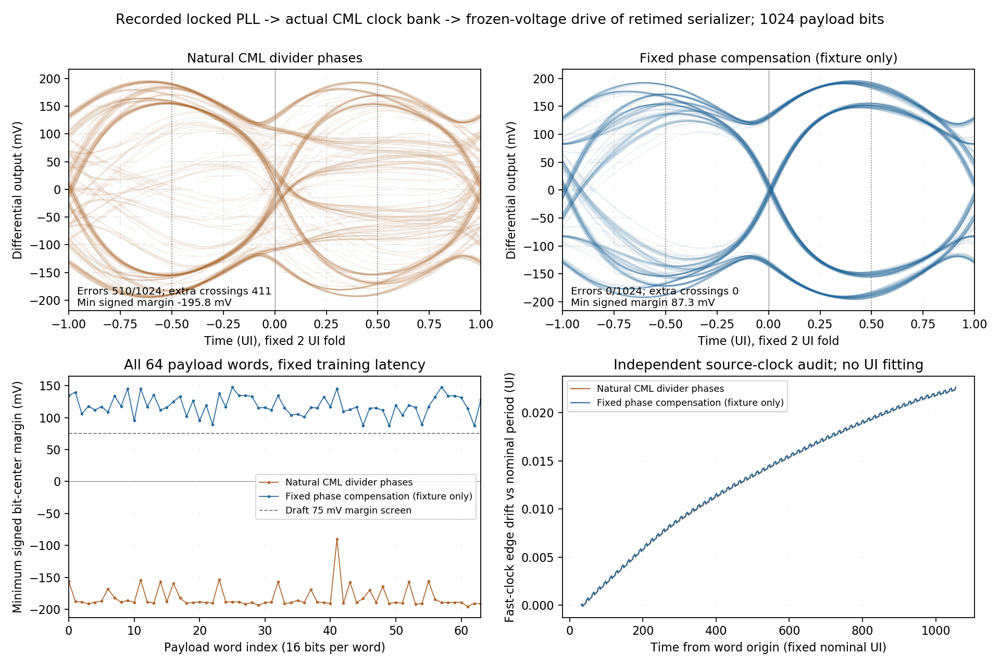

# 冻结PLL时钟驱动CML串化器

本轮没有重跑PLL本体。取已完成持续工程判锁观察的原生PLL连续记录，经现有真实缓冲器、接收器和CML÷8链生成抽头，
再冻结这些CML抽头电压驱动已有末级重定时16:1串化器。
两组各有2个训练字和64个有效负载字，**每组完整检查1024 bit**，没有时钟周期重复拼接。
CMOS选择方案依用户决定退出当前候选，原试验仅作历史保留。

## 源记录和冻结边界

源PLL运行编号为20261027T234336Z_ngspice_tt_native_precharged_checkpoint_ui。
取原记录2816–4096 UI（704–1024ns），直接平移时间原点到0，长度1280 UI。
该尾段已持续满足工程判据，VCO平均约1.999952GHz（约−24ppm），未强制归一到2GHz。

源文件保存了相位0的差分电压d0与共模cm0，按cm0±d0/2还原两根线，没有把CMOS接收器输出冒充CML。
原PLL中四路对称、有偏置dummy的影响已包含在该源记录条件中。
下游时钟链沿用现有CML抽出buffer、全速接收器、三级固定÷2和反馈接收器；
CMOS接收器输出每端20fF，分频抽头每端5fF，与原PLL名义抽出负载一致。
分频链有短启动扰动，字原点取32ns之后的÷8下降沿；这不是硬件复位/字对齐的验证。

**冻结源为零输出阻抗电压回放。** 它保留电平、边沿、占空比和相关波动，
但后加串化器的扇出/反向耦合不会改变已冻结时钟或PLL。因此本轮是可复用的电压接口/时序试验，
尚不能验收实际驱动能力、完整时钟分发或PLL与串化器的相互加载。

## 实际CML时钟

| 抽头 | 测得频率 | 差分峰峰值 | 平均共模 | 平均高占空比 |
|---|---:|---:|---:|---:|
| c2g | 1999.955577MHz | 539.9mV | 1.6575V | 49.9869% |
| c1g | 999.977846MHz | 461.7mV | 1.6680V | 50.0094% |
| c500 | 499.988923MHz | 519.2mV | 1.6681V | 49.9971% |
| c250 | 249.994415MHz | 544.3mV | 1.6674V | 50.0014% |

各抽头按共同4ps（0.016 UI）网格回放，避免多个交错采样网格。
稳定段每端最大重采样误差约0.103mV。没有缩放幅度/频率，也没有逐周期对齐。

## 相位条件

自然组保留时钟链实际相对相位。补偿组对每个时钟对只作一次常数时间平移，使初始下降沿对应既有候选[0,0.16,0.32,1] UI。
补偿量仅由时钟测得，与负载数据无关。自然下降沿相位以÷8字原点计，按各路周期取模。

| 选择级 | 自然下降沿相位，UI | 补偿的时间平移，UI | 补偿目标，UI |
|---|---:|---:|---:|
| c250 | 0.0000 | +0.0000 | 0.00 |
| c500 | 7.2838 | +0.8763 | 0.16 |
| c1g | 2.5591 | +1.7614 | 0.32 |
| c2g | 1.9069 | -0.9069 | 1.00 |

补偿组是诊断夹具，尚未实现相应相位选择/延迟电路，**不能把补偿后结果视为自然接线已通过**。

## 串化结果

沿用Wdata=40µm、中间R=500Ω、末级R=400Ω、末级前两只真实CML锁存器；
输入为16路真实CMOS→CML单元，输出每端20fF，仍没有并行字捕获寄存器。
位序预期d0先出，输入每固定16 UI更新，负载码流与既有理想CML时钟1024-bit LFSR测试相同。

每组只用两个0xAAAA训练字测一个常数输出延迟，下降沿相位由输入时钟测量提供。
眼图固定UI=250ps、2UI窗口及2UI步进，不从输出拟合UI，也不逐字/逐位/逐边沿调相。
自然组包含真实分频传播延迟及当前输入字更新约定的影响，失败时不能只归因于电流舵单元速度。

| 指标 | 自然相位 | 固定相位补偿 |
|---|---:|---:|
| 位中心错误 | 510/1024 | 0/1024 |
| 有位错误的负载字 | 64/64 | 0/64 |
| 最小有符号中心裕量 | -195.8mV | 87.3mV |
| 配对跳变散布 | 0.227 UI | 0.169 UI |
| 额外零交越 | 411 | 0 |
| 漏掉的预期跳变 | 388 | 0 |
| 固定训练延迟 | 2.226 UI | 1.319 UI |
| 差分峰峰值，含瞬态 | 395.4mV | 392.7mV |
| 串化器所列电源轨合计 | 39.00mW | 39.00mW |
| 草案观察判据 | 未通过 | 未通过 |

既有理想CML时钟、同相位补偿和相同负载字序列的历史对照为：0/1024位错误、0额外零交越，
最小有符号裕量102.8mV、配对边沿散布0.102 UI，运行编号20261028T001452Z_ngspice_tt_tree_retimed_phase100_lfsr_tt。

有位错误或漏跳变的组，其配对散布只描述仍成功配对的边沿，不能单独作为眼宽合格证据。
峰峰值含瞬态，不等同于平台摆幅。电源轨数值不含冻结时钟的生成及实际分发功耗。
有限无噪声1024-bit结果不是统计BER或随机相噪结果。

自然组还存在整数位对齐歧义：两个0xAAAA训练字只提供周期性边沿，不能唯一识别字位置。
追加诊断仅用前两个负载字作字对齐校准，选择一个固定−2 UI平移后，余下62字仍有100/992位错误，
主要集中在字内第0、1、8、9位。因此大量原始位错误含有字对齐因素，但也不能仅靠修改一个延迟值解决。
此诊断没有改变主表的1024-bit判决和眼图，也没有用于调节后续逐位采样。

补偿组在负载段的独立2GHz时钟边沿，相对标称2 UI周期累计漂移约0.0227 UI。
0.169 UI散布包含这项可解释的时钟频差/慢漂移，不能全部归因于串化器新增抖动；
本轮保留固定标称UI，并未通过重新拟合UI把漂移消掉。当前草案0.15 UI门槛尚未达到，唯一失败项是配对跳变散布。

追加独立时钟对照：对516个匹配数据跳变，按位奇偶关联其对应的真实2GHz输入时钟边沿，
量测时钟到数据输出的传播延迟变化，峰峰值仍约0.165 UI。
这项诊断没有修改眼图或验收采样；它表明0.169 UI的散布不能主要归因于标称频差，
仍需处理选择时钟相位、锁存建立时间和CML数据/时钟路径动态。两个峰峰值不能直接相减来分摊贡献。
明细见[时钟与串化器时序分解](../data/pll_clock_vs_serializer_timing.json)。

0.15 UI是本轮提出的串化比较草案线，不是已约定的PLL规格。载频、确定性时序散布和随机相噪需分别评估。
优先修正方向是：分频链可控复位/字对齐、按字时钟捕获输入、实现真实的相位选择/延迟分发，
再对高速CML级分配电流/负载与门电容。若PVT下固定补偿不够，可增加上电相位校准或延迟锁定；
更宽PLL带宽不能代替这些串化器建立/保持约束。

## 后续修改与重复检查

[草案观察判据](../../verification/contracts/pll_clock_replay.toml)要求：完整64字、零位中心错误、零漏跳变/额外零交越、
最小有符号裕量至少75mV、配对跳变散布不超过0.15 UI。
这是比较修改的初始门槛，不是已定稿接口规格；两组分别报告，最终签核仍为ungraded。

后续修改可固定本轮时钟、数据和判决参考再做对比。实际相位分发、输入字捕获、扇出/反向耦合和PVT仍需验证。

冻结时钟库：

`results/analog/tx/serializer/pll_clock_replay/20261028T065451Z_ngspice_tt_native_locked_vco_clock_bank/raw/clock_bank.npz`。

同运行的clock_bank_summary.json包含波形/压缩数据SHA256、字原点、端口统计和相位设置。

串化运行：

- `results/analog/tx/serializer/pll_clock_replay/20261028T070237Z_ngspice_tt_pll_cml_replay_natural_phase/`

- `results/analog/tx/serializer/pll_clock_replay/20261028T070237Z_ngspice_tt_pll_cml_replay_fixed_phase/`

各运行保留激励、预期1056位（32训练+1024负载）、电路/模型快照、日志、输入SHA256、
逐位判决、逐字结果、边沿配对及2UI眼图数组。
见[测试定义](../../analog/tx/serializer/tb/pll_clock_replay/case.toml)、[汇总CSV](../data/pll_clock_replay_comparison.csv)。

两次完整串化记录均实际结束于312ns。为避免启动器墙钟超时中止有效仿真，曾暂停Python启动器，
ngspice继续运行；完整数据及两个ngspice的正常退出状态已核实，过程见结果根目录timeout_guard.json。
另验证了每端新增误差≤0.25mV、零交越时间误差<0.001 UI的PWL压缩方式；
完整原始采样版本先完成后，压缩版重复仿真主动结束并保留为superseded记录，不用于本报告结论。
