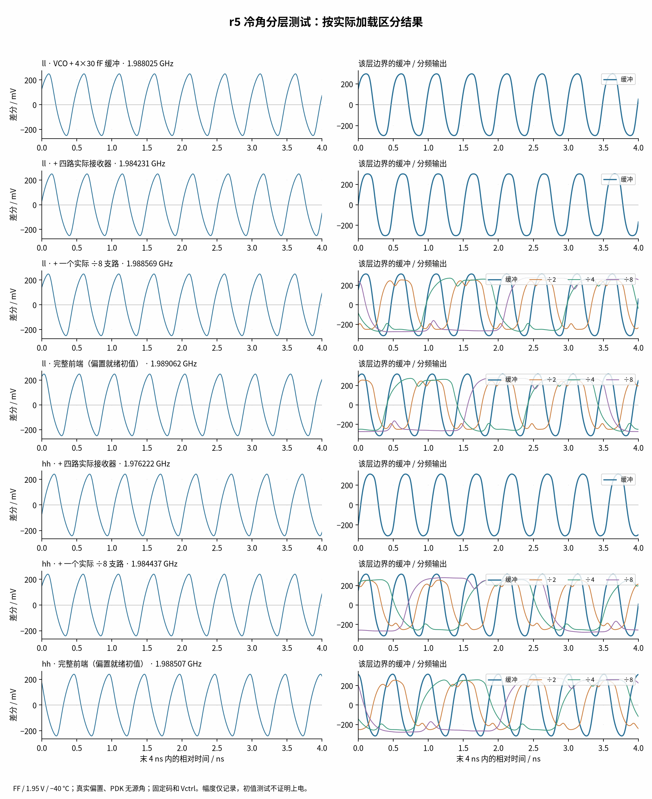

# r5 时钟前端冷角分层诊断（2026-11-06）

**FF / 1.95 V / −40 °C、ll/hh 的 r5 前端，已在偏置就绪的近似初始电压下获得完整 24 ns 原生瞬态：VCO 分别约 1.989062/1.988507 GHz，四路全速 CMOS 和四路反馈持续翻转，÷2/÷4/÷8 频率关系正确。自动 DC 工作点求解仍卡住；未改器件尺寸，也没有采用 PDK 模型替换。** 这提供了一个能观察工作态功能的本地测试路径，不改变原生 TX 联合测试两个缺点、PLL 闭环和真实上电的现有结论。

## 测试边界

- 当前 `pll_vco_ring4_4b`、r4 接收器、首级保持 W40 / 后两级 W80 的 ÷8。真实带隙/电流分配与 PDK 电阻，固定供电和 `config/pll_code_table.json` 的粗码/Vctrl；不是闭环锁定。
- 分成 VCO＋四个缓冲（各 30 fF）、VCO＋四路实际全速接收器（CMOS 输出各 20 fF）、VCO＋一个实际 ÷8（抽头各 5 fF，其余三个缓冲仍各 30 fF）、完整四支路前端。最后一级不含 TX 分发、PFD/CP/LF，负载范围以该级 DUT 和 bench 为准。
- 每例有独立目录、deck、日志、执行身份；先做 1 ns 冒烟，再做 24 ns。读取要求到达实际瞬态终点且所有保存量有限。频率/幅度取最后 5 ns；慢分频与反馈取最后 16 ns，至少三周期。
- `prebiased` 用同条件小模块初始 DC 表拼接近似电压，以 `.ic` 和 `uic` 初始化，包括偏置电路状态。反馈接收器只复用相同 restorer helper 的平衡态初值，其模拟增益级仍由瞬态求解。没有在瞬态中强制锁存器状态；保留原 20 ps、1 µA 差分启动扰动。
- 验证对象是工作态起振/分频、CMOS 电平及占空比。初始化不证明上电、偏置 ready、粗码搜索或复位时序；无噪声/失配。本轮幅度只记录，器件应力与既有摆幅约束仍需处理。

## 分层结果

| ll 边界 | VCO / GHz | VCO 差分 / mVpp | 结论 |
|---|---:|---:|---|
| 四缓冲 × 30 fF，默认求解器 | 1.988025 | 499.30 | DC 与 24 ns 瞬态完整 |
| 四缓冲 × 30 fF，KLU | 1.988025 | 499.30 | 与默认求解器一致 |
| 四路实际全速接收器加载 | 1.984231 | 500.27 | DC 与 24 ns 瞬态完整；此例未保存 CMOS 输出，不单独作其功能验收 |
| 一个实际 ÷8 | 1.988569 | 498.78 | DC 与瞬态完整；÷2/÷4/÷8 约 994.298/497.148/248.573 MHz |
| 四支路完整前端，`prebiased` / 默认求解器 | 1.989062 | 498.44 | 24 ns 完整，四路全速约 49.99% 占空比，四路反馈约 248.68–248.71 MHz |

完整前端的全速 CMOS 约 −32 mV 到 2.022 V，符合本轮翻转/电平检查；上冲属于已有 I-11 的器件应力待核对项，不因功能翻转而关闭。两无源角中分频频率与 VCO 比值误差小于 0.06%；各自测量窗口不同，仍应补逐边沿及更长稳定窗口检查。

hh 同条件的小模块也完整：接收器加载下 1.976222 GHz / 483.27 mVpp，四路全速 CMOS 功能检查满足；单 ÷8 为 1.984437 GHz / 480.80 mVpp，三级分频关系正确。完整前端 `prebiased` 为 1.988507 GHz / 479.90 mVpp，四路全速约 49.99% 占空比，反馈约 248.66–248.73 MHz；所有本轮频率关系/CMOS 功能检查满足。



## 未奏效的假设

| 对照 | 观察与结论 |
|---|---|
| 原始 60 s 单例时限 | 完整前端尚未进入求解器；这是模型展开未完成，不能判成电路收敛失败。后续独立前端用 240 s 有界对照。 |
| 默认 SPARSE / KLU；VCO 共模和内部 p2 初猜 | 完整前端仍进入 gmin/source stepping 失败或停在 transient OP；仅指定 VCO 共模不够。 |
| 去掉历史 receiver SR 不对称初猜 | 两种求解器仍未完成 DC，不能把旧 SR 初猜认定为根因。 |
| 测试副本将 `log(cosh(x))` 改成 `abs(x)+log(1+exp(-2*abs(x)))-log(2)` | 原 PDK 不变；原式有限范围内一致，小 VCO 稳态频率与幅度一致。完整前端不再报这一溢出但 DC 仍卡住，说明它不是充分解释。未推广模型替换。 |
| 同条件小模块 OP 拼接为 `.nodeset` | 默认求解器仍卡在 DC；KLU 对部分初猜节点缺少矩阵元素，打印的 `out of memory` 前有明确矩阵诊断，不能直接归因于机器 RAM。 |
| 同样数据作为 `.ic`＋`uic` | 默认求解器通过 1 ns 冒烟及完整 24 ns。KLU 同类初始化仍受矩阵限制，不用它承担此测试。 |

PDK 变容管 p2 通过内部电阻接 Vctrl，不能凭日志中的 singular node 名称就判其悬空。`cosh` 越界可能来自偏离物理解的 Newton 试探；本轮尚未定位完整 DC 系统中首先造成病态的方程。

## 复跑与下一步

入口：[probe.py](../../analog/pll/top/tb/convergence/probe.py)。`none` 保留历史 SR 初猜，`vco` 加 VCO 初猜，`free` 去掉 SR 初猜，`assembled` 为同条件小模块拼接 Newton 初猜，`prebiased` 为明确的初始电压瞬态。切换方式生成新例，已有失败目录保留。

两个已验证的初值已登记为 `pll_r5_cold_prebiased_state_v1`：[边界登记](../../config/boundary_conditions.json)。`--seed-bc` 检查完整消费电路文件哈希、PVT、码/Vctrl 和初值文件哈希；加载签名在此不适用，因为没有持续回放电压源，改用完整消费者电路身份。改接 TX/RX 或改电路后须重新建立对应边界，不能直接沿用本 ID。

```sh
uv run python analog/pll/top/tb/convergence/probe.py --passive ll --levels receivers,prescaler --solvers sparse --timeout 180 --workers 2
uv run python analog/pll/top/tb/convergence/probe.py --passive ll --levels frontend --solvers sparse --seeds prebiased --seed-bc pll_r5_cold_prebiased_state_v1 --timeout 300 --workers 1
```

第一条用于重新建立小模块证据；第二条直接复用已登记的初值。开发新的初值时，使用明确 campaign 的 `--seed-source`，验证后再登记。`--resume` 检查输入身份并只跳过到达指定终点的完整输出；若改变源码/边界或初值来源，使用新 campaign。旧运行没有新入口的输入清单时，不追认其身份。

下一步先将工作态测试与实际启动测试保持独立，用本地结果恢复受影响的 TX/RX 接口测试，并检查逐边沿关系、位映射和动态数据。随后推进 TX 实际字入口与 PLL CP/LF 参数选择；不以重跑全 SerDes 作为这些任务的前提。

数据快照：[pll_cold_isolation.json](../data/pll_cold_isolation.json)。原始日志、deck、波形和哈希见 [结果索引](../../results/catalog/pll_cold_convergence.json)。重画脚本 [pll_cold_isolation.py](../../verification/plotting/pll_cold_isolation.py) 默认读快照，`--collect` 只读取显式指定的原始 campaign，不改历史结果。
