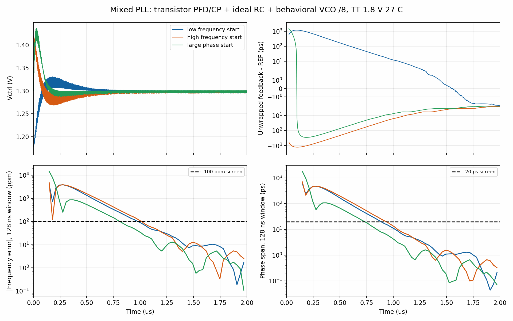
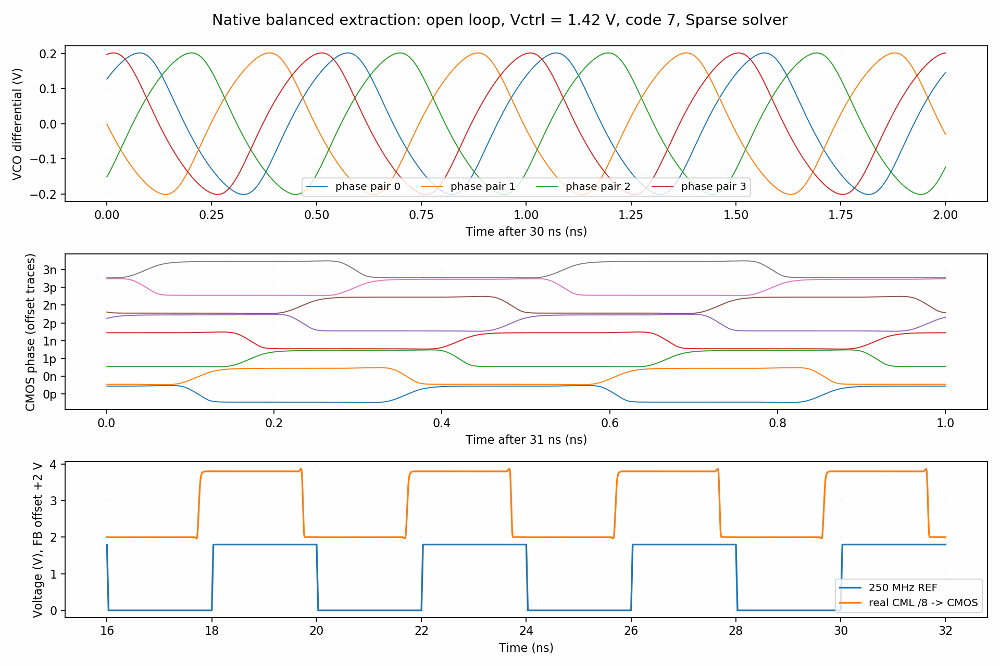
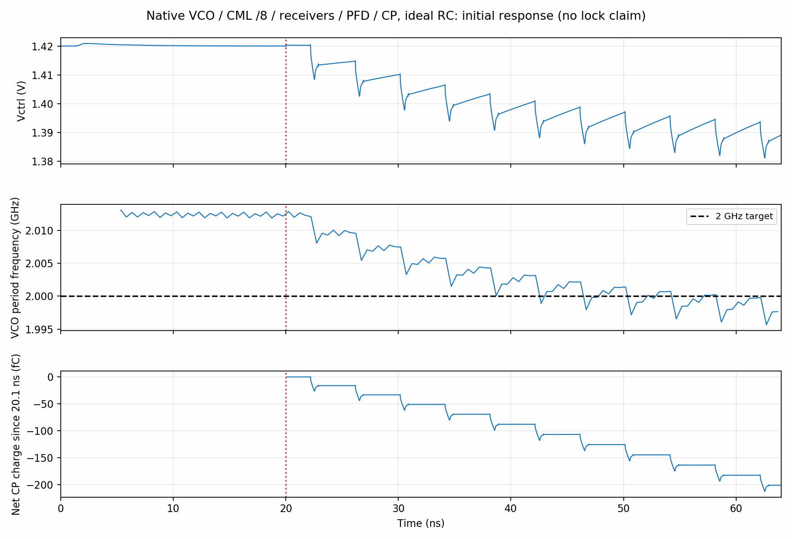

# PLL 首轮闭环与抽出负载

TT、1.8 V、27°C，ngspice 47。当前已证明混合视图的环路捕获，并跑通原生 SKY130 VCO、
真实 CML ÷8、接收器及对称 dummy 抽出的开环链和初始闭环响应；尚未证明完整晶体管 PLL 锁定。
没有改动“多相 CML 转换后的最高 2 GHz CMOS 域做自由分频”的架构，也没有为自由分频重跑仿真。

## 混合视图的捕获

测试台：`analog/pll/top/tb/acquisition/tb_pll_mixed_ngspice.cir.in`。
PFD 和 CP 使用实际晶体管；LF 为理想 6.5 kΩ、40 pF、2 pF；VCO 和反馈 ÷8 为行为模型。
模型取 1.3 V 对应 2 GHz，Kvco = +485 MHz/V，反馈目标为 250 MHz。
模型显式积分相位，不含 VCO 控制端寄生、RF 启动、实际分频器状态、时钟树延迟或噪声。
这个 Kvco 沿用此前局部表征，尚未重新拟合新增 dummy 后的 VCO。

工程观察判据见 [pll_lock_screen.toml](../../verification/contracts/pll_lock_screen.toml)：
128 ns 窗内平均频差低于 100 ppm、展开后的边沿相差跨度低于 20 ps，且保持至少 320 ns 至记录结束。
窗口步进 32 ns；判据是调试筛选，不是最终 SerDes 规格。所报时刻为首个持续满足条件的**窗口结束**，
要再等待 320 ns 才能在线确认。相差由最近反馈边沿配对并展开；变化过快会混叠，不替代完整周期滑移验证。

| 初始状态 | 首个持续满足窗口结束 | 至最后窗口的保持时间 | 1.5–2 µs 平均频差 | 相差跨度 |
|---|---:|---:|---:|---:|
| Vctrl 1.18 V，模型初始 1.9418 GHz | 0.980 µs | 0.992 µs | +4.94 ppm | 2.44 ps |
| Vctrl 1.42 V，模型初始 2.0582 GHz | 1.044 µs | 0.928 µs | −2.92 ppm | 1.45 ps |
| Vctrl 1.30 V，约半参考周期初相差 | 0.820 µs | 1.152 µs | −2.13 ppm | 1.06 ps |

三次最终控制电压的时间平均均接近 1.300 V。早先 800 ns 两次记录未满足持续判据，仍保留为未通过观察筛选的记录。
平均小信号模型的慢极点约 −4.79e6 rad/s，时间常数约 209 ns，不能仅凭约 3.56 MHz 的交越频率判断捕获时间。
无噪声瞬态中的小幅边沿变化不是已验证的相噪或抖动。

数值汇总：[pll_acquisition_points.csv](../data/pll_acquisition_points.csv)。对应运行：
`20261027T164035Z_ngspice_tt_mixed_low_long`、`mixed_high_long`、`mixed_large_phase_long`（后三者共享时间前缀）。

## VCO 抽出与 dummy

测试台：`analog/pll/top/tb/acquisition/tb_pll_transistor_ngspice.cir.in`，
配置：[clock_extraction.toml](../../config/clock_extraction.toml)。

四对 VCO 输出各接同样的 CML buffer，再各驱动一个 2 GHz CML→CMOS 接收器。
相位 0 的 buffer 还驱动实际 CML ÷8 和反馈接收器；相位 1–3 各复制一条有偏置的 ÷8、反馈接收器和 CMOS DFF 输入负载。
每根 VCO 线保留相同 0.5 fF 线电容，每个 CMOS 输出加 20 fF。
这样直接接在 VCO 上的器件结构一致，也保留 buffer 后级的动态负载。
这比单独挂一个固定电容更完整，但仍只是保守参考：PFD 内部复位和 dummy DFF 的复位活动并不完全相同，
尚未验证失配、布局寄生或电源耦合后的相位精度。

原生变容管加完整分频树时，KLU 在初始瞬态报 timestep too small，退出码却为 0；已按失败归档。
固定 30 fF 替代变容管的定位实验可运行，但不计作原生 VCO 通过。
保持原生器件模型与求解精度不变，改用 Sparse 后完成 32 ns 开环记录；没有修改全局 PDK。

测量窗口 16–32 ns，固定 Vctrl≈1.42 V，粗码 7：

| 项目 | 测量 |
|---|---:|
| VCO | 2.012659 GHz |
| VCO 差分峰峰值 | 403.31 mVpp |
| VCO 共模 | 1.63155 V |
| 实际反馈 CMOS 时钟 | 251.58245 MHz |
| 测得分频比 | 7.999999 |
| CMOS 八相相邻间隔 | 44.983°–45.017° |

相位间隔只是 TT、无失配、无布局寄生的理想对称条件下测量，不构成几十飞秒精度的硬件承诺。
VCO 四级物理顺序不是相位先后顺序，详细对应关系保存在运行目录的 `exploration.json`。
8 ns、4 ps 最大步长的补充定位记录也起振，但反馈周期不足，反馈频率记 null，没有拿它判锁。

该保守参考的分项供电功率：

| 电路 | 功率 |
|---|---:|
| VCO 与外部 CML 偏置参考 | 7.594 mW |
| 四个 CML buffer | 3.420 mW |
| 四个全速接收器 | 14.026 mW |
| 真实 CML ÷8 | 6.549 mW |
| 真实反馈接收器 | 1.325 mW |
| 三条 dummy ÷8、接收器及 DFF 负载 | **23.765 mW** |
| 所列供电合计（含其余 PFD/CP 偏置） | 56.957 mW |

不含理想参考时钟驱动、测试预充参考和启动扰动源；不是最终 SerDes 或时钟树功耗。
完整复制支路只用于先建立对称参考。下一版可比较额外独立抽出 buffer 与器件级等效 dummy，
以该基准核对频率、幅度、相位和功耗，不能直接把 dummy 断电后继续假定负载等价。

原生完整开环记录：`20261027T165156Z_ngspice_tt_rf_native_sparse_solver`。
测试预充由真实传输门连接外部理想电压参考；当前未实现片内粗调控制器或启动预充控制器。
有限启动扰动和接收器 nodeset 也不等于自主起振良率验证。

## 后续闭环边界与记录

真实闭环测试使用同一个原生 VCO 与 dummy 树，20 ns 后关闭测试预充并释放 PFD 复位。
64 ns 记录已完成，使用 Sparse、4 ps 最大步长，结果如下：

- 20.1–64 ns 的 CP 净输出电荷为 −201.24 fC，平均净输出电流 −4.584 µA，方向与超频后的降频需求一致。
- 32–64 ns 控制电压时间平均为 1.39478 V，范围 1.38110–1.40661 V；末点为 1.38909 V，不能把单个瞬时值当作稳态控制电压。
- 该窗按 VCO 边沿周期测得平均约 2.00082 GHz，反馈平均 250.13290 MHz，频差约 +532 ppm。
- 窗内反馈相差跨度约 18.7 ps；记录短于 128 ns 观察窗口和 320 ns 持续时间，且频差仍超过 100 ppm，因此不判锁。

运行：`20261027T165857Z_ngspice_tt_transistor_closed_first_response`。
调节过程非稳态，VCO 和反馈各自窗口边沿均值的比值不用于评判精确分频比，稳态分频关系以上述开环记录为准。
以上为首轮历史记录。随后完成局部带载校准：2 GHz控制点约1.39285 V，Kvco约464.55MHz/V；
原生电路的4096 UI记录已满足预充释放后的持续工程判锁判据，见 [后续预充与捕获结果](pll_precharge_capture.md)。
`config/pll_loop_prototype.toml` 的 `real_closed_loop_verified` 继续为 false。
该标志用于完整验证，单独的 `native_tt_engineering_lock_observed` 记录本轮观察；频段重叠、PVT、相噪、参考杂散、物理 LF 和最终 dummy 的精简仍待完成。

运行索引：[pll_debug_runs.csv](../data/pll_debug_runs.csv)。每次结果在
`results/analog/pll/top/acquisition/<run_id>/`，含 `run.json`、`metrics.json`、
输入及 SHA256、原始波形/边沿、日志与 `exploration.json`；失败和替代模型诊断也保留。
当前未新增 Python 执行/分析脚本；case.toml 仍是定义文档，参数替换与启动方式沿用手工探索。
