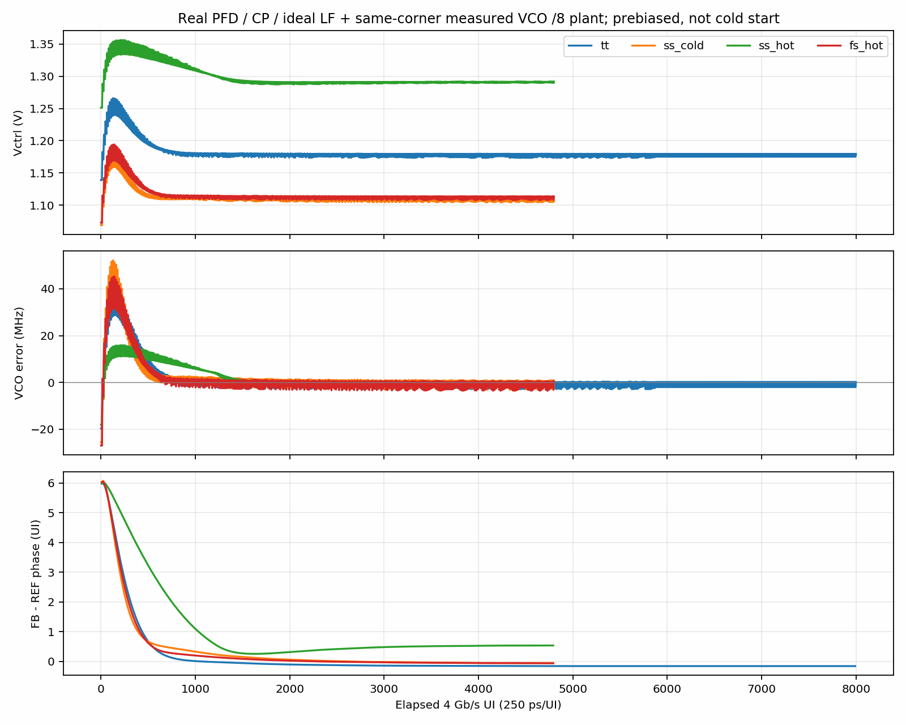
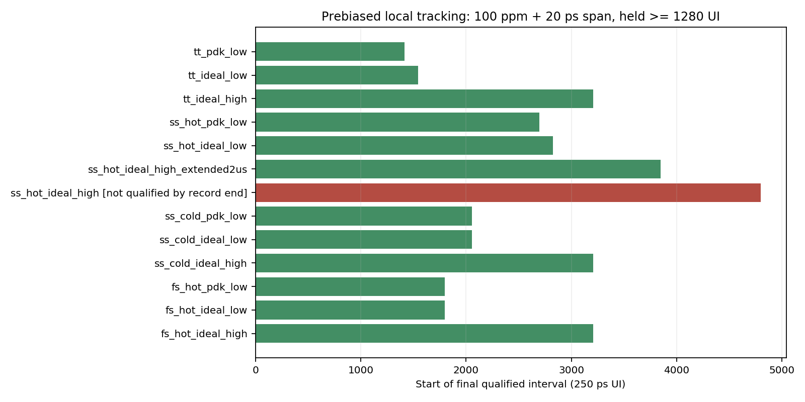
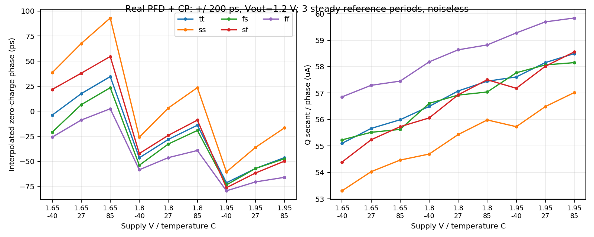
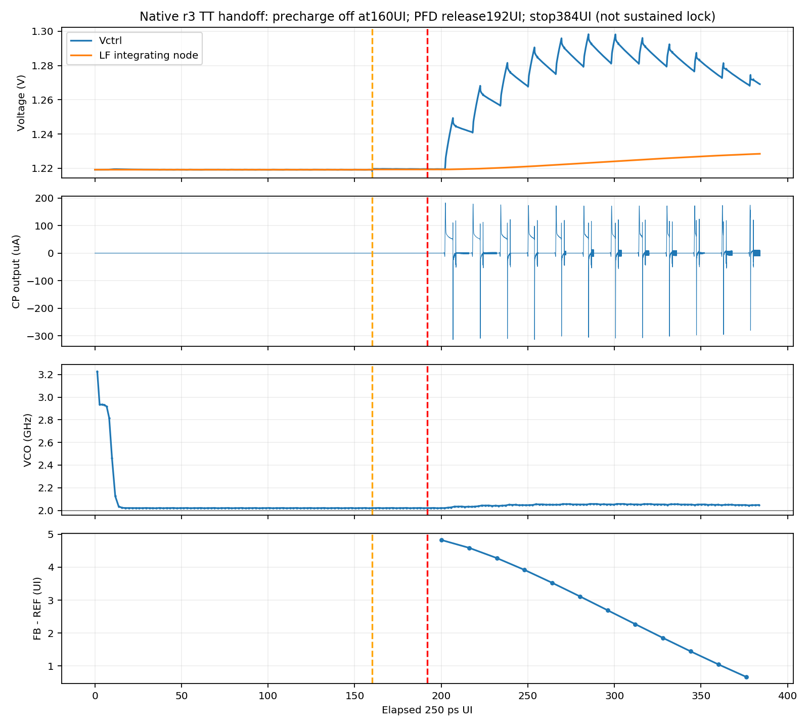

# PLL：PFD/CP/LF 接入后的选角 PVT

2026-10-30。当前 r3 在四个选定工况的分层闭环中完成局部跟踪；原生短时接回另列。冻结 v0.1 未改。数据见 [JSON](../data/pll_loop_pvt.json)，执行档案见 [campaign](../../results/analog/pll/loop_pvt/20261029T162452Z)。

## 本轮实际完成

- CP DC：5 MOS 角 × 3 供电 × 3 温度，共 45 个工况，扫描输出电压。
- 真实 PFD→CP：同样 45 个工况，各测 −200/0/+200 ps，共 135 组；250 MHz、Vout=1.2 V，积分最后三个参考周期。
- 原生四相 VCO/缓冲/反馈/dummy：四个选角，各用三个控制电压实测频率曲线。
- 真实 MOS PFD/CP 加理想 LF、或 PDK 多晶硅电阻/MIM LF，接同工况实测 VCO→÷8 模型；四工况各三种初始条件，共 12 个场景，另有一条延长记录。

模型按三点分段线性近似实测调谐曲线，并采用按实测上升时间近似的有限反馈边沿；不包含 VCO 噪声、控制端负载、分频状态和传播延迟。供电/温度/MOS 模型随工况切换，PDK LF 本轮采用基本入口的典型无源模型，不能声称独立 RC 极限角已通过。偏置参考电流仍理想，镜像及电路本体为实际 MOS。

## 闭环结果

以 250 MHz ×8 为目标，两颗 LF 电容均预置到目标附近 ±40 mV；这测的是预偏置后的局部跟踪，不是从零充电、全频段捕获或完整校准算法。三个场景为理想 LF 的低/高起点，以及 PDK LF 的低起点。

沿用工程判据：32 个参考周期窗口、步长 8 周期，平均频差 ≤100 ppm、展开相位变化 ≤20 ps，并在记录末尾持续至少 320 ns。相位均值可以非零；这些无噪声结果不是抖动签核。时间图用 250 ps/UI，锁定表同时给出 µs。

| 工况 | 粗调码 / 实测插值目标 Vctrl | 理想 LF 低起点 | 理想 LF 高起点 | PDK LF 低起点 |
|---|---|---|---|---|
| TT / 1.8 V / 27°C | 5 / 1.1792 V | 0.386 µs | 0.802 µs | 0.354 µs |
| SS / 1.65 V / -40°C | 5 / 1.1093 V | 0.514 µs | 0.802 µs | 0.514 µs |
| SS / 1.65 V / 85°C | 6 / 1.2912 V | 0.706 µs | 0.962 µs | 0.674 µs |
| FS / 1.65 V / 85°C | 5 / 1.1132 V | 0.450 µs | 0.802 µs | 0.450 µs |

表中时间是最终持续合格区间的起点，还需再观察至少 0.320 µs 才能确认。所有最终采用记录均未超出各自三点实测控制电压范围。

SS 高温高起点的原始 1.2 µs 记录未通过：最后 320 ns 相位变化 24.75 ps；相同设置延长到 2 µs 后重新评估，原记录和失败分类保留。没有调整电路或放宽阈值。

分析中也修正了末段窗口选择：旧判定把开始于保持区之前、仅结束于保持区内的窗口计入，造成三条高起点记录保守误判。最终判定使用实际末段 320 ns 数据及持续窗口；初始分类、修订说明和原波形都保留。

## PFD/CP 与 LF 的判断

45/45 工况在 ±200 ps 的净电荷方向正确且三个采样点单调。两端割线得到有效电荷增益 53.31–59.84 µA；线性插值的零电荷相位约 -79.4 到 93.1 ps。三点不足以证明无死区，也不覆盖所有输出电压和参考频率。

零相差残余电荷随工况变化，稳态闭环以静态相位偏移补偿。独立无源器件的早期 RC 模型表征见 [首轮结果](pll_pvt_first_results.md)，本轮未将这些极限角全部接入闭环。不能把这当作随机相位噪声，也不能只凭 DC 上下拉不匹配就宣布失锁。当前选定控制电压避免了 SS 低供电时更差的高压上拉顺从区；捕获全范围仍需另验。

PDK LF 在四选角的低起点均收敛，所以暂时不需要靠增大 CP 电流或重改 LF 来解决本轮功能。用同角局部 VCO 斜率和 1.2 V 输出处 CP 电荷割线重算，理想 LF 的线性模型估计单位增益频率 3.0–4.4 MHz、相位裕度 63–65°；不含延迟和寄生，不能标为实测带宽或实际 PDK LF 裕度。独立 RC 极限角、参考源、失配、噪声、带宽及全幅切频尚未由本轮覆盖。

## 原生接回与边界

实际 r3 四相 VCO、四条提取支路（包含三个通电 dummy）、真实反馈转换、PFD、CP，以及理想 R/C 的 LF 与实际 MOS 预充开关均接回。TT 1.8 V /27°C，预充开关 40 ns 断开，48 ns 释放 PFD，观察到 96 ns。两颗 LF 电容初值已预置；这不是充电时间测量。具体轨迹、频率和电荷见 JSON。首条同设置记录因 .save 漏了 rst_b，wrdata 未产生波形；补保存项后重跑，失败日志单独保留，电路和时序未改。

实际反馈相差从释放后首个比较周期约 1.206 ns 降到末周期约 168 ps；追赶阶段 VCO 从约 2.02 GHz 加速到约 2.05 GHz，以消除反馈滞后的相位误差。反馈 ÷8 比值保持约 8，这不是稳态频差测量。

这段记录用于检查原生接管和因果连接；其闭环观察只有 48 ns，不能满足 320 ns 保持判据，不能标为新 r3 原生持续锁定或全 PVT PLL 通过。旧版本的长时原生 TT 证据也不能自动升级到 r3。

PLL 当前依赖的是 ÷8 后 250 MHz CMOS；SS 冷角 2 GHz 全速 CMOS 缺口可先延后。现有 RX 样本对齐/RTL 桥仍依赖全速 CMOS，应保留待办，见 [尺寸与时钟优先级](divider_size_and_clock_priority.md)。分频器暂不缩尺寸；后续先选关键工况延长原生接回，再补 RC 极限角、偏置源和噪声验收。
