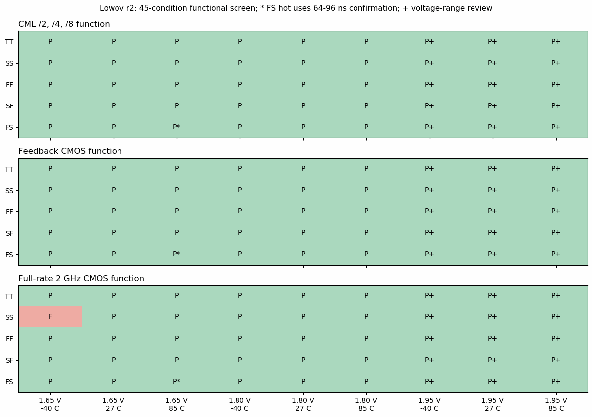
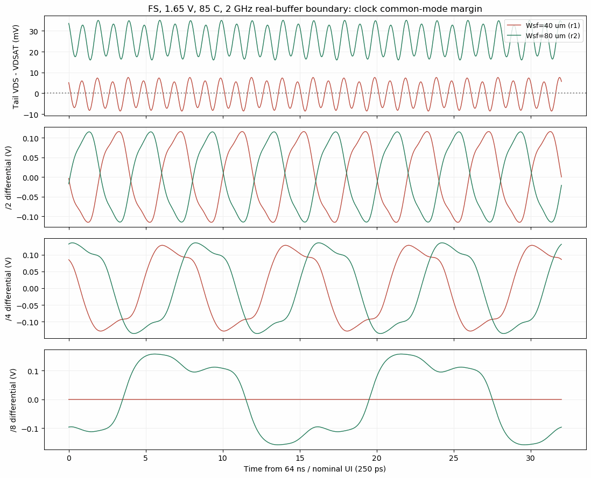
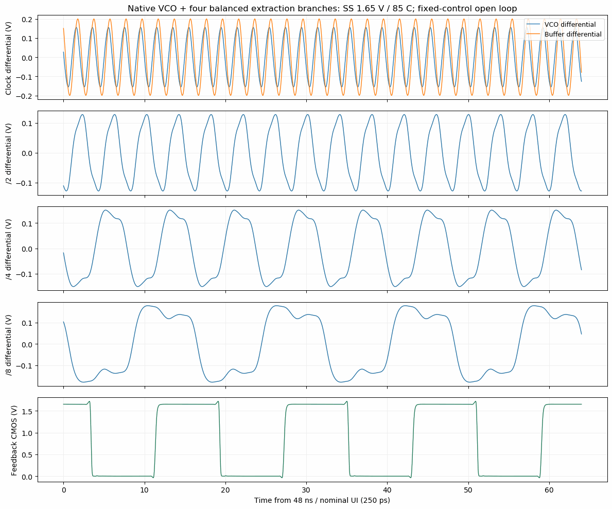

# 低过驱动分频器：设计应用与 PVT 继续验证

本轮已把低过驱动方案应用到工作网表，并实现真实 MOS 偏置镜。工作版本入口为 [pll_working_revision.toml](../../config/pll_working_revision.toml)，数值见 [JSON](../data/pll_lowov_pvt.json)。v0.1 的冻结发布目录保持不变。

稳态功能筛查覆盖 5 个 MOS 角 × 3 个电源 × 3 个温度，共 45 个条件：CML ÷2/÷4/÷8 和反馈 CMOS 均获得正确周期；导出的全速 CMOS 为 44/45，剩余 SS、1.65 V、−40°C。此计数不包含噪声、失配、版图寄生、完整闭环捕获或模拟裕量签核。

## 应用到设计的内容

- [cml_latch.spice](../../analog/pll/divider/spice/cml_latch.spice)增加可配置尾管指数量，默认仍为 4，保留 RX 采样器和其他通用锁存器的原电路参数。
- [cml_div2.spice](../../analog/pll/divider/spice/cml_div2.spice)的分频尾管改为总宽度 72 µm、24 指。输入源跟随器继续使用原偏置，锁存尾管使用独立的低过驱动偏置。
- 偏置由 NMOS 复制原参考的一部分，经 PMOS 镜注入 W/L=20/0.5 µm 的真实 NMOS 二极管产生；没有在分频器内部放理想电压源或理想参考电流源。[cml_prescaler8.spice](../../analog/pll/divider/spice/cml_prescaler8.spice)中三级共享一个本地偏置镜。
- PVT 扩扫暴露 FS 低压热角的时钟共模不足，源跟随输入管总宽度再从 40 增至 80 µm，仍为 4 指，下拉管宽度保持 4 µm。单独 ÷2 和旧二进制链的参数入口同步更新；旧实验数据保留原源快照。
- clock_frontend_lowov.spice (`../../analog/pll/top/spice/clock_frontend_lowov.spice`, retired in `retired_legacy_vars_20261120.json`)连接上轮 VCO、转换器修整版及本轮分频器；四路真实抽出和三路供电 dummy 均保留，每路 prescaler 都有同样的偏置镜。

分频器外部引脚保持兼容。网表是本轮工作设计依据，分频器内部原理图尚需同步；没有把旧原理图视图标为已更新。

## 真实偏置与 45 条件网格

条件为 TT/SS/FF/SF/FS，1.65/1.80/1.95 V，−40/27/85°C。外部仍由理想 0.85 mA 参考驱动真实全局 MOS 镜，因此参考发生器本身尚未资格验证。新增本地偏置镜的直流网格中，逻辑偏置约 0.712–0.835 V，参考支路电流约 118–141 µA；所探测复制 NMOS 和 PMOS 镜的直流压差余量均为正。不能把尺寸比当成精密电流比。

动态网格使用差分 300 mVpp、共模 VDD−0.15 V、精确 2 GHz 的正弦，驱动真实 CML buffer。buffer 同时加载全速转换器和三级 CML 分频器；分频 tap 每端 5 fF，反馈转换器和全速转换器每端 20 fF。这是明确的单元输入边界；另用真实 VCO、PFD 输入负载及供电 dummy 前端检查实际加载。

最终 r2 每条件跑 48 ns、分析 24–48 ns。FS、1.65 V、85°C 的该窗口仍含状态建立过程，另以相同最终电路跑至 96 ns，使用 64–96 ns 确认稳态。初始 48 ns 的异常记录和后续确认均保留，未删掉初筛结果。

功能筛查要求差分 tap 摆幅至少 150 mVpp、边沿计数正确、周期误差小于输出周期的 1%；两路 CMOS 需达到 <0.2 VDD/>0.8 VDD，完整周期占空比在 45–55%。150 mVpp 是本轮功能筛查门槛，不是把原 400 mVpp 名义目标改成已签核的新规格。

| 项目 | 本轮结果 |
|---|---|
| 真实本地偏置镜 DC | 45 条件完成 |
| CML ÷2/÷4/÷8 稳态功能 | 45/45，含 FS 热角延长确认 |
| 反馈 CMOS 稳态功能 | 45/45 |
| 全速 2 GHz CMOS | 44/45，SS/1.65 V/−40°C 失败 |
| 400 mVpp 全 PVT | 未资格验证；最低实测 tap 摆幅约 230 mVpp |
| 1.95 V 条件端压范围 | 15 条件有 CMOS 上冲，需逐器件端电压复核 |

SS 冷端此时 CML 分频和反馈 CMOS 都正常，剩余问题位于全速转换器支路，不能再记成反馈分频链失效。

## FS 热角为什么还要改源跟随器

上一轮只在 SS 上验证了宽尾管/低过驱动方向。扩扫发现 FS、1.65 V、85°C 的源跟随后时钟共模只有约 0.804 V，首级 master 尾管平均 VDS−VDSAT 约 −0.4 mV；原源跟随尺寸跑到 96 ns，÷8 仍无有效摆幅。

| 源跟随总宽度 | 内部时钟共模 | 首级尾管平均压差余量 | ÷8 差分摆幅 |
|---|---:|---:|---:|
| 40 µm | 0.804 V | −0.4 mV | 接近零 |
| 60 µm | 0.824 V | +15.6 mV | 312 mVpp |
| 80 µm | 0.838 V | +25.6 mV | 316 mVpp |

最终选 80 µm，额外保留一些共模余量，并重新执行了完整 45 条件动态网格。改善不是简单地增加输出电流：第一 tap 的摆幅并未大幅提高，关键是后续时钟转向和再生能持续建立。

## 真实时钟前端的回接

最终版本用真实 VCO、四路 buffer、全速转换器、四个真实 prescaler、反馈转换器和供电 dummy 回接。静态 Vctrl 测试属于开环工作点检查，不能用其频差表示 PLL 锁定精度。TT 和 SS 低压热角已在约 2.012 GHz 获得持续的三级分频、四路反馈及四相全速 CMOS 输出。

FS 低压热角首次使用码 4、Vctrl=1.4 V 时，实际 VCO 达到约 2.301 GHz，超出 2 GHz 目标，分频链失效。该超频测点作为带宽压力结果保留，不能把它当成 2 GHz 下的失败；随后另做粗细调校准回接，数值见本页末尾和 JSON。

## 更低堆叠的结构是否值得换

有进一步减少压差需求的方案。已有器件级设计去掉传统独立尾源，改用时钟管栅偏置和 AC 耦合来减少堆叠；它能节省压差，但本项目需要重新验证电流、摆幅、时钟共模、耦合 RC 和启动行为，不能直接沿用本轮参数。[低压 CML 结构实例](https://www.mdpi.com/2079-9292/10/19/2404)。

TSPC 等动态 CMOS 也是后续功耗/面积比较方向，但动态节点的保持和最低频率需要检查；本项目全速 CMOS 冷端也尚未解决，切换它会新增待验证边界。[Berkeley 原始设计中的动态节点保持讨论](https://digicoll.lib.berkeley.edu/nanna/record/134542/files/EECS-2016-25.pdf?registerDownload=1&version=1&withMetadata=0&withWatermark=0)。本轮继续静态 CML，先把已定位的修改和 PVT 证据做完整。

## 尚未收口的项目

- SS、1.65 V、−40°C 的全速 CMOS 转换仍失败，反馈转换正常。
- FS、1.65 V、−40°C 虽然功能正常，首级 master 尾管平均 VDS−VDSAT 仍约 −5 mV，约 63% 采样点低于模型饱和判据；这不是宽裕的模拟工作点。
- 名义差分 400 mVpp 尚未在全部 PVT 条件实现或签核；本轮最小值约 230 mVpp。所有 1.95 V 条件的 CMOS 上冲也需端电压适用范围复核。
- CML 电阻仍为名义理想 R，参考发生器、失配、随机噪声和提取寄生尚未资格验证。
- 没有执行完整单片晶体管级 PLL 的 45 条件闭环捕获网格；PFD/CP/LF 的新 PVT 网格也尚未扩扫。
- 电源和偏置在 DC 工作点已建立，再启动时钟/振荡；没有验证电源爬升或偏置使能瞬态。启动时的短周期与稳态周期分开记录，不能把它们误记为随机抖动。

全部渲染 TB、输入 SPICE 快照、模拟器日志及命令记录在 campaign (`results/analog/pll/pvt_lowov/20261029T114507Z`)。单元 [PVT 模板](../../analog/pll/divider/tb/pvt/tb_prescaler8_lowov_ngspice.cir.in)和 原生前端模板 (`../../analog/pll/top/tb/pvt_lowov/tb_frontend_ngspice.cir.in`, retired in `retired_legacy_vars_20261120.json`)已加入层级测试目录。

## 最终原生回接测点与恢复检查

电脑异常后确认所有完成数据仍在；补跑 FS 码 6 测点，未重跑已完成的网格。以下全部使用最终 r2 电路、64 ns 记录，测量 32–64 ns。每次均为固定理想 Vctrl 的开环测试。

| 条件 | 电容码 / Vctrl | 实际 VCO GHz | VCO / buffer 差分 mVpp | 分频 / 反馈 / 全速 CMOS |
|---|---|---:|---:|---|
| TT / 1.8 V / 27°C | 5 / 1.205 V | 2.0129 | 360 / 504 | 均通过 |
| SS / 1.65 V / 85°C | 6 / 1.32 V | 2.0121 | 310 / 398 | 均通过 |
| FS / 1.65 V / 85°C | 4 / 1.4 V | 2.3009 | 296 / 362 | 分频与反馈失败；超目标频率 |
| FS / 1.65 V / 85°C | 5 / 1.2 V | 2.0553 | 225 / 301 | 分频与反馈失败；实际波形幅度偏低 |
| FS / 1.65 V / 85°C | 6 / 1.5 V | 1.9271 | 316 / 404 | 均通过，但尚未达到 2 GHz |

**FS 实际 VCO 驱动下的 2 GHz 回接仍未资格验证。** 码 6 的恢复说明调谐点和波形幅度是重要变量，不能仅凭频差、平均尾管饱和余量或标准正弦夹具的通过数判定实际接口。45/45 的标准边界单元结果保留其明确范围，不能推广成全前端或完整 PLL 已通过全 PVT。

失效机制、公共锁存器复用与其他拓扑的文献比较见 [CML 锁存器结构调研](cml_latch_topology_review.md)，电路阅读图见 [三页 PDF](../schematics/lowov_review/cml_latch_review.pdf)。候选图尚未作为新设计应用或仿真。
