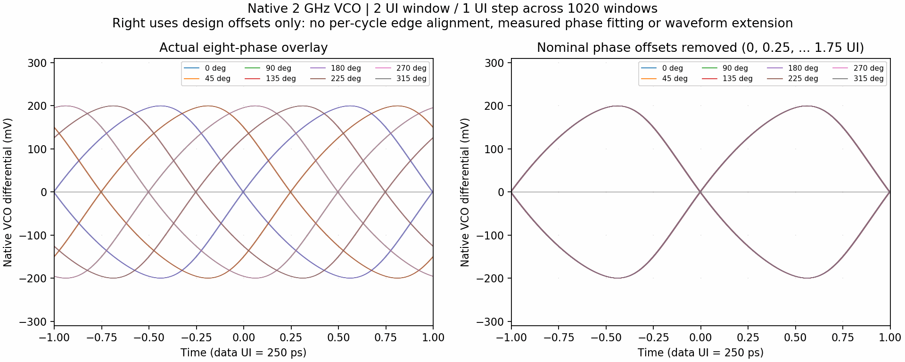
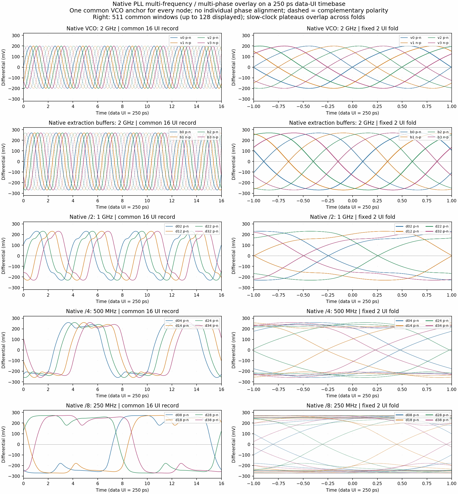
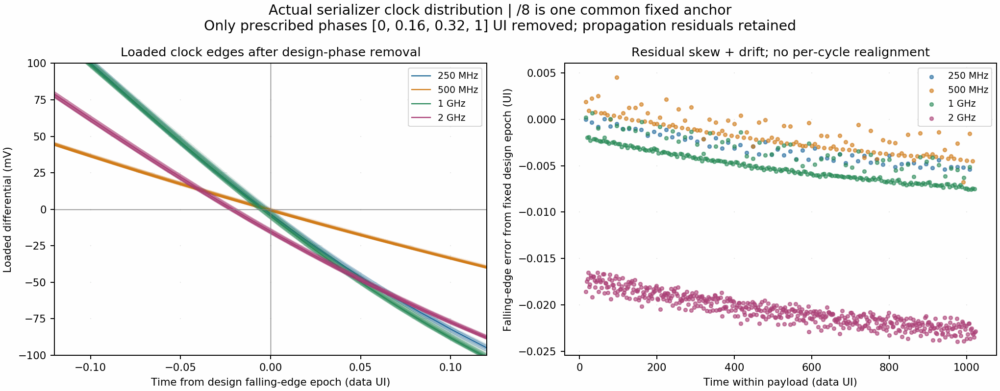

# 多频多相时钟的250ps时基套叠

使用已有原生闭环PLL及实际buffer负载记录，没有新增SPICE仿真，也没有更改数据眼图的折叠周期、判决或验收结果。统一定义1数据UI=250ps。

## 原生八相时钟眼图

这张图使用2UI显示窗口、1UI折叠步长，即每250ps取一个窗口。2GHz时钟自身周期为2UI，因此相邻窗口包含相反的边沿，形成时钟眼图。左侧保留各相的实际相位，右侧仅扣除名义相位0、0.25、…、1.75 UI；未逐周期对齐，也未依据实测相位逐路拟合修正。共同频偏、相间误差和形状差异仍保留。显示窗口按连续块抽取，包含两种相邻边沿；不对相反极性的窗口取电压中位数。

2GHz的八相名义间隔是45°=0.25 UI=62.5ps，并不是250ps。八相来自四组差分电压及其互补极性，不是八组独立振荡器。左图的多个交叉点主要来自设计相位差，不能当成随机抖动。右图的轨迹大体重合，表明本TT、无随机噪声的记录中，原生VCO各相形状及相位一致性较好；全幅图不能代替过零放大或统计相噪测量。

## 全部已保存的多频多相节点

五行依次为原生VCO、抽出buffer、÷2、÷4、÷8。每行展示四组实际差分节点；VCO及抽出节点另外用虚线展示互补极性。左列是同一段16UI连续记录，右列按同一个VCO锚点、固定2UI周期套叠。所有节点共享同一个初始时基，没有分别把各路边沿拉到零点。

右列数值记录包含511个共同窗口。显示子集按多个连续8窗口块抽取，覆盖慢时钟的各个折叠位置，避免抽样步长与分频周期整除而漏掉某类边沿。低频节点不画跨不同逻辑状态的电压中位数，避免生成原波形中不存在的曲线。

多种频率可以放在同一张叠图上，但慢时钟会让高低平台和不同时刻的边沿同时出现。其折叠图通常不构成可按串行数据眼高/眼宽解释的单一眼睛。因此分频族分行显示，统一横轴单位；跨不同频率比较时，应优先看共同时间轴和边沿残差。

## 实际串化器时钟的跨频率边沿套叠

使用实际负载下的250MHz时钟一个下降沿作为共同锚点，按固定标称周期生成后续期望位置。只扣除预定相位[0, 0.16, 0.32, 1] UI，分别对应250MHz、500MHz、1GHz、2GHz；不会将每个输出自己的过零重新对齐。

左图可以同时看斜率差和过零偏斜，右图可以看固定标称时基下的累积漂移与残余偏差。2GHz路仍有约−0.02 UI的残差，数值与此前实际分发结果相符；500MHz路斜率更缓。两项都不会在绘图中被自动校正掉。这个理想源之后的负载分发记录与原生PLL记录分开标注，避免混淆源端表现与分发路径表现。

## 数据与边界

[节点相位诊断、边沿残差和原始输入SHA256](../data/pll_multiphase_250ps_fold.json)。原串化运行目录保存三个图的副本及同名NPZ数组。原生图在原生电压上绘制；实际分发图仍保留此前明确的源端理想化接口，不表示模拟了该边界上的负载回灌。所有图均限于现有无随机噪声TT记录。

针对1GHz/500MHz可见不等间隔的定量核对，以及buffer/末级锁存器的UI偏差溯源，见[相位与串化时序诊断](serializer_timing_root_cause.md)。
