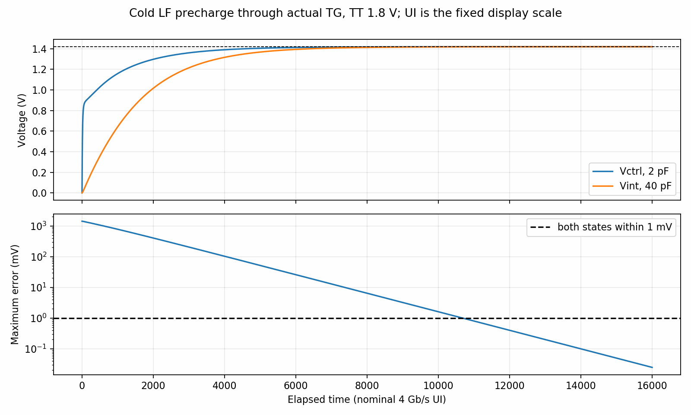
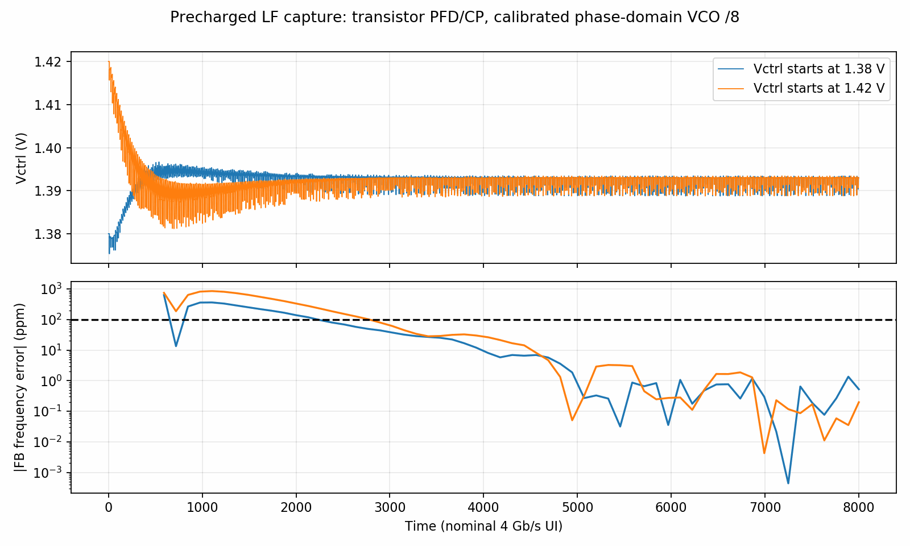
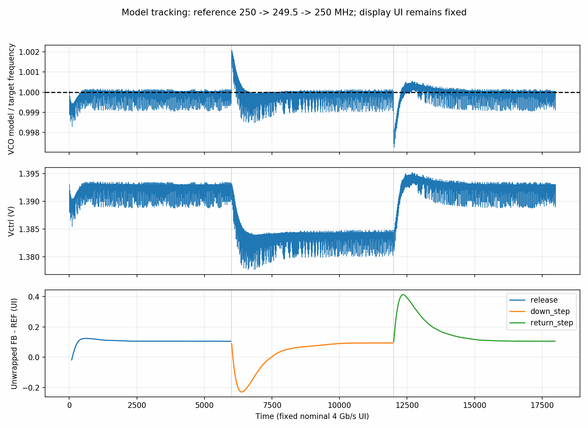
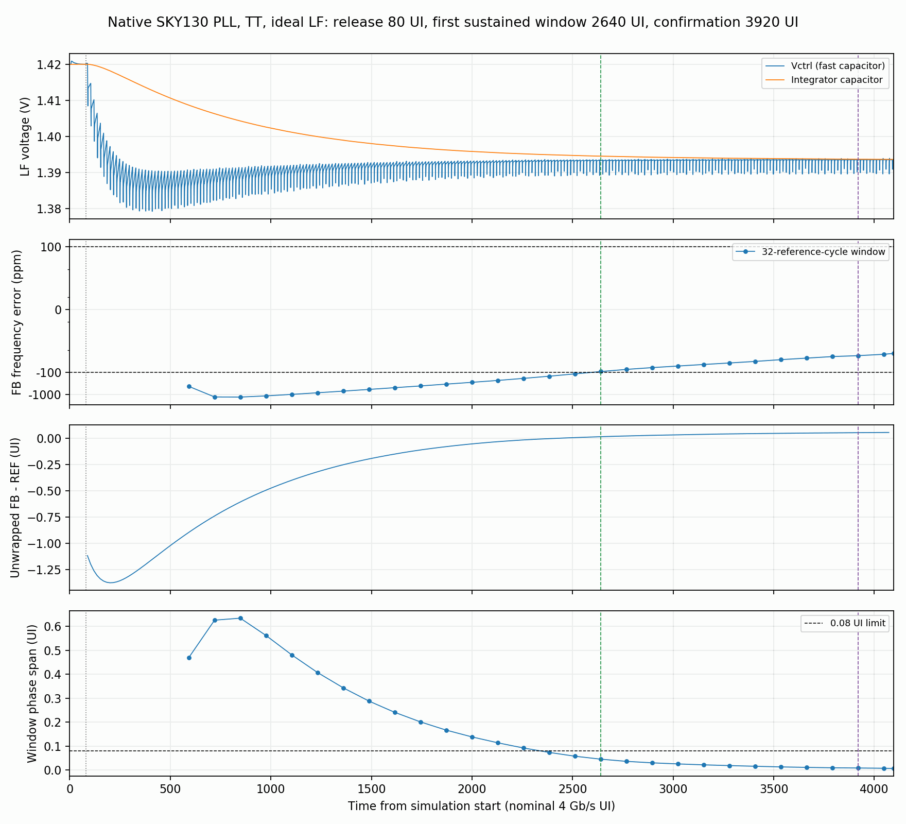

# LF 预充、捕获与频率跟踪

本轮完成 LF 冷态充电、充分预充后的原生闭环捕获，以及校准混合视图的参考频率阶跃。
原生电路在本次 TT 记录中满足频差/相差持续观察判据；不代表 PVT、噪声或提取后签核。

时域图统一使用标称 4 Gb/s UI，1 UI=250 ps；参考周期为 16 UI，VCO 周期约为 2 UI。
跟踪阶跃时，UI 仍是固定显示尺度，没有按变化的输出频率重新对齐。

## 冷态 LF 预充

[测试台](../../analog/pll/loop_filter/tb/precharge/tb_lf_precharge_ngspice.cir.in)从两个电容电压均为 0 开始，
通过实际 CMOS 传输门由外部理想参考预充。LF 为理想 6.5kΩ、40pF、2pF，电源视为已经建立。
两节点均进入目标 ±1mV 并保持至记录结束，才认为预充建立。

| 目标 | 两状态均建立 | 记录末端最大误差 |
|---|---:|---:|
| 1.40V | 约 10794 UI | 0.0279mV |
| 1.42V | **约 10682 UI** | 0.0248mV |

10682 UI 对应约 2.67µs。此前 80 UI 释放测试预充是 DC 状态已建立后的接管时刻，不是冷态充电时间。
不能只看较小的控制端电容，积分电容的状态也必须建立。

本夹具未接完整 CP/VCO 动态负载，也未实现片内预充参考/控制器或整芯片电源爬升。
独立冷充电与已预充捕获不能拼成一次完整芯片上电到锁定的实测。

## 带完整负载的 VCO 局部校准

原生 VCO、四个相同抽出 buffer、全速接收器和三条有偏置 dummy，在 TT、1.8V、27°C、粗码7下：

| 控制电压约值 | VCO频率 |
|---|---:|
| 1.38V | 1.99409GHz |
| 1.40V | 2.00326GHz |
| 1.42V | 2.01266GHz |

局部线性拟合 Kvco≈464.55MHz/V，2GHz 中心约 1.39285V，最大拟合残差约79kHz。
只适用于本局部 TT 条件，未验证宽频、粗码重叠或 PVT。来源见 [拟合数据](../data/pll_loaded_vco_fit.json)。

## 充分预充后的校准混合视图

PFD、CP 为实际晶体管，LF 为理想 R/C；VCO 是上述拟合的相位模型，÷8 为理想分频。
两个 LF 电容的初始电压相同，捕获时间不包含冷预充等待。

[工程观察判据](../../verification/contracts/pll_lock_screen.toml)：512 UI 窗内平均频差低于100ppm、
展开相差跨度低于0.08 UI，之后保持至少1280 UI至记录结束；每128 UI检查一次。
首个持续满足条件的窗口结束与完成保持期后的可确认时刻分别报告，不等于最终抖动/杂散规格。

| 初始 LF 电压 | 距释放的首个持续满足窗口结束 | 距释放的最早可确认时刻 |
|---|---:|---:|
| 两节点均1.38V | 约2252 UI | 约3532 UI |
| 两节点均1.42V | 约2892 UI | 约4172 UI |

释放后 Vctrl 与积分节点 z 的电压分离，是比例/积分支路调节时的响应。
是否完成预充应检查释放前的两状态，不能把释放后两节点不相等当作预充未完成。

## 频率跟踪阶跃

已预充模型在6000 UI处把参考从250MHz连续相位地降至249.5MHz，在12000 UI处恢复250MHz。
VCO目标为2.000→1.996→2.000GHz，控制范围处于本轮局部拟合范围内。

| 阶跃 | 距阶跃的持续满足判据时刻 | 保持后可确认 |
|---|---:|---:|
| 向下 | 约2052 UI | 约3332 UI |
| 恢复 | 约1920 UI | 约3200 UI |

这些是晶体管 PFD/CP 加校准相位模型的结果，不能替代原生 VCO、分频链和接收器的真实闭环捕获时间。
未加入随机器件噪声，边沿变化不是相噪或统计抖动结果。

## 原生电路捕获结果

原生运行保留 VCO、变容管、CML÷8、接收器、PFD、CP 和对称 dummy，LF 仍为理想R/C。
DC 工作点在 t=0 前预充两个 LF 状态，80 UI释放预充及PFD复位；再次检查释放前两节点均在1.42V±1mV内。

先前整段运行触发35分钟墙钟超时，未产生完整波形，已按失败保留。
新夹具用同一 ngspice 进程内的 stop/resume 连续推进，保存128、512、1024、2048、3072、4096、5120、6144、6400 UI的累计波形。
恢复保留本进程的动态状态；波形文件不等于可跨进程恢复的器件状态快照。

保留 `reltol=1e-4` 和原生器件，不使用全节点 cshunt。
全节点1aF诊断虽运行完成，但改变约11%的开环频率，已拒用于捕获结论；
放松精度的试验也改变初始频差，未用于正式捕获测量。

原生记录已推进至 **4096 UI**，两 LF 状态在释放前的最大偏差分别为0.1500mV和0.01585mV，满足预充检查。

| 原生 TT 观察量 | 结果 |
|---|---:|
| 预充/PFD复位释放 | 80 UI |
| 首个持续满足窗口结束，仿真起点计 | 2640 UI |
| 捕获窗口结束，距预充释放 | **2560 UI** |
| 加1280 UI保持后最早可确认，距释放 | **3840 UI** |
| 实际首个满足时刻至记录末端保持 | 1456 UI |
| 最后512 UI窗口的平均反馈频差 | **−14.21 ppm** |
| 最后512 UI窗口的展开相差跨度 | **0.00692 UI** |

捕获时间按窗口结束计，每128 UI检查一次，并非精确的瞬时锁定边界。
反馈相差约有0.051 UI的平均静态偏移；判据检查其展开跨度和频差，不要求静态偏移为零。

工程判据保持充分后，控制器在已完整写出的4096 UI检查点结束运行，未继续到计划上限6400 UI。
`exit_code=-15`是控制器请求的SIGTERM，`controller_completion.json`保存了判据、实际记录长度和波形SHA256；
结果状态为捕获目标完成，不解释为计划全时长自然结束。
运行目录为 `results/analog/pll/top/precharged_capture/20261027T234336Z_ngspice_tt_native_precharged_checkpoint_ui/`。

该原生记录证明本条件下预充接管后的持续工程判锁；频率阶跃跟踪仍只有校准混合视图结果。
LF器件尚未物理映射，粗调控制、自主上电、PVT、相噪/杂散和真实串化器时钟分发仍未包含。

汇总见 [捕获/跟踪CSV](../data/pll_precharged_capture.csv)。失败和诊断均保留，退出码0或Vctrl变平不能替代有效性判断。

带宽定义、阶跃稳定时间、连续扫频速率与第一版工程目标见[PLL跟踪研判](pll_tracking_assessment.md)。
