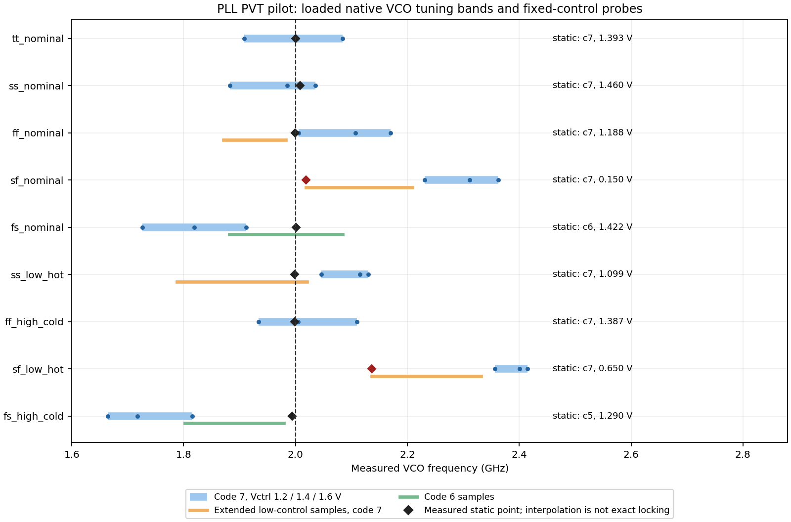
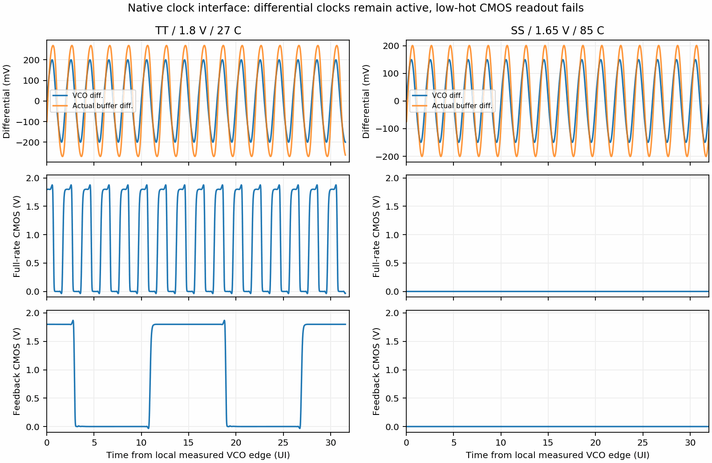
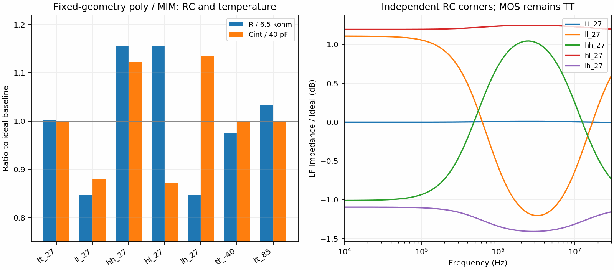
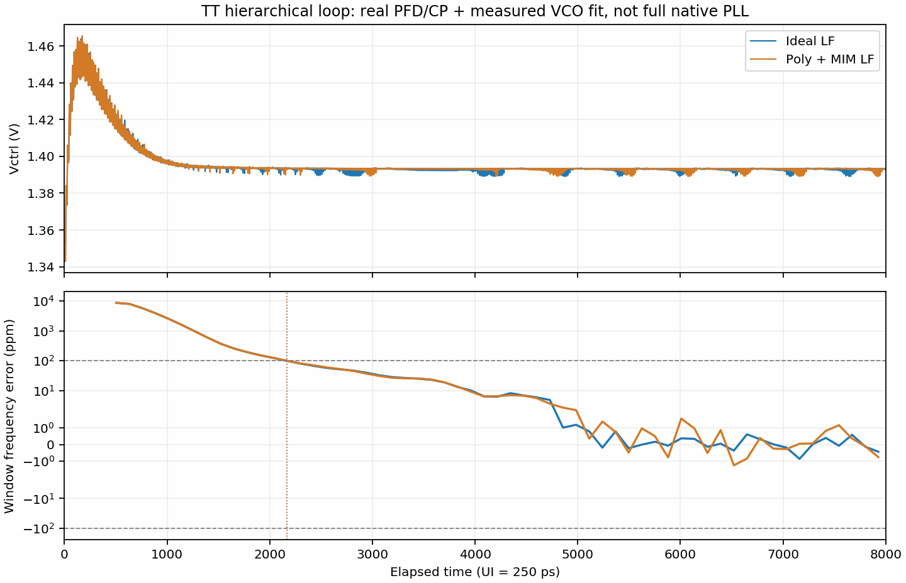

# PLL首轮PVT与精密多晶硅/MIM滤波器候选

2026-10-29。本轮从PLL开始做PVT。冻结电路保留原样，新增测试夹具和物理器件滤波器候选；不将本轮称作完整PVT签核。原始运行位于 `results/analog/pll/pvt/20261029T070119Z`。

## 无源器件的选择

理想电阻可以映射到工艺电阻，但应按阻值、电流密度、寄生和温漂分别选型。本轮6.5kΩ环路电阻使用 `sky130_fd_pr__res_high_po_0p69`，宽0.69µm、长12.44µm。CML中数百Ω负载不能直接套用这一高阻器件，需要单独考虑低阻poly或其他线性电阻的尺寸/电流密度与带宽影响。

电容也可以用MOS电容，但其C(V)、泄漏和偏置范围应进入设计。VCO的可变调谐本来就在利用MOS变容；LF的40pF/2pF希望保持线性，因此这份候选使用 `sky130_fd_pr__cap_mim_m3_1`。使用42个约1pF的单元：40个并联形成积分电容，2个并联形成快速电容，单元边长22.1965µm。总名义板面积约20693µm²，即0.0207mm²，未计布线、间距和边界。

模型中包含电阻温度/电压依赖、poly对衬底电容以及MIM边缘电容/串联电阻；完整布线、底板耦合和版图寄生仍需提取。该MIM模型的电容量温度系数为0，本轮不能据此证明真实硅上没有温漂。[SKY130器件说明](https://skywater-pdk.readthedocs.io/en/main/rules/device-details.html)

候选见[物理LF模型](../../analog/pll/loop_filter/spice/passive_rc_pdk_candidate.spice)，原[理想LF](../../analog/pll/loop_filter/spice/passive_rc.spice)保持原值，用于对照。候选尚未提升为冻结基线。

## 测试边界

| 测试 | 已包含 | 范围限制 |
|---|---|---|
| 九环境时钟前端 | 原生VCO、四路真实buffer/转换、真实÷8及三路powered dummy、实际PFD输入负载 | 外部Iref理想；CML电阻/代理线负载沿用基线；Vctrl由理想源钳定作开环调谐 |
| 自适应调谐补测 | 扩大Vctrl窗口，或把码7减到6，再按实测选择固定工作点 | 调码/偏置控制是测试配置；自动片上校准未实现 |
| 固定工作点复查 | 相同电路，固定控制电压，检查稳态频率/摆幅及各分频链 | 短窗功能检查，未包含统计噪声/失配 |
| 物理LF表征 | TT及独立R/C角、温度变化，DC偏置下小信号R/C与LF阻抗 | 是模型/几何视图，未包含版图提取 |
| TT环路对照 | 实际PFD/CP，理想或物理LF；VCO来自同角原生调谐数据的分段线性模型 | 理想÷8，无原生振荡启动/抽出动态；不是原生整PLL捕获或全PVT闭环签核 |

MOS基本TT/SS/FF/SF/FS库段的R/C均为typical。本轮无源工艺变化通过独立的 `ll/hh/hl/lh` 库段检查，未把MOS最坏角当作无源最坏角，也未声称所有MOS×RC×温度交叉组合都已运行。

## 方法与判读

前端先在码7下依次保持Vctrl=1.2/1.4/1.6V，每段8ns，0.2ns过渡；使用各段末尾约4ns的差分上升过零拟合频率。调谐范围不覆盖2GHz时，再扩大低压窗口或逐级减少电容码。这里的阶跃远快于正常CP/LF的控制变化，跨阶跃的分频异常必须与固定工作点结果分开。

固定控制复查记录最后8ns内频率和摆幅；分频/CMOS转换检查以真实VCO的周期坐标计算连续输出上升沿之间包含多少VCO周期，避免用统一的2GHz参考误判PVT频差。短窗经过的周期有限，静态频率的插值设定也不等于闭环锁定精度。

TT带载复核在Vctrl=1.392846V时测得约1.999969GHz、399.5mV差分峰峰值，与旧基线一致。KLU在该前端仍于初始时间步失败，相同夹具由Sparse完成；数值引擎失败单列，不计作某工艺角的电路失败。

LF以0.01V DC差压附近的小信号阻抗测R，以1kHz导纳测MIM单元有效C，并比较100Hz–100MHz的完整滤波器阻抗。TT/27°C约为6.508kΩ、40.000pF、2.000pF；约2.93MHz处相对理想LF仅约0.009dB幅度差、−0.010°相位差。

环路使用既有工程判锁：32参考周期窗口、100ppm频差、20ps未去趋势相差跨度、至少320ns连续好窗。两状态电容初始电压约1.343V，反馈初相位0.13周期；不是未预充冷启动。控制电压轨迹必须留在实测VCO模型域内；未出域也不把行为模型结果提升为原生PLL的同等证明。读出接口已失败的工况不能用理想反馈模型绕过失败后记为通过。

## 结果

| 环境 | 供电 / V | 温度 / °C | 静态码 / Vctrl | 固定控制频率 / GHz | 稳态时钟链检查 |
|---|---:|---:|---|---:|---|
| tt_nominal | 1.80 | 27 | 7 / 1.3931V | 2.000091 | 观察窗通过 |
| ss_nominal | 1.80 | 27 | 7 / 1.4599V | 2.008505 | 观察窗通过 |
| ff_nominal | 1.80 | 27 | 7 / 1.1881V | 1.999572 | 观察窗通过 |
| sf_nominal | 1.80 | 27 | 7 / 0.1500V | 2.018713 | 观察窗通过 |
| fs_nominal | 1.80 | 27 | 6 / 1.4220V | 2.001214 | 观察窗通过（32ns复查） |
| ss_low_hot | 1.65 | 85 | 7 / 1.0992V | 1.998097 | 未通过/无有效周期（32ns复查） |
| ff_high_cold | 1.95 | -40 | 7 / 1.3873V | 1.998522 | 观察窗通过 |
| sf_low_hot | 1.65 | 85 | 7 / 0.6500V | 2.136349 | 未通过/无有效周期 |
| fs_high_cold | 1.95 | -40 | 5 / 1.2900V | 1.993765 | 观察窗通过 |

上表是固定Vctrl下的开环工作点，频率接近2GHz不等于PLL已经锁定；插值后的点也尚未逐角精确校准到同一载波。6个环境在同一码下已测到跨越2GHz的频率点；FS高压冷角另用码5测到约1.994GHz，精确括区/校准仍待补齐。

当前有三类明确缺口：

- **SF调谐覆盖未验证。** SF标称与SF低压热角在已测点的最慢频率仍约2.019/2.136GHz，尚未找到2GHz括区。不能外推成完整控制域都不可达，也不能将它们记为覆盖通过；需补密最低频点及慢端电容余量设计。
- **SS低压热角读出失效。** 1.65V/85°C时VCO约1.998GHz、差分约299mVpp，实际CML buffer仍约401mVpp；直接CMOS时钟和反馈读出无有效稳态边沿。32ns复查仍存在，需进一步检查CML→CMOS接收器的共模、偏置与门限裕量。SF低压热角的反馈周期同样未通过，但该点尚未调到2GHz，不单独推断目标2GHz下必然失效。

- **高压角端电压仍需核对。** FF/FS的1.95V冷角中，全速CMOS输出峰值约2.022/2.026V，高于公开1.8V MOS模型给出的1.95V范围。周期检查通过不等于这些器件端电压已在有效模型域内签核，后续需核对过冲及所有VDS/VGS裕量。

FS标称角16ns记录中的偏差经32ns复查后消失，后16ns各÷8链的周期比回到约8，属于启动观察窗口不足。另修正了旧分析在窗口末端截去真实输出边沿、并钳住VCO相位插值的边界问题：固定工作点改用“实测VCO稳态频率×完整输出周期”，没有延拓任何驱动时钟。原metrics.json和原波形保留，16ns复查的首选结果另存metrics_static_recheck.json。

| 无源模型条件 | 等效R / kΩ | 积分C / pF | 快速C / pF |
|---|---:|---:|---:|
| tt_27 | 6.5077 | 40.0000 | 2.0000 |
| ll_27 | 5.5078 | 35.2111 | 1.7606 |
| hh_27 | 7.5076 | 44.9274 | 2.2464 |
| hl_27 | 7.5076 | 34.8623 | 1.7431 |
| lh_27 | 5.5078 | 45.3710 | 2.2686 |
| tt_-40 | 6.3321 | 40.0000 | 2.0000 |
| tt_85 | 6.7137 | 40.0000 | 2.0000 |

TT分层环路中，理想LF与物理LF候选均在约0.542µs出现后续持续满足条件的好窗，并保持到2µs。物理候选最后一窗频差约−0.76ppm、相差跨度约0.14ps；这些是无噪声模型的收敛残差，不是随机抖动或相噪指标。这里仅证明候选物理LF在该TT初始化/模型边界下可工作，不构成其他PVT角或原生整PLL的捕获证明。

本轮完成36个有效测量运行，另保留5个准备/求解器诊断失败记录。完整数值与首选测量文件见[结果数据](../data/pll_pvt_first_results.json)，输入/产物哈希见[证据清单](../data/pll_pvt_first_evidence.json)。

## 数据与复现

测试定义：[PLL PVT](../../analog/pll/top/tb/pvt/case.toml)、[LF映射](../../analog/pll/loop_filter/tb/pdk_mapping/case.toml)、[环境矩阵](../../verification/corners/pvt_plan.toml)。每次运行保存展开网表、原生子电路快照、模型库段/供电/温度、命令、日志、结构化指标和SHA256。数据按gzip无损压缩，压缩后完整读回核对原始字节哈希，再移走未压缩副本。

首轮中测试表达式、依赖或夹具连法导致的准备失败与数值求解器诊断均保留日志，并从有效PVT测量中排除。未发现目标覆盖的角保留为覆盖缺口，不通过改尺寸/偏置或拟合外推将其记为通过。完整45环境组合、无源交叉、真实偏置参考、随机失配、噪声与版图仍是后续范围。
