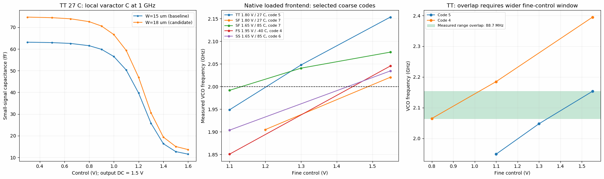
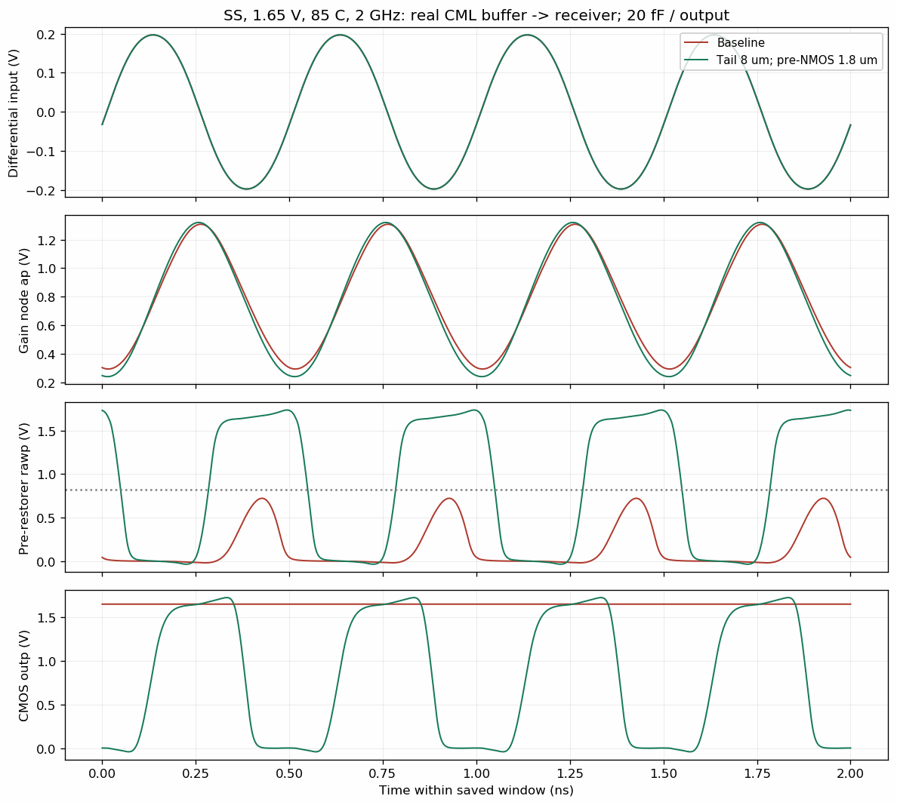
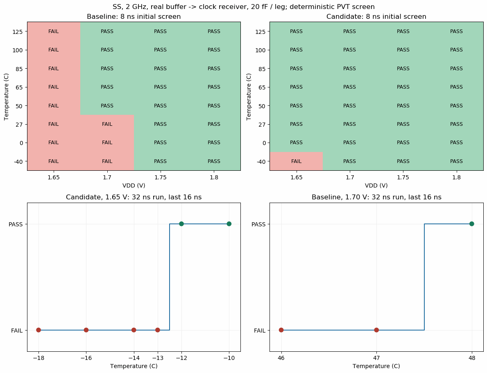
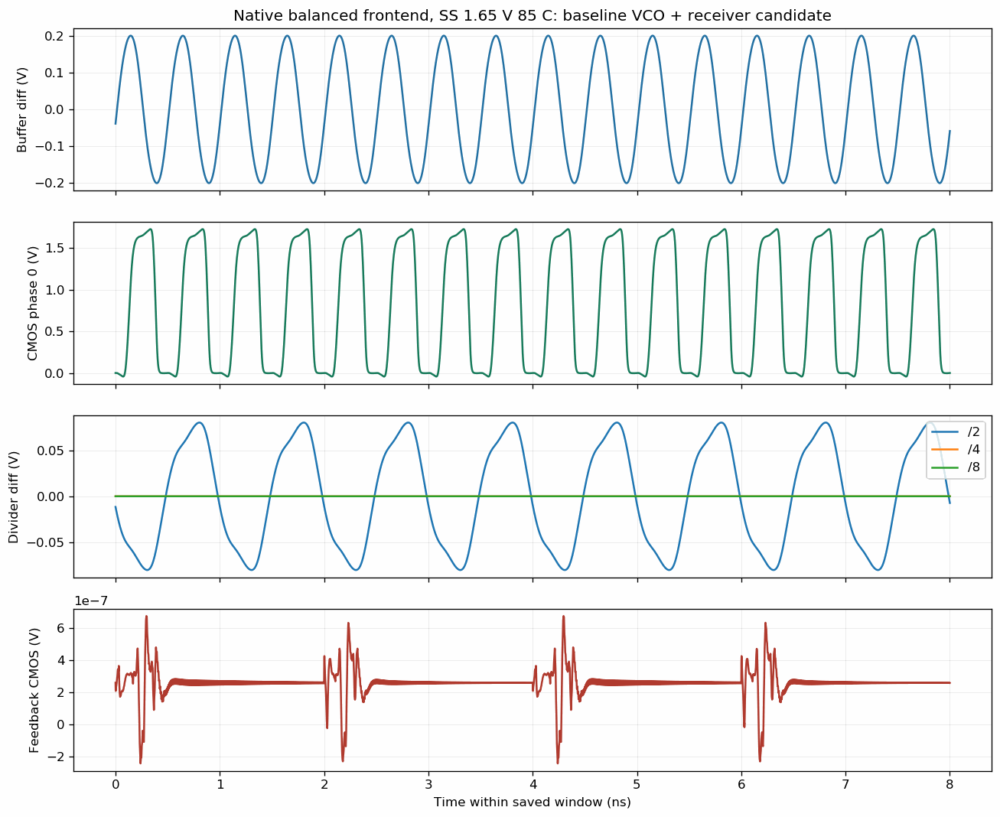

# VCO 调谐与 CML→CMOS 的 PVT 修整

本轮建立了独立候选，冻结版本和原生产 SPICE/RTL 没有改动。结果属于确定性器件级表征及真实时钟前端联调，不能视为完整 PLL 的 PVT 锁定验收。首轮结果见 [PLL PVT](pll_pvt_first_results.md)，本轮数值入口为 [结果 JSON](../data/pll_pvt_refinement.json)。

## VCO：小幅增大变容管，对称补充节点电容

候选为 vco_ring4_pvt_candidate.spice (`../../analog/pll/vco/spice/vco_ring4_pvt_candidate.spice`, retired in `retired_legacy_vars_20261120.json`)：变容管 W/L 从 15/0.5 改为 18/0.5 µm；粗调 MIM 单元从 2×5 改为 2.35×5 µm；八个振荡节点各增加一颗 2.5×2.5 µm 的真实 MIM 电容。电流、延迟单元及抽出结构保持原参数，三个供电 dummy 分支仍完整保留。

TT、27°C、1 GHz 小信号器件表征中，新增 MIM 每颗为 14.132 fF；粗调单元为 25.908 fF，原值为 22.292 fF。变容管在输出直流偏置 1.5 V、控制 0.3–1.6 V 时，原尺寸约为 63.136→11.514 fF，新尺寸约为 74.700→13.623 fF。这是指定偏置下的小信号电容，不等于环振大信号周期中的有效电容。

扫描先比较变容管 W=15/20/25 µm、粗调电容尺寸和固定 MIM 的组合，再回到真实四路 buffer、接收器、三级 CML 分频器和 dummy 前端。抽出简化模型的结果只用于筛选，不能替代完整加载结果。部分低控制电压点在短窗口中振幅很小或仍在建立，不能只凭过零次数认定其为可用工作点。

SF、1.65 V、85°C 下，候选码 7 在控制 1.1/1.3/1.55 V 时约为 1.992/2.041/2.076 GHz，覆盖了 2 GHz。再以控制 1.134512 V 固定仿真 32 ns，后 16 ns 约为 1.994895 GHz，四相 CMOS 和四路真实 ÷8 反馈持续工作。该点是开环设置，约 −2553 ppm 的频差不代表 PLL 锁定误差；闭环可以继续改变控制电压。

粗调码需要重新校准。可调到目标频率和相邻码连续覆盖是两项独立检查；窄控制窗口中的空隙、扩展控制窗口的测量及剩余限制列在文末。没有执行运行中的 ±1 跳码/控制电压交接测试，静态频段重叠也不等于无扰切码。

## 五个选择环境的频率覆盖

| MOS / 电源 / 温度 | 校准粗调码 | 已测频率区间 (GHz) | 全速 CMOS 周期 | ÷8 反馈周期 |
|---|---:|---:|---|---|
| TT / 1.80 V / 27°C | 5 | 1.949–2.153 | 匹配 | 匹配 |
| SF / 1.80 V / 27°C | 7 | 1.905–2.020 | 匹配 | 匹配 |
| SF / 1.65 V / 85°C | 7 | 1.992–2.076 | 匹配 | 匹配 |
| FS / 1.95 V / -40°C | 4 | 1.850–2.045 | 匹配 | 匹配 |
| SS / 1.65 V / 85°C | 6 | 1.904–2.034 | 匹配 | 失败 |

五个选择环境均获得跨过 2 GHz 的细调采样点。周期匹配是局部功能观测，不能覆盖全部模拟/数字时序或 PVT 资格；FS 的 1.95 V 冷角另有端电压范围待查。其余环境及所有码段尚未扩扫。

TT 码 4 在控制 0.8 V 的 32 ns 复验中约为 2.064699 GHz，码 5 在 1.55 V 约为 2.153394 GHz，获得约 88.7 MHz 的已测区间重叠。若限制两码都仅使用 1.1–1.55 V，仍有约 31.4 MHz 的采样区间间隙。因此不能把细调控制范围过早缩窄；其他相邻码/工艺角仍需同样确认。

两点割线估算的局部 KVCO：TT 码 5 的 1.1–1.3 V 段约 495 MHz/V，SF 低压热角同段约 245 MHz/V；它们不是统一常数，也不是闭环带宽或频率追踪速度。

## 转换器：前级动态裕量不足，最终输出驱动并非主因

候选为 [cml_to_cmos_pvt_candidate.spice](../../analog/common/cml_to_cmos/spice/cml_to_cmos_pvt_candidate.spice)。拓扑、输入源跟随隔离级和最终输出级均沿用原设计；差分增益级尾管 W 从 6 增至 8 µm，预驱动反相器 NMOS W 从 1 增至 1.8 µm。

SS、1.65 V、85°C 的实际 buffer 输出共模约为 1.511 V，差分摆幅约 400 mVpp。在独立 buffer→转换器测试中，原增益节点 ap 仍在约 0.295–1.307 V 摆动，但预驱动 bp 最低约 0.744 V，后级 rawp 最高仅约 0.722 V，不能产生有效时钟边沿。候选的 bp 范围约 0.095–1.517 V，rawp 恢复至接近全摆幅，20 fF/端负载下 CMOS 时钟恢复。

仅增大源跟随器或降低其下拉电流并不能在扫描条件下普遍解决问题；前级增益、带宽、共模和反相器翻转区间需要一起看。原转换器在 SS、1.65 V 下转换 250 MHz 时可以工作，包括 −40°C 和 85°C；因此不能将 2 GHz 的失效解释成完全没有直流增益或所有频率都无法转换。

代价也有量化：直接差分正弦输入、TT、1.8 V、27°C、2 GHz、20 fF/端时，单转换器功耗约从 3.494 增至 3.732 mW（约 +6.8%，不含外部参考支路）。失效状态与正常翻转状态之间的功耗差不能当成同功能功耗比较。

在原 VCO 几何保持不变的 32 ns 真实前端复验中，SS、1.65 V、85°C 的 VCO 约为 1.998153 GHz；四相 CMOS 均恢复，后 16 ns 占空比约 49.7–49.8%。这将转换器修改与 VCO 修改的作用分开验证了。

## 温度边界是有条件的，不是“SS 从 85°C 开始失效”

温度测试使用 SS MOS、0.85 mA 理想参考电流驱动真实偏置镜、真实 CML buffer、2 GHz 差分正弦输入及 20 fF/端 CMOS 负载。buffer 输入差分为 300 mVpp，共模设为 VDD−0.15 V；转换器实际输入共模由 buffer 自然形成。此边界不能直接移用于其他幅度、频率、偏置、加载或噪声条件。

初筛为每点 8 ns、观察后 4 ns；临界点改为 32 ns、观察后 16 ns。较严格的读出标准同时检查两路输出：电平达到 <0.2 VDD/>0.8 VDD，输出边沿数正确、周期误差 <1%，占空比 45–55%，最小高/低脉宽 >0.3 周期。原粗筛的 8% 周期误差判据只保留作诊断记录。

| SS 条件 | 原转换器 | 候选 |
|---|---|---|
| 1.65 V，−40/0/27/50/65/85/100/125°C 初筛 | 所有已测点均失败 | −40°C 失败，其余已测点通过 |
| 1.70 V，32 ns 临界复查 | 47°C 失败、48°C 通过 | 两点均通过 |
| 1.75/1.80 V，−40 至 125°C 的上述离散温度点 | 均通过初筛 | 均通过初筛 |
| 1.65 V，32 ns 冷端复查 | 测试点均失败 | −13°C 失败、−12°C 通过 |

因此本激励下候选冷端边界落在 (−13,−12]°C，原转换器在 1.70 V 的恢复边界落在 (47,48]°C。它们是确定性仿真的局部通过边界，不是带噪声/失配后的产品温度额定值。8 ns 的候选 −12°C 点曾出现异常，延长仿真后通过，说明必须区分启动过程和稳态失效。

## SS 的反馈路径还有独立问题

转换器恢复不等于 PLL 的 SS 反馈恢复。在保持原 VCO、仅修改转换器的 SS 32 ns 前端中，÷2 差分摆幅约 161 mVpp；÷4 只有约 1 µVpp，÷8 接近零。÷4 的微小数值过零不能算有效分频时钟。问题已经发生在 CML 分频链中，反馈转换器无法把不存在的差分时钟恢复出来。

独立施加有效 250 MHz CML 信号时，原/新转换器均能工作；结合真实 ÷2/÷4/÷8 的内部观测，下一处需要调的是 CML 级间摆幅、源跟随时钟共模和锁存再生裕量。本轮没有修改分频器，也没有用理想 ÷8 信号掩盖该问题。

## 证据与适用范围

运行目录：本轮 campaign (`results/analog/pll/pvt_refinement/20261029T100030Z`)。其中保存独立源快照、每次完整 TB、日志、数值结果及 `execution/*.txt` 命令记录；没有增加持久 Python 源文件。转换器 [单元模板](../../analog/common/cml_to_cmos/tb/pvt/tb_cml_to_cmos_candidate_ngspice.cir.in) 和前端 联调模板 (`../../analog/pll/top/tb/pvt_refinement/tb_frontend_candidate_ngspice.cir.in`, retired in `retired_legacy_vars_20261120.json`) 可供后续模型拓展。

测试中的 CML 电阻仍为理想名义值，偏置参考电流仍为外部理想电流源，未开启随机噪声或失配，未包含提取寄生。1.95 V 冷角的 CMOS 节点仍可上冲至约 2.026 V，器件端电压适用范围检查尚未收口。未完成 45 环境网格、闭环捕获 PVT、无扰跳码或相位噪声签核。当前候选不替换冻结版本。

两次早期温度控制试跑被明确标为无效：`reset` 覆盖了先前的 `set temp`；修正为 reset 后设置温度，并逐项核对日志实际 TEMP。原日志/数据及无效标记保留，不纳入结论。原粗筛、功耗符号和占空比测量修订见 campaign 的 `measurement_revision.json`。

归档检查完成：46 个模拟器进程中，44 个正常完成执行，2 个温度控制诊断被排除；“正常完成”包含设计参数扫描中的功能失败点，不表示全部设计通过。322 份大波形逐一校验解压后 SHA-256，约 520 MB 无损压缩至 180 MB。全部 59 个冻结文件及 40 个对应生产 SPICE/RTL 文件保持原哈希。

本轮更新了图目录、PVT 计划和计划说明。旧首轮清单中相应路径的旧版本保存在 campaign 的 before/；旧 799 项证据已按原文件/旧版本快照重新核对。[新证据清单](../data/pll_pvt_refinement_evidence.json)记录这一修订关系，不覆盖旧仿真结论。
