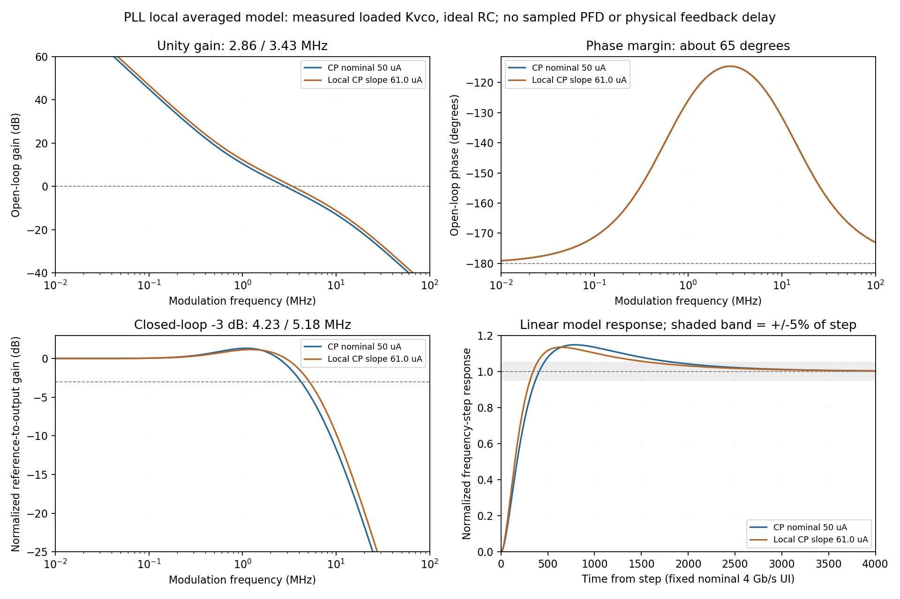

# PLL 跟踪、带宽与第一版工程目标

本次只重新分析已有跟踪波形，并用 SciPy 计算局部平均线性模型，没有启动新的 SPICE 仿真。
基准为250MHz参考、反馈÷8、2GHz VCO，固定4Gb/s UI=250ps。下列目标是本项目的第一版工程建议，不是通信接口标准。

## 电流舵速度取舍与选择电平

当前低电流单元复用CML偏置体系，用400/500Ω负载建立所需摆幅，作为15单元串化树的低功耗起点。
尚未完成按级电流、尺寸和负载扫描，因此不能称为已优化的功耗—速度折中。
已有时序问题说明高速级需要独立预算，不能以位中心无错取代建立时间、边界毛刺检查。

目前选择端是差分CML时钟：共模1.63V、差分400mVpp，进入本地MOS源跟随器后降低共模，再驱动选择对。
它不是直接由0–1.8V CMOS驱动的版本。若改用CMOS选择，需要重新安排电平转换、栅压及支路换流时序。

## 带宽的两个定义

平均模型采用带载局部Kvco=464.55MHz/V、R=6.5kΩ、Ci=40pF、Cf=2pF。
令Cp=Ci+Cf，Kv以Hz/V计，电荷泵斜率I以A计：

\[
Z(s)=\frac{1+sRC_i}{s(C_p+sRC_iC_f)},\qquad
L(s)=\frac{I K_v}{N}\frac{Z(s)}{s},\qquad
T(s)=\frac{L(s)}{1+L(s)}.
\]

这里T是归一化的参考至输出相位传递函数，即(输出相位/N)/参考相位。
两个积分分别来自LF和VCO，因此是Type-II；加上LF高频极点，当前平均模型为三阶。

| 局部平均模型 | 标称CP 50µA | 既有局部CP斜率61.04µA |
|---|---:|---:|
| 开环单位增益频率，\|L\|=1 | 2.856MHz | 3.428MHz |
| 相位裕量 | 65.38° | 64.94° |
| 归一化闭环−3dB带宽 | 4.228MHz | 5.184MHz |
| 闭环峰化 | 1.33dB | 1.16dB |
| 线性频率阶跃过冲，相对阶跃幅度 | 14.74% | 13.42% |

61.04µA是先前局部净电荷对相位差的斜率，不是独立可编程电流档位；两列也不是PVT上下界。
未包含实际反馈链传输延迟、采样PFD、有限CP输出电阻和VCO控制端物理负载，以上不是晶体管闭环带宽实测。

带宽越宽通常越快，但参考/PFD/CP噪声的传递、VCO噪声抑制和杂散之间存在折中；
最终带宽需结合两侧噪声谱，不能仅凭稳定时间选定。参见[TI带宽与抖动取舍说明](https://www.ti.com/document-viewer/lit/html/SSZTB85/GUID-6556209D-FC52-4BCA-9C45-48B1462E3A65)。

## 已有阶跃的常规指标

跟踪夹具使用实际PFD/CP、理想RC、局部校准相位域VCO及理想÷8。
参考相位连续地250→249.5→250MHz，目标VCO为2.000→1.996→2.000GHz，即±4MHz、约±2000ppm。

| 指标，距阶跃起点 | 向下 | 恢复 |
|---|---:|---:|
| 频率单独稳定至目标±100ppm，按一个参考周期平均 | 1707 UI | 1540 UI |
| 频率单独稳定至阶跃幅度±2%，按一个参考周期平均 | 2172 UI | 2436 UI |
| 已有频差/相差联合判据持续满足窗口结束 | 2052 UI | 1920 UI |
| 加1280 UI保持后可确认 | 3332 UI | 3200 UI |
| 周期平均频率过冲，相对4MHz阶跃幅度 | 14.23% | 12.97% |

目标频率±100ppm约为±200kHz，约等于4MHz阶跃的±5%；不能把它误写成阶跃幅度的±100ppm。
联合判据采用32参考周期窗口、8周期步进，频差小于100ppm且展开相差跨度小于0.08 UI，随后至少保持1280 UI。
频率单独稳定时间与窗口联合判据的定义不同，不宜混用。
这里的过冲不是载频变化14%，而是约4MHz×14%≈0.56MHz。

原生VCO/分频/接收器/PFD/CP的预充后捕获另已记录：2560 UI达到持续满足窗口、3840 UI可确认；
这与上述在锁定点施加频率阶跃的稳定时间不同。见[预充与捕获记录](pll_precharge_capture.md)。

## MHz/s 应如何使用

频率变化率或扫频速率为df/dt，单位Hz/s、MHz/s或MHz/µs。阶跃的输入斜率理想情况下无穷大。
已有向下阶跃的4MHz÷2052UI≈7.80MHz/µs，即7.80×10^6MHz/s，只是该阶跃的幅度与稳定时间之比，
不能作为最大可跟踪连续扫频速率；它也不适合跨不同阶跃幅度、容差和控制码跳转直接比较。

连续扫频应另测maximum trackable frequency ramp rate：规定扫频幅度、方向、斜率，以及频差、相位滞后和无周跳要求。
Type-II PLL跟踪线性频率斜坡时会形成与斜率相关的相位滞后，参见[ADI AN-1079](https://www.analog.com/en/resources/app-notes/an-1079.html)。

对本局部平均模型，如果r_out是目标VCO频率变化率，增加的稳态时间误差近似为：

\[
\Delta t\approx\frac{r_{out}(C_i+C_f)}{I K_v f_{ref}}.
\]

例如仅作预算演示，允许扫频额外产生0.04 UI的稳态时间滞后，则两种CP斜率给出约1.38–1.69MHz/µs的目标VCO变化率；
参考端斜率是其1/8。这个0.04 UI是示例预算，**不是现有0.08 UI窗口相差跨度判据**。
这是线性稳态估算，未计斜坡起止瞬态、静态CP偏移、控制范围、粗码切换或周跳；尚不是实测最大速率。
所有速率以VCO频率计；若用4Gb/s数据率的变化量表达，数值还要乘2。

## 建议的第一版目标

| 项目 | 250MHz参考、÷8、2GHz点的工程建议 |
|---|---|
| 开环单位增益频率 | 先保留2–5MHz作为候选范围 |
| 相位裕量 | 目标60–70°；初步筛查不低于55° |
| 归一化闭环峰化 | 不超过2dB |
| ±4MHz阶跃联合稳定时间 | 不超过4000 UI，再观察至少1280 UI保持 |
| 阶跃观察容差 | 目标频差±100ppm，窗口展开相差跨度<0.08 UI，另查周跳 |
| 连续扫频 | 单独建立额外相位滞后预算，再扫描斜率；当前不设已达标最大值 |

这些时域容差是调试指标，不是SerDes最终采样抖动预算。参考噪声、VCO相噪、CP噪声与参考杂散尚未统一预算，
所以现在保留约3MHz的开环带宽比直接继续加速更有依据。
不同参考频率、VCO粗码和Kvco下需要重算；单个局部拟合不覆盖整个工作范围。

下一步验证顺序：小信号参考相位/频率调制测闭环增益与峰化；±不同幅度阶跃；局部连续斜坡与起止瞬态；再选代表点进行原生闭环复查。
结果数据和输入SHA256见[分析JSON](../data/pll_tracking_assessment.json)，模型曲线数据保存在相邻`pll_tracking_lti_*.npz`。
