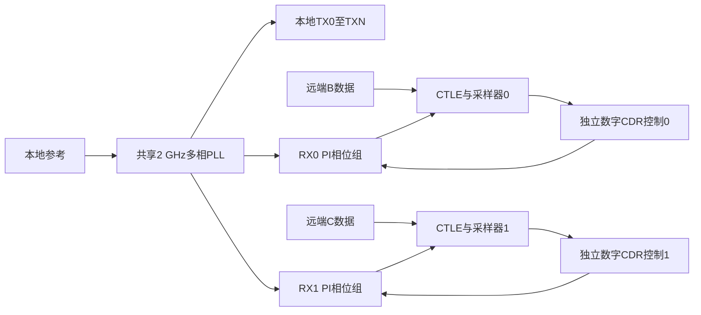

# 固定4 Gb/s、多端口RX时钟方案

2026-10-29选择：现有TX PLL按物理时钟组共享，驱动本地同速率TX以及各RX的PI相位旋转器，不再另建RX PLL；每个独立RX保留自己的采样器、数据/边沿鉴相和数字跟踪环。已有真实MOS模拟PI、四相CML采样、静态CMOS读出与公共pair对齐，数字CDR和16位训练/串转并已做行为plant闭环。后续聚焦物理16UI降速/时序及PI控制接口；按用户确认，原生PLL重新联验不单列为本阶段待办，见[当前闭环结果](rx_cdr_closed_loop.md)。

这里的多节点指多条独立点对点链路。每个远端节点可有自己的晶振/PLL，频率存在独立ppm差异。PLL共享发生在一块芯片的适当时钟组内；芯片间没有假定共用时钟，也没有把多个节点直接挂在同一差分对上。

## 本地资源关系



本地所有4 Gb/s TX可使用同一个PLL的时钟，经各自分发buffer进入串化器。RX0、RX1分别调整自己的相位组，控制环不调共享PLL的VCO控制电压，因此不会在控制目标上要求TX同时跟随多个不同远端频率。

| 本节点有N个独立全双工端口 | 共享的高速时钟源 | 每增加一个RX |
|---|---|---|
| TX共享PLL、RX独立VCO-CDR | 1个TX PLL | 1套RX振荡/恢复环与采样器 |
| 本项目选择的PI-CDR | 每时钟组1个基准PLL，可同时供TX/RX | 1套PI相位组、采样器与数字恢复环 |

例如4个相邻端口，前一种实现有1个TX PLL加4套RX振荡环；PI方案的初始规划是1个共享基准PLL加4套RX PI-CDR。具体能共享多少端口取决于布局、相位时钟树、负载与抖动预算，尚未把“4路共享”作为已验证能力。

每个RX仍需要独立时序跟踪：不同远端可能分别快100 ppm、慢150 ppm，即使标称速率都是4 Gb/s。不能用一个公共相位控制码同时跟随所有远端。

PI-CDR由PLL提供基准、多相插值器与数据/边沿采样组成，是已有商用实现采用的架构，见[AMD RX CDR说明](https://docs.amd.com/r/en-US/am002-versal-gty-transceivers/RX-CDR)。独立每RX振荡器的架构也常见，见[Microchip收发时钟说明](https://onlinedocs.microchip.com/oxy/GUID-AE985A83-E181-4941-B39D-055A6746BB07-en-US-11/GUID-35D2A0AC-B288-4507-BB0D-2BF447E7F2BC.html)。这些资料支持架构可行性，不直接提供本项目SKY130的面积/功耗或抖动保证。

## 持续调相如何补偿频差

定义theta为朝前的采样相位，使用连续展开的相位表示：

```text
phi_sample(t) = 2*pi*f_base*t + theta(t)
f_sample = f_base + (1/(2*pi))*dtheta/dt
```

本地PLL保持2.000000 GHz，远端数据对应的半速频率若为2.000200 GHz，则相位应平均每秒向前旋转200000圈，即每5 µs旋转360°。远端较慢时向相反方向旋转。两个PLL仍各自锁本地参考，本路采样时刻跟随远端。

数字相位码虽然只表示0–360°，到边界后继续回卷。物理输出需要跨相位扇区与回卷连续、无毛刺；单次选定相位或只有有限范围的延迟补偿不能长期消除恒定频差。恢复时钟相对本地基准累计多/少边沿，对应远端本来就存在的速率差，不等于删除/复制远端数据。

2 GHz的周期500 ps，等于2 UI。初版若采用64个名义相位位置，则每档7.8125 ps=0.03125 UI。补偿200 kHz半速频差，平均每秒前进1280万档，相当于约78.125 ns移动一档，5 µs完成一圈。这是平均频差补偿的算例；实际控制更新还要响应相位误差和抖动，不能据此把CDR更新率设成固定12.8 MHz。

## 初版实现选择

- 沿用现有2 GHz、多相ring-VCO/PLL作为基准。计划使用8个相位锚点，在相邻相位间采用CML电流加权插值，先探索6 bit总相位分辨率。
- 每RX需要一组共同旋转的采样相位：数据0°/180°，边沿90°/270°。PI相位组可能包含多个匹配插值单元，不能把它的面积/功耗当作单个小逻辑门。
- 采用半速bang-bang数据/边沿鉴相及数字相位/频率跟踪。先固定4 Gb/s与已知标称频率，探索相对TX/RX频差±300 ppm；该范围是开发目标，不是已经通过的指标。
- 共享时钟经分级buffer与每路隔离送到PI，VCO各相位抽取保持对称负载/dummy。新增PI不能直接无预算地挂在VCO节点，也不能假定当前多相分发已经覆盖任意新增扇出。
- 保留CTLE，首版不加入DFE。每路解串及恢复时钟独立，进入公共系统时钟域前预留弹性FIFO；FIFO之外仍需明确空闲码补偿或流控策略。

当前项目已有多相PLL与CML时钟基础，采用共享PI-CDR可以摊薄振荡器、CP和模拟环路滤波器成本。实际总功耗/面积收益仍需实现后测量，尤其要计入多相时钟树、PI相位组和采样器。选择依据是多端口扩展和已有积木复用，不以4 Gb/s这个数字单独推断任何CDR都能便宜实现。

## 接下来的验证顺序

1. 先实现单个PI及成组相位输出，检查全码相位单调性、步进/DNL、振幅/共模、占空比、扇区切换和0/63回卷。实际时钟斜率与波形会影响插值，不能只用理想相位加权公式验收。
2. 加真实数据/边沿采样器，验证灵敏度、孔径、失调、kickback和四相相对时序。前端加载测试继续沿用TX驱动器—PCB—RX的缩小模型边界。
3. 用长时行为/混合模型验证数字CDR捕获、恒定频偏、相位阶跃、连续同码保持和多个RX独立跟踪；时长覆盖多个相位回卷。晶体管级短窗分别验证PI/采样器细节，避免每次重跑整个模拟链路。
4. 验证解串、字对齐、恢复域到公共域的CDC及速率匹配，再扩展信道、PVT和噪声测试。

参数入口为[rx_cdr.toml](../../config/rx_cdr.toml)。早期PI/采样单元使用理想锚点与CTLE输入；当前CMOS读出/对齐和实际RTL闭环的测试边界由最新结果文档明确。长时RTL采样plant不是完整晶体管/PCB/PLL闭环；已冻结PLL/串化器保持原版本。
