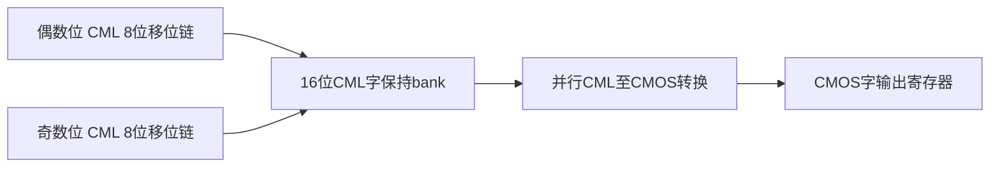

# 半速CML移位与整字CMOS收集讨论

状态：根据2026-10-29讨论澄清结构，尚未实现新的CML移位/保持bank。不改变已有判决与闭环结果。

数据采样使用2 GHz的0/180°相位，时间上交织，相邻样本250 ps；两路各2 Gb/s。90/270°边沿采样继续用于鉴相。每个数据分支积累8位，可输出16位字、标称250 MHz；每分支积累N位时，总宽度2N、字频率2 GHz/N。若两支各16位，则得到32位、125 MHz。

两条CML移位链的全部抽头仍每500 ps更新。因此“每8次移位才读一次CMOS”本身不提供4 ns稳定窗口。结构应包含整字保持：

移位链持续收数，字保持bank每8个半速周期更新一次，转换器面对稳定的完整字。CMOS输出寄存器可在下一字边沿接收前一字，把转换延迟放进一个明确的流水级；仍需核对字边沿、setup/hold和负载。乒乓两组保持bank也是一种实现，不等同于仅把输出valid降速。

已有CML→CMOS数据接收器是连续静态电路。“每字收集一次”首先意味着每字锁存一次转换结果，不自动意味着转换器只在该瞬间上电；若之后要门控偏置，需要另预算唤醒与建立时间。

奇偶位必须以同一个字边界合并，输出bit0最早。字时钟从PI后的恢复时钟分频产生，随远端频偏变化。新的结构可用局部移位/保持/转换夹具验证并衔接已有RTL；不需要重做TX PLL或要求全局晶体管长仿真。
