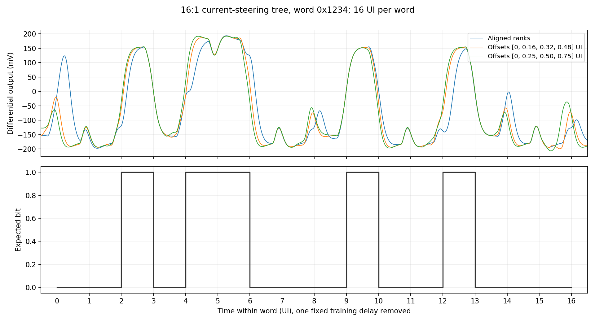
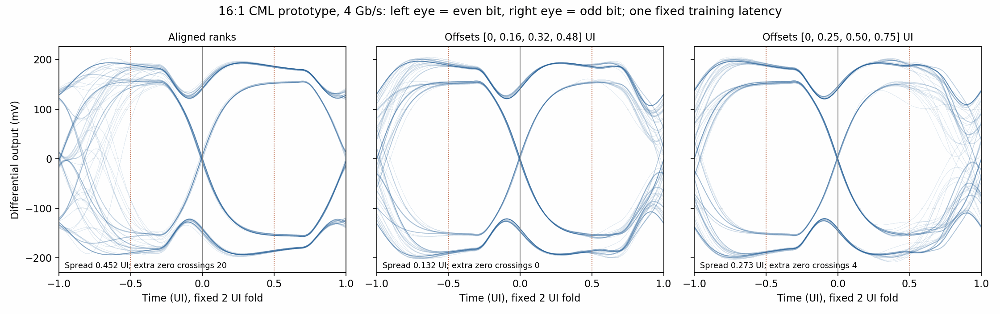
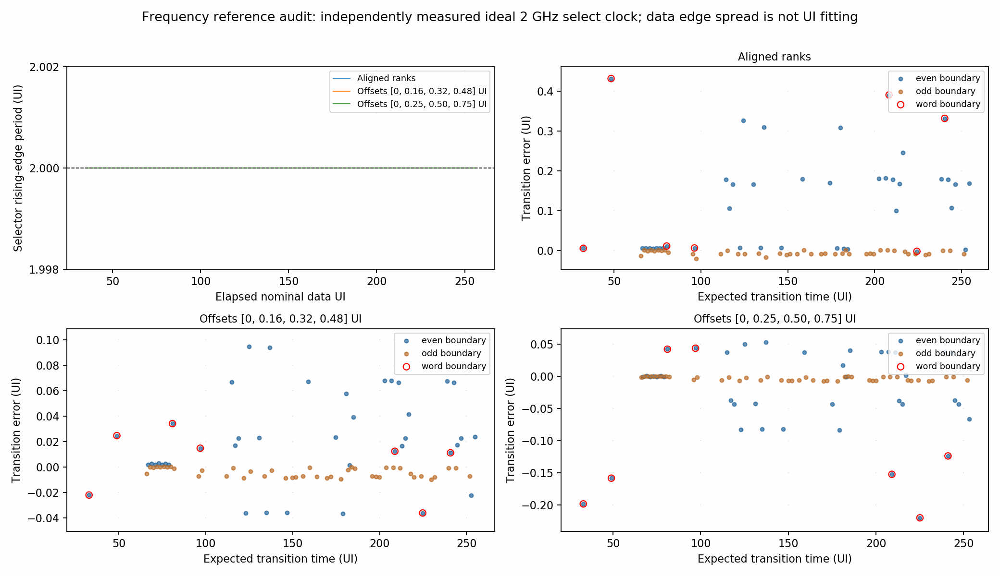
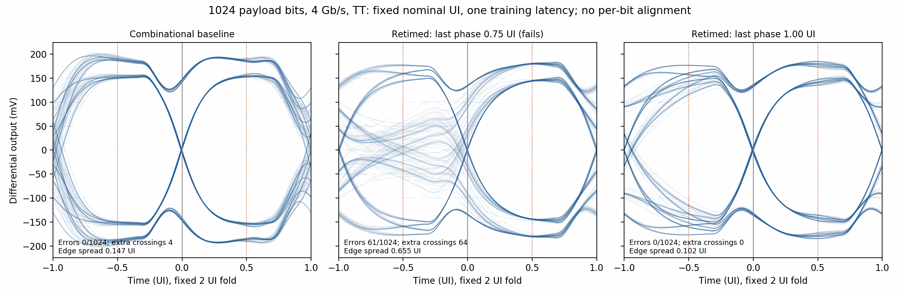
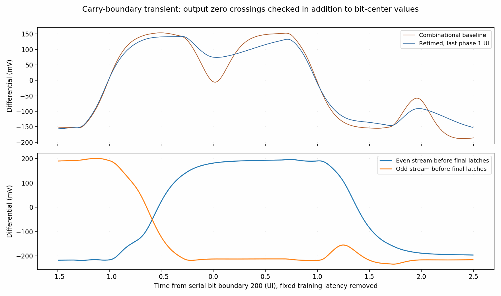
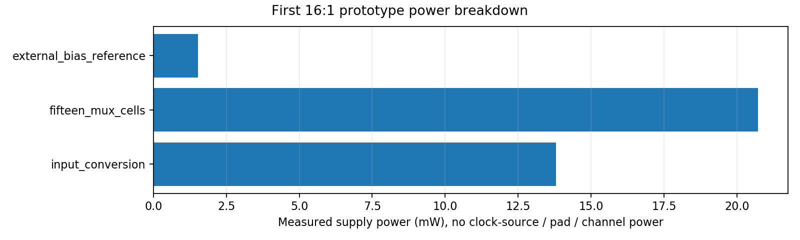

# 16:1 电流舵串化器首轮结果

本轮建立了 16 路实际 CMOS→CML 输入单元和 15 个差分 2:1 电流舵选择器组成的串化树。
TT、1.8 V、27°C、理想相关 CML 时钟、每端 20 fF 片内负载下完成首轮比较。
组合树作为基准保留，另完成末级双 CML 锁存重定时版本；当前没有并行字捕获寄存器、实际 PLL 时钟分发和外部线驱动器。

时域图统一用 UI：4 Gb/s 时 1 UI=250 ps，一个输入字占 16 UI。原始结果仍以 SI 单位保存。

## 电路与位序

- [2:1 CML 单元](../../analog/common/cml_mux/spice/cml_mux2.spice)：数据非反相，正选择差分选择 B、负选择差分选择 A。选择端用本地源跟随器平移共模，各级由尾电流和负载重新建立输出共模。
- [静态 CMOS→CML](../../analog/common/cmos_to_cml/spice/cmos_to_cml_data.spice)：用于并行数据，没有把时钟专用恢复器当作静态数据接口。
- [16:1 树](../../analog/tx/serializer/spice/serializer16_tree.spice)：四级 8+4+2+1 个选择器。
- [测试定义](../../analog/tx/serializer/tb/functional/case.toml)、[参数配置](../../config/serializer16.toml)。

| 级次 | 配对 | 选择时钟周期 | 每路数据周期 |
|---|---|---:|---:|
| 16→8 | d[j] 与 d[j+8] | 16 UI | 8 UI |
| 8→4 | 上级 j 与 j+4 | 8 UI | 4 UI |
| 4→2 | 上级 j 与 j+2 | 4 UI | 2 UI |
| 2→1 | 偶数流与奇数流 | 2 UI | 1 UI |

原型约定 d0 先出；跨半字配对保持连续位序。选择时钟分别对应 250 MHz、500 MHz、1 GHz、2 GHz。
这些相位目前由理想夹具提供，不表示实际时钟电路已实现相同相位。

## 单元与多字比较

2:1 单元的八种静态 A/B/选择组合符合预期；输入提前 0.5 UI 准备时，后续 119 个随机位中心未见错误，最小有符号电压裕量约 148 mV。

16:1 测试前两个字为固定 `0xAAAA`，仅用于测量一个常数输出延迟。
后续测试包含全零、全一、交替码、边界码、`0x1234`、`0xFEDC` 和独立随机字。
CMOS 字每 16 UI 更新，边沿为 0.08 UI；没有真实输入寄存器。
按独立 d0-first 序列在固定 UI 中心判决，不逐字或逐位调整相位。

| 方案 | 数据管宽 / 中间R / 最后R | 各级相位 UI | 错误/判决位数 | 最小有符号裕量 | 差分峰峰值 |
|---|---|---|---:|---:|---:|
| 初始单元 | 20µm / 400Ω / 400Ω | [0,0,0,0] | 0/223 | 103.3mV | 363.9mV |
| 增益调整、同相 | 40µm / 500Ω / 400Ω | [0,0,0,0] | 0/223 | 76.6mV | 400.7mV |
| 短向量组合候选 | 40µm / 500Ω / 400Ω | [0,0.16,0.32,0.48] | 0/223 | **148.4mV** | 406.2mV |
| 另一相位网格 | 40µm / 500Ω / 400Ω | [0,0.25,0.50,0.75] | 0/222 | 109.0mV | 414.0mV |

无噪声、有限向量的零位中心错误不是统计 BER 结论。部分方案虽位中心正确，位间仍有额外零交越。

## 2 UI 眼图和参考核对

[绘图约定](../../verification/contracts/eye_fold.toml)：2 UI 窗口、2 UI 步进，横轴 −1 到 +1 UI；
左眼是偶数位，右眼是奇数位，采样中心在 ±0.5 UI。
仅去掉训练字测得的一个固定延迟，不从输出拟合 UI，不逐边沿或逐比特对齐。

本夹具由理想相关源驱动，**尚未接 PLL**。
独立测量的选择时钟周期为 2.000000 UI，偏差处于浮点/输出精度附近。
所以这组散布不能归因于 PLL 未锁或折叠参考存在频偏。

| 相位方案 | 数据边沿散布 | 偶数边界平均偏移 | 奇数边界平均偏移 | 非预期零交越 |
|---|---:|---:|---:|---:|
| 增益调整、同相 | 0.452 UI | +0.122 UI | −0.006 UI | 20 |
| [0,0.16,0.32,0.48] | **0.132 UI** | +0.021 UI | −0.004 UI | **0** |
| [0,0.25,0.50,0.75] | 0.273 UI | −0.027 UI | −0.004 UI | 4 |

预期数据跳变与观测零交越按方向和固定延迟配对；另计未匹配的观测零交越。
这里是码型/路径相关的确定性散布，不是随机相噪。偶奇位差异、字边界关联和改变级间相位后的结果指向时序问题。
简单回归输出边沿漂移可能被码型分布影响，不能取代理想源时钟的独立频率检查。

进一步的1024 bit LFSR码流中，组合候选仍在位中心给出0错误，但发现两处窄脉冲，宽度约0.071和0.080 UI，
分别出现在字内第8、第4位附近的选择进位边界；输入到达延后0.125 UI时仍存在。
因此短向量中的0额外零交越不能外推。下面通过实际末级双CML锁存重定时处理，保持原来的眼图折叠规则。

## 末级重定时与长码流

[重定时树](../../analog/tx/serializer/spice/serializer16_retimed.spice)在末级选择器前加入两只[实际 CML 锁存器](../../analog/common/cml_mux/spice/cml_data_latch.spice)。
A 被选择时保持 A、同时跟踪 B；B 被选择时反之。
锁存器和选择器各有本地选择端源跟随器，避免一组跟随器承担三份时钟负载。
这是末级数据重定时，尚未实现并行字捕获。

固定前三级相位为 [0,0.16,0.32] UI，比较末级相位。训练后使用周期127的LFSR生成1024 bit，仍由每16 UI更新的16路实际CMOS→CML单元输入。

| 1024 bit 方案 | 位中心错误 | 最小有符号裕量 | 边沿散布 | 额外零交越 | 未配对预期跳变 |
|---|---:|---:|---:|---:|---:|
| 组合树、末级0.48 UI | 0 | 146.2mV | 0.147 UI | 4 | 0 |
| 双锁存、末级0.75 UI | **61** | **−55.4mV** | 0.655 UI | 64 | 64 |
| 双锁存、末级1.00 UI | **0** | **102.8mV** | **0.102 UI** | **0** | **0** |

0.75 UI版本失败，符合锁存前建立不足的时序判断；额外延后0.25 UI后，本段码流恢复正确。尚未扫描建立/保持边界，不能把这两个点当作完整时序裕量。
末级1 UI版本的单次训练固定延迟为1.305 UI，输出差分峰峰值约372.5mV，输出共模约1.713V；供电合计约38.81mW，比组合树增加约2.76mW。
边沿散布来自与预期跳变按方向配对的零交越；失败版本同时列出漏跳变，避免仅用散布数值评价。
输入字延后0.125 UI的同码流复查也完成：0/1024位中心错误、0额外零交越、0漏跳变，最小有符号裕量约102.8mV、边沿散布约0.102 UI。
这只是一个额外输入到达时刻，尚未扫描完整建立/保持边界，也不是两组独立随机序列的统计BER测试。

## 功耗、边界与后续

短向量组合方案所列供电合计约 36.06 mW，输出共模约 1.713 V，包含输入转换、15 个选择器及外部偏置参考。
不含理想时钟源的分发功耗、PLL、ESD、封装、端接和通道，不是完整发射器功耗。
峰峰值为当前片内负载下的波形最大值到最小值，平台电平和真实后级负载仍需分别验证。

下一步是实际选择时钟的相位/占空比、输入字捕获、跨级时序、真实负载与 PVT。
各级时钟满足二倍频率关系，并不足以保证被选择的数据已经建立。
设计背景参考 Razavi 的[高速线发送器论文](https://www.seas.ucla.edu/brweb/papers/Journals/BROJSSCSep21.pdf)；本轮未直接移植其完整拓扑。

汇总：[串化测量](../data/serializer16_first_points.csv)、[眼图参考审计](../data/serializer16_eye_reference_audit.csv)。
原始运行在 `results/analog/tx/serializer/functional/<run_id>/`，运行编号见CSV，
含电路/激励快照、预期位序列、逐位判决、2 UI 折叠数据及边沿配对。
原理图自动化事项继续留在项目外的独立交接目录，本轮未重新人工扩画原理图。
