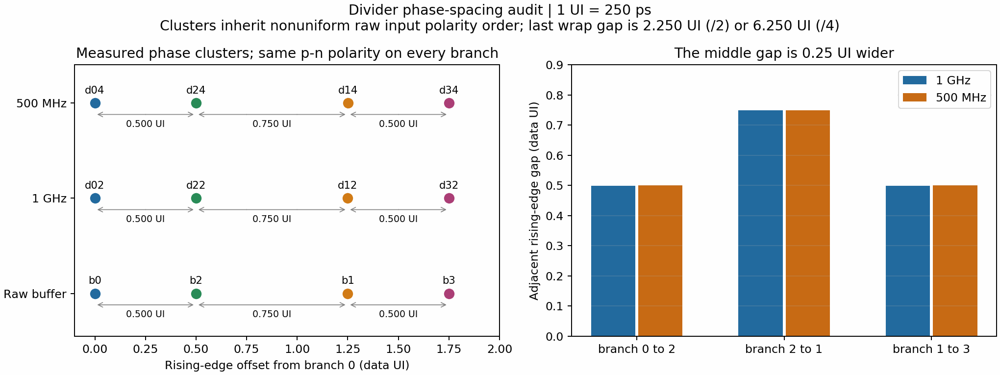
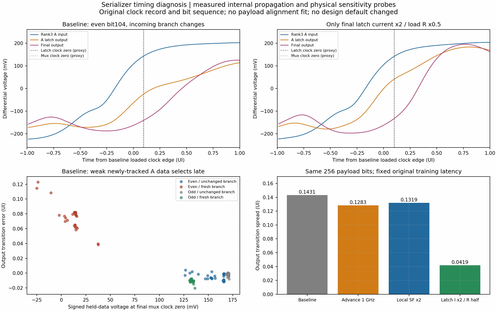
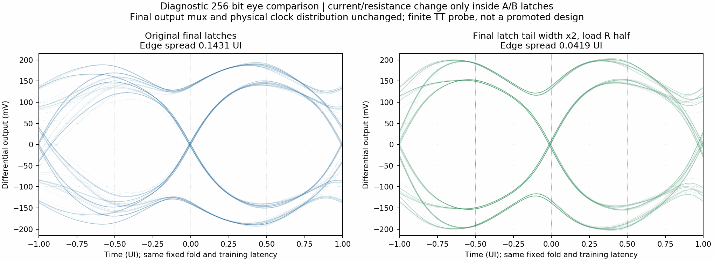

# 分频相位间隔与串化器UI偏差溯源

**图中的0.50/0.75/0.50 UI间隔确实存在，主要来自原始相位极性及分频接法。数据眼图的主要异常则追到了末级锁存器的动态跟踪/恢复与上游到达时刻的耦合。** 这两项有联系，但本轮没有把原生分频相位不等距直接当作数据散布的原因。

## 分频相位核对

全部采用原始p−n的同极性过零时刻，以支路0为参考。在已选定的稳定记录内，上升沿结果如下；1UI=250ps。

| 节点族 | 0→2 | 2→1 | 1→3 | 3→下一周期0 |
|---|---:|---:|---:|---:|
| ÷2，1GHz | 0.499915 UI | 0.750095 UI | 0.499837 UI | 2.250153 UI |
| ÷4，500MHz | 0.500255 UI | 0.750018 UI | 0.500060 UI | 6.249667 UI |

中间间隔比两侧约大0.25UI，即62.5ps。下降沿也呈现同样规律。抽出buffer原始b0、b1、b2、b3的p−n相位本来就是约[0,1.25,0.50,1.75]UI（模2UI）；按时序排列是b0→b2→b1→b3。分频输出在这次启动记录中基本继承了这些绝对时间偏移，并不是等间隔四相输出。

上一张总览中，VCO/抽出两行为按45°排序而使用了v1/v3或b1/b3的反极性，分频行则直接画各支路p−n；不能把不同节点族的颜色顺序理解为等间隔四相。将输入和分频节点使用同一极性核对后，可看到该不等距在分频之前就存在。

四路÷2单元从输入下降沿到输出更新的延迟中位数约0.6524–0.6528UI；÷4单元约0.7244–0.7250UI。支路之间差异远小于0.25UI，现有数值不支持把额外62.5ps归因于某一路buffer慢了这么多。模周期比较还必须保留分频器启动状态；÷8支路存在额外整周期粗相位，不能仅由VCO相位推出全部低频相位。若以后需要严格等间隔低频多相，还需明确极性、边沿选择和确定状态的分频/复位设计。

[完整相位及逐级延迟](../data/divider_phase_spacing_audit.json)。

## 原始长片段的码型相关性

在原1024bit记录里，按“输出边界奇偶”和“将要被选中的同一支路相对k−2是否更新”分组：

| 输出边界 | 同一支路刚更新 | 样本数 | 输出误差中位数/UI | 输出误差范围/UI |
|---|---|---:|---:|---|
| 偶数 | 否 | 131 | -0.00661 | [-0.01728, +0.00565] |
| 偶数 | 是 | 128 | +0.07212 | [+0.03126, +0.14154] |
| 奇数 | 否 | 129 | -0.00420 | [-0.01405, +0.00111] |
| 奇数 | 是 | 129 | -0.01232 | [-0.02094, -0.00735] |

约0.03–0.14UI的晚边沿几乎由“偶数边界且A支路刚更新”这一组构成。稳定输入的偶数边界，以及奇数边界，并未出现同样大的晚簇。[完整分组](../data/serializer_edge_history_audit.json)。

## 内部节点与敏感性对照

从相同冻结PLL时钟、相同输入序列重跑前16个负载字（256bit），保存全部MUX各级差分节点、末级A/B锁存输出、局部时钟源跟随器差分电压及共模。基准新增观察节点后，过零误差与原运行对应片段最大差异约5×10⁻¹⁴UI，可复现此前现象。

末级由A/B两只锁存器加一个MUX构成。A在B被选中时跟踪，A被选中时转保持；B相反。上游1GHz一级为偶/奇两条数据路径更新，但A的数据更新离自身被选中更近。测得A刚更新时，上游数据过零到本地锁存时钟过零约0.372UI，而B约1.374UI。这里的本地过零是开关过程的观察参考，不是测得的严格建立时间或唯一保持边界。

在末级MUX本地时钟过零处，基准A支路刚更新的数据差分电压中位数仅14.0mV；A未更新时约165.5mV，B刚更新时约132.6mV。数据已跨过零并不意味着跟踪/恢复已经充分，弱差分输入仍会使后续电流转向及输出过零延迟依赖码型。

所有对照保持原训练延迟和固定250ps时基，不对负载重拟合。下表均为同一256bit片段；其原始散布为0.143UI，不能与原1024bit的0.162UI直接比较。

| 电路副本 | 数据过零散布/UI | 最小位中心有符号裕量/mV | 位错误 | 额外/漏跳变 |
|---|---:|---:|---:|---|
| 原电路，新增内部观察 | 0.14310 | 101.7 | 0 / 256 | 0 / 0 |
| 1GHz微调电容160→80fF | 0.12835 | 106.6 | 0 / 256 | 0 / 0 |
| 末级本地时钟跟随器及电流下拉宽度×2 | 0.13192 | 105.2 | 0 / 256 | 0 / 0 |
| 仅末级两只锁存器尾管宽度×2、R/2 | 0.04192 | 141.4 | 0 / 256 | 0 / 0 |

减小1GHz微调电容使实际时钟相位约从0.320变为0.237UI，同时加快边沿；它不是只改变时间的理想延迟试验。A刚更新时的输出误差中位数从+0.078降到+0.044UI，说明上游到达时间/边沿形状确有影响。

末级本地时钟源跟随器加倍时，其自身的过零附加延迟约从0.097降到0.053UI；但输入电容增加，又把外部2GHz时钟拖后约0.056UI，因此局部选择时刻净变化很小，数据散布改善有限。单纯加大本地时钟管不能直接等同于整个时钟路径变快。

最强的对照是仅修改末级两只A/B锁存器：尾管宽度12→24µm、每端负载400→200Ω，最终输出MUX、上游MUX及分发buffer参数均不变。目标是增加恢复电流、减小负载RC，同时让名义I×R摆幅接近；这会同时改变锁存器小信号增益与再生特性，不是单一理想极点扫描。

该对照中，A刚更新时的数据过零到锁存输出过零中位延迟从0.326降到0.170UI；选择时刻的锁存输出差分中位数从14.0升到79.6mV。A输入到达及1GHz时钟相位基本保持原值，输出散布却降至0.04192UI，因此支持把末级锁存器的数据跟踪/恢复能力认定为本片段的重要瓶颈。尚未把残余散布完全分配给每只晶体管或每一阶极点。

实测每只锁存器平均电阻负载电流约由0.44mA升到0.91mA，整棵串化树电源功耗约由23.62升到25.32mW（+1.70mW）；时钟分发电源约14.42mW保持接近。这里电阻电流由实际共模及电阻计算，功耗由电源积分得到；PLL源端功耗不包含在这几个串化电源内。

## 本轮结论与保留事项

目前证据链为：上游到达相位使偶数A支路的恢复时间更紧 → 原末级锁存器在被选中时差分信号偏弱 → 末级MUX输出延迟随支路数据是否刚更新而变。原生多相分频的不等距属于另一项相位规划/极性核对问题，不能直接等同于这个晚边沿簇。

原analog源码、默认参数及原1024bit眼图均未被替换。四组修改保存在各自运行的网表快照中。本轮是TT、无随机噪声、有限向量诊断；锁存电流对照还未完成1024bit、低速保持/再生裕量、PVT或版图寄生验证，不能视作已完成的电路修复。若继续优化，应优先围绕末级锁存器跟踪带宽、保持增益和上游相位联合取舍，再评估功耗，而非先盲目放大所有buffer。

[四组数值结果](../data/serializer_timing_diagnosis.json)。各运行目录含parameters.json、输入SHA256、全部电路快照、原波形、path_events.tsv和diagnostic_metrics.json；关键节点、窗口及条件均可复核。
