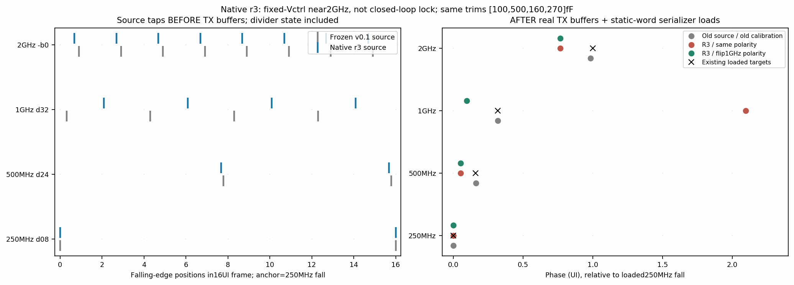
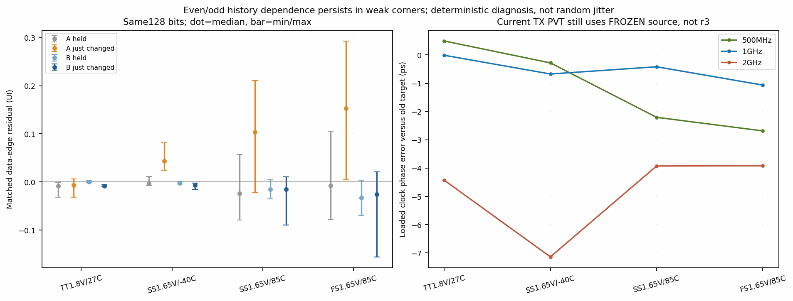
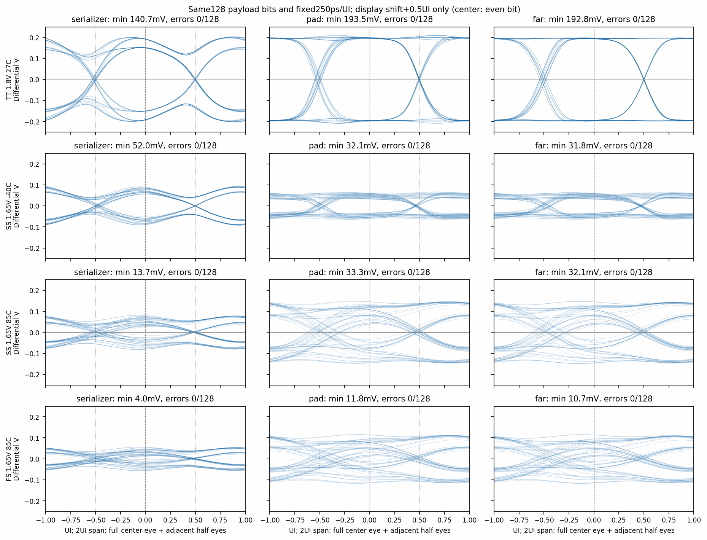

# 新分频 buffer 的相位边界与 2UI 显示

2026-10-30。**本轮TX PVT沿用冻结v0.1的PLL边沿源，未把新增r3分频buffer的相位带入。** 因此当前弱角和even/odd数据仍对应旧时钟边界。新增r3的极性/相位需要重新核对，不能照搬原标定。

本次补了r3原生时钟采样，以及该时钟理想化后接真实TX分发buffer/串化器负载的两个极性对照；没有重验r3数据流。数据见 [JSON](../data/tx_clock_phase_audit.json)，执行见 campaign (`results/analog/tx/clock_distribution/buffered_phase_audit/20261030T091451Z`)。

## buffer影响哪几路

| TX选择时钟 | 原固定源节点 | 取到该节点之前新增的级间buffer |
|---|---|---:|
| 250 MHz | 分支0的d08（÷8） | 2 |
| 500 MHz | 分支2的d24（÷4） | 1 |
| 1 GHz | 分支3的d32（÷2） | 0，但其后级输入负载改变 |
| 2 GHz | 抽出b0的反极性 | 0 |

因此四路相位变化不同，不是全部加一个公共延迟。1GHz虽然位于新增buffer之前，自身输出负载也由下一单元的跟随器变成buffer输入，不能假设它完全不变。

先对比r2/r3已有标准边界记录：同一TT/1.8V/27°C、2GHz正弦输入、同一偏置/负载约定，观察共同32–48ns窗口。下表是相对输入的相位变化，包含新增buffer、被替换的负载/边沿恢复和启动状态，**不是纯buffer传播延迟**。

| 抽头 | r3−r2相位差（按自身周期取模）/UI | 再去掉500ps输入周期整数部分/ps |
|---|---:|---:|
| divide2 | +1.9641 | -9.0 |
| divide4 | -1.9637 | +9.1 |
| divide8 | +6.1502 | +37.6 |

整周期部分涉及分频启动状态，不能把÷8的约1.5ns差值解释为两个buffer的器件延迟。本次原生r3中两个buffer自身的下降沿延迟分别约 34.3 ps, 33.9 ps；与上表净相位差不是同一测量口径。

## 新r3实际时钟到TX的核对

原生前端为TT/1.8V/27°C、码5、固定Vctrl=1.179193V，保留四路抽出和三个通电dummy，运行64ns。测得约1.999215GHz。这是开环固定控制电压的相位采样，**不是闭环PLL锁定性能测量**。

取连续24–64ns，保持每个过零时刻，转换成400mVpp/20ps完整边沿的理想CML源，再接原八级真实TX微调/扇出buffer及真实串化器时钟负载。数据端固定0xD3A5，输出20fF/端代理负载；不包含输出线驱动、PCB或随机负载数据，不作为数据功能/BER验收。没有延拓时钟或逐路数值平移。

各相位以本次加载后250MHz下降沿为0，单位仍为固定250ps/UI；不比较两次仿真的绝对时间。trim保持[100,500,160,270]fF，得到：

| 时钟 | 原加载目标/UI | 旧源原标定/UI | r3保留旧极性/UI | r3仅对调1GHz的P/N/UI |
|---|---:|---:|---:|---:|
| 250MHz | 0.000 | 0.0000 | 0.0000 | 0.0000 |
| 500MHz | 0.160 | 0.1620 | 0.0523 | 0.0523 |
| 1GHz | 0.320 | 0.3200 | 2.0943 | 0.0957 |
| 2GHz | 1.000 | 0.9823 | 0.7658 | 0.7655 |

这次启动中，1GHz差了一次半周期（约2UI）的状态；对调P/N只是本次极性候选，不代表所有启动都可固定用它。确定分频状态、路由极性及必要校准逻辑仍需明确。

去掉该粗相位差后，关键1GHz→2GHz相对相位从0.6623UI变为0.6699UI，细差约1.88ps，变化较小。但500MHz以及快速两路相对250MHz字时钟的位置仍变了，所以不能宣称旧trim已适用于r3。

## even/odd不对称是否仍值得怀疑相位

值得。此前已有明确的链路：上游更新与本地选择相位决定恢复时间，A/B两支的时间余量不同；弱锁存器会把它转成码型相关边沿偏移。此前单改1GHz微调或增强末级锁存器得到的对照见 [串化溯源](serializer_timing_root_cause.md)。

本次重新按旧源PVT的同一128bit分组，下面只列“同一支路相对k−2刚更新”的中位边沿残差；不是随机抖动：

| 工况 | 偶数A/UI | 奇数B/UI |
|---|---:|---:|
| tt_v1800_t27 | -0.0066 | -0.0082 |
| ss_v1650_t-40 | +0.0435 | -0.0068 |
| ss_v1650_t85 | +0.1039 | -0.0149 |
| fs_v1650_t85 | +0.1528 | -0.0253 |

FS弱角A的新数据晚簇仍明显，但这组数据没有用新r3时钟；同时其加载后1GHz/2GHz细相位相对TT只变动少量ps。应把相位、建立/恢复能力和尾管余量联合检查，不能仅用频率偏差或这两个新增buffer解释已有幅度/边沿退化。尾节点/Vdsat及输出使能的独立证据仍见 [TX PVT](tx_pvt.md)。

## 眼图显示已平移半UI

当前两组TX PVT眼图已采用 **2UI总宽、中央一个完整眼、左右各半眼**：向右平移0.5UI并在边界回绕处断线。中央为原偶数bit完整眼，两侧为奇数bit半眼；反向平移可对换两类。

保留每条原2UI片段的全部绘图时间/电压采样点，不引入训练片段、不外推波形，也不改变UI、训练延迟、采样点、错误数或裕量。20个面板均验证了绘图样本哈希相等，原始 [TX指标JSON](../data/tx_pvt.json)内容不变；显示校验见 [JSON](../data/tx_eye_display.json)。

默认显示约定：[config/eye_display.toml](../../config/eye_display.toml)；当前显示器：[tx_pvt_eye_display.txt](../../verification/plotting/tx_pvt_eye_display.txt)。历史图的改前副本与原执行脚本保留，当前图索引记录新显示来源。

本轮没有修改默认电路、分频状态控制、P/N路由或trim，也没有宣称r3时钟的数据流已重验。下一步应在确定分频状态后重标定250/500/1G/2G相位，再接回数据测试；CML尾偏置和输出使能的问题单独推进。
