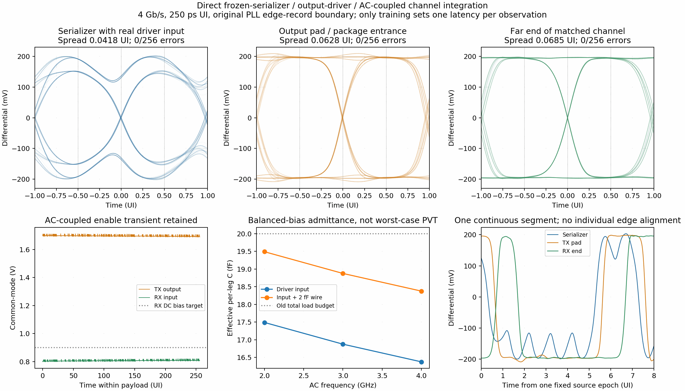

# 输出级、RX与数字链路的推进路线

PLL和电流舵串化器已按用户指令作[v0.1设计冻结](design_freeze_v0p1.md)。之后的输出驱动器属于新模块，不计入该冻结，也不把输出负载变化自动视为已签核。

## 当前选择：先补TX输出级

目前串化器的20fF/端是片内负载预算，不是可驱动PCB的证明。用户确认本轮先按100Ω差分通道、两端端接、AC耦合、接收端差分400mVpp探索。芯片I/O边界如下：

~~~mermaid
flowchart LR
 S[片内16:1 CML串化器] --> I[小输入隔离buffer]
 I --> P[较强预驱动]
 P --> D[大电流输出差分对 / 源端50Ω]
 D --> PAD[焊盘与封装]
 PAD --> AC[AC耦合]
 AC --> CH[100Ω差分通道]
 CH --> TERM[远端终端与共模偏置]
 TERM --> RX[未来RX前端]
~~~

这一级确实对应高速PCB电气环节的芯片输出级。前级通过有源阻抗变换，将大输出管门电容与低阻端接的电流需求逐级隔开；输入门极仍有电容性负载。CML级通过各自尾电流/负载重建共模，不要求片内与线端使用同一个共模。

双端端接时每端交流等效负载约25Ω，理想充分换流近似Vdiff_pp≈2×I_tail×25Ω；400mVpp需要约8mA尾电流。已有片内低电流MUX不能直接替代它。片内数据幅度与外部线幅度现在都暂取400mVpp，数值相近不表示驱动能力相同。

源端采用两只50Ω上拉到1.8V提供直流电流路径，远端两只50Ω接接收端0.9V偏置。AC电容隔直流共模；它不能消除PCB的交流负载，也不是电隔离屏障。寄生Cgd、偏置、供电和地回流仍可反向耦合，所以不把buffer等同于完全隔离。

本版已分出预驱动/输出电源端口；当前电源理想，尚未测电源阻抗、回流电感、PSRR和偏置反向扰动。物理实现仍需独立供电支路、局部去耦及合适的回流/偏置布局。不能只靠逻辑模块分层就宣称已完成这些隔离。

## 输出级实现与通道代理

[电路](../../analog/tx/output_driver/spice/cml_line_driver.spice)采用隔离W12µm、预驱动W48µm、输出对W256µm、尾管W172µm；源端50Ω，实际器件镜像偏置。tx_en低时将线尾管偏置关断，预驱动仍消耗功率。电气空闲提供两端对称的DC起始状态，不能强行指定AC电容差分状态来美化结果。

[通道代理](../../verification/models/channel/diff_rlc16.spice)每端R总0.05Ω、L总12.5nH、C总5pF，分16段π网络，名义阻抗50Ω、延迟约250ps。额外RC示例为每端串联15Ω、并联400fF。焊盘200fF、封装0.5nH也只是明确的探索参数，不是实测提取或真实ESD单元。

初次理想T线瞬态在数据激励前因时间步失败，虽退出0且有波形文件，已判为失败且未用于结果。改用被动RLC代理后要求完整记录到计划终点再收集。这一替换未声称代理已经等价某条真实板线，最终应由板线S参数/提取模型替换。

## FFE与RX的顺序

预留主抽头+一后游抽头的方向：y[n]=c0·x[n]−c1·x[n−1]。它针对通道ISI，不能替代之前对串化器内部锁存时序的修正。需真实1UI延迟/重定时支路和可控电流分段，不能把理想时间平移当成硬件已实现。

当前先旁路FFE。拿到目标通道损耗、脉冲响应和接收端眼图后再定系数、摆幅/功耗和是否需要后游抽头。高速CML输出与可编程FIR去加重在工程器件中可以共处，但本项目没有直接套用其工艺或规范数值：[TI TLK10034输出结构与去加重](https://www.ti.com/lit/ds/symlink/tlk10034.pdf)。

下一步RX建议先做100Ω终端/共模→可调CTLE→采样器，先用受控采样相位验收前端，再加入半速CDR和解串。CDR属于RX时钟恢复，不放在TX数据输入流前。CDR环路与TX倍频PLL的带宽/状态判据需分别设计；原CML→CMOS时钟接收器也不能直接称为4Gb/s数据RX。

## 加扰、8b/10b与速率预算

当前冻结的是4Gb/s原始线速、16bit×250MHz，不含编码开销。8b/10b每8bit变10bit，提供直流平衡和受限差异度等性质，有助时钟恢复：[AMD编码说明](https://docs.amd.com/r/en-US/am002-versal-gty-transceivers/TX-8B/10B-Encoder)。

- 线速维持4Gb/s：编码后有效载荷上限3.2Gb/s，未计训练/帧开销。
- 保持16bit×250MHz的4Gb/s有效载荷：8b/10b线速要5Gb/s；现有2GHz DDR时钟计划不能直接承诺它。
- 若采用16bit×200MHz有效载荷，可编码成20bit×200MHz，再用20→16 gearbox供给现有16bit×250MHz串化器；80bit周期为4×20→5×16。
- 加扰用于白化，单独加扰不能给出严格的DC平衡或最大连续相同码长度保证；还需约定训练、空闲、同步和错误处理。

因此本轮不直接加入编码器、加扰器、gearbox或CDR。模拟开发使用训练标记/PRBS旁路，数字PCS在有效载荷、线速及协议选择后再定。上述接口与编码预算不是PCIe合规声明。

## 已完成的标称输出级检查

[独立驱动器眼图](../figures/tx/output_driver/tx_line_driver_channel_eyes_ui.png)使用理想400mVpp CML输入和受控平衡DC起始状态；所有采样相位仅由32bit交替训练及32bit唯一标记确定，负载数据不参与拟合。

| 独立驱动夹具 | 远端差分峰峰值 | 最小有符号位中心裕量 | 确定性边沿散布 | 位中心错误 |
|---|---:|---:|---:|---:|
| matched_channel | 399.3mV | 194.9mV | 0.00526UI | 0/256 |
| rc_loss_example | 351.0mV | 168.7mV | 0.00827UI | 0/256 |

尾管初值192µm产生约448mVpp，已收敛到172µm以使匹配通道远端约399mVpp。稳态独立夹具预驱动约4.82mW、线输出电源约14.10mW，共约18.92mW；独立偏置参考另1.53mW。与串化器共享偏置时不要重复累计这笔参考功耗。器件电流是镜像实际电流，并未用理想8mA源替代输出尾管。

## 与片内串化器直接连接

原20fF/端总代用负载改为真实驱动器门电容+2fF/端残余布线，而不是把真实门电容又叠加到完整20fF之上。无串联隔离电阻，零伏测流源不改变连接。串化器使用已冻结的24µm/200Ω末级锁存器；时钟仍为之前保留的PLL边沿源加真实分发buffer，未扩展/重复或逐路平移时钟源。

平衡1.68V输入工作点下，输入每端有效C约17.49fF@2GHz、16.38fF@4GHz；加2fF布线后约19.49/18.38fF。实部导纳也保留，因此这不是纯理想电容；更不能外推为最差PVT/大信号电容上界。

| 直接连接观察点 | 过零散布/UI | 最小有符号位中心裕量/mV | 差分峰峰值/mV | 位中心错误 | 额外/漏跳变 |
|---|---:|---:|---:|---:|---|
| 片内串化器 | 0.04185 | 140.7 | 406.7 | 0/256 | 0/0 |
| 芯片输出端 | 0.06275 | 193.4 | 419.8 | 0/256 | 0/0 |
| 通道远端电压 | 0.06850 | 192.6 | 398.4 | 0/256 | 0/0 |

原选定锁存器在20fF代用负载时散布0.04192UI，改为真实驱动器后为0.04185UI；该片段支持小输入buffer在当前点没有明显拖坏串化器。线端/远端的新增码型延迟仍可见，不能把各观察点峰峰值简单相减来分配抖动来源。

**这里“远端零错误”是已知训练相位的电压采样，不是实际RX/CDR或BER验证。** 尚无接收放大器、采样器、CDR和解码器。

tx_en在DC时为0、4ns开启，初始差分AC电容状态由真实关断电路自然形成，没有强写电容初值。发送开始后，负载区间远端共模约0.798–0.821V，而偏置目标为0.9V。这是AC耦合电容充电及共模阶跃的真实夹具结果，RX前端应考虑其范围或等待共模恢复。

这一短启动窗口中，线电源平均功耗约7.46mW，明显低于独立稳态夹具14.10mW；耦合电容储能及远端偏置在交换能量，不能把短窗值当作稳态功耗预算。供电、参考、地仍理想，尚不包含实际跨模块电源/回流/偏置耦合。

## 测试交接

- [独立终端/通道模板](../../analog/tx/output_driver/tb/terminated/tb_cml_line_driver_ngspice.cir.in)：理想CML输入，近匹配及附加RC例子。
- [输入导纳模板](../../analog/tx/output_driver/tb/terminated/tb_cml_line_driver_input_ac_ngspice.cir.in)：平衡工作点、小信号每端C/G及增益。
- [直接串化器连接模板](../../analog/tx/output_driver/tb/terminated/tb_serializer16_line_driver_ngspice.cir.in)：复用既有物理时钟运行的stimuli.inc，原激励文件路径见下方结果目录。不能另造时钟延拓后继续声称同一个连续记录。
- [独立驱动数值](../data/tx_line_driver_results.json)、[直接连接/导纳数值](../data/tx_line_driver_integration.json)、[配置](../../config/tx_line_driver.toml)。

直接连接模板的stimuli.inc取results/analog/tx/serializer/physical_clock/20261028T090856Z_ngspice_tt_native_buffered_clock_64words/raw/stimuli.inc；输入字和原生源记录的关系已在该运行固定。实际运行均含模型/电路快照、条件及SHA256。全部图仍为固定250ps UI、2UI显示窗口，不按负载拟合新的速率。

下一步优先换入实际通道与pad/ESD/封装模型，再确定FFE是否需要和RX共模/增益范围。当前RLC和RC例子不能决定某条真实板线的均衡系数，也不证明PCIe合规。

用户随后选定100Ω板内/板间PCB作为RX主目标。[新合成信道族](pcb_channel_family.md)提供3/6/10dB平滑损耗、开路支路反射和两线偏斜的S4p与被动SPICE视图。C0/C2/C3已完成[真实TX接入PCB联调](tx_pcb_channel_integration.md)；本页旧通道结果继续保留为历史基线。

## 编码与FFE说明补充

用户已接受保持4Gb/s线速、8b/10b后有效载荷上限3.2Gb/s（不含额外帧/空闲开销）的取舍。编码尚未实现，也未改变冻结16:1串化器。8b/10b固定每8数据bit变10编码bit，因此128数据bit→160编码bit→10个16bit串化字；144数据bit→180编码bit，连续码流中的余量需与后续码组（含空闲码）拼接。20→16 gearbox允许10bit码组跨16bit物理字边界，接收端另做码组对齐。

“FFE旁路”更准确地指当前仅主抽头工作、等效后游系数为零：尚无实际1UI延迟或后游电流支路。是否需要均衡由目标通道损耗和脉冲响应决定，不能只根据4Gb/s速率或温和代理通道判断。逻辑上先生成当前/延迟数据，电流模式抽头权重和求和常可集成在输出级。

输出级已做理想CML独立激励和实际晶体管串化器直连两类检查。直连数据路径为真实16:1电流舵输出→小输入buffer→预驱动→线输出对；没有在串化器和驱动器之间回放理想数据电压源。PLL时钟仍保留已注明的冻结边沿源理想化边界；这与数据端直接连接是两个不同边界。

RX已有[输入终端与CTLE首版](rx_frontend_first_design.md)，完成独立DC/AC和6dB通道电压回放。真实驱动器/PCB/CTLE的[加载联合测试](rx_loaded_link.md)也已完成，源边界在TX隔离buffer输入，并用原负载对照完整串化链。采样器/CDR仍待设计。
