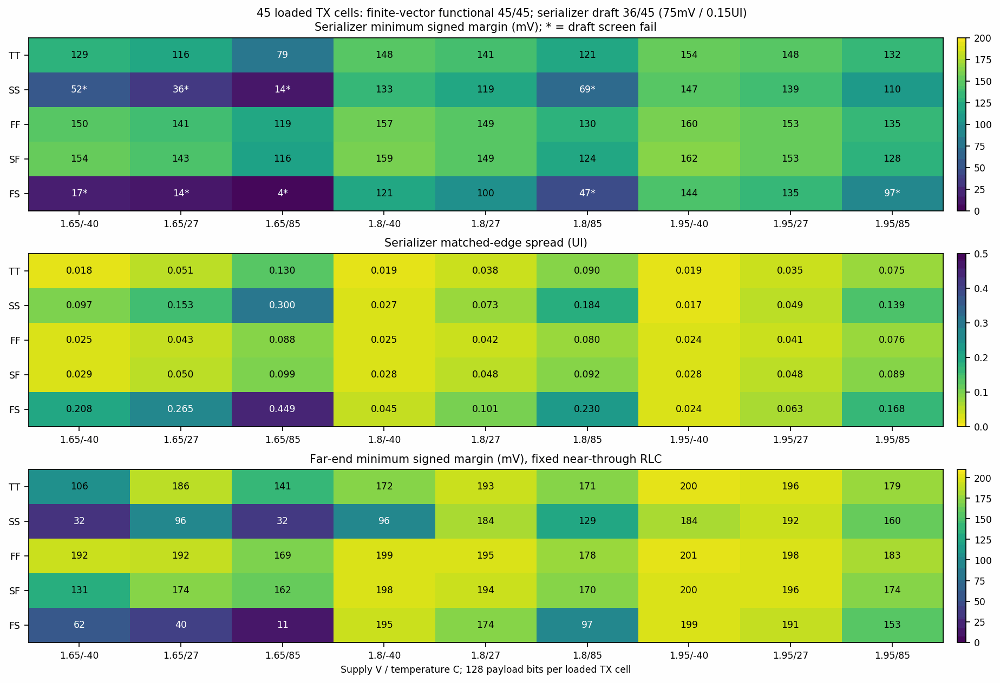
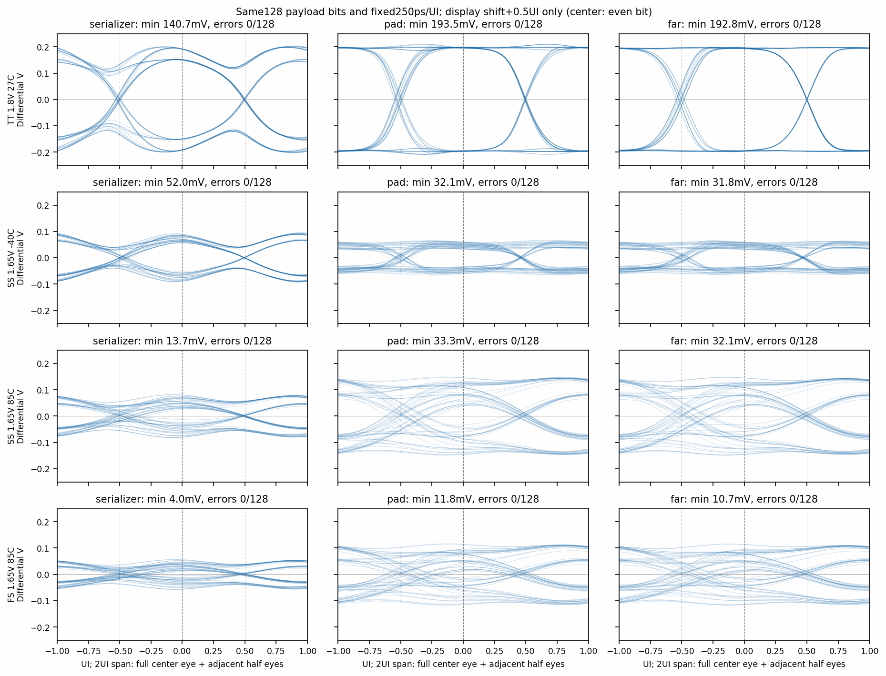
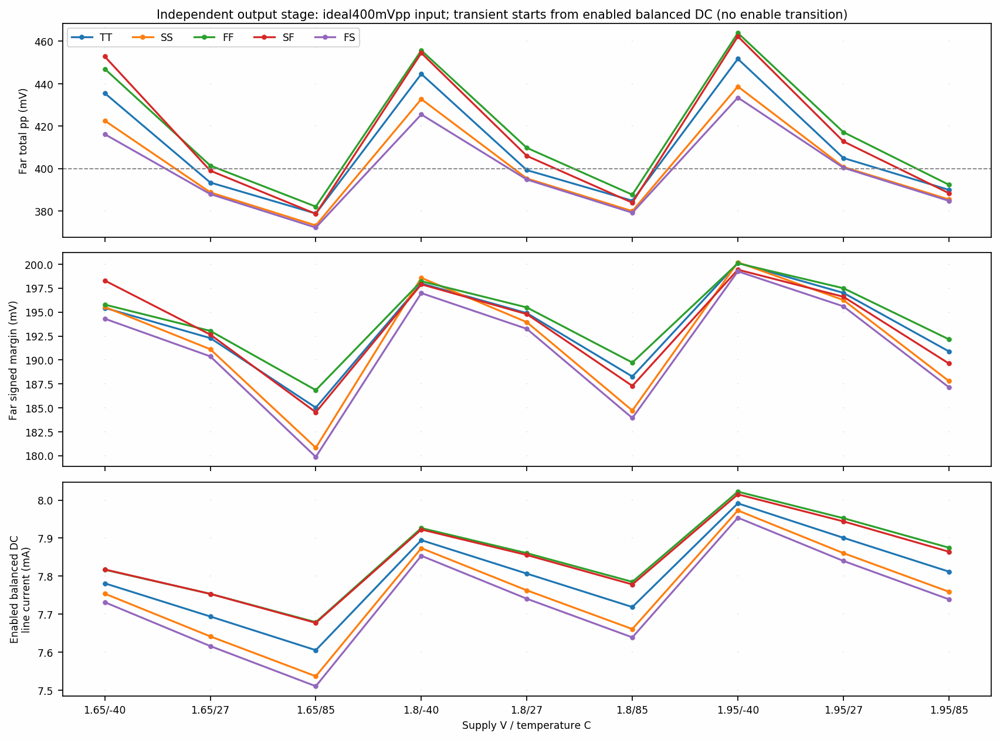
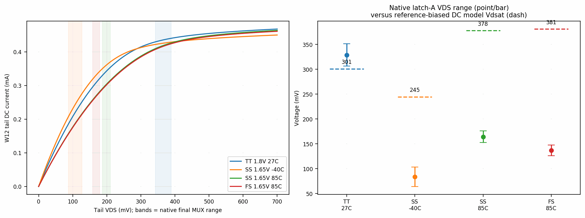
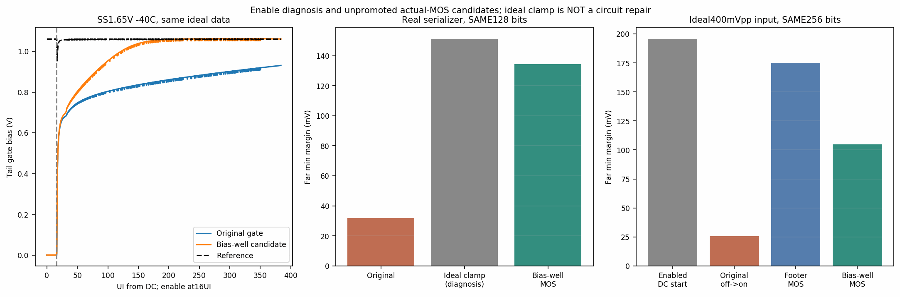
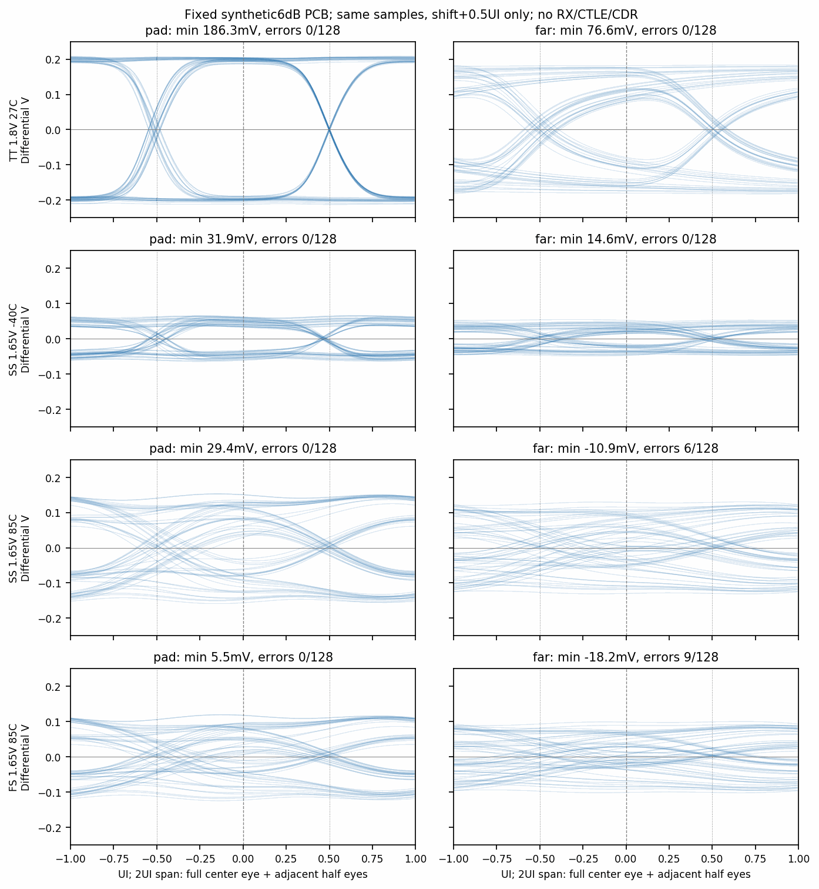

# TX 电流舵与输出级 PVT：网格完成，角上裕量尚未收口

2026-10-30。当前基线完成 **45 个 MOS/电压/温度工况的独立输出级 + 45 个真实加载串化链**，近无损 RLC 下均无有限码型采样/跳变错误；但串化器仅 **36/45** 满足既有 75 mV / 0.15 UI 裕量草案。6 dB PCB 的弱角已有错误，因此本轮是表征完成，不是 TX 全 PVT 通过。

数据：[汇总 JSON](../data/tx_pvt.json)；执行档案：campaign (`results/analog/tx/pvt/20261029T172144Z`)；测试边界：[契约](../../verification/contracts/tx_pvt.toml)。未改冻结 v0.1、现有串化器或输出级默认电路，两个实际 MOS 候选另列。

## 测试层次和边界

| 层次 | 工况和记录 | 实际接入内容 |
|---|---|---|
| 独立输出级 | 5 MOS角 × 3电压 × 3温度；每点256bit负载，96ns、最大2ps | 理想400mVpp CML → 隔离/预驱动/线输出 → 焊盘封装/AC/固定RLC/远端终端 |
| 完整TX加载链 | 同45点；统一128bit负载，通常72ns、最大4ps | CMOS数据转换、16:1 CML树、真实时钟trim/扇出buffer、真实输出门负载及上述线端 |
| 输出级DC | 同45点，各测关闭/使能两个状态 | 平衡输入下尾电流、关断残流、预驱动电流 |
| PCB局部联调 | 4个选角，各128bit | 真实TX + 固定C2_loss6合成PCB；无RX/均衡/CDR |
| 定位与候选 | 尾管I–V、输入幅度、使能初态、理想偏置接管、实际MOS候选、步长对照 | 所有对照单独保留，不升级成原设计通过 |

MOS角 TT/SS/FF/SF/FS，供电 1.65/1.8/1.95 V，温度 −40/27/85°C。参考电流为理想 0.85 mA 注入真实二极管/电流镜；电阻、电容、封装和通道均固定，未扫独立无源极限角、参考源误差、失配、噪声或版图寄生。源端/远端每端50 Ω、AC每端10 nF、远端偏置0.9 V；焊盘与封装仍是明确的代理参数。

时钟沿用有限长度的冻结 TT PLL 理想化边沿记录，CML源共模随供电保持VDD−0.17 V、差分400 mVpp；后面是实际MOS分发buffer与串化器扇出，trim保持TT选值，不按角重新校准。这里不包含实时PLL或其PVT波形，也没有延拓源时钟。输入仍没有物理整字捕获寄存器，按原先的已知并行字到达时刻激励。

UI固定250 ps，眼图折叠2UI。只用前32bit交替训练确定分数延迟、随后32bit标记消除整数歧义；负载数据不参与采样相位或UI拟合。位中心符号正确、无额外/漏跳变只是有限无噪声电压采样功能，不是实际RX/CDR或统计BER。

当前两组眼图按 [显示配置](../../config/eye_display.toml)平移0.5UI，呈现中央完整眼与左右半眼；原绘图样本、UI和指标不变。[新分频buffer相位核对](tx_clock_phase_audit.md)另列r3实际时钟加载测试；本报告的45工况仍使用旧冻结源，没有混入r3数据流结果。

## 主网格

| 检查项 | 结果 |
|---|---|
| 独立输出级功能 | 45/45，每点256bit |
| 独立远端总峰峰值 | 372.3–463.9 mV，包含过冲 |
| 独立远端位中心中位电平间隔 | 363.8–411.0 mV |
| 独立远端最小位中心有符号裕量 | 全网格最低 179.9 mV |
| 真实加载串化链功能 | 45/45，每点统一128bit |
| 串化器既有裕量草案 | 36/45；9点未满足75mV和/或0.15UI |
| 输出级使能DC电流 | 7.511–8.022 mA |
| 输出级关闭DC残流 | 最大 1.153 nA；预驱动仍耗电 |

400 mVpp是目前目标，尚无用户确认的PVT幅度容差，因此不能把功能45/45当作幅度合格。总峰峰值还会被过冲和长连码抬高，须与位中心裕量一起看。

未满足串化器草案的点：

| MOS角 | VDD/V | 温度/°C | 最小裕量/mV | 边沿散布/UI |
|---|---:|---:|---:|---:|
| FS | 1.65 | -40 | 16.57 | 0.208 |
| FS | 1.65 | 27 | 13.74 | 0.265 |
| FS | 1.65 | 85 | 3.96 | 0.449 |
| FS | 1.8 | 85 | 46.89 | 0.230 |
| FS | 1.95 | 85 | 97.35 | 0.168 |
| SS | 1.65 | -40 | 51.96 | 0.097 |
| SS | 1.65 | 27 | 36.24 | 0.153 |
| SS | 1.65 | 85 | 13.66 | 0.300 |
| SS | 1.8 | 85 | 69.47 | 0.184 |

FS/1.65 V/85°C 的串化器只有约4 mV裕量；SS/1.65 V/−40°C 则是幅度和输出使能接管都偏弱。不能把所有角上退化都等同于“SS更慢”或认为只有一个冷角问题。

## 问题一：CML堆叠的尾管余量

真实SS冷角两只末级锁存器的尾节点约64–104 mV，而同角参考偏置下模型Vdsat约245 mV；FS低压高温的锁存器尾节点约126–148 mV，而模型Vdsat约381 mV。对照DC扫压也显示，在漏压80 mV处的尾电流明显低于漏压充足时。因此这里有直接的电压余量/尾电流受限证据，不只是线端低阻负载太重。

TT锁存器尾节点约306–352 mV，对应模型Vdsat约301 mV。图中DC曲线用W12尾管，原生锁存器为W24；用相同参考偏置的Vdsat作头间隙诊断，不能将DC电流当成所有时刻的动态锁存电流。

FS弱角的2GHz时钟平均周期仍约2UI、周期散布约0.002UI，而数据边沿散布约0.449UI，当前证据不支持只怪折叠UI或平均频率；这不排除级间静态相位和建立/恢复时间的贡献。尚未把每个角的全部误差唯一归因给一只管。

## 问题二：输出尾偏置使能接管

独立输出级从“已经使能”的平衡DC开始，不能暴露从电气空闲开启的过程。完整TX在DC时关闭尾电流、4ns后才开启；SS冷角原传输门给尾管门极充电偏慢：30ns约0.817 V、90ns约0.922 V，而参考偏置约1.060 V，96ns记录内未进入所测1%跟踪误差带。这个1%只是诊断口径，不是产品启动规格。

输入幅度由理想400降到200mVpp、但保持已使能DC时，独立输出仍能恢复较大幅度；所以仅用“串化幅度小了”不能解释冷角线端的全部退化。真实串化器的同一128bit记录对照如下：

| SS冷角接法 | 串化器最小裕量/mV | 远端最小裕量/mV | 远端总峰峰值/mV |
|---|---:|---:|---:|
| 原设计 | 51.96 | 31.78 | 131.2 |
| 理想尾偏置钳位，仅用于定位 | 52.02 | 151.03 | 391.8 |
| 实际MOS独立井候选 | 51.99 | 134.26 | 392.0 |

理想钳位没有实现成电路，也不能当作修复通过。实际MOS候选有两种，默认设计均未替换：

- 独立井偏置开关 (`../../analog/tx/output_driver/spice/cml_line_driver_biaswell_candidate.spice`, retired in `retired_legacy_vars_20261120.json`)：PMOS单独井接参考偏置，以改变模拟传输门的体偏置；保留实际NMOS/PMOS和关断下拉。独立SS冷角约50ns、完整TX约71ns后进入所测1%误差带，仍不算快速接管完成。需要单独井布局、偏置供电时序及全角开关瞬态验证。
- 源端footer (`../../analog/tx/output_driver/spice/cml_line_driver_footer_candidate.spice`, retired in `retired_legacy_vars_20261120.json`)：尾管门极保持参考偏置，增加受CMOS轨到轨控制的源端开关；当前只在SS冷角测了一点，独立远端裕量约175mV。新增源端电压和体效应、关断残流及面积/电流代价尚未做全角比较。

两个候选都只是局部启发，不把它们的结果混入原设计的45工况矩阵。

## 真实TX进入6dB PCB

| 工况 | 串化器裕量/mV | C2远端裕量/mV | 采样错误/128bit | 漏跳变/额外过零 |
|---|---:|---:|---:|---:|
| FS / 1.65 V / 85°C | 3.96 | -18.20 | 9 | 17/1 |
| SS / 1.65 V / -40°C | 51.96 | 14.56 | 0 | 0/0 |
| SS / 1.65 V / 85°C | 13.66 | -10.92 | 6 | 12/2 |
| TT / 1.8 V / 27°C | 140.70 | 76.61 | 0 | 0/0 |

C2是此前的固定合成6dB PCB，没有接RX、CTLE、DFE或FFE。远端错误说明“近无损下零错误”不足以支持该工况的链路目标；不能据此单独宣布TX或PCB模型有错，也不能把已知相位采样叫作CDR/BER。

## 数值与归档

SS低压高温从最大4ps改到2ps，并将记录延长到100ns/256bit；共同128bit上，最大波形差约为串化器 34.2 µV、焊盘 68.8 µV、远端 129.5 µV，错误数不变。支持该弱角结果不是当前步长造成的数量级假象；不是所有角的网格收敛签核。TT与SS冷角也保留完整256bit先导记录。

功耗按实际时间积分收集。完整TX记录包含AC耦合启动、储能和远端偏置源能量交换，不能拿早期线电源功耗当作稳态预算；独立驱动从已使能平衡DC开始，45工况DC结果另列。不要把开关门极尚未充足造成的低电流当成节能。

波形采用无损gzip，逐份核对解压SHA256后移除未压缩副本；网表、激励、日志、逐位采样、边沿残差、初始分析及候选源码保留。入口：[配置](../../config/tx_pvt.toml)、[串化器测试](../../analog/tx/serializer/tb/pvt/case.toml)、[输出级测试](../../analog/tx/output_driver/tb/pvt/case.toml)。

本轮收口是：**PVT网格已完成，CML末级余量和输出使能仍需修正，不能把TX定为全角合格。** 下一步优先研究末级逻辑尾偏置/过驱动与级间时序，再选择实际输出使能结构；不先盲目放大线输出电流。
