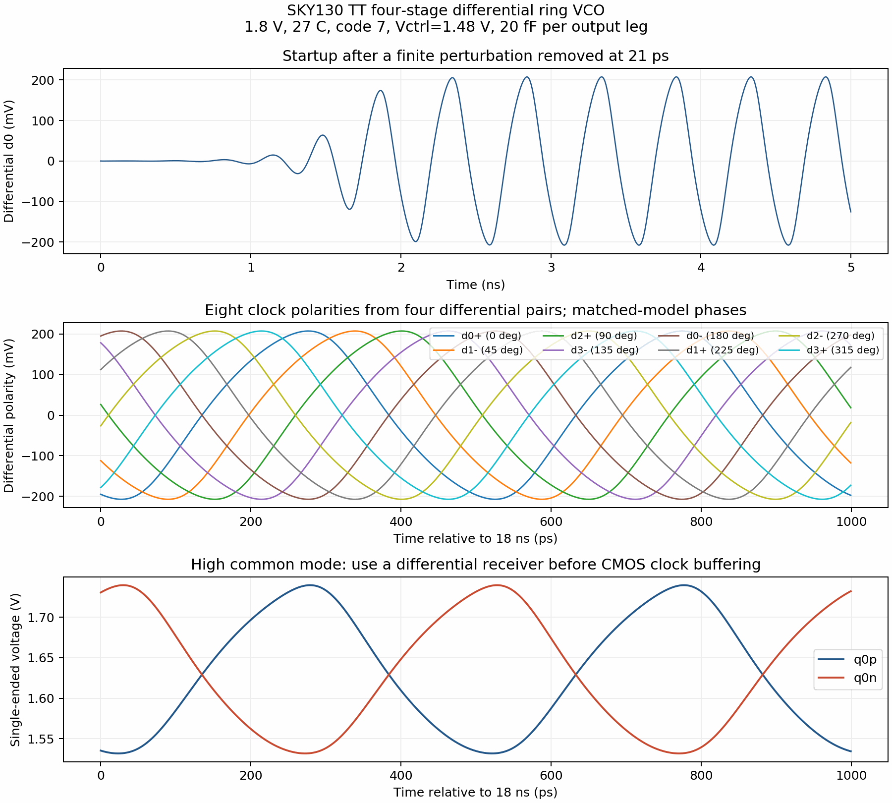
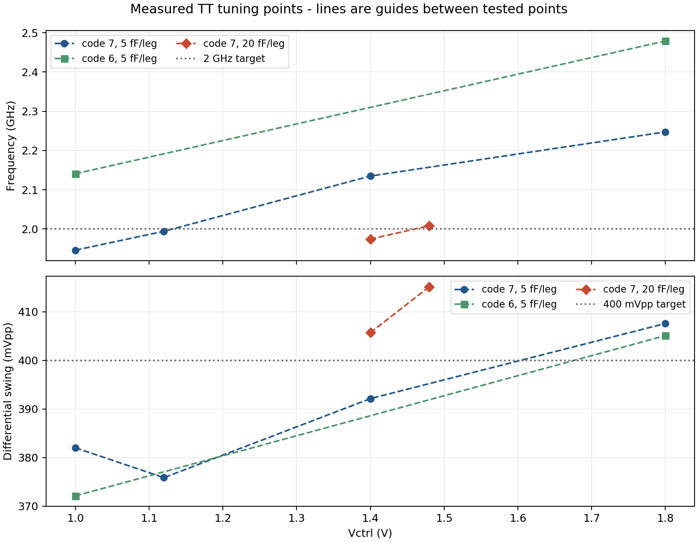

# 四级差分环振：首轮设计与前仿真

后续已完成真实时钟接收器与可选 CML 缓冲的 TT 联调，见 [接口电路结果](cml_clock_receiver_results.md)。
本文保留首轮代理电容条件，便于独立追溯 VCO 表征。

## 结论与条件

电容粗调加变容管细调的方案已有接近目标的晶体管级原型。
在 SKY130A、TT、27°C、1.8 V、每端 20 fF 对称代理负载下，得到约 2.008 GHz、
415 mV 差分峰峰值。四组差分输出对应八个时钟极性，匹配模型中的间隔约 45°。
这支持继续开发 2 GHz 时钟方案，但不是完整 SerDes、版图后或相噪验证。

用户确认的摆幅定义为差分峰峰值 400 mV。此点略高于目标，允许误差尚未设定，
因此全部设计测量保持 ungraded，不记为规格通过。

## 电路

- 四个电阻负载 CML 反相延迟单元；偶数级环路加入一次差分交叉连接。
- 输入对：SKY130 1.8 V LVT NMOS，总宽 40 µm、8 指、长 0.15 µm。
- 尾管：普通 1.8 V NMOS，总宽 20 µm、4 指、长 0.5 µm。
- 每端负载电阻 400 Ω；暂用理想电阻，尚未实现工艺电阻和匹配布局。
- 外部理想参考电流 0.85 mA，驱动二极管连接的真实镜像器件；完整电流参考尚未设计。
- 每个输出节点一个 15 µm × 0.5 µm LVT 变容管。
- 3 bit 电容阵列以七个相同的 2 µm × 5 µm MIM 单元构成 1:2:4 权重，
  底板由真实 NMOS 开关控制；含开关寄生和导通电阻，不使用理想开关。
- 所有级、两根输出施加相同代码与代理负载。

原理基础参见 [Razavi, The Ring Oscillator](https://www.seas.ucla.edu/brweb/papers/Journals/BR_SSCM_4_2019.pdf)；
器件接口和电压范围参见 [SKY130 器件文档](https://skywater-pdk.readthedocs.io/en/main/rules/device-details.html#v-accumulation-mode-mos-varactors)。
实际仿真使用本机固定安装版本 c6d73a35f524070e85faff4a6a9eef49553ebc2b。

## 名义点

代码 7，Vctrl = 1.48 V，每端 20 fF，20 ns 仿真；测量窗口为 12.5–20 ns。
频率由差分电压上升过零点的平均周期得到；幅度为窗口内 max−min。

| 项目 | 1 ps 最大步长结果 |
|---|---:|
| 频率 | 2.008304 GHz |
| 差分峰峰值 | 415.138 mV |
| q0 共模均值 | 1.63155 V |
| VDD 平均功耗，含参考支路 | 7.59438 mW |
| 扣除理想参考支路后的核心功耗 | 6.06438 mW |
| 八相相邻时间间隔 | 约 62.24 ps |

2 ps 步长给出 2.008218 GHz；减半步长后频率变化约 0.00429%，振幅变化约 0.00163%。
这种数值一致性不包含模型误差或版图误差。

局部稳幅时间约 2 ns，定义为每周期峰峰值进入最终幅度 ±5% 后持续保持。
启动使用一次有限电流扰动，21 ps 后撤除；这不是上电启动良率或无扰动对称初值的保证。

参考结果目录：

- results/analog/pll/vco/startup/20261027T121044Z_ngspice_tt_nominal_20f_1p48v/
- results/analog/pll/vco/startup/20261027T121044Z_ngspice_tt_nominal_20f_1p48v_step1p/

每次运行均保存了输入快照、工具/PDK 信息、初始化文件哈希、完整日志、原始波形、
过零边沿表和 run.json / metrics.json。图的源数据来自第二个运行目录。

[可导出 SVG](../figures/clocking/vco/vco_ring4_tt_waveforms.png)

## 粗调与细调

以下固定 Iref = 0.85 mA，变容管 15 × 0.5 µm，MIM 单元 2 × 5 µm。
这些是离散测试点，不代表已完成整个三位阵列及连续调谐范围验证。

| 代码 | 每端代理负载 | Vctrl | 频率 | 差分峰峰值 |
|---|---:|---:|---:|---:|
| 7 | 5 fF | 1.00 V | 1.946 GHz | 382 mV |
| 7 | 5 fF | 1.12 V | 1.994 GHz | 376 mV |
| 7 | 5 fF | 1.40 V | 2.135 GHz | 392 mV |
| 7 | 5 fF | 1.80 V | 2.247 GHz | 408 mV |
| 6 | 5 fF | 1.00 V | 2.141 GHz | 372 mV |
| 6 | 5 fF | 1.80 V | 2.479 GHz | 405 mV |
| 7 | 20 fF | 1.40 V | 1.974 GHz | 406 mV |
| 7 | 20 fF | 1.48 V | 2.008 GHz | 415 mV |

同条件下，代码 6/7 的端点频率范围存在约 106 MHz 的交叠，但尚需连续扫压、全码和 PVT
验证，不能据此宣称全范围无空洞。1.8 V 控制点仅作模型表征；CP 的可用输出范围尚未设计。

每端负载从 5 fF 增到 20 fF 时，同一个 1.40 V 控制点从 2.135 GHz 下降到 1.974 GHz。
后续缓冲输入尺寸及连接方式会直接影响频率和各相位负载。

20 fF、代码 7 下，1.40–1.48 V 的局部有限差分 Kvco 约 423 MHz/V。
它是两个测试点之间的斜率，不应作为全频段常数。

[可导出 SVG](../figures/clocking/vco/vco_ring4_tt_tuning.png)；[测量汇总 CSV](../data/vco_ring4_tt_points.csv)。
曲线连线只连接已测点，不代表未测区间已验证。

## 变容管损耗

独立小信号测试将振荡端共模固定为 1.65 V，读取约 1.995 GHz 的复导纳。
有效电容按 Im(Y)/ω、Q 按 Im(Y)/Re(Y) 计算；不等同于大信号周期内的瞬时电容。

| Vctrl | 有效电容 | 小信号 Q |
|---|---:|---:|
| 1.0 V | 55.5 fF | 2.76 |
| 1.4 V | 30.1 fF | 2.91 |
| 1.8 V | 11.2 fF | 23.34 |

当前单宽变容器在部分偏置下损耗明显，后续应探索分段、多指与接触布局并重新表征，
同时评估其对摆幅、功耗、Kvco 和相噪的影响。

## 相位与串化接口

八个差分时钟极性的上升过零顺序为：

| 相位 | 时钟极性 |
|---:|---|
| 0° | d0 = q0p−q0n |
| 45° | −d1 |
| 90° | d2 |
| 135° | −d3 |
| 180° | −d0 |
| 225° | d1 |
| 270° | −d2 |
| 315° | d3 |

相位来自所有八种极性的实际过零测量；没有把物理级号直接当作递增相位。
匹配模型中的均匀间隔不是版图后相位精度保证。

16 bit × 250 MHz 对应 4 Gb/s。2:1 四级串化的选择时钟为 250 MHz、500 MHz、1 GHz、2 GHz；
4:1 两级方案为 250 MHz 四相和 1 GHz 四相。末级 4:1 还需构造约 25% 的选择窗口，
并处理分级重定时、选通重叠/间隙以及字内位序，不能只连接四路 50% 占空比时钟。
也可从 2 GHz VCO 用正交 ÷2 生成 1 GHz 四相，分频器需独立验证。

原型共模约 1.63 V，因此不能直接假定小摆幅节点能驱动普通 CMOS 反相器。
下一步优先实现 CML→CMOS 差分接收器并回接真实负载，再做全码/PVT、启动条件、失配和相噪。
此阶段尚未设计或仿真 16:1 串化器及外部线驱动。
